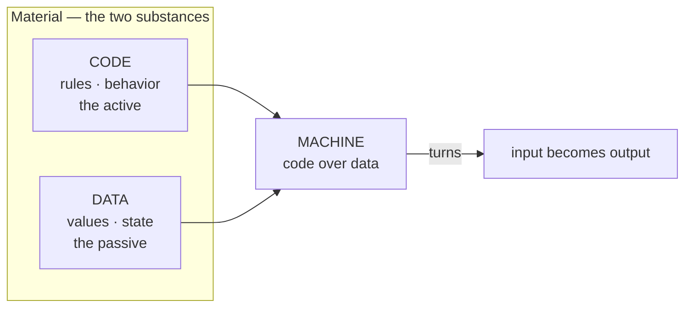
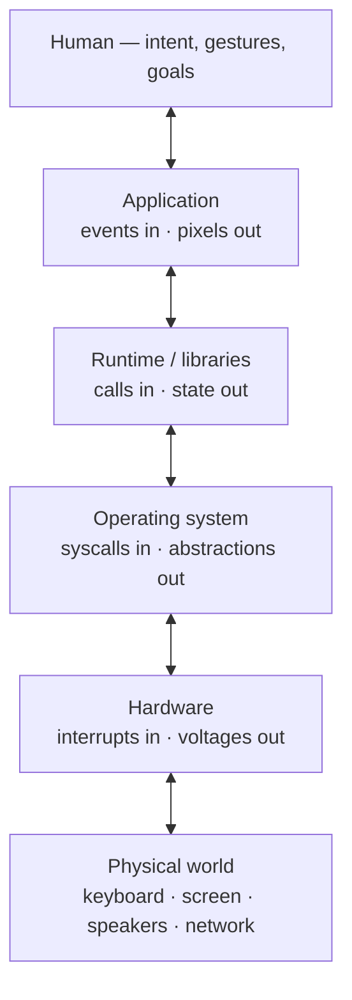
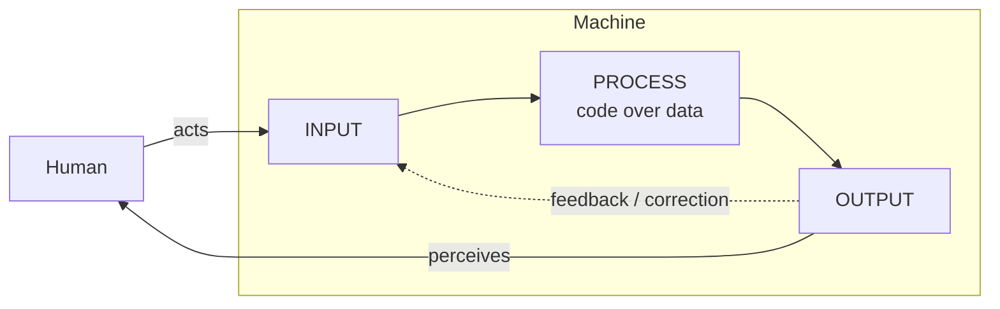
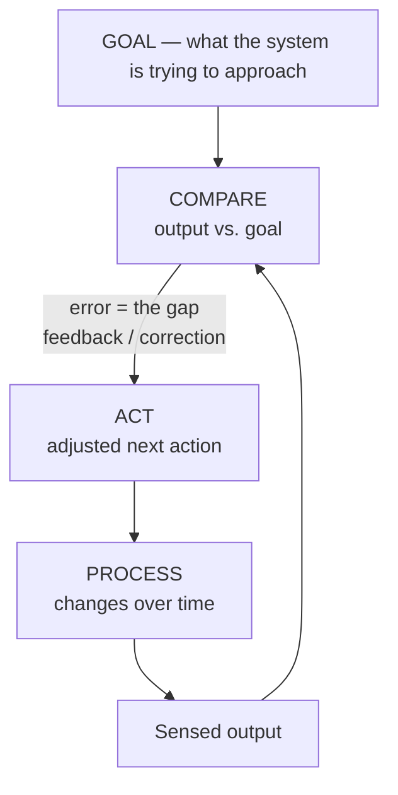
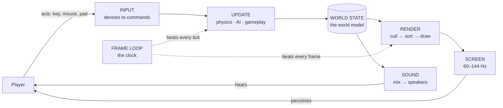
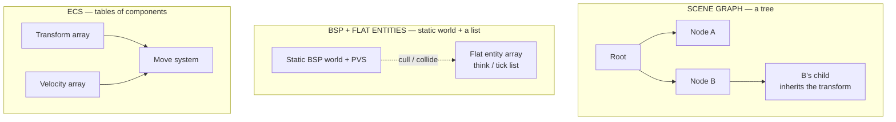
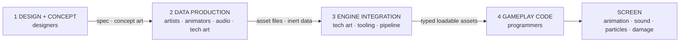
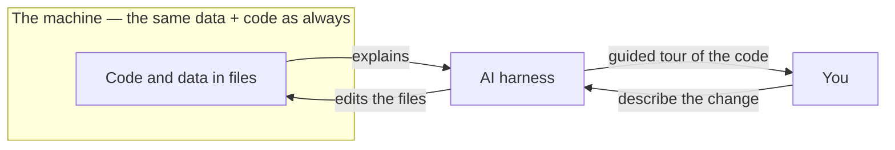

---
type: Reference
title: Software Is the Medium — A Career Reference for Game Development
description: What software is (data and code), how it fits into cybernetics (the input → process → output loop with a human in it), and how game engines are that loop massively scaled up — a career-long reference for students in every discipline.
generated: { by: kilocode/subagent, at: 2026-11-01T18:00:00Z }
---

# Software Is the Medium — A Career Reference for Game Development

This reference is given to students entering game development in **every**
discipline — art, animation, audio, design, engineering, and production. It
argues one thing, and everything else layers on top of it:

> Whatever your discipline, the medium you work in is **software**. A painter
> works in paint and canvas, a musician in an instrument, a civil engineer in
> steel and concrete. Software has a small set of properties and parts that
> every practitioner must understand — and you cannot make great work in a
> medium you do not understand.

A **game engine** is not a different kind of thing. It is software at its most
demanding — the same structure every program has, made large, fast, and
hard-realtime. Learn the generic structure first, and every engine, tool, era,
and job becomes a new instance of something you already understand.

**How to use this reference.** Read it top to bottom once, in order — the
sections build on each other. After that, treat it as a shelf reference: every
section stands alone, ends with a boxed **come back to this** summary, and is
linked from the map below, so a year from now you can open any single section
and get its takeaway in a minute. No prior programming is required; every term
is defined on first use. Points that go beyond their sources are explicitly
flagged as interpretation.

## The whole reference in one page: overview and synopsis

This is the map. The reference makes **one argument**, then spends ten
chapters making it concrete; the synopsis box below is the argument, and the
table is where each piece of the argument lives.

> **The one argument, in one paragraph:** whatever your discipline in game
> development — art, animation, audio, design, engineering, production — the
> medium you work in is *software*: a small set of properties and parts
> (*data* and *code*, an input → process → output loop, a clock, and a human
> somewhere in the feedback loop) that every program shares. A **game engine
> is not a different kind of thing** — it is the same structure every program
> has, made large, fast, and hard-realtime. Learn that generic structure once,
> and every engine, tool, era, and job becomes a new instance of something you
> already understand. The closing claim of the medium: foundations outlast
> tools — the **interface changed, the medium didn't**.

| Chapter                                                           | The high-level idea                                                                                                                                                                                                                                                                    | Where the content lives                                                                                       |
| ----------------------------------------------------------------- | -------------------------------------------------------------------------------------------------------------------------------------------------------------------------------------------------------------------------------------------------------------------------------------- | ------------------------------------------------------------------------------------------------------------- |
| **§1 What software is**                                           | Software is exactly two substances — **data** (passive: the values) and **code** (active: the rules that act on them) — and the two blur on purpose: code travels as data (scripts, `.uasset` Blueprints, QuakeC bytecode) and data acts as code (WAD-driven DOOM, `.decl` files, ECS) | this file, [§1](#1-what-software-is-data-and-code) onward                                                     |
| **§2 IO everywhere**                                              | A program with no input or output is a spreadsheet in a locked drawer; the boundaries — files, sockets, devices, the screen — are where software meets the world, and where its latency hides                                                                                          | this file, [§2](#2-io-everywhere-software-is-its-boundaries)                                                  |
| **§3 The loop**                                                   | Software is **cybernetics**: a goal-seeking feedback loop — sense, think, act — with a *human inside* it; latency is the loop's price                                                                                                                                                  | this file, [§3](#3-the-loop-software-and-cybernetics)                                                         |
| **§4 The five-part skeleton**                                     | Every program is the same five parts — **state, logic, input, output, clock** — and every tool maps onto them; this is the lens for everything after                                                                                                                                   | this file, [§4](#4-the-five-part-skeleton)                                                                    |
| **§5 Engines = the loop scaled up**                               | Game engines are the generic loop made hard-realtime: the frame loop *is* the human–machine loop at 60–144 Hz, filled by the same subsystems in every engine                                                                                                                           | this file, [§5](#5-game-engines-the-loop-massively-scaled-up) + the [Engines/](Engines/index.md) case studies |
| **[01-common-structure](01-common-structure.md)**                 | The cross-engine map: the five-part skeleton filled by the *same* subsystems everywhere — the channels, the variation axes, "same structure, different fills"                                                                                                                          | the companion study of §5                                                                                     |
| **[02-world-models](02-world-models.md)**                         | How an engine *organizes the game world*: scene graph vs BSP + flat entities vs ECS — the deciding dimensions, and the world model as a state store with a clock                                                                                                                       | an extended chapter on §4's State fill                                                                        |
| **[03-hardware-and-performance](03-hardware-and-performance.md)** | Two processors, one budget: the CPU (a few deep lanes) and the GPU (thousands of wide lanes), and how to read where a frame's time goes — CPU/GPU/IO/memory-bound                                                                                                                      | the frame clock made physical                                                                                 |
| **[04-concurrency-and-state](04-concurrency-and-state.md)**       | **Who runs when**: event loops, threads, coroutines, async I/O, and the ladder out to the network; **whose copy**: shared memory vs messages vs replication                                                                                                                            | §2 + §4 under concurrency and distribution                                                                    |
| **[05-schemas-and-formats](05-schemas-and-formats.md)**           | Data is only data because of a **schema** — the shape-and-meaning contract every read must keep; the authoring/runtime/wire triangle, schema evolution, determinism                                                                                                                    | §1's data half, formalized                                                                                    |
| **[06-spatial-indexes](06-spatial-indexes.md)**                   | The **map, not the warehouse**: grids, quadtrees/octrees, BVHs, BSP + PVS — the culling ladder and the physics broadphase that keep a game real-time                                                                                                                                   | §2's IO under spatial-locality pressure                                                                       |
| **[07-operating-systems](07-operating-systems.md)**               | The scaffold and the observatory: processes, virtual memory, system calls, the scheduler, handles, and the OS as negotiator between game and machine                                                                                                                                   | where every engine actually runs                                                                              |
| **[08-the-weapon-example](08-the-weapon-example.md)**             | **The synthesis**: one rifle from concept to muzzle flash through all four stages (design → data → integration → gameplay code) — the whole reference in a single object                                                                                                               | the "everything fits the skeleton" proof, in Unreal 5 and DOOM 3                                              |
| **[09-ai-and-the-medium](09-ai-and-the-medium.md)**               | The new interface: the steersman's loop, the model/harness/knowledge split, local vs cloud models, and what "talking to software" actually is                                                                                                                                          | §3's loop, now with the AI in it                                                                              |
| **[10-the-coming-times](10-the-coming-times.md)**                 | The future chapter: AI as symbiosis (not replacement), the hybrid engine (symbolic scaffolding + neural subsystems), and the worlds agents will live in                                                                                                                                | the reference's horizon                                                                                       |

Two ways to read the table: **down the left column** for the throughline
(foundations → map → world → hardware → concurrency → data → space → OS →
synthesis → AI → horizon), or **diagonal** — inventory the chapter titles and
you have read the whole-argument-in-titles. Either way, the box up top and
the [§9 ten rules](#9-the-medium-reminder) at the end are the same story in
two forms.

> **Come back to this.** This reference argues **one thing**: the medium is
> software, engines are that medium scaled up, and a small generic structure —
> data + code, input → process → output, the five-part skeleton, the human in
> the loop — explains every engine, every discipline's role, and every era.
> Chapters 01–10 are that argument's deep-dives, and the weapon example (§08)
> and the engine case studies (the [Engines/](Engines/index.md) folder) prove
> it holds end to end.

## Contents

- [§1 What software is: data and code](#1-what-software-is-data-and-code)
- [§2 IO everywhere: software is its boundaries](#2-io-everywhere-software-is-its-boundaries)
- [§3 The loop: software and cybernetics](#3-the-loop-software-and-cybernetics)
- [§4 The five-part skeleton](#4-the-five-part-skeleton)
- [§5 Game engines: the loop massively scaled up](#5-game-engines-the-loop-massively-scaled-up)
- [§6 World models: the State fill](#6-world-models-the-state-fill)
- [§7 The discipline map: who feeds the machine](#7-the-discipline-map-who-feeds-the-machine)
- [§8 Why this anchors a career](#8-why-this-anchors-a-career)
- [§9 The medium reminder](#9-the-medium-reminder)
- [§10 Where to go next](#10-where-to-go-next)

---

## 1. What software is: data and code

A painter learns what paint does on canvas — how it dries, mixes, spreads,
thins. A musician learns the instrument — its range, its timbre, how breath or
a bow speaks through it. A civil engineer learns steel and concrete — how they
bear load, how they cure, how they fail. Each of these people works in a
**medium**: the material, and its properties, out of which the work is made.

The same is true on a game team. The medium is **software** — and a game
engine is software in its most demanding form. Software is what your product
is made of, the way a song is made of an instrument's sound and a building is
made of concrete and steel.

And like any medium, software is made of a small number of raw materials.
Strip any program down to its bones and you find exactly two of them — nothing
else:

- **Code** is the *active* substance: the rules that transform, move, compare,
  and produce. It is the **behavior** — functions, statements, instructions;
  the "do this, then that" of a program. A spreadsheet's formulas are code; a
  web form's validation script is code; a game's "if the player presses jump,
  apply upward velocity" is code.
- **Data** is the *passive* substance: the information the code acts on. It is
  the **state** — numbers, text, structures, bytes, files, the contents of
  memory and disk. The numbers in a spreadsheet's cells, the values in a form
  field, a game's world state. Data sits there; it does not act.

Everything you can point at in a running program is either an instruction
about to run (code) or a value being processed (data). This split is the
skeleton of computing itself — the **von Neumann model** of computing, in
which a *stored program* (code) operates on *stored state* (data) in the same
memory. It is a fact about the medium, written into the first computers and
still true today.

### 1.1 Code is data

Source text, shaders, and scripts are just data — text and bytes — until
*some* code runs them. This is not a curiosity; it is a design instrument.
Game engines lean on it hard, shipping whole languages as ordinary files:

- Quake ships its game rules as **QuakeC**, compiled to a `progs.dat`
  bytecode file — code delivered as data.
- Quake III Arena does the same with `.qvm` bytecode; DOOM 3 runs an
  **idScript** virtual machine over script files.
- Unreal Engine's **Blueprints** are visual scripts stored as editable
  `.uasset` data, expanded into logic when the game runs; scene-graph engines
  such as Godot-family engines ship gameplay scripts as plain text files.

Read the pattern: game logic increasingly *travels as data*. Ship a level and
a script together, and you have shipped behavior without rebuilding the
engine.

### 1.2 Data is code

The reverse is equally true: tables, configuration, and **data-driven**
systems make data *act* — behavior changes by changing data, not code. Lookup
tables, state machines, and declarative systems all let the "rules" live in
the data itself:

- DOOM is famously **WAD-driven**: maps, textures, sprites, sounds, and even
  monster behavior tables live in WAD archives, and modding means replacing
  data files — never the program.
- DOOM 3 drives content through declarative `.decl` files.
- An **ECS** (entity-component-system, [§6](#6-world-models-the-state-fill))
  is data-as-code in its purest form: what an entity *is* is determined by
  which component data it has, not by its class.

### 1.3 The career-long design question

Because both moves are possible, every serious software discussion eventually
reaches the same question, and it is worth internalizing now — you will hear
it your entire career:

> **What belongs in code, and what belongs in data?**

The good default — one of the most durable rules in the medium — is *push the
answer toward data*. Data is cheaper to change, easier to inspect, and simpler
to ship than code, and it is the layer the non-programmers on a team can touch
safely. You can retune a number in a file and the whole project rebalances;
you can look at a model or a sound file and know what it is. Changing *code*
means changing behavior itself — a bigger, riskier act. This is why engines
evolved toward "content and tuning are assets, not code," and why modding
works, why tuning numbers in an editor is normal, and why "data-driven" is a
term of praise.

There is a personal corollary for every discipline: **your work is data until
code plays it back.** The model, sound, or level layout you make at your desk
is *data*; the moment it makes the game *behave*, it has crossed into the
territory of code, where someone's logic plays it back. Knowing that a texture
is data the renderer reads, and that an animation is data the gameplay code
triggers, tells you exactly what your handoff is and why it behaves the way it
does.



> **Come back to this.** Software is made of exactly two substances: **code**
> (behavior, the active) and **data** (state, the passive). The boundary blurs
> by design — code is data (scripts, shaders, Blueprints, bytecode) and data
> is code (tables, WADs, `.decl` files, ECS components). The career-long
> question is *"what belongs in code, and what in data?"* — and the default
> answer is *data*. The work you make in your discipline is data until code
> plays it back.

---

## 2. IO everywhere: software is its boundaries

The two substances sit inside a shape. Strip any program — a shell script, a
web form, a database, a game engine — down to its skeleton and you find the
same transformation between two boundaries:

```
input ──► [ code over data ] ──► output
```

- **Input** is anything that crosses into the machine from outside:
  keystrokes, mouse moves, a file read, a network packet, a sensor reading, a
  database query, an HTTP request, a touch, a microphone.
- **Process** is the middle: the code + data from [§1](#1-what-software-is-data-and-code).
  State is read, transformed, written; decisions are made; new data is
  produced.
- **Output** is anything that crosses out: pixels on a screen, a file write, a
  network packet, a sound, a response, a motor command, a database write.

Every program, from a one-line utility to a full engine, is this shape. The
differences between a thermostat, a checkout form, a spreadsheet, and DOOM are
only in *how much* data and code sit in the middle, *how fast* the loop must
turn, and *where the boundaries are drawn.* Nothing more. When you are lost in
a new engine or tool, the first question is: *where is the input, where is the
output, and what is in the middle?*

### 2.1 You are never one hop from the metal

Software does not sit directly on the world. It is **nested layers of IO**,
each layer being input → process → output for the layer above or below:

- The **human** sits at one end: words, gestures, goals.
- The **application** (the game, the tool) trades user events in and pixels
  and audio out — app-level IO.
- The **runtime / libraries** (the engine's core, the language runtime) trade
  function calls in and return values and state out — API IO.
- The **operating system** trades system calls in and hardware abstractions
  out — syscall IO.
- The **hardware** trades interrupts in and voltages and pixels out — device
  IO.
- The **physical world** (keyboard, mouse, screen, speakers, sensors,
  network) is the far end where human intent finally becomes physical effect.

Every horizontal line in that stack is an IO boundary, and each layer
translates the signal for the next. A "program with no IO" only appears to
have none: it still reads startup state, writes its exit code, and sits inside
a runtime that does IO for it. The strongest claim in software anatomy is
this:

> **There is no such thing as software without IO — only software whose IO is
> hidden.**

What looks like plumbing is actually structure: where you draw the input
boundary and the output boundary largely determines what the software *is*. A
program that reads only files and writes only files *is* a file tool; a
program that reads a human and writes pixels *is* a game.



Two consequences you will feel directly at work:

- **State crosses boundaries as IO.** Reading a config file is input; writing
  a save game is output; the world held in memory is the process state between
  them. When your discipline touches the asset pipeline, you are touching IO.
- **The human is at one boundary, the machine at the other.** Everything in
  between exists to translate human-meaningful signals (intent, gestures,
  goals) into machine-meaningful signals (bits, calls, voltages) and back.
  Software is a *translation machine* between a human intent and a physical
  effect — which is why latency, the cost of that translation, matters so much
  ([§3](#3-the-loop-software-and-cybernetics)).

> **Come back to this.** Software is input → process → output, and those
> boundaries are nested — human, application, runtime, operating system,
> hardware, physical world — with every one of them an IO interface. No
> software exists without IO; it only hides it. The boundaries *are* the
> architecture: where they are drawn decides what the software is.

---

## 3. The loop: software and cybernetics

Software is not a one-shot transformation. It is a **loop** — because the
thing it ultimately serves is a human, and a human acts, observes, and acts
again.

The study of how systems goal-seek and self-correct is called **cybernetics**
(Norbert Wiener's study of *control and communication in animals and
machines*). Its central idea is the **feedback loop**: a system with a goal
*senses its own output*, compares it to the goal, and corrects its behavior.
Software is a cybernetic system in exactly this sense — and, unlike the
thermostat in the canonical example, the human is usually *inside* the loop.

### 3.1 The human–machine interface loop

The fundamental diagram of all interactive software:



Read it as a cycle of four beats:

1. The machine presents **output** — pixels, text, sound.
2. The human **perceives** it and **decides** what to do next.
3. The human **acts** — the action becomes **input**.
4. The machine processes input, updates state, produces new **output** —
   repeat.

This is the **human–machine interface (HMI) loop**. Every interactive program
is this loop running continuously, and two things follow that are worth
writing down in every discipline:

- **Software does not exist to compute; it exists to close the loop between a
  human and a machine.** A calculator's value is not the addition — it is that
  a human can point at numbers, see the result immediately, and act again. A
  game's value is not its code; it is the loop it closes with a player.
- **The loop closes in software, not in hardware.** Whether the "human" is a
  person, another program, a sensor, a network peer, or the machine itself,
  the loop structure is identical. The thermostat is cybernetic with no human
  at all; the human is just the most important and most demanding participant.

The cybernetic shorthand for the same cycle is the **sense, think, act**
triangle, which maps one-to-one onto the loop:

| Triangle | Loop slot | Human's role |
|---|---|---|
| **Sense** | input crossing the boundary | perceive the output |
| **Think** | process — code over data | decide what to do next |
| **Act** | output crossing the boundary | perform the next action |

When people talk about a "tight sense–think–act loop" in games, they mean
exactly this cycle running smoothly and quickly with the player inside it.

### 3.2 Feedback and goal-seeking

A loop with a goal is a **goal-seeking** system. The mechanism is feedback:
the system watches its own output, compares it against a goal, and uses the
**gap** (the error) to drive the next action. The goal itself can live in the
human's head (and usually does) or inside the machine. (*This paragraph and
the diagram extend the vault sources, which name goal-seeking and correction
without the control-science detail — treat the gain/timing phrasing as
interpretation.*)



Feedback is *directional*: a loop that senses its output can **converge**
(each correction shrinks the gap — the thermostat reaching room temperature,
the player aiming at a target) or **diverge** (the gap grows — pumping the
brakes harder because you over-corrected, an audio feedback screech). Whether
a loop converges is a question of gains and timing — how hard you correct and
how late you correct.

### 3.3 Latency: the loop's critical parameter

The tighter the loop, the more the machine feels like an extension of the
body; the looser it gets, the more it feels like "a machine that sometimes
responds." **Latency** — the time it takes for an action to come back as a
result — is therefore the single most important parameter of an interactive
system.

Think about the full distance a single button press travels before its
effects reach your eyes and hands again (*this decomposition is an
interpretation; the sources state the principle without breaking the chain*):

```
finger → device → OS event pump → input normalization (actions / commands)
→ simulation update → world state → render → swap → display
→ eye → brain decision → hand → device …
```

Every hop adds latency. Some is tiny (microseconds); some is structural —
*you cannot perceive any display before it shows the next frame*. Rules of
thumb that recur across the sources:

- **Refresh is a loop speed limit.** At 60–144 Hz refresh and
  single-digit-millisecond input latency, a game becomes "you"; at seconds of
  latency it becomes "a machine that sometimes responds." All interactive
  software is chasing a tighter loop; games demand the tightest.
- **The frame is a budget, not a unit.** At 60 frames per second the whole
  process gets ~16 milliseconds per frame; at 144 Hz, ~7. Everything competes
  for that budget.
- **Latency compounds.** The loop sums the delays of every subsystem; a
  renderer that is 90 ms behind and an input path that adds 30 ms do not
  average out — they stack.

This is why the industry's biggest latency drivers are structural — the
display refresh, the double-buffered swap, the render pipeline depth, network
round-trip — and why a game engine exists to tighten exactly this loop
([§5](#5-game-engines-the-loop-massively-scaled-up)).

### 3.4 Pipelines and loops: the same shape, two gaits

There are two ways to run the input → process → output shape, and the
difference matters everywhere:

- **Pipeline (one-shot / batch):** data flows through once, transformation by
  transformation, and stops. A compiler, a build step, an offline render of a
  single frame. No feedback during the run — no human in the middle.
- **Loop (interactive / real-time):** the process runs repeatedly and its
  output feeds the next input. A shell, an editor, a spreadsheet, a web
  server, a game. The human (or another system) is *in* the loop, observing
  and correcting.

Most software you interact with daily is loop-shaped; most software running
in CI and batch jobs is pipeline-shaped. A game engine is the extreme of the
loop — a rare case that is *both* shapes at once: a batch pipeline (input →
update → render) *executed inside* a hard-real-time loop.

> **Come back to this.** Software is control and communication over time: a
> goal-seeking feedback loop with a human (or another system) in it, cycling
> sense → think → act. **Latency is the loop's critical parameter** — the
> tighter the loop, the more the machine feels like part of you. Two gaits
> exist — pipeline (one pass, no feedback) and loop (output feeds the next
> input) — and a game engine is a pipeline inside a hard-real-time loop.

---

## 4. The five-part skeleton

Bring the two substances and the loop together, and every program — a website,
a save-file formatter, a game engine, a thermostat — shares one skeleton. Like
a small periodic table, it is short, fixed, and explains almost everything you
will ever meet in the medium:

| Part | What it is | Examples |
|---|---|---|
| **State** (data) | the persistent data the program acts on | variables, world state, a store, a database |
| **Logic** (code) | the transformation rules run over the state | functions, systems, reducers, update loops |
| **Input** | everything crossing the boundary inward | events, requests, reads, sensor data, user actions |
| **Output** | everything crossing the boundary outward | rendering, responses, writes, sounds, commands |
| **Clock** | when the processing happens — event-driven or polled | on input arrival, or on a timer |

The whole discipline of software structure is deciding four things about this
skeleton:

1. where the **state** lives and how it is structured (the game-engine version
   of this decision is the **world model** — [§6](#6-world-models-the-state-fill));
2. how the **code** (logic) is organized to transform it;
3. what counts as **input** and **output**; and
4. what drives the **clock** — **event-driven** (react to input as it arrives,
   like a button click) or **polled** (re-read everything every tick, like a
   game loop).

That last choice — event-driven vs polled — is the most consequential one in
software, and it recurs at every scale. A web form that re-checks nothing until
you press submit, a spreadsheet that recomputes on every edit, a game whose
simulation runs 60 or 70 or 144 times per second no matter what happened — the
skeleton is identical; only the clock differs. The web's "push vs pull"
state-store debate and the game's frame loop are the same decision at different
scales.

Two habits follow and will serve you in any tool:

- **Find the clock first.** Ask: does this system run on events or on a
  timer — and who owns the timer? In a game, nearly everything hangs off the
  frame loop; in a web page, nearly everything hangs off events.
- **Name the part you're in.** When a discussion stalls — "the engine does
  this," "the tool won't let me" — say which part of the skeleton you mean:
  state, logic, input, output, or clock. That one move turns most arguments
  into questions.

The mapping from these five general parts to the real engines studied in this
folder — the evidence that the skeleton actually holds under real-time
conditions — is written out in [01-common-structure.md](01-common-structure.md).

> **Come back to this.** Every program is one skeleton of five parts: **state,
> logic, input, output, clock**. The clock choice — event-driven vs polled,
> and who owns it — is the most decisive. When you are lost in a tool, find
> which part you are in — state, logic, a channel, or the clock — and you are
> found again.

---

## 5. Game engines: the loop massively scaled up

A **game engine is not a different kind of thing.** It is the same
[§4](#4-the-five-part-skeleton) skeleton with every part made large, fast, and
explicit — the proof that the structure actually holds under real-time,
performance-heavy conditions. Every engine you will ever touch reads as one
instance of this skeleton. The case studies in this folder carry one engine
each:

- [Engines/doom.md](Engines/doom.md) — the 1993 classic: BSP level, thinker list, software rasterizer, WAD data.
- [Engines/quake.md](Engines/quake.md) — BSP world, `edict_t` entities, QuakeC scripting, client/server split.
- [Engines/quake-iii-arena.md](Engines/quake-iii-arena.md) — fixed server tick, snapshots, QVM bytecode.
- [Engines/doom-3.md](Engines/doom-3.md) — OO entity classes, `.decl` data, idScript VM.
- [Engines/unreal-engine.md](Engines/unreal-engine.md) — modern heavyweight: game thread, render thread, Chaos, Nanite/Lumen.
- [Engines/threejs.md](Engines/threejs.md) and [Engines/babylonjs.md](Engines/babylonjs.md) — the minimal case: rendering libraries, not full engines.
- [Engines/redot-engine.md](Engines/redot-engine.md) and [Engines/urho3d.md](Engines/urho3d.md) — mid-size open engines with scene trees.
- [Engines/openengine.md](Engines/openengine.md) — a modern data-oriented engine with an ECS core.

### 5.1 The skeleton filled: five slots, whole subsystems in each

| General part | In a game engine |
|---|---|
| **State** | the **world model** — scene graph, BSP + entity list, or ECS ([§6](#6-world-models-the-state-fill)) plus in-memory assets and config |
| **Logic** | the **update / simulation systems** — physics, AI, gameplay, movement ("the code over data") |
| **Input** | the **input subsystem**: OS device pump → normalized commands (`usercmd_t` on the id Tech engines, actions/events on modern ones) — plus network packets and asset reads |
| **Output** | the **renderer** (image to screen), **audio** (mix to device), the **UI overlay**, network sends, file writes |
| **Clock** | the **frame loop** — fixed-tick or variable, owned by the engine or the app |

Read the table once and you can already predict where problems live: the
renderer *is* output, physics *is* logic, the scene tree *is* state. When a
team says "the engine does X" and two people mean different things, asking
which *part* of the skeleton they mean — state, logic, a channel, or the clock
— is the fastest agreement device in the room.

Two things make an engine "larger and more complicated" than ordinary
software — not differently shaped, just scaled up:

- **Every part is a full subsystem.** Input handling, state, rendering,
  audio, physics, networking — each is a program in its own right, glued
  together by the loop. The same subsystem slots reappear in engine after
  engine, only with presence varying: three.js ships rendering and loaders but
  no audio/UI/network core; the id Tech engines ship everything.
- **It is hard-real-time.** The loop has a *deadline*: a frame must be
  presented by the next display refresh, and missing it breaks the human loop
  — the eye notices, the action–reaction chain hiccups, the game stops feeling
  like you. Ordinary software is soft-real-time or event-driven; a game must
  miss no deadline, or the human notices and the loop breaks. This one
  property explains more of engine design than any other — why physics uses
  fixed internal steps, why renderers run on their own threads, why caches
  exist.

Also worth holding onto, because it demystifies every engine you touch:

- **Everything around the world and its simulation is an IO channel.** State
  and logic are the only two parts that keep a world and stay *inside* the
  machine. Assets, audio, UI, and networking are channels that carry bytes or
  intent across a boundary.
- **The renderer is never inside the simulation.** It is a downstream
  consumer of state — scene proxies, render lists, component queries —
  running on its own cadence (Unreal's render thread, Quake III's draw-command
  back-end, an ECS engine's render systems). The sim does not draw; it
  publishes state. This is what makes the world model so important: it is the
  single most-read, most-downloaded-out part of the engine.

### 5.2 The frame loop is the HMI loop at 60–144 Hz

The decisive move is to see that the engine's **frame loop** *is* the HMI loop
from [§3](#3-the-loop-software-and-cybernetics), executed fast enough to feel
immediate. The human closes it at the display; every optimization in the
engine exists to tighten the sense–think–act circuit — lower input latency,
higher frame rate, less perceived lag. **Cybernetics is not a metaphor here;
it is the product spec.**



Concretely, at the two extremes of the studies:

- **DOOM (1993)** runs `D_DoomLoop`: drain device events into a queue, run the
  simulation as a series of fixed 35 Hz "tics" (`TICRATE = 35`, with catch-up
  if the machine is slow), render the BSP world with a software rasterizer,
  flip the framebuffer to the window, mix sound — then do it again
  ([Engines/doom.md](Engines/doom.md)).
- **Unreal Engine 5** runs `FEngineLoop::Tick`: game-thread world tick across
  actor groups, physics substeps, scene update handed across threads to a
  render thread that builds a render graph (Nanite, Lumen, virtual shadow
  maps) and issues commands through a hardware abstraction, then presents —
  the same loop, with threads between the skeleton's slots
  ([Engines/unreal-engine.md](Engines/unreal-engine.md)).

And a game frame is, at the same time, **a pipeline inside a loop**: input →
update → IO → render → GPU → screen — the data-flow spine every engine shares —
runs inside the loop, many times per second. It is worth noticing where the
pipeline's seams are, because that is where the latency hides: the sim
publishes state, the renderer consumes it late (sometimes a frame behind, for
throughput), the swap waits for the display, the display itself adds scan-out
delay. Each seam is measured, deliberate, and the whole industry works on it.

### 5.3 How engines differ: fills, not structure

The same skeleton yields very different engines, and the differences are
*fills* — never new parts:

1. **World model** — the shape of State: scene graph, BSP + flat entities, or
   ECS ([§6](#6-world-models-the-state-fill)).
2. **Clock cadence** — fixed-tick (DOOM at 35 Hz, Quake III's server at 20
   Hz), variable, or a hybrid (fixed physics + variable render, as in Unreal's
   physics substeps or the Godot family's fixed-physics-with-interpolated
   render).
3. **Process topology** — single process, dedicated server, browser process.
   This changes where the Clock runs, never whether it runs.
4. **Channel presence** — whether assets/audio/UI/network are built in, an
   add-on package, or the application's job. three.js ships rendering and
   loaders but no audio/UI/network core; the id Tech engines ship everything.

One more axis lives inside the Clock and deserves separate attention: **who
owns the clock.** Engines own it; a library like three.js hands it to the
application (`requestAnimationFrame`). The five-part skeleton holds for
three.js exactly as it holds for Unreal — the app merely supplies the missing
Clock node ([Engines/threejs.md](Engines/threejs.md)).

> **Come back to this.** A game engine is the five-part skeleton made large,
> explicit, and hard-real-time: state becomes the world model, logic becomes
> physics/AI/gameplay, input and output become whole subsystems, and the clock
> becomes the frame loop. **That loop IS the human–machine interface loop,
> running at 60–144 Hz until it feels like part of your body.** The renderer
> is a downstream consumer of state, never inside the simulation. Variety
> between engines is fill, not structure.

---

## 6. World models: the State fill

Of the five skeleton parts, **State** is the one your senses meet most often:
the level, the characters, the props, the enemies — everything you see *is*
state, structured a particular way. The **world model** is the data structure
and runtime strategy an engine uses to hold, update, and render everything
dynamic in a game: the level geometry, the entities in it, and their
relationships.

### 6.1 Three questions, three families

Every engine answers the same three questions, and the answers *are* its world
model:

1. **How is the world stored?** — as a tree of objects, a flat list of
   entities, or a table of components.
2. **How do things relate to each other?** — by parent→child transform
   inheritance, by nothing (absolute positions), or by optional links.
3. **How is it traversed every frame?** — walk the tree, run a think/tick
   list, or run systems over component sets.

There is no single universal answer; the engines studied fall into three
distinct families, and which family an engine picked explains a surprising
amount of how it feels to work in it.

**Family 1 — the scene graph (tree).** The world is a tree of nodes (three.js's
`Object3D`, the Godot family's `Node`, Urho3D's `Node`/`Component`, Babylon's
`Node` → `TransformNode`). Each node carries a local transform (position,
rotation, scale) plus references to its children; a child's *world* transform
is its own composed with its parent's, so moving a parent moves the whole
subtree — attach a weapon to a hand, a camera to a car, and it just works.
Artists' and designers' intuition maps straight onto it. Costs: traversal walks
parent-before-child serially, and data is scattered per-object. Examples:
three.js, Babylon.js, redot-engine, Urho3D.

**Family 2 — BSP world + flat entity list (id Tech).** The world is *two*
things (DOOM, Quake, Quake III, DOOM 3). The **static level** is precomputed
offline into a **BSP tree** (binary space partitioning) with visibility data,
used at runtime for both collision and culling. The **dynamic content** is a
flat array of entities: DOOM's `mobj_t` "things" running on a **thinker list**,
Quake's `edict_t` slots, DOOM 3's entity list. There is no transform hierarchy —
"attaching a weapon to a hand" is game code positioning the model every frame.
Brutally fast on 1990s hardware; costs: no hierarchy, and levels are compiled,
not built at runtime. Examples: DOOM, Quake, Quake III Arena, DOOM 3.

**Family 3 — ECS (entity-component-system).** The world is a database, not a
tree (OpenEngine). An **entity is just an ID**; data lives in **component
arrays** (all positions contiguous, all velocities contiguous); **systems** —
plain functions — run each frame over every entity that has a given *set* of
components: "for every entity with Transform + Velocity, integrate movement."
Cache-friendly, parallelizable, and composable at runtime. Costs: no natural
hierarchy (parenting must be rebuilt as a component) and real authoring
friction for artists — so engines usually bolt a hierarchy editor on top.
Example: OpenEngine.



### 6.2 Why engines pick different shapes

The families differ along concrete, comparable dimensions: how transforms
propagate (hierarchy vs absolute vs none); what runs each frame (traversal,
think list, systems); how visibility is decided (BSP/PVS, octree, per-node
culling, GPU occlusion); how data is laid out in memory (per-object vs
contiguous arrays); and how dynamic the world can be at runtime (freely
add/remove objects vs a static BSP).

Two observations from the study carry the real lesson:

- **The scene graph and the BSP are not rivals for the same job.** A scene
  graph answers "how do my dynamic objects relate?" A BSP answers "how do I
  cull and collide against static geometry?" The id Tech engines dropped the
  hierarchy answer entirely because their games' dynamics were simple enough
  (dozens of entities, no parenting) that it was pure overhead — and 1990s
  culling budgets made the BSP answer the difference between playable and not.
- **Modern engines blend the families.** The Godot family keeps a scene tree
  for authoring but routes rendering through abstract servers that consume
  flattened data, not the tree; OpenEngine keeps a data-oriented ECS at its
  core but exposes scenes and a hierarchy editor on top. The "pure" families
  are the textbook archetypes; production engines pick one as the core and
  borrow from the others at the edges.

The deciding question for you as a practitioner is less "which shape is best"
and more "which shape does this engine choose, and what does that ask of the
people feeding it?" A scene graph rewards object-and-hierarchy thinking (art
porting, level assembly); an ECS rewards data-first thinking and exact tuning;
a BSP world rewards careful authored geometry and teams who understand culling.
Matching your mental habit to the engine's choice saves weeks of friction.

### 6.3 The loop doesn't care which shape

Notably, the *loop* is identical across all three families — the clock still
beats, the sim still advances state, the renderer still consumes it. The world
model is the fill of the State slot: **same slot, different shape.** This is
what makes the concept portable: when you meet a new engine, ask which family
it leans on, and you immediately know how its State is stored, traversed, and
consumed.

### 6.4 The world model is a state store

There is one idea in software that shows up in UI frameworks, databases, and —
as this section argues — in every game engine: the **state store**: a
centralized, observable piece of state the rest of the program derives from.
Its three commitments: **single source of truth** (all state that matters
lives in one place), **explicit change propagation** (changes travel through a
defined mechanism), and **one-way flow** (reads down, changes up, never
backward). Reactive UI frameworks like Redux implement exactly this — and so
does a game engine:

```
Redux:  action → reducer → store → subscribe → view (re-render)
Game:   input  → game logic → world state → frame loop reads → renderer → screen
```

The world model occupies the *store* slot. The renderer is the *view*. Input
events are the *actions*. **The world model is not downstream of a state store —
it *is* the store**, and the renderer is downstream of it. ECS makes this
nearly literal: entities are keys, component arrays are state slices, systems
are the "subscriptions," and the frame loop is the subscriber that re-renders
every tick.

Calling the world model "a store" is right, but it is a *specialized* store,
and the three differences are worth remembering because they explain everyday
engine behavior:

1. **Push vs pull — the big one.** UI stores *push* (they notify subscribers
   of change); world models *pull* — the frame loop re-reads the whole world
   every frame, whether anything changed or not. This is not an accident; it
   is the right trade, because rendering sweeps everything anyway and
   notification bookkeeping would buy nothing. Reactivity pays off where reads
   are selective and changes sparse — the UI case, not the game case.
2. **Spatial vs relational.** A store indexes by key; a world model indexes by
   position and parentage. Culling, adjacency, and collision queries are
   first-class in a world model and do not exist in a UI store.
3. **Simulation vs derivation.** Store logic *reacts*, deriving new state from
   intent; world-model logic *integrates over time* — it simulates (physics,
   AI, movement). A store is event-driven; a world model is clock-driven. You
   can rewind a Redux store trivially; rewinding a simulated world means
   *re-running the simulation* — which is why classic id Tech save games reload
   the level rather than restore a snapshot.

### 6.5 UI: the screen-space layer that does not fit

The world model organizes things in **world space** — "what's in the world,
where is it, what is visible?" **UI lives in screen space** — pixels laid out
relative to the viewport. It needs none of the world model's machinery (no
culling against the BSP, no transform inheritance, no simulation). So
structurally, **UI is a parallel system on top of the world model, not an
extension of it.**

The carve-outs are where it stops being clean, and both are worth having seen:

- **World-space UI is world geometry by another name.** DOOM 3 renders its
  `.gui` surfaces *inside* the 3D scene — in-world monitors and terminals that
  participate in culling and transforms. Any health bar over a head or
  billboarded nameplate falls here: it must go through the world's render path
  to stay glued to an object.
- **In 2D, the boundary collapses.** In a 2D canvas engine, the world itself
  lives in the canvas and so does the UI — a button and a sprite are the same
  kind of node, separated only by z-order. In 2D, a health bar genuinely *can*
  be part of the world model.

The full world-model study — families in depth, the deciding dimensions, the
state-store comparison, and UI's place — is [02-world-models.md](02-world-models.md)
in this folder.

> **Come back to this.** The world model is the State slot, and its shape is
> one of three — a scene graph (a tree), a BSP world plus flat entities (a
> static spatial index + a list), or an ECS (a table of component arrays).
> They answer the same three questions and are chosen for the same trade-offs.
> The world model is fundamentally a state store — pulled every frame, spatial,
> and simulation-bearing. And the *loop* is the same over all of them: when
> you meet a new engine, identify its family and you understand its State slot.

---

## 7. The discipline map: who feeds the machine

The skeleton's slots are not merely technical things — each one is *owned and
fed by different people* on a game team. Two kinds of people are in every
subsystem's life:

- **The people who own it** — who build it, keep it alive, fix it, and make it
  run correctly. These are almost always **engineers** and **programmers**.
- **The people who feed it** — who fill it with content: the models, textures,
  sounds, rules, and layouts that make the game. Most disciplines on a game
  team are *feeders*.

Every filled slot is a **handoff point** — a place where your work leaves your
hands and becomes someone else's input.

| Part / subsystem | Who owns it | Who feeds it |
|---|---|---|
| **Input** (devices → commands) | engineers | usually no one — it is plumbing; designers specify mappings |
| **State / world model** (the scene, characters, props) | engineers | level designers, game designers, technical artists |
| **Logic / simulation** (physics, AI, gameplay) | engineers, gameplay programmers | designers (rules, tuning data) |
| **Renderer + asset pipeline** (what you see) | rendering engineers | artists, animators, technical artists |
| **Audio** | audio programmers | audio designers, composers |
| **UI** (menus, HUD, overlays) | UI engineers | UI/UX designers, artists |
| **Network** (multiplayer) | netcode engineers | designers (rules), everyone's assets |
| **Clock / frame loop** | engine core engineers | no one — nobody feeds the clock, everyone obeys it |

Read it personally:

- **If you make art and animation**, you feed the **renderer** and the **asset
  pipeline**. Everything you make is data the pipeline must store, find, and
  hand to the renderer at the right moment. You do not need to build the
  renderer — you need to know what form it wants, and what the pipeline does
  between your file and the screen.
- **If you are a technical artist**, you **integrate the pipeline**: you are
  the person who makes artists' content *reachable by code*. Importing assets,
  configuring references, setting up loaders and importers — you are the
  translator between the art desks and the machine. You may not be an
  "engineer" by title, but you are the discipline that lives inside the
  handoff.
- **If you are an audio designer**, you feed the **audio subsystem**. Your
  sounds are data; the subsystem mixes and spatializes them once game events
  trigger them. Your craft includes knowing what the game will ask of a sound —
  how it fires, how it stops, how it competes.
- **If you are a game designer**, you feed the **scene/world model** and the
  **UI**. The rules, content, and placement you specify become data in the
  world model; the menus and HUD you conceive are a screen-space layer on top
  of it ([§6](#6-world-models-the-state-fill)). And because the world model
  *is* a state store — a single source of truth the rest of the machine reads —
  the moment you spec "the world," you are spec'ing a database.
- **If you are an engineer**, you **own** the core/runtime, physics,
  networking, and input — you build and maintain the channels other disciplines
  feed. And if you write gameplay code, you are the one who *plays back* the
  data everyone else produced.

The most useful sentence in this section turns "who owns what" into "how do we
actually work together": **each discipline feeds a part of the machine that
some other discipline owns, and no one owns the whole thing.** Every argument
about "this isn't my job" and every mystery about "where did my work go"
resolves to a handoff here. Team disagreements usually decode as boundary
disagreements: two people fighting over a renderer setting are fighting over
the output boundary; a designer blocked on "the build exposes the wrong state"
is blocked at a state/IO boundary. When you can say which of the five parts a
conflict is about, you are already halfway to a shared language with engineers
and producers.

### 7.1 One product, every discipline: the weapon

The discipline map shows *where everyone sits*. One concrete example shows
*how one thing a player touches chains every one of you together* — in terms
anyone recognizes.

Take a single gameplay element: a pistol. It is simple, familiar, and it
exercises every discipline end to end. Follow it from conception to a player
seeing it fire, in four stages that are roughly in production order:

**Stage 1 — Design and concept.** The **design director and designers** decide
what the weapon is: its role, its feel, its stats, its silhouette, its sound
identity. Output: a design doc, concept art, reference. This drives everything
below — nothing in later stages has direction without it.

**Stage 2 — Data production.** The **artists, animators, audio designers, and
technical artists** produce the raw content: the 3D model, the skeleton, the
animations (idle, fire, reload, aim), the textures and materials, the sound
effects (fire, reload, impact, dry-fire). Output: asset files on disk — a
`.fbx` or `.gltf` model, `.wav` files, textures. **None of this does anything
yet.** It is inert content — all data ([§1](#1-what-software-is-data-and-code)).

**Stage 3 — Integration into the engine.** The **technical artists, tooling
people, and pipeline engineers** bind that inert data to engine logic:
registering assets in the asset/cache system, configuring references through
config files, blueprints, or scripts, and setting up loaders and importers so
the content becomes a *typed, loadable asset*. This is the bridge layer: the
data is now reachable by code — but nothing has caused it to fire yet.

**Stage 4 — Gameplay code.** The **gameplay programmers and engineers** write
the weapon's class and logic — the "weapon object." When the player presses
fire, the gameplay code reads the configured asset references, instantiates
the weapon, and *orchestrates playback*: it starts the animation, plays the
sound, spawns the muzzle flash, applies the damage. Those outputs are exactly
what the player sees and hears.



And the takeaway that makes this section worth keeping — the whole thesis in
one sentence:

> **Stage 4 only *plays back* what stages 1–3 produced.**

A weapon "works" only when all four stages line up — and **no single
discipline owns the whole chain.** The sound designer who recorded a great
shot cannot make the gun fire. The artist who made a beautiful model cannot
make it appear in the player's hands. The designer who wrote the spec cannot
code the trigger. And the programmer who writes the logic cannot invent the
feel of the moment the design doc promised — they can only *orchestrate* the
assets that exist. When a weapon feels great, it is because every discipline
understood the others' handoffs well enough to serve them. This same data →
code → IO pipeline is the one the early sections established, shown as a
concrete production chain.

If you remember only one concrete image from this reference, remember the
chain: **design → data → integration → gameplay code.** Every feature — a
weapon, a vehicle, a charging UI, a networked boss — runs through it. Find
your stage in that chain and you will always know what your work becomes and
who builds on it.

> **Come back to this.** Every subsystem has **owners** (who build and
> maintain it, usually engineers) and **feeders** (who fill it with content —
> you). One weapon, four stages: **design → data production → engine
> integration → gameplay code** — every discipline feeds exactly one stage, and
> the last stage only *plays back* the earlier ones. **No one owns the whole
> machine; the handoff is where teams work or break.**

---

## 8. Why this anchors a career

The engine anatomy and the practice map are not only useful for making games
well. They are now the difference between keeping your footing and drifting in
an industry that is actively changing shape under you.

Three facts about the moment:

- **AI is diffusing into every role.** Tools that can explain software and
  modify it are already here, and they are changing how every discipline works
  — not just programmers.
- **The historical roles and structures built to produce games will not hold
  up unchanged.** That is the explicit premise of the primer presentation this
  reference supports.
- **A noisy environment rewards people with a compass.** When everything is
  moving, the people who stay useful are the ones who know what their craft is
  *actually made of* — who can tell a real problem from a fashion, a real
  cause from a rumor.

**Foundational knowledge — not tool fluency — is the anchor.** Being fluent in
one engine, one editor, or one tool is valuable and perishable. Understanding
the medium — what software is, how it is shaped, where your discipline sits in
it — is durable. Orientation beats completeness: what matters is knowing *where
you sit in the machine*, not reciting subsystem lists.

Keep the goal in sight through the noise: **producing video games for the
enjoyment, entertainment, and enlightenment of people.** That is what the whole
machine — and this reference — exists to serve.

### 8.1 The new interface: AI, and why the foundations are what make it useful

Here is what is happening in this exact moment, and it mirrors everything in
this reference.

For the **entire history of computing**, the human side of the loop
([§3](#3-the-loop-software-and-cybernetics)) had to learn an *artificial*
language first — punch cards, then C++, Blueprint, SQL. The machine never
understood us; we learned its languages, because there was no way to turn
intent reliably into correct code and data. **That is no longer true.** AI is
the first interface that works in *both* directions of the loop:

- **Explain** (software → understanding): "walk me through the engine's
  renderer," "what does this world-model query do," "why is my UI overlay
  wrong." The interface reads the code and data and pushes back a guided tour.
  This is the learning tool — it can find what to study next and map large
  abstract structures.
- **Modify** (intent → software): describe the change, and the harness edits
  the files. The same edit loop an engineer does by hand, now driven by words.



This is **not a new kind of software.** It is a new **interface** to the *same*
medium — the exact input → process → output loop from
[§2](#2-io-everywhere-software-is-its-boundaries) with a new doorway. And it
comes with a catch that is *good news* for everything you have just read:

> You still have to **know the medium** to ask good questions. You need to know
> that a renderer and a scene graph *exist* before you can ask "walk me through
> the renderer." The foundations in this reference are exactly what make the
> interface useful.

Every discipline — art, audio, design, production — now has the same doorway
into the machine. What you point it at is what you choose to understand. The
map in this document is what you point it at.

If you want to try the new interface yourself: agent harnesses like
[Kilo](https://kilo.ai) and similar tools edit real projects from natural
language; [LM Studio](https://lmstudio.ai) runs open-weight models locally with
no account; [OpenRouter](https://openrouter.ai) is one gateway to many models;
and [Hugging Face](https://huggingface.co) is the hub where open models and
datasets live.

> **Come back to this.** AI diffusion and collapsing structures make the
> industry noisy. **Foundational knowledge, not tool fluency, is the anchor.**
> AI is the first interface that explains *and* modifies software — but it
> only works if you know the medium well enough to aim it. The interface
> changed, the medium didn't.

---

## 9. The medium reminder

Everything in this reference, reduced to the rules you can keep for the rest
of your career — regardless of the tool, the engine, or the era:

1. **You work in a medium, and it is software.** You cannot make great work in
   a medium you don't understand, and you cannot collaborate if everyone has a
   different mental model of what is being built. When a project starts, the
   shared map of the medium is the first thing to build.

2. **Software is made of two substances: data and code.** Everything you make
   in your discipline is data until code plays it back. The career-long design
   question is *"what belongs in data, and what belongs in code?"* — and the
   answer usually leans toward data, because data is cheaper to change,
   inspect, and ship.

3. **There is no software without IO — the boundaries are the architecture.**
   Input and output are not the edges of the program; they are the layers of
   it, from the human to the physical world. When you are lost, map the
   boundaries — where they are drawn determines what the software is.

4. **Every program is the five-part skeleton: state, logic, input, output,
   clock.** Not sometimes; always. Find the clock first (event-driven or
   polled, and who owns it), then the state, then the boundaries. It holds
   from a thermostat to a spreadsheet to an AAA engine.

5. **Software exists to close a loop between a human and a machine, and
   latency is its product spec.** Design, critique, and debug in loop terms:
   input, process, output, feedback. Feedback is how systems converge —
   observe your own output, compare it to the goal, correct. A tighter loop
   feels like an extension of the body; games demand the tightest loop.

6. **An engine is the skeleton made large — nothing more, nothing less — and
   real-time is a deadline discipline.** The frame loop at 60–144 Hz is the
   human–machine loop; subsystems are single-slot cities. Soft real-time is
   optional; hard real-time is contractual — when a deadline is structural, it
   is engineered for, not negotiated.

7. **Every subsystem has owners and feeders, and the handoff is where work
   happens.** Your discipline feeds a part of the machine that someone else
   owns, and no one owns the whole thing. **Design → data → integration →
   gameplay code** is the chain every feature walks; the last stage only plays
   back the earlier ones.

8. **Worlds are stores, and stores have shapes.** How state is organized —
   scene graph, BSP + entities, or ECS — determines what the engine can do and
   what it costs. The world model is a store with a clock: single source of
   truth, polled every frame, spatial, and simulation-bearing. Learn the shape
   behind the engine.

9. **Foundations outlast tools.** Engines rise and fall; interfaces change;
   the medium does not. Tool fluency is perishable. Knowing what software is,
   how it is shaped, and where your discipline sits in it is durable — and it
   is the difference between noise and compass when the industry shifts around
   you.

10. **Whenever you touch software** — a build, a patch, a design change, a bug
    report — find the loop, find the clock, find the latency, and ask what data
    and code are doing inside it. That is how you think in your medium.

And the closing thought, for the era you are entering: for the first time we
can talk to the computer — it explains software *and* modifies it. But a new
interface reaches the *same* medium, and you still have to know the medium to
ask the right questions. The tools will change again, and again, and again.

**The interface changed, the medium didn't.**

> **Come back to this.** Ten rules, one medium. Whatever tool or engine or
> era you are in, a handful of facts hold: software is data and code; there is
> no software without IO; every program is state, logic, input, output, and a
> clock; software closes a loop with a human and latency is its price; engines
> are that loop scaled up; your work is data until code plays it back; and
> foundations outlast every tool. That is the whole reference in one box.

---

## 10. Where to go next

This reference stands on its own, but it points outward deliberately. Here is
where to go from here.

**Inside this folder** — the companion studies you can pull off the shelf:

- [01-common-structure.md](01-common-structure.md) — every engine mapped onto the
  five-part skeleton: the subsystem-fill tables, the channels, the variation
  axes, and the "same structure, different fills" overlays.
- [02-world-models.md](02-world-models.md) — the three world-model families in
  depth, the deciding dimensions, the state-store comparison, and UI's place.
- **The engine case studies** — the `Engines/` folder in this directory,
  indexed in §5 above. Start with [Engines/doom.md](Engines/doom.md) — the
  smallest complete example — then open the modern ones and look for the same
  skeleton.
- **The extended chapters** — the machine and the new interface, in reading
  order: [03-hardware-and-performance.md](03-hardware-and-performance.md) (the two
  processors and where the time goes), [04-concurrency-and-state.md](04-concurrency-and-state.md)
  (who runs when, whose copy of state), [05-schemas-and-formats.md](05-schemas-and-formats.md)
  (the contracts every read must keep), [06-spatial-indexes.md](06-spatial-indexes.md)
  (the map of where things are — culling, collision, streaming),
  [07-operating-systems.md](07-operating-systems.md)
  (the scaffold a game runs inside), [08-the-weapon-example.md](08-the-weapon-example.md)
  (one weapon through the whole machine — the synthesis), [09-ai-and-the-medium.md](09-ai-and-the-medium.md)
  (the harnesses, the models, and the new interface), and [10-the-coming-times.md](10-the-coming-times.md)
  (games, AI, and the worlds agents will live in).

**Outward** — well-known resources to learn from (all free):

- The classic id Software engines are open source on GitHub under the
  [id-Software organization](https://github.com/id-Software) — DOOM, Quake,
  Quake III Arena, and DOOM 3. Opening these is the single best way to make
  the skeleton concrete.
- Modern rendering in the browser: [three.js](https://threejs.org) and
  [Babylon.js](https://www.babylonjs.com) both have rich tutorials that map
  onto the scene-graph family.
- [Godot](https://godotengine.org) is a complete, beginner-friendly engine
  with excellent official documentation; the redot-engine case study in this
  folder is a close cousin.
- [Unreal Engine's documentation](https://dev.epicgames.com/documentation) is
  enormous but worth learning to navigate — the case study in this folder
  points at the terminology.
- If the theory sections itch, the two foundational ideas come from
  [cybernetics](https://en.wikipedia.org/wiki/Cybernetics) and the
  [von Neumann architecture](https://en.wikipedia.org/wiki/Von_Neumann_architecture).

**How to keep using this reference.** On your first read, go top to bottom.
After that, come back per task: stuck in a tool? — find yourself in the
[§4](#4-the-five-part-skeleton) skeleton. Starting a new engine? — identify its
world-model family in [§6](#6-world-models-the-state-fill). Confused about who
does what on the team? — the [§7](#7-the-discipline-map-who-feeds-the-machine)
weapon chain. Unsure why an interface matters? — [§8](#8-why-this-anchors-a-career).
And whenever the industry noise gets loud, re-read
[§9](#9-the-medium-reminder): ten rules, a whole career.

> **Come back to this.** The medium is software; the engines are the same
> skeleton scaled up; your discipline feeds a handoff someone else owns; and
> the foundations you hold — data, code, IO, the loop, the clock, the world
> model — are what stay true as tools turn over. Go build, and when you get
> lost, find the loop.