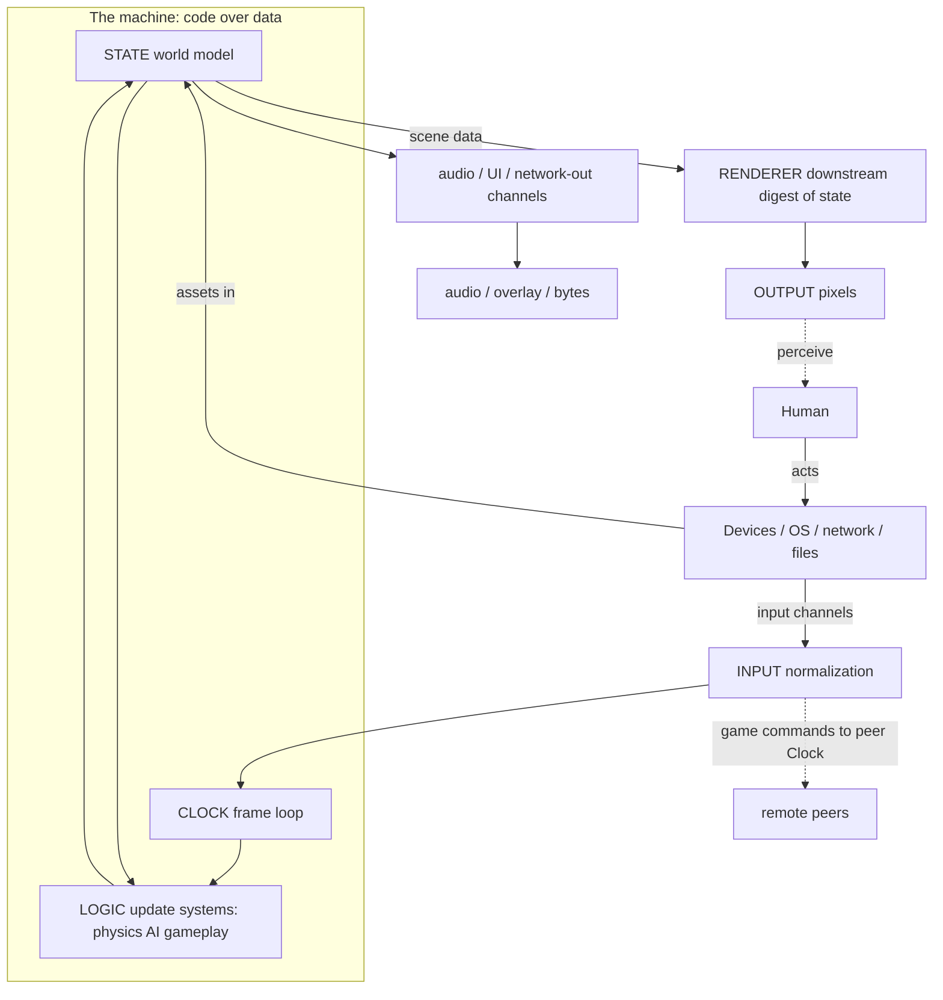
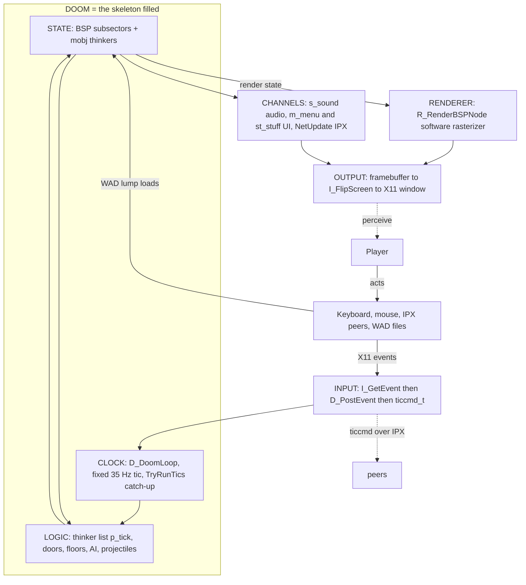
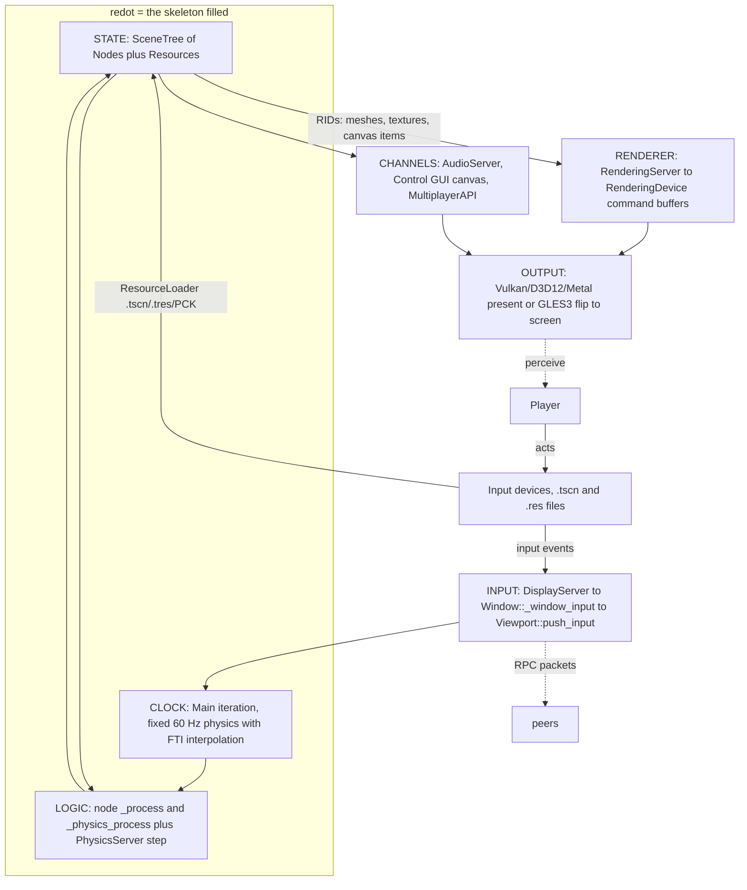
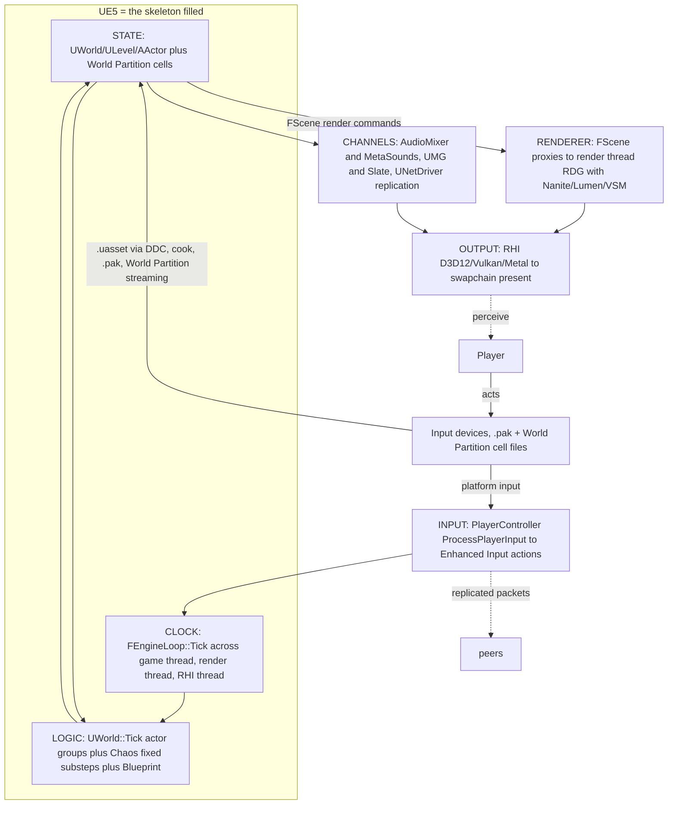

# Common Structure — Every Engine, One Anatomy

This is the cross-engine map. Once you can see the five-part software skeleton —
**state, logic, input, output, clock** — you can see it inside every game engine
you will ever meet. Engines do not invent new shapes. For thirty years, the same
five slots get filled by the same kinds of subsystems, with different names and
scale.

It is a companion to [00-software-is-the-medium.md](00-software-is-the-medium.md), the
flagship note on software as a medium, and to [02-world-models.md](02-world-models.md),
which zooms into the single most consequential slot (state). Per-engine detail
lives in the sibling notes under `Engines/`:
[doom.md](Engines/doom.md),
[quake.md](Engines/quake.md), [quake-iii-arena.md](Engines/quake-iii-arena.md),
[doom-3.md](Engines/doom-3.md), [threejs.md](Engines/threejs.md),
[babylonjs.md](Engines/babylonjs.md),
[redot-engine.md](Engines/redot-engine.md), [urho3d.md](Engines/urho3d.md),
[openengine.md](Engines/openengine.md), and
[unreal-engine.md](Engines/unreal-engine.md). This document is written for
students in any discipline — programming, art, design, audio, production — so
every term is defined the first time it is used.

## 1. The five-part skeleton: software's periodic table

Every piece of software — a spreadsheet, a web form, a database, a game engine —
is the same machine under different clothes: **code** (the active substance: the
rules that transform, move, and produce) running over **data** (the passive
substance: the information the code acts on), wrapped in a loop that connects a
human — or another system — back to the machine. Strip any program to its
skeleton and you find the same five parts:

| Part | What it is | Plain-language definition |
|---|---|---|
| **State** | data | The persistent information the program acts on: variables, a world, a store, a database. |
| **Logic** | code | The transformation rules run over the state: functions, systems, update loops. |
| **Input** | the boundary inward | Everything that crosses into the machine from outside: keys, mouse, a file read, a network packet, a touch. |
| **Output** | the boundary outward | Everything that crosses out: pixels on a screen, sound, a network packet, a file write. |
| **Clock** | when it happens | What makes processing run: polled on a timer (every tick) or event-driven (in response to input). |

Think of these five as a periodic table of software. The periodic table predicts
chemistry: know an element's properties and you can predict what it bonds with.
The software skeleton does the same for engines: know these five elements, and
you can predict which subsystems any engine must have, and which questions to
ask about them.

Engine after engine, the same five slots get filled by the same *named*
subsystems. The **world model** sits in State. The **update systems** (physics,
AI, gameplay) sit in Logic. An **input subsystem** sits in Input. The
**renderer**, **audio**, **UI**, and **networking** sit in Output (and, for
networking, back in Input too). A **frame loop** sits in Clock. The names
change — "thinker list" in DOOM, "physics server" in redot, "Chaos" in Unreal —
but the slot is the same slot.

> **COME BACK TO THIS — the five parts are your map.** No matter how big or
> modern an engine looks, it is state, logic, input, output, clock. Find those
> five inside it and you have understood its architecture; everything else is
> detail and scale.

## 2. One table: general part → engine subsystem → how it varies

This is the mapping each engine in the sibling notes is an instance of:

| General part | Engine subsystem(s) filling it | How it varies |
|---|---|---|
| **State** | The **world model** (scene graph, or BSP + entity list, or ECS — see [02-world-models.md](02-world-models.md)) plus in-memory assets and config | Three families recur across every engine; everything else reads whatever State the engine chose. |
| **Logic** | **Update/simulation systems**: physics, AI, gameplay, movement, animation; asset parsers; the renderer's own culling and sorting | The same "advance the world" idea under four names: thinkers (DOOM), entity ticking, `_process`/systems, actor tick groups. |
| **Input** | The **input subsystem**: OS device events (X11, SDL, GLFW, DOM) → normalized commands (`usercmd_t` on the classic id engines, actions/events elsewhere) | Same shape everywhere: raw device state becomes a clean, game-readable command. |
| **Output** | The **renderer** (image to screen), **audio** (mix to device), **UI overlay**, network sends, file writes | Presentation is the big output; most of what looks "different" between engines is render-pipeline depth, not structure. |
| **Clock** | The **frame loop** — fixed-tick or variable, owned by the engine or handed to the app | The single most decisive choice (section 4): it is the part engines diverge on most. |

Two things to notice. First, **State and Logic are the only two parts that stay
"in" the machine** — everything else is a boundary or a channel (section 3).
Second, the table holds even for libraries like three.js, which ship only
rendering: the five slots are still all present, just filled by different hands
(the app provides the clock and most channels).

> **COME BACK TO THIS — read the row, not the name.** When you meet any engine,
> name which subsystem fills each of the five rows, and you have drawn its
> architecture. The differences between engines are in the "how it varies"
> column.

## 3. IO channels: what is not state or logic

A **channel** is a subsystem whose job is to carry bytes or intent across a
boundary. In a game engine the channels are the parts everyone recognizes by
name:

| Channel | Direction | What it carries | Engine examples |
|---|---|---|---|
| **Assets** | in | geometry, textures, sounds, scripts from disk or archives | DOOM's WAD `lumps`, Quake III Arena's `pk3` zips, redot's PCK pack, Unreal's `.uasset` + DDC cache, OpenEngine's asset database |
| **Audio** | out | mixed sound to the device | DOOM's sound server (`s_sound.c`), redot's `AudioServer`, Unreal's `AudioMixer`/MetaSounds |
| **UI** | out (overlay) | menus, HUD, panels drawn on top | DOOM's menu/status bar, Urho3D's `UIElement` tree, Unreal's UMG, OpenEngine's CSS/XML UI |
| **Network** | in **and** out | player commands and world updates to and from peers | DOOM's ticcmd packets over IPX/UDP, Q3A's delta snapshots, Unreal's actor replication |

The reason these are called "channels" and not "core" is structural: the
**world model and its simulation are the substance between the boundaries**, and
everything that moves data across a boundary is IO. An archive plus a search
path plus on-demand parsing plus a cache is the same idea whether the format is
a WAD, a `pk3`, a `pak`, a PCK, or a `.uasset` store — only the container name
changes. A mixer over a list of sound sources is the same idea in five
languages.

The channel view also explains the one relationship students get wrong: **the
renderer is never inside the simulation.** The renderer is a **downstream
consumer of state** — it reads the world (scene objects, render lists, entity
states, ECS queries) and turns it into draw commands on its own cadence. In the
big engines that distance is explicit: Unreal runs a render thread fed by
proxies of the game state, Q3A builds a draw-surface command buffer that its
back-end replays, redot's `RenderingServer` consumes numeric resource IDs from
the scene tree, and OpenEngine runs rendering ECS "systems" as a separate job
wave after simulation. Game logic does write visual state — but the renderer
only *digests* state; it never runs the game.

> **COME BACK TO THIS — two parts are core, the rest are channels.** State and
> logic hold the world; assets, audio, UI, networking, and even the renderer are
> boundaries that feed it or consume it. If someone tells you a renderer "is"
> the engine, they are naming the biggest channel, not the structure.

## 4. The clock: fixed, variable, hybrid, app-owned

The **clock** is the part of the machine that decides *when* processing happens.
In an engine this becomes the **frame loop**: read input, advance the world,
draw, repeat, fast enough that the human in the loop feels no delay. A **tick**
(or timestep) is one step of that loop.

Two basic designs repeat everywhere:

- **Fixed timestep** — the world advances in exact, equal-sized steps, no matter
  what. The sim is repeatable (deterministic): run the same inputs on the same
  machine and you get the same result, which is why networked and competitive
  games like it. The cost is that if a frame takes longer than the step, the
  loop must **catch up** by running several steps at once.
- **Variable timestep** — the world advances by however much wall-clock time
  passed since the last frame ("delta time"). Simpler and often smoother, but
  the sim is no longer exactly repeatable, and a huge frame-to-frame delta can
  make physics unstable.

Across the studied engines the clock beats four different ways:

| Engine | Logic cadence | Render cadence | Notes |
|---|---|---|---|
| DOOM | **fixed** ~35 Hz game tic (`TICRATE`) | display refresh rate | `TryRunTics` runs catch-up tics if the machine falls behind; logic and drawing are decoupled |
| Quake | variable, clamped | same as logic | per-frame time is filtered and clamped to avoid huge steps |
| Quake III Arena | **fixed** server tick, 20 Hz (`sv_fps`) | client frame rate, capped by default near 85 FPS | client prediction and snapshot interpolation smooth the gap |
| DOOM 3 | **fixed** 60 Hz player command tic | frame rate | an owed-tic loop with a catch-up clamp |
| redot | **fixed** physics step, 60 Hz by default | display refresh rate | **FTI** (fixed timestep interpolation) blends rendering between physics states so movement stays smooth at any frame rate |
| Unreal Engine 5 | variable game-thread delta | frame rate | physics advances in **fixed-size substeps** (Chaos), the same hybrid idea as redot's FTI |
| Urho3D | variable delta | variable | physics is a fixed internal step wrapped in an accumulator, so the boxed sim stays stable |
| Babylon.js | per-`requestAnimationFrame` | display refresh rate | optional deterministic lockstep mode exists |
| three.js | **none** — the app owns the clock | display refresh rate | the library offers `Clock.getDelta()` as a convention; the app calls `requestAnimationFrame` |

Read the middle column as the two categories plus two hybrids: fully fixed
(DOOM, Q3A server, DOOM 3), fully variable (Quake, Urho3D), hybrid
fixed-physics/variable-render (redot FTI, Unreal Chaos substeps), and app-owned
(three.js — and arguably Babylon, which is library-shaped even when it runs its
own loop).

Two things follow. First, **the loop always exists** — what changes is who owns
it and what it beats at. Three.js still has a clock, it just lives in the app
that uses the library. Second, the trade is real: fixed timesteps buy
determinism and stable physics, variable timesteps buy simplicity and smoothness,
and hybrids try to keep both by running a fixed simulation inside a variable
frame.

> **COME BACK TO THIS — every engine has a loop; only the beat changes.** Find
> the beat before you trust anything else about an engine. Fixed tick suggests
> determinism and network fairness; variable delta suggests simplicity; a hybrid
> is the modern answer; app-owned means the engine is really a library.

## 5. Four axes of difference: fills, never new parts

The shared skeleton produces very different engines along four axes. Every
difference you see between engines is a different *fill* of one of these slots —
no engine ever grows a sixth part.

1. **World model** (the State fill) — which of the three families in
   [02-world-models.md](02-world-models.md) holds the world: a scene graph (three.js,
   Babylon, redot, Urho3D), BSP + flat entities (DOOM, Quake, Q3A, DOOM 3), or
   an ECS (OpenEngine).
2. **Clock cadence** (the Clock fill) — fixed, variable, hybrid, or app-owned
   (section 4).
3. **Process topology** — where the world runs and how many copies of it exist.
   DOOM is one process; Quake and Unreal can run the server inside the game
   ("listen server") or as a separate dedicated binary; Q3A is a dedicated
   server plus clients, with a same-process loopback for single-player; modern
   engines like Unreal also split the *frame* across threads (game thread,
   render thread, RHI thread). This changes where the Clock runs — never whether
   it runs.
4. **Channel presence** — which channels are built in, shipped as a package, or
   left to the app. Unreal, redot, and DOOM 3 fill every channel. Three.js and
   Babylon push the most out of core (three.js ships only rendering and loaders;
   Babylon ships GUI as a separate package). OpenEngine ships assets, audio, UI,
   and physics but no networking in its alpha core.

Three consequences are worth stating:

- **State and Logic are the only two parts that stay "in" the machine.** Every
  engine in this study can be described as "a clock, a state, some simulation,
  and its channels."
- **The renderer is a downstream consumer of state, never part of the
  simulation.** This holds at every scale — from DOOM's software rasterizer,
  which reads the BSP and the thinkers, to Unreal's render thread and OpenEngine's
  GPU-driven render jobs.
- **Absence is a deliberate slot, not a new structure.** Three.js "has no
  clock" only because the app owns it; "has no physics" only because nobody
  filled that channel. The skeleton is not missing a bone — a bone was left
  empty.

> **COME BACK TO THIS — all engines are the same shape, differently stuffed.**
> When two engines look nothing alike, you are looking at one of four changed
> fills: the world model, the clock cadence, the process topology, or the
> channel list. Name the axis and the choice becomes comparable.

## 6. Mermaid — one skeleton, three fills

The canonical structure every engine instantiates:

Now the same diagram, filled in for three engines that span the range: a 1993
software renderer (DOOM), a modern scene-tree engine behind abstract servers
(redot), and Unreal Engine 5 with its game/render-thread split.

### 6.1 DOOM (id Tech 1) — the smallest engine, fully closed loop

All five parts present and tiny: one loop, one state (BSP + thinkers), one
thinker-list simulation, one software renderer, four channels. DOOM is small —
there is simply no room for second copies of anything.

### 6.2 redot — scene tree behind abstract servers

The scene tree is State; gameplay runs as `_process` and `_physics_process`
(Logic); the servers are the downstream digest boundary — the renderer is *not*
the tree, it is a resource-ID-facing consumer. The skeleton is identical to
DOOM's; only the fills changed scale.

### 6.3 Unreal Engine 5 — the same skeleton, threads between the slots

Exactly the same five parts as DOOM. The differences visible in the graph are
only where the parts run: the Clock is three threads instead of one loop, the
Sim is actor-tick groups plus fixed Chaos substeps, and the Renderer node is a
whole render-thread pipeline (Nanite → Lumen → VSM → present). No new part
appears between them.

> **COME BACK TO THIS — the diagram is a template.** Copy the canonical graph,
> replace the labels with any engine's subsystems, and you have drawn its
> architecture. If a graph of an engine ever needs a sixth node, you are
> probably looking at a channel wearing a hat.

## 7. What this means for you

Reading any new engine through this skeleton tells you the right questions to
ask — in order, the questions that unlock the rest:

1. **What holds the state?** A scene graph, a BSP + entity list, an ECS? Then —
   what else reads it, and when? (Go deeper in [02-world-models.md](02-world-models.md).)
2. **What advances it, and what beats the clock?** Fixed tick or variable delta?
   Who owns the loop — the engine or the app? Is there a physics substep, and
   does rendering run on its own thread or cadence?
3. **What crosses the boundaries?** Which devices become which commands? What is
   a channel versus core — how do assets get in, and audio/UI/network get out?
4. **Where is the renderer in the stack?** It is downstream of state, never
   inside the simulation — confirm which data structure it digests each frame.
5. **Which of the four axes was tuned, and why?** The engine's choices on world
   model, clock, process topology, and channel presence are the engine's
   personality.

The skeleton is also a *work-language* for a team. When the programmer says
"systems iterating over transform arrays," the artist hears "where my scene
objects update"; when the designer says "the tick owns determinism," the audio
person hears "the loop that mixes our sound." Each discipline reads the same
five slots from its own side. And when you pick up an engine you have never
touched, you are not starting from zero — you are re-filling five known slots.

> **COME BACK TO THIS — the skeleton is the professional's head-start.** Asking
> "what fills the five slots?" instead of "what does this engine do?" moves you
> from tourist to analyst in one step, on every engine you will ever meet.

## 8. Facts, provenance, and where to go next

Every concrete claim in this document is drawn from the Game Engine Anatomy
reference collection (the same vault) and checked against well-known public
releases and documentation:

- **DOOM's tic rate.** DOOM's fixed game tick is **35 Hz**, not 70 Hz: the GPL
  source release defines `#define TICRATE 35` ("State updates, number of tics /
  second") in `doomdef.h`, and John Carmack's release notes refer to "DOOM's 35
  hz timebase". Some secondary descriptions (including parts of the older
  anatomy notes) say 70; this document uses the primary source. The 70 Hz
  figure is likely a confusion with display refresh on early hardware.
- **Quake III Arena's cadence.** Server tick default is 20 Hz (`sv_fps`); the
  client renders at its own capped frame rate with prediction and
  interpolation. Both are documented in the anatomy notes and consistent with
  public documentation.
- **Unreal Engine 5.** Its row is based on the documented architecture (Epic's
  public engine documentation) rather than source-tree citations; specifics such
  as exact Chaos substep rates are intentionally not asserted here.
- **Marked interpretation.** The "periodic table" framing in section 1, the
  channel/core split in section 3, and the four-axis framing in section 5 are
  analytical lenses from the anatomy study, not names the engines use
  themselves.

Where to go next: read the flagship [00-software-is-the-medium.md](00-software-is-the-medium.md)
for the medium-level argument this map serves, then [02-world-models.md](02-world-models.md)
for the deep dive into the State slot, then the per-engine sibling notes —
[doom.md](Engines/doom.md), [redot-engine.md](Engines/redot-engine.md), and
[unreal-engine.md](Engines/unreal-engine.md) are the three fills drawn in
section 6, and the rest fill the same skeleton just as exactly. To see the
skeleton under real-time pressure, continue into the extended chapters:
[03-hardware-and-performance.md](03-hardware-and-performance.md),
[04-concurrency-and-state.md](04-concurrency-and-state.md),
[05-schemas-and-formats.md](05-schemas-and-formats.md),
[06-spatial-indexes.md](06-spatial-indexes.md), and
[07-operating-systems.md](07-operating-systems.md) — in that order.

> **COME BACK TO THIS — start from the map, not the engine.** Keep the five
> slots and the four axes beside you while you read any sibling note, and each
> engine becomes one more instance of the same anatomy rather than a new
> mystery.
