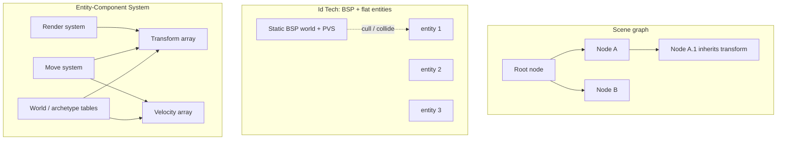

# World Models — How Engines Organize the Game World

Every game engine has to hold a world in memory: the level geometry, the things
in it (players, enemies, props, effects), and the relationships between them.
How an engine does that — its **world model** — is the single most important
design decision it makes, because every other subsystem reads the answer. This
document explains the world model in plain language, walks the three families
that every engine belongs to, and ends with the way to think about the world as
data (the "state store" view), which is the hook that makes the whole subject
click for non-programmers.

It is a companion to [00-software-is-the-medium.md](00-software-is-the-medium.md) and
to [01-common-structure.md](01-common-structure.md) (the five-part skeleton, where the
world model is the fill of the **State** slot). Per-engine detail lives in the
sibling notes: [doom.md](Engines/doom.md), [quake.md](Engines/quake.md),
[quake-iii-arena.md](Engines/quake-iii-arena.md), [doom-3.md](Engines/doom-3.md),
[threejs.md](Engines/threejs.md), [babylonjs.md](Engines/babylonjs.md),
[redot-engine.md](Engines/redot-engine.md), [urho3d.md](Engines/urho3d.md),
[openengine.md](Engines/openengine.md), and
[unreal-engine.md](Engines/unreal-engine.md).

## 1. What a world model is

A **world model** is the data structure and runtime strategy an engine uses to
hold everything dynamic in a game — the level geometry, the entities in it, and
their relationships. It is the engine's answer to the same three questions,
every time:

1. **How is the world stored?** As a tree of objects (a scene graph), a flat
   list of entities (array or linked list), or a table of components (ECS).
2. **How do things relate to each other?** Through a parent→child transform
   hierarchy (a weapon hangs from a hand bone), through no relationship at all
   (every entity is positioned absolutely), or through optional links stored
   as data (a "parent ID" on an entity).
3. **How is it traversed every frame?** By walking the tree, by running a
   think/tick list of entities, or by running **systems** (plain functions) over
   sets of components.

The three families in this study answer those questions differently:

| Family | How stored | How related | How traversed | Engines here |
|---|---|---|---|---|
| **Scene graph** | tree of nodes/objects | parent→child transform inheritance | per-object update/traversal | three.js, Babylon.js, redot, Urho3D |
| **BSP + flat entities** | static precomputed BSP (tree of the *level*) + a flat list of *entities* | none — entities positioned absolutely | think/tick list over the entities | DOOM, Quake, Quake III Arena, DOOM 3 |
| **ECS** | table of component arrays keyed by entity ID | none by default (optional link components) | systems over component sets | OpenEngine |

There is no single universal answer, and the families are not rivals fighting
for the same job — a scene graph answers "how do my dynamic objects relate?",
while a BSP answers "how do I cull and collide against static geometry?". One
engine can (and modern engines routinely do) blend them. The rest of this
document goes family by family, then compares them on five concrete
dimensions.

> **COME BACK TO THIS — a world model is three answers, not one thing.** For any
> engine, ask: stored how? related how? traversed how every frame? Two engines
> that answer the same way will feel familiar to each other; different answers
> are the real family difference.

## 2. Family 1 — the scene graph (three.js, Babylon.js, redot, Urho3D)

**Definition.** The world is a **tree**. Each node (three.js calls it `Object3D`,
Babylon `Node`/`TransformNode`, redot and Urho3D `Node`) carries a **local
transform** — position, rotation, scale — plus references to its children. A
child's **world transform** (its position in the actual game space) is its local
transform *combined with* its parent's world transform. Consequence: move the
parent, and the entire subtree moves automatically. A character with a weapon
attached to a hand bone is just a small tree.

**In the studied engines:**

- **three.js** — the scene graph is central and explicit. Everything renderable
  is an `Object3D` in a parent/child tree; the `Scene` object adds background,
  fog, and environment. World matrices are computed hierarchically and
  visibility/layers propagate down the tree ([Object3D docs](https://threejs.org/docs/#api/en/core/Object3D)).
- **Babylon.js** — `Node` is the base; `TransformNode` adds the transform;
  `Mesh` (and camera and light) extend it, so cameras and lights participate in
  the same hierarchy as geometry.
- **redot (Godot 4 fork)** — the `SceneTree` of `Node`s is the core of the
  engine. Nodes carry gameplay scripts, and the renderer/physics/audio are
  abstract **servers** that consume *flattened* data derived from the tree —
  the tree is the authoring reality, the servers are a digest boundary.
- **Urho3D** — a `Scene → Node` tree with components attached to nodes;
  drawables, rigid bodies, and UI elements are all components.

**What a scene graph buys you:**

- **Authoring ergonomics.** Nested objects that move together — a character
  with a weapon, a camera attached to a car — are expressed directly as
  parent→child links. That is exactly how artists and designers already think.
- **Inheritance of state.** Visibility, render layers, and much lighting state
  flow down the tree automatically.
- **Predictable traversal.** Update and render walk the same tree, so there is
  one canonical "where things are."

**What it costs:**

- **The traversal is serial.** The classic implementation updates
  parent-before-child, depth-first; it does not parallelize well.
- **Data is scattered per object.** Each node owns its transform, mesh, and
  material, so iterating "all transforms" means chasing pointers across objects
  (poor CPU cache locality).
- **Identity is bundled with data.** The node *is* the container; changing "what
  data an entity has" at runtime means restructuring the object model, which is
  clumsy compared with ECS (section 4).

> **COME BACK TO THIS — scene graphs are for people.** If artists and designers
> must build the world directly, a tree-shaped world model is the friendliest
> answer, and its performance costs are real but manageable. Reach for it when
> the world is built by hand and read by traversal.

## 3. Family 2 — BSP world + flat entity list (DOOM, Quake, Q3A, DOOM 3)

**Definition.** The world is split into two radically different structures:

- **The static level** is precomputed *offline* into a **BSP tree** (binary
  space partitioning — the level geometry is cut along planes into regions so a
  renderer can walk it front-to-back and a collision system can answer "what's
  here?"), packaged with **PVS** (potentially visible set) data that says which
  regions can see which other regions. Tools like Q3A's `q3map` compile the
  level before the game runs; the BSP is immutable at runtime.
- **The dynamic content** is a **flat list of entities** — DOOM's `mobj_t`
  thinkers in a linked list, Quake's `edict_t` array, Q3A's `gentity_t` array,
  DOOM 3's `idEntity` objects. Every entity has an absolute position. There is
  **no transform hierarchy**: "attaching a weapon to a hand" means game code
  *positions* the weapon model at the hand every frame, not parenting it.

**In the studied engines:** DOOM runs a software renderer that walks the BSP
front-to-back and a **thinker list** that advances every thing. Quake adds PVS
visibility and a QuakeC virtual machine that updates the edict array. Q3A keeps
the server world as a `gentity_t` array and sends snapshots to clients, which
hold an interpolated state ring for rendering. DOOM 3 has an object-oriented
entity *class* hierarchy — many entity types — but it is a class hierarchy of
types, not a runtime transform tree; the world is still a static BSP-derived
structure plus a flat entity list.

**What id's model buys you:**

- **Brutally fast static culling.** PVS precomputes "which leaves can see which
  other leaves", so the renderer never visits geometry that cannot be visible.
  On 1990s hardware this was the difference between playable and not.
- **Tight collision.** The BSP is a natural spatial structure for point and
  hull traces — no broadphase needed.
- **Flat, predictable entity storage.** Iterating all entities is a simple loop
  over contiguous or linked memory.

**What it costs:**

- **No hierarchy.** No parenting, no transform inheritance; every attachment is
  manual positioning in game code.
- **Static levels only.** The BSP is baked offline; destructible or procedurally
  generated levels are out of scope or live in awkward side structures.
- **Two world models to reason about.** The game faces the entity list; the
  renderer faces the BSP and a render-list abstraction. The split is a real
  source of complexity.

> **COME BACK TO THIS — BSP worlds are a hardware-era answer, and still the gold
> standard for cull-and-collide on static geometry.** They trade authoring
> power (no hierarchy) for a perfectly precomputed, brutally fast static world.
> Their real lesson for modern engines: separate *static* culling structure from
> *dynamic* entity data.

## 4. Family 3 — ECS (OpenEngine)

**Definition.** The world is a **database, not a tree**. An **entity is just an
ID** — an integer. Data lives in **component arrays**: all transforms in one
contiguous array, all velocities in another. **Systems** — plain functions —
run each frame over every entity that has a given *set* of components: "for
every entity with Transform + Velocity, integrate movement." Adding a behavior
to a thing is adding a component to its row, not changing its class.

**In this study:** OpenEngine is the full example — an archetype-table ECS at
the core with queries, a scheduler that runs systems in parallel "job waves",
and commands (create/remove entity, add component) queued and flushed once per
frame. Its rendering is built *from* the ECS: render-prep runs as ECS systems
in job waves, and the closest thing to a "scene" on the GPU is a ray-tracing
acceleration structure (a **TLAS** — the top-level structure that organizes
geometric instances for the GPU) refitted from entity data. Scenes are saved
and loaded as `.scene` data files via reflection.

**What ECS buys you:**

- **Cache locality.** Iterating one component array touches contiguous memory —
  ideal for CPUs and for GPU-driven culling.
- **Parallelism.** Systems over disjoint component sets can run on multiple
  threads at once (OpenEngine's job waves).
- **Runtime composability.** Components can be added and removed per entity
  freely: "give this entity a physics body" is a data change, not a class
  change.
- **Data-driven, inspectable worlds.** The whole world is serializable as data —
  every entity is a row, every component is a column.

**What it costs:**

- **No natural hierarchy.** Parenting must be rebuilt as a component (a "parent
  ID"), and transform inheritance becomes a system that walks those links —
  more machinery than a scene graph's built-in tree.
- **Authoring friction.** Artists and designers think in objects with children;
  ECS does not expose that, so engines bolt a hierarchy editor *on top* of a
  data-oriented core.
- **Boilerplate.** Systems, queries, access policies, lifecycle events — real
  infrastructure before the first scene.

> **COME BACK TO THIS — ECS trades human-shaped thinking for machine-shaped
> speed.** It is the modern answer for large dynamic worlds and for performance
> and parallelism, and its price is that teams need tooling and editors to
> translate design back into a readable shape.

## 5. The deciding dimensions

Engines in different families can be placed side by side on five concrete
dimensions. Understand the dimensions and you can predict the trade-offs of any
new engine you meet:

1. **Transform model** — does the engine have built-in parent/child transform
   inheritance, or is every entity positioned absolutely (or via optional
   links)?
2. **Update traversal** — what actually runs each frame to advance the world?
   A tree walk, a think/tick list, a fixed server tick, system waves?
3. **Culling / rendering traversal** — how does the engine decide what to draw
   this frame? BSP back-face + PVS, octree frustum culling, render lists,
   GPU/HZB occlusion?
4. **Data layout** — how is state physically stored? Per-object fields,
   per-struct, fixed-size arrays, contiguous component arrays?
5. **Runtime dynamism** — how freely can the world change at runtime? Add/remove
   objects freely (scene graphs, ECS) versus a static precomputed level plus
   spawn/despawn of entities (id Tech).

| Engine | Transform model | Update driver | Culling | Data layout | Runtime dynamism |
|---|---|---|---|---|---|
| three.js | built-in `Object3D` tree | app-driven `requestAnimationFrame` | per-object frustum during render | per-`Object3D` fields | objects add/remove freely |
| Babylon.js | built-in `Node`/`TransformNode` tree | per-`rAF`, `Scene.animate` | per-mesh frustum via render lists | per-node fields | meshes add/remove freely |
| redot | built-in `Node` tree | `SceneTree` `_process`/`_physics_process` | per-viewport rendering-server cull | per-node variant data | instantiate/free nodes freely |
| Urho3D | built-in `Node`/`Component` tree | engine events driving `Scene::Update` | octree frustum cull | per-node/per-component | create/destroy freely |
| DOOM | none (absolute) | fixed 35 Hz thinker list | BSP back-side cull | `mobj_t` structs, zone-allocated | thinkers spawn/despawn; BSP static |
| Quake | none (absolute) | per-frame entity physics + QuakeC VM | BSP + PVS walk | fixed `edict_t` array | entities spawn/remove; world static |
| Quake III Arena | none (absolute) | fixed 20 Hz server tick + client prediction | BSP + PVS; sorted command buffer | `gentity_t`/state arrays | gentities spawn/remove; world static |
| DOOM 3 | entity class hierarchy, no transform tree | fixed 60 Hz usercmd tic, `RunFrame` | portals/occlusion via `idRenderWorld` | per-`idEntity` instances | entities spawn/remove; `.proc` world static |
| OpenEngine | none by default; optional link components | ECS systems in job waves | GPU/HZB occlusion, GPU-driven | contiguous component arrays | excellent — components add/remove at runtime |

> **COME BACK TO THIS — the same five questions classify every engine.** Once
> you can answer transform model, update driver, culling, layout, and dynamism
> for an engine, you know its family and its trade-offs — no source code needed.

## 6. Why engines pick different shapes — and how modern engines blend

Two observations fall out of the comparison.

**The scene graph and the BSP are not rivals for the same job.** A scene graph
answers "how do my dynamic objects relate?"; a BSP answers "how do I cull and
collide against static geometry?" The id Tech engines answered the first with
"no hierarchy" and leaned entirely on the second, because their games' dynamics
were simple — dozens of entities, no parenting — so a hierarchy was pure
overhead. Their era also did the deciding: static, hand-built levels suited
offline precomputation, and 1990s CPUs could not afford a scene graph's
serial per-object traversal on top of software rendering.

**Modern engines increasingly blend the families.** redot keeps a scene tree
for authoring but routes rendering and physics through abstract servers that
consume flattened data, not the tree. OpenEngine keeps a data-oriented ECS at
the core but exposes scenes and a hierarchy editor on top. Unreal and Unity —
outside the original study set — likewise present a hierarchy to creators while
the engine internally gathers, culls, and bakes data in data-oriented passes.
The "pure" scene graph, the "pure" BSP+list, and the "pure" ECS are textbook
archetypes; production engines pick one as the core and borrow from the others
at the edges: **a friendly tree on the outside, a performant store on the
inside, and a precomputed spatial structure where static geometry must be
fast.**

> **COME BACK TO THIS — family choice is a product decision, not a style
> contest.** Static, hand-built worlds favor precomputed structures; dynamic,
> author-driven worlds favor trees; large, performance-hungry, data-heavy
> worlds favor ECS — and every mature engine borrows the other two at the
> edges.

## 7. UI: a screen-space layer on top of the world model

UI is the one subsystem that fits no world-model family cleanly — because it
does not live in world space at all.

**World space vs screen space.** The world model organizes everything in
**world space** — it exists to answer "what's in the world, where, what is
visible?" (transform hierarchy, culling, simulation). UI lives in **screen
space**: pixels laid out relative to the viewport. It needs none of the world
model's machinery — no culling against the BSP, no parent→child inheritance, no
physics. Structurally, **UI is a parallel system that sits on top of the world
model, not an extension of it.**

**The spectrum in practice:**

1. **Pure overlay, drawn last** — the classic id Tech engines render the world,
   then composite menus/console/HUD in screen space on top (DOOM's menu and
   status bar, Quake's composite screen, Q3A's UI virtual machines).
2. **Separate hierarchy, same renderer** — Urho3D keeps its own `UIElement`
   tree drawn as vertex batches after the 3D scene; OpenEngine renders CSS/XML
   UI into the render graph as its own passes; redot's `Control` nodes run
   through the *canvas* renderer, a layer distinct from the 3D scene. Same
   machinery as the world, different data structure in a different layer.
3. **UI rendered INTO the world** — genuinely part of the world model. DOOM 3
   renders `.gui` files as in-scene geometric surfaces (the in-world monitors,
   the PDA). Any "health bar over a head", billboarded nameplate, or 3D text is
   the same thing: world-space UI that must go through the world's render path
   to stay glued to an object.
4. **No engine UI at all** — three.js ships none in core (you use DOM/CSS; the
   bundled editor is a separate tool app); Babylon ships GUI as a separate
   package.

The pattern: **the more world-anchored the UI, the more it belongs to the world
model.** Screen-anchored UI (menus, HUD, panels) is always an overlay layer;
object-anchored UI is world geometry by another name.

**The 2D collapse.** In a 2D game the boundary collapses, because the 2D world
itself lives in a canvas — and so does the UI. In redot, a 2D sprite is a
`CanvasItem` and a button is *also* a `CanvasItem`: same scene tree, same
renderer, same batched draw. The only thing separating "world" from "UI" is the
**canvas layer / z-order**, not world-vs-screen space. A health bar as a sprite
parented to the player is natural and common, and the engine often cannot tell
— and does not care — whether a canvas item is "the game" or "the UI".

So the general rule: **UI is its own screen-space layer on top of the world
model**, with two carve-outs — *world-space* UI (anchored to objects) becomes
part of the world model, and in *2D canvas engines* the boundary is just a
z-order rather than a structural one.

> **COME BACK TO THIS — draw the HUD last, in screen space, and know which UI
> is world geometry.** When a health bar must track a moving character, it
> stops being UI and becomes a child of the world model. That one distinction
> decides which render path and which team owns it.

## 8. The world model as a state store (the non-programmer's hook)

Here is the idea that makes the whole subject familiar, because you have seen it
before — in every web app and mobile app you have ever used.

**A state store is a centralized, observable piece of state that the rest of the
program derives from.** It has three commitments:

1. **Single source of truth** — all state that matters lives in one place, not
   scattered across modules.
2. **Explicit change propagation** — state changes travel through a defined
   mechanism (actions, events, reducers), not arbitrary writes from anywhere.
3. **One-way flow** — the UI reads from the store; user input produces state
   changes; the store notifies subscribers; the view re-renders. Data never
   flows backward.

That is the shape of **Redux** (dispatch an action → a reducer computes a new
state → subscribed views update) and **MobX** (observable state → computed
values → reactions). Reference: [Redux](https://redux.js.org/) and
[MobX](https://mobx.js.org/). Now look at a game engine:

```
Redux:  action → reducer → store → subscribe → view (re-render)
Game:   input  → game logic → world state → frame loop reads → renderer → screen
```

The **world model sits in the store slot**. The renderer is the **view**. Input
events are the **actions**. The world model is not downstream of a state store —
it *is* the store, and the renderer is downstream of it. ECS makes this nearly
literal: entities are keys, components are the state slices, systems are the
subscriptions, and the frame loop is the subscriber that re-renders every tick.

**Two axes, not one type.** People say there are "two types" of state storage —
mutable and immutable. That is one real axis; the second, equally important one
is **push vs pull**: do consumers get *notified* when state changes (push —
Redux subscribers, MobX reactions), or do they *re-read everything every tick*
(pull — the game frame loop)? Most real stores blend:

| Axis | Immutable | Mutable |
|---|---|---|
| How change happens | create a new state object and swap the reference (Redux) | mutate in place; the library tracks who read what (MobX, an ECS component array) |
| Strengths | trivial change detection, free snapshots, time-travel | natural to write, no copying, fine-grained |
| Costs | copying plus structural-sharing discipline | implicit; harder to answer "who changed this?" |

| Axis | Push (reactive) | Pull (polled) |
|---|---|---|
| How consumers learn | store notifies subscribers (Redux `subscribe`, MobX reactions) | consumers read the state every tick regardless (the game frame loop) |
| When it wins | selective, expensive reads; sparse changes (UI) | full-sweep reads every frame (game rendering) |
| Cost | subscription bookkeeping | redundant reads when little changed |

**Push vs pull is the big structural difference between a UI store and a world
model.** UI stores are push; world models are pull. Games do not use reactivity
for the world because it would buy nothing: the renderer does a full sweep of
everything every tick anyway, so change-notification bookkeeping is pure
overhead. The one place engines borrow push is a **dirty-feed** — OpenEngine
signals "this component changed" via a dirty-feed mechanism, but rendering
still polls the world.

**Three more differences beyond push/pull:**

- **Spatial vs relational.** A store is a keyed table with no notion of *where*
  things are. A world model is organized around space: BSP + PVS answers "what
  is visible?", an octree answers "what is near me?", a scene graph answers
  "what moves with what?". Culling, adjacency, and collision queries are
  first-class in a world model and do not exist in a UI store.
- **Simulation vs derivation.** Store logic *derives* new state from intent —
  it reacts. World-model logic *integrates over time* — it simulates (physics,
  AI, movement). A store is event-driven; a world model is clock-driven. You
  can rewind a Redux store trivially; rewinding a simulated world means
  re-running the simulation — which is why an id Tech save game re-loads the
  level rather than restoring a snapshot.
- **Where "downstream" is real.** There is one genuine store→derived-state
  relationship, but it lives *inside* engines: the **presentation state** is
  downstream of the authoritative world state. In Q3A the server world sends
  snapshots and the client keeps an interpolated entity-state ring for
  rendering; networked engines generally keep authoritative state and
  interpolate/extrapolate a render state from it. That is the closest thing in
  games to Redux/MobX "store → selector".

**Where each family sits on the store spectrum:**

| World model | Mutable/Immutable | Push/Pull | Store-ness |
|---|---|---|---|
| Redux / MobX (reference) | immutable / mutable | push | pure store |
| Scene graph (three.js, Babylon, redot, Urho3D) | mutable | pull | object-oriented store + hierarchy |
| id Tech (BSP + entities) | mutable | pull (think/tick) | flat store + spatial index |
| ECS (OpenEngine) | mutable | pull (+ dirty-feed) | closest to a "real" store |

So: **a world model is a mutable, polled, spatial, simulation-bearing store** —
a store the way a Formula 1 car is a vehicle: same category, wildly different
engineering priorities. The state-store lens is worth keeping because it is one
of the most persistent ideas in software: the same
single-source-of-truth / explicit-change / one-way-flow shape reappears in UI
frameworks, game engines, and distributed systems — and recognizing it in each
makes the others easier to reason about. (Historically the shape runs from
Smalltalk's Model–View–Controller through Elm and Flux to Redux; every
generation re-invents the same shape, and Redux's special contribution was
immutability-for-free-snapshots while MobX contributed fine-grained reactive
tracking.)

> **COME BACK TO THIS — the world model is your store; everything else derives
> from it.** Inputs are actions, the simulation is the reducer, the renderer is
> the view, the frame loop is the subscriber — and unlike a web store it is
> *polled*, *spatial*, and *simulated*. If you understand Redux or MobX, you
> already understand the game loop.

## 9. Mermaid — the three families, and the store spectrum

The three families side by side — a tree that inherits transforms, a static BSP
plus a flat entity list, and component tables driven by systems:



The store spectrum — from a pure push-reactive web store to a fully polled,
spatially indexed world store:


> **COME BACK TO THIS — these two pictures are the whole argument.** Three ways
> to organize a world, and one spectrum of "store-ness" they all sit on. Keep
> both in your head and no engine's world model will surprise you again.

## 10. Choosing and living with a shape: what each asks of the people feeding it

Every world-model family asks different things of the people who feed it —
programmers, artists, designers, and the production/tooling pipelines around
them. Choosing an engine is largely choosing which set of demands your team can
absorb:

| | **Scene graph** | **BSP + flat entities** | **ECS** |
|---|---|---|---|
| **Designers** | think in objects and parents; a puzzle with a door attached to a room is just a tree | place entities in data (spawn points, pickups); no parenting — build movement out of states and positions | think in data and tags; "gives this entity a health component" is a natural sentence |
| **Artists** | comfortable — export a model with a named bone and the tree does the rest | levels are baked offline by tools; art must tolerate precomputed lighting/PVS | need a bridge: editors that map "objects with children" onto components, because the raw ECS has no tree |
| **Programmers** | write per-object logic (scripts on nodes); watch serial traversal and scattered data on big scenes | write think/tick code and manual attachments; enjoy precomputed culling and tight collision | write systems and queries; enjoy locality, parallelism, runtime composability |
| **Production / tools / QA** | the editor *is* the world; save files are trees; easy to inspect | the toolchain (map compilers) is a first-class production asset; levels are hard to change late | the world is serializable data (`.scene` files); tooling and hot reload shine, but debugging "who changed this component" needs discipline |

Two practical living-and-breathing rules follow from the whole comparison:

- **Read the engine's world model first** — it tells you what your job will feel
  like. If you are an artist choosing between engines, you are really choosing
  between "a tree I can see in an editor" and "a database I need a bridge to
  edit."
- **The store discipline travels with you.** Whatever family you land in, keep
  single source of truth, explicit change, and one-way flow. A team that names
  its world model and treats it as a store can scale a scene, an ECS, or a
  baked level without the architecture falling over.

> **COME BACK TO THIS — pick the shape your team can feed.** The world model is
> not just an implementation detail; it is the contract between the engine and
> every discipline that touches it. Name the family, know what it demands of
> your role, and the engine stops being a mystery and becomes a tool.

## 11. Facts, provenance, and where to go next

Every concrete claim in this document is drawn from the Game Engine Anatomy
reference collection (the same vault) and checked against well-known public
releases, documentation, and official references:

- **Engine subsystem names and cadences** (DOOM `mobj_t` thinkers and `TICRATE`
  35 Hz, Quake `edict_t`, Q3A `gentity_t` and 20 Hz server tick, DOOM 3 `.proc`
  worlds, redot `SceneTree`/RenderingServer, Urho3D `Node`/`Component`,
  OpenEngine archetype ECS and TLAS) come from the anatomy notes, with specifics
  where noted cross-checked against the public GPL source releases (e.g. the
  `id-Software/DOOM` release on GitHub defines the fixed tick in `doomdef.h`).
- **State-store comparisons** (Redux subscribe/reducer flow, MobX observable →
  computed → reaction) follow the official documentation of
  [Redux](https://redux.js.org/) and [MobX](https://mobx.js.org/).
- **Marked interpretation.** The five-dimension comparison in section 5 and the
  "store-ness" framing in section 8 are analytical lenses from the anatomy
  study, not terms the engines use themselves. The claim that an id-style
  "presentation state" mirrors a store→selector relationship is an analogy,
  marked as such.

Where to go next: read [00-software-is-the-medium.md](00-software-is-the-medium.md)
for the medium-level argument, [01-common-structure.md](01-common-structure.md) for
the five-part skeleton into which the world model fits, and then one engine from
each family to anchor the shapes: [threejs.md](Engines/threejs.md) and
[redot-engine.md](Engines/redot-engine.md) for scene graphs,
[doom.md](Engines/doom.md) and [quake-iii-arena.md](Engines/quake-iii-arena.md)
for BSP + entities, and [openengine.md](Engines/openengine.md) for ECS. For
where the world model's state is stored, copied, and replicated, continue to
[04-concurrency-and-state.md](04-concurrency-and-state.md) and
[05-schemas-and-formats.md](05-schemas-and-formats.md); for how anything looks
*through* that world spatially — the index behind culling, collision, and
streaming — continue to [06-spatial-indexes.md](06-spatial-indexes.md).

> **COME BACK TO THIS — carry the three questions into every sibling note.**
> Stored how? Related how? Traversed how? Answer those three and the engine's
> family, its trade-offs, and the work its team does to feed it are all visible
> before you read a line of its documentation.