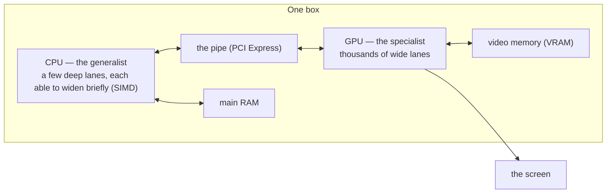
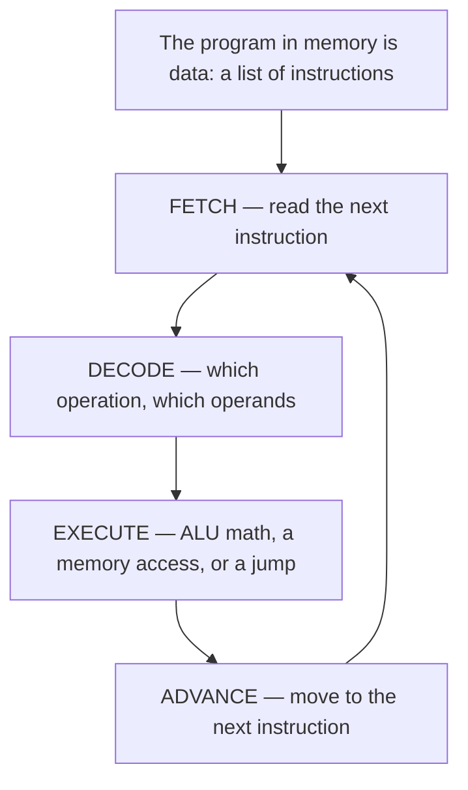
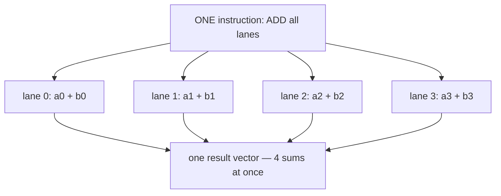
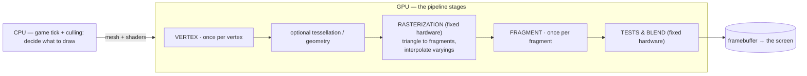
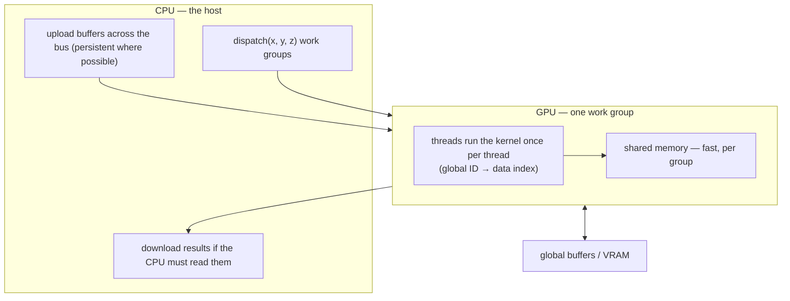
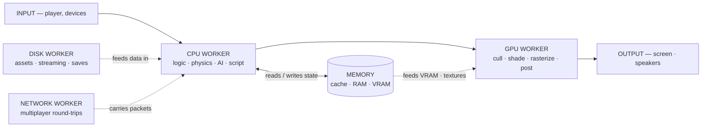
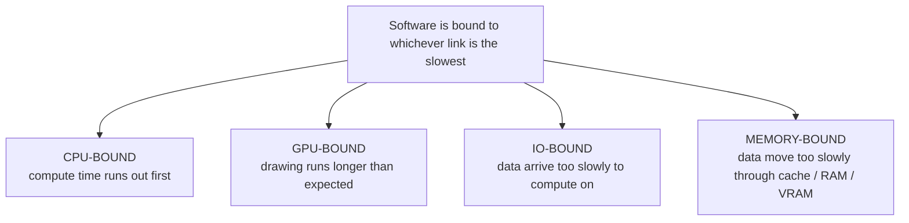

# Hardware and Performance — Two Machines, One Budget

Every game runs on **two computers at once** — a generalist **CPU** (central
processing unit) and a specialist **GPU** (graphics processing unit) that happen
to live in the same box. This document is about the two as *different machines*,
and about where a frame's time actually goes. It is the first stop in the
hardware-and-performance chapter of the collection; the next chapter is
[04-concurrency-and-state.md](04-concurrency-and-state.md). It answers — at the level
of the silicon itself — the claim of the flagship
[00-software-is-the-medium.md](00-software-is-the-medium.md) that software is the
medium you work in, and it shares the anatomy of
[01-common-structure.md](01-common-structure.md), whose five-part skeleton the two
machines fill. Written for students in every discipline: every term is defined
on first use, every section stands alone, and each ends with a boxed **come
back to this.**

The whole subject fits in one image. The CPU is a small number of **deep lanes** —
a few to dozens of cores, each able to run *any* describable program one careful
step at a time, and each able to *widen* briefly into a short **SIMD** vector;
think of a scholar who can solve anything, one step at a time. The GPU is
**thousands of narrow wide lanes** applying the same small recipe to enormous
amounts of data at once; think of an army doing one identical chore in lockstep.
They are **not** "the same computer, one bigger." They are two machines for two
shapes of work, and every frame is split between them.

Two questions keep returning:

1. **What is each processor for?** The CPU runs general software — the operating
   system, the engine's logic, your tools. The GPU runs graphics work — shading,
   rasterizing — and increasingly math that looks like rendering.
2. **What is each one good at?** A few deep lanes that can handle unpredictable,
   branchy logic, versus thousands of narrow lanes that must all run the *same*
   instruction on *different* data at once. That one difference explains most of
   this document — including why UE5's `stat unit` prints both a Game row and a
   GPU row.

## 1. Two machines in one box

The fact that surprises every new student: a game is not "software that runs on
the computer." It is software that runs on two computers **simultaneously, in the
same box**, joined by a pipe and by software. The **CPU** lives on the main
processor die, surrounded by the operating system, drivers, and main memory
(**RAM**). The **GPU** lives on a graphics chip — its own card with its own fast
**VRAM** (video memory) on discrete graphics cards, or sharing the main memory
package on integrated silicon (laptops, consoles, phones) — connected to the CPU
by a bus (**PCI Express** on PCs) and by the **graphics API** and **driver**, the
software that translates the engine's drawing commands into the GPU's language.



How the two share a frame is the story of modern engine design. The **CPU** runs
whatever needs judgment — input, the simulated world (AI, physics, gameplay),
and the instructions that tell the GPU what to draw. The **GPU** runs whatever is
the same small recipe repeated a staggering number of times: for every vertex,
move it; for every fragment (screen-sized piece of a triangle), color it.
Rendering is **embarrassingly parallel** — millions of independent, identical
jobs — the opposite of what a CPU is good at and exactly what a GPU is for.

That split is recent history. In 1993 *DOOM* drew every pixel with the CPU alone:
a 320×200 **software rasterizer** — the programmer's name for drawing shapes to
pixels by hand, no GPU involved — running on an **Intel 486** [unverified]
([Engines/doom.md](Engines/doom.md)). It worked because at 320×200 a good
generalist could just barely carry the whole table. Every console generation
since has pushed far more identical-massive work to the army. Today nobody
renders a 3D frame on the CPU: **the question is never "CPU *or* GPU" — it is
"which work goes to which machine, and is the other one idle?"**

> **Come back to this.** You run on two machines at once: a generalist CPU (a
> few deep lanes, each able to widen briefly via SIMD) and a specialist GPU
> (thousands of wide lanes), joined by a bus and a driver. A frame has a shared
> deadline (~16.6 ms at 60 fps), so an idle lane is wasted budget. "CPU or GPU?"
> is never the real question — "which venue is the time going to, and is the
> other one idle?" is.

## 2. The CPU — the universal machine

The **CPU** is the chip that runs the program of instructions the operating
system hands it. It is **general-purpose**: not built for graphics or audio or
physics, but to compute *whatever a program describes* — the property called
being a **universal machine**. The working silicon: the **ALU** (arithmetic/logic
unit, which does the math and comparisons), **registers** (a few very fast
named slots), a **program counter** (which instruction is next), and a **clock**
timing everything in gigahertz. Data lives in a hierarchy — registers, on-chip
**caches**, main **RAM** — and **cache misses** (reaching past the nearest level
of that hierarchy) are the difference between a fast program and a slow one.

### Program as data

The key move of the **stored-program computer**: *the program itself lives in
memory as data.* Instructions are not wired in; they are fetched one at a time,
exactly like the numbers they operate on — which is why the same silicon runs
the operating system one moment and a game engine the next. Everything reduces
to one loop, the **fetch–decode–execute cycle**:



Modern CPUs are **multi-core** — several engines on one die sharing RAM
(consoles: typically 8; desktops: 8–24) — so CPU parallelism is a handful of
deep lanes. Each core may run two threads at once via **simultaneous
multithreading** (SMT; Intel calls it "hyper-threading"), and each core also
carries a **SIMD vector unit** (§3) — so a single core can, in the right hot
loop, process several numbers in one step. Net picture: the CPU is *a handful
of deep lanes that can each briefly widen into a few lanes*, not a single lane.

### The two big theorems (what they do and don't say)

**Turing completeness.** A system is **Turing-complete** if it can simulate any
Turing machine — the model Turing used to define "computable." A general-purpose
CPU is one. *What it says:* one general engine can run any computable,
describable program. *What it doesn't say:* that running it is fast, feasible,
or ever finishes.

**The halting problem.** "Will this program finish?" cannot be answered by *any
single general algorithm* for all program–input pairs; Turing proved this
undecidable in 1936–7. *What it says:* no one program can generally prove
another halts. *What it doesn't say:* that a *specific* program is unknowable —
run it and you can observe whether it halts.

What the theorems mean for a game: they do **not** mean "your game might loop
forever and nobody can tell." The weight is carried by *budgets and deadlines*,
not proofs:

- **The frame budget.** A frame at 60 fps gets ~16.6 ms; a system that overruns
  makes the frame late (a **hitch**). The whole vocabulary of bound work and
  profiling (§§7–9) exists because "we can't prove it, so we measure and budget
  it."
- **The watchdog.** For the rare thing that genuinely never returns, the
  operating system does not *prove* the loop wrong — it *watches*, reclaiming
  the machine.
- **The deadline is a team decision.** "Does it finish on time?" is an everyday
  conversation backed by profilers, not theorems.

### The instruction set: the language the silicon speaks

**Machine code** is the rawest form of a program — the actual numbers a CPU
executes, varying by CPU family; nobody sane reads it. **Assembly language** is
its human-readable shadow, one mnemonic per instruction, translated one-to-one by
an *assembler*. The contract in the middle — *which words exist and what they
mean* — is the **instruction set architecture (ISA)**: the machine-level
interface a processor family honors, and the reason software written against it
is **binary compatible** across chips of the same family. The classic trade:
**CISC** (x86) uses many variable-length instructions, choosing compatibility and
dense code; **RISC** (ARM, PowerPC, MIPS, RISC-V) uses fixed-width simple
instructions in a **load–store** design, choosing small, fast, cool silicon.
Different ISAs speak completely different dialects — an x86-64 binary will not run
on an ARM phone — which is why a game needs one build per ISA family unless an
engine like UE5 compiles for all of them
([Engines/unreal-engine.md](Engines/unreal-engine.md)).

> **Come back to this.** The CPU is a universal machine because program = data:
> any describable computation is instructions in memory, run through the
> fetch–decode–execute cycle on a handful of deep lanes. Turing completeness
> says one engine can do any of it; the halting problem says no program can
> *guarantee* another finishes — which is why bounded work per frame is
> engineered and measured, not promised by the silicon. The ISA is the language
> the silicon speaks; the OS is who you ask for services.

## 3. SIMD — one order, many legs (the bridge between the machines)

Meet the middle ground inside the CPU, and the ancestor of the GPU's whole way
of working. **SIMD** — single instruction, multiple data — executes *one*
instruction across several **lanes**, each holding its own data: "multiple
processing elements perform the same operation on multiple data points
simultaneously." Scalar code does `a=a*2`, then `b=b*2`, then `c=c*2`; SIMD loads
a lane of four numbers and multiplies all four in one step. One order — "varnish!"
— and every apprentice moves at once. Not magic speed: the same speed doing four
times as much work, *when the work is naturally many-similar-numbers*.



**Where it lives.** On x86 in the **SSE** and **AVX** families; on ARM in
**NEON** (carried by phones, the Switch, and Apple silicon). **Who cares.** SIMD
shines on *homogeneous* game math: **vector math** (a 3D position is four floats,
one per lane) and **audio** (a volume change is one multiply per sample — a
reverb filters thousands of samples with the same math). Nearly every console
since 1998 ships a SIMD unit, so "keep the math SIMD-friendly" is still a real
performance rule: keep data in flat, regular arrays and loops data-parallel, and
the compiler **auto-vectorizes** them for you (free but fragile) — or write
**intrinsics**, function-like calls that map one-to-one to SIMD instructions.

**What it is NOT.** CPU SIMD is *short-vector* parallelism — a handful of wide
registers inside one core. It cannot help when operations differ per element.
And it is **not** the GPU model: the GPU fans one instruction out to thousands
of *whole threads*, not to packed values in a few registers. **SIMD packs values
into lanes in one deep core (a few lanes); SIMT (§4) fans one instruction out to
many whole threads (thousands of lanes).** The bridge between the machines runs
straight through SIMD — the GPU is "the same many-lanes idea, scaled until the
programming model changes."

> **Come back to this.** SIMD is one order, many legs: one instruction over a
> lane of numbers. Short-lane data parallelism (SSE/AVX, NEON) ideal for vector
> and audio math — the CPU's own small taste of "many things at once." Not
> thread parallelism, and not yet the GPU model: SIMD packs values into register
> lanes, SIMT runs whole threads in lockstep. The bridge between the machines
> runs straight through SIMD.

## 4. The GPU — the specialist

A **GPU** is a specialized circuit built to accelerate graphics, modern ones
packing "hundreds, or thousands, of calculation units." The transistor-budget
difference is flat: the CPU spends silicon on a *small number of smart deep
lanes* that must handle arbitrary control flow, each minimizing **latency** (the
time one operation takes) for the few threads it runs; the GPU spends it on
*thousands of narrow arithmetic lanes* designed to **maximize throughput** (the
number of operations finished per second) across "a large number of concurrent,
lightweight threads." That one design goal explains everything below.

### SIMT — how the wide lanes run together

**SIMT** (single instruction, multiple threads) is the GPU's execution model:
one control unit broadcasts an instruction, and many processing units perform
*that same instruction simultaneously*, each on its own thread's data, in
lockstep. NVIDIA threads run in **warps of 32**; AMD calls its 64-thread unit a
**wavefront**. A modern GPU keeps so many of these groups resident that a chip
carries hundreds of thousands of threads in flight — arranged as rows of
**streaming multiprocessors** (NVIDIA) or **compute units** (AMD).

**Latency hiding.** A GPU memory read takes hundreds of cycles, so the machine
does not wait — the scheduler swaps in another ready warp, and with thousands
resident the arithmetic units are almost never idle. That one choice replaces the
CPU's caches, branch prediction, and out-of-order execution: it does not shorten
the *wait*; it makes waiting *free*.

**Divergence.** If the threads of one warp disagree on a branch (some take the
`if`, some skip it), the two paths are executed *separately* — the warp's total
instructions multiply. GPU-friendly code avoids **data-dependent** branching and
branches on **uniform** values (everyone-together conditions) instead.

```mermaid
flowchart TD
    subgraph GPU[GPU — thousands of narrow lanes (SIMT)]
        CU["one control unit broadcasts an instruction"]
        W["a warp of 32 lanes runs it in lockstep, each on its own data"]
        MP["many warps per multiprocessor — a stalled warp is swapped for a ready one, so waiting is free"]
        DV["if lanes disagree on a branch, the warp runs both paths separately (divergence)"]
        CU --> W --> MP
        MP -.-> DV
    end
```

### Why GPUs smell like supercomputers for math

For massive vector work — every pixel or vertex treated identically — the gain
is not marginal: compute kernels can run orders of magnitude faster than the
same loop on a CPU. The mirror image is the same fact backward: the architecture
that makes the GPU a supercomputer for uniform math makes it bad at the CPU's
home turf. Sparse, data-dependent work — a branching `if/else` over scattered
pointers, a linked-list walk — leaves few usable lanes and idle arithmetic
units. GPU "speed" is throughput; it does not cut the latency of any single
dependent operation.

> **Come back to this.** A GPU is not a bigger CPU: thousands of narrow lanes
> run the same instruction together via SIMT, hiding latency by keeping so many
> warps in flight that a stall is instantly absorbed. CPU = a few deep lanes
> minimizing latency for one complex stream each; GPU = thousands of shallow
> lanes maximizing throughput for many identical streams. The army is nearly
> unbeatable on repeated identical work, expensive on anything that makes lanes
> march differently.

## 5. The shader pipeline — programs that run once per unit of work

SIMT hardware needs jobs shaped as "apply this small program to every one of
these many similar things." Rendering is the original such job, and the GPU's
programs are named after the thing they run **once per**. A **shader** is "a
programmable operation which is applied to data as it moves through the
rendering pipeline":

| Program (stage) | Runs once per… | Roughly does |
|---|---|---|
| **Vertex shader** | per vertex | transform a corner of geometry; cannot create new vertices |
| **Tessellation / geometry** | per patch or per primitive | optional: subdivide meshes, spawn new primitives |
| **Fragment (pixel) shader** | per rasterized fragment | compute each covered pixel's color + depth |
| **Compute shader** | per dispatched thread | arbitrary (non-graphics) math on the wide lanes (§6) |

Stages are either **programmable** — where you supply the once-per program — or
**fixed-function**: hard-wired GPU work (rasterization, depth tests, blending)
you *configure*, not program.

### The pipeline, stage by stage

The **graphics pipeline** is the series of procedures that turns a 3D scene into
a 2D screen image; the graphics APIs (Direct3D, OpenGL, Vulkan) standardize its
shape across vendors:



1. **Application (CPU).** Game code decides what to draw and updates the scene.
2. **Vertex stage.** The **vertex shader** runs once per vertex — transforming
   each vertex to its 2D screen position (plus a depth value) through the
   object→world→view→clip chain of matrix multiplies. One vertex in, one
   transformed vertex out; it cannot create geometry. Outputs are the mandatory
   clip-space position plus **varyings** — values the rasterizer will
   interpolate across the surface. *Vertex is the poser*: placement, skinning,
   per-vertex lighting.
3. **Rasterization (fixed).** The GPU works out which pixels each triangle
   covers and emits **fragments** — one per screen-ish pixel — interpolating the
   varyings across the surface. **Pixel count, not vertex count, explodes here.**
4. **Fragment stage.** The **fragment shader** (a.k.a. pixel shader) runs once
   per fragment: the interpolated normal and UV feed the material (PBR — base
   color, roughness, metalness), producing per-fragment color and optionally
   depth. *Fragment is the painter.* It operates "only on a single fragment,
   without knowledge of a scene's geometry" — that is its one honest limit.
5. **Tests and blend (fixed).** A **Z-buffer** keeps the closest fragment, color
   is blended, the finished **framebuffer** is swapped to the screen.

Two consequences every discipline should keep:

- **Vertex is cheap; fragment is expensive.** One triangle is 3 vertex runs but
  tens of thousands of fragment runs — coverage, not vertex count, usually wins.
  An expensive material node "tastes" every pixel it covers; **overdraw** is
  several fragment programs at one pixel. This is why "expensive shaders" sit
  in the GPU-bound column of §7.
- **Independence is the whole trick.** Every vertex and fragment needs nothing
  from its neighbors, so one control unit can serve all those lanes "instead of
  replicating the control logic N times." That is how so many lanes fit in the
  silicon.

> **Come back to this.** The shader pipeline is rendering carved into stages,
> each a program that runs once per unit of work — the vertex shader per vertex
> (positions, no new geometry), the fragment shader per fragment (color, depth),
> with fixed rasterization, tests, and blending between. Vertex = the poser,
> visits every corner; fragment = the painter, visits every speck millions of
> times. Independence → SIMT wide lanes; divergence is the tax you avoid.

## 6. Compute shaders — running general math on the wide lanes

**GPGPU** (general-purpose computing on GPUs) uses the GPU for non-graphics
math. The mechanism is the **compute kernel**: a routine compiled for the
accelerator, run "separately from but used by" the main program, written in a
shading language as a **compute shader**, sharing execution units with vertex
and pixel shaders. There are four doors into it:

- **CUDA** — NVIDIA's platform: you write host functions (CPU) and device
  functions (the kernels) launched onto the GPU.
- **OpenCL** — the open, cross-vendor standard; one kernel source runs on GPUs,
  CPUs, and accelerators from any vendor.
- **SPIR-V** — a language- and machine-independent intermediate form: shaders
  and kernels compile once into SPIR-V and any driver consumes it.
- **Compute passes in a graphics API** — what engines typically use (Direct3D's
  version is **DirectCompute**): the engine submits compute shaders to the
  render thread rather than calling CUDA directly.

A kernel is not "a thread" — it is a *population* of threads launched at once.
The host **dispatches** a 3D volume of **work groups** (each holding a declared
thread count); each invocation gets a unique global index with which to address
its data. Threads *inside one group* share fast **shared memory** with barriers
and atomics; threads in *different* groups coordinate only through slow global
memory. Thread count is simply the shape of the job — one thread per pixel, per
particle, per matrix row.



**What you buy: throughput** — massively parallel math (matrix-heavy lighting,
particle physics over millions of samples) orders of magnitude faster than the
same loop on a CPU. "Teraflops" are *peak advertised* rates; what a kernel
actually achieves is what profilers report. **What you pay — the four bills:**

1. **The host↔device boundary.** Host and device have *separate physical
   memories*; data crosses over PCI Express, and NVIDIA is blunt that transfers
   "are costly in terms of performance and should be minimized." The rule of
   thumb is the *ratio of operations per element transferred*: matrix *addition*
   (one operation per element) is not worth shipping; matrix *multiplication* is.
2. **Divergence** — the lockstep penalty: data-dependent branches multiply the
   warp's instructions.
3. **Occupancy** — the ratio of active warps per multiprocessor to the maximum
   possible. Since latency is hidden by running *other* warps while one stalls,
   low occupancy hurts.
4. **Synchronization** — coordinating across warps costs barriers and global
   round-trips; GPUs are not good at dependency-laden pipelines.

**Where a real engine spends compute passes.** In UE5, compute shaders do a
large share of ambient math — device-resident particle simulations, screen-space
effects (blur, denoise, SSAO), and runtime data for shipping cities [unverified].
The safest, Epic-documented claims: **Nanite** stores meshes as hierarchical
clusters of triangle groups, swapped on the fly at varying levels of detail, in
its own rendering pass ([Epic: Nanite](https://dev.epicgames.com/documentation/en-us/unreal-engine/nanite-virtualized-geometry-in-unreal-engine);
[Engines/unreal-engine.md](Engines/unreal-engine.md)); **Lumen** is fully dynamic
global illumination computing indirect lighting at much lower resolution for
real-time performance ([Epic: Lumen](https://dev.epicgames.com/documentation/en-us/unreal-engine/lumen-global-illumination-and-reflections-in-unreal-engine);
[Engines/unreal-engine.md](Engines/unreal-engine.md)). Exactly which pipelines
count as "compute-heavy" changes every release — take the direction, not a stage
list.

> **Come back to this.** GPGPU runs general programs on the wide lanes via
> compute shaders and kernels (CUDA, OpenCL, SPIR-V, engine compute passes):
> dispatch a grid of thread groups, each thread addressing its own data, shared
> memory inside a group. You buy massive throughput and pay four bills — the
> host↔device crossing, divergence, occupancy, synchronization — which is why
> engineers only GPU-ify the embarrassingly parallel, device-resident parts.

## 7. Where the time goes — bound work

Every piece of software, every frame, spends its time somewhere. When someone
says a program is **bound** to a resource, they mean that resource is what
limits how fast the software can go — the thing the whole system waits on, the
point of lowest throughput on the critical path: the **bottleneck**. Everything
else finishes early and sits idle waiting for it.

| Bound to | It means | Typical culprits in games |
|---|---|---|
| **CPU-bound** | the processor is the constraint; work finishes late because there isn't enough compute time | expensive gameplay/AI/physics logic, too many objects updating per frame, script overhead, bad algorithms |
| **GPU-bound** | the graphics processor is the constraint; the CPU side is done and waiting on the GPU | too many triangles/pixels, overdraw, expensive shaders, big render passes, post-processing |
| **IO-bound** | moving data in or out is the constraint — disk or network; compute waits on data to arrive | streaming assets, loading screens, map streaming, multiplayer round-trips, texture uploads, saves |
| **Memory-bound** | data itself is cheap to compute but too large to move fast enough through cache/RAM/VRAM (usually **bandwidth-bound**) | anything pointer-chasing, streaming through huge textures — the classic **von Neumann bottleneck** of the bus between CPU and memory |

Read the frame as a chain of workers — every worker is a place software can be
bound, and whichever is the slowest link is what the software is bound to:



And the diagnosis — where each bind name-calls its slowest link:



Read them together: the first graph is the *machine*, the second is the
*diagnosis*. Point at a worker in the first, get its bind name in the second.
A chain is only as fast as its slowest worker — the classic **convoy effect**,
long known in operating systems: one long job monopolizes a device while
everything else queues behind it. In games the "convoy" is usually one slow
subsystem the rest of the frame is all waiting on.

> **Come back to this.** Software is always bound to *something* — CPU, GPU, IO,
> or memory — and that something is the constraint limiting how fast it can go.
> The bound resource is the bottleneck, and the other resources sit idle making
> it invisible. Identify the bound first; everything else is downstream.

## 8. Why the bottleneck is invisible

A player — and a producer, and a designer — sees **symptoms**: a stutter, a lag,
a long load, low frame rate. Those symptoms do not say where the time went, and
they often point *away* from the real cause:

- A **frame hitch** can be a CPU spike (a huge AI update), a GPU stall (a shader
  compiled mid-game, a giant texture streaming in), an IO stall (a level
  streaming from disk), or a driver/OS moment. Same visible symptom, four
  different machines under the hood.
- **Low frame rate** can be CPU-bound (too much game logic) or GPU-bound (too
  much rendering) — and the fixes are completely different. Lowering graphics
  settings *only helps if the problem is GPU-bound*; if it is CPU-bound, the
  settings are decorative — the classic confused experience: "I turned
  everything down and it's still slow!"
- A **long load** can be IO-bound (slow disk, huge file), CPU-bound (asset
  decompression), or both — patching one side may do nothing.
- **Correlation is not causation:** "it got slower after the update" does not
  mean the new feature is slow — it may merely have pushed a previously idle
  subsystem past its tipping point.
- In **multiplayer**, network-looking symptoms (rubber-banding, input lag) can
  be client CPU/GPU limits, server tick limits, prediction mismatches, or
  genuinely bad routes — the game can be "bound" on either side of the wire, or
  the wire itself.

The structural version is worse: the bottleneck **shifts rapidly between
components**. A worker at 30% utilization can be the one the whole pipeline is
waiting on — the bottleneck is almost never the loudest part — and resolving one
bottleneck may do nothing for another task, which is why upgrading one component
"does not always have a dramatic effect."

> **Come back to this.** The symptom is evidence, not a diagnosis. Users describe
> what their *experience* did; they can almost never say what the *machine* did —
> and the machine's bottleneck may well have moved between yesterday and today.

## 9. Profiling — the two strategies, and Amdahl's law

Because the cause is invisible from the outside, finding it is a discipline:
**profiling** measures where the time (and memory, and IO) actually goes, and
its output is a statistical summary of where the events happened — the standard
tool for making long-running code obvious. There are separate tools because the
bind point differs (CPU profilers, GPU frame debuggers, IO/network tracers), and
every engine ships its own first-stop counters — Unity's profiler is the
canonical example of an engine-side instrument you connect to the editor or a
remote device ([Unity Profiler](https://docs.unity3d.com/Manual/Profiler.html)).
Underneath every panel sits a small number of *general* ways to measure a
running program:

**Strategy A — sampling / statistical profilers.** The profiler probes the
running program at regular intervals (usually via OS or hardware interrupts) and
records where the call stack points at that moment. Over many samples it builds
a statistical picture: a function that appears in 70% of samples is where ~70%
of the time goes. Approximate — it looks *only* at sample moments — but because
the program runs at near full speed, it barely disturbs what it measures. The
least intrusive, most honest, cheapest technique.

**Strategy B — instrumentation.** The profiler builds measurement *into* the
target — inserted markers around functions, execution counts, basic-block
tracing. This gives exact per-call numbers but **changes the very thing it
measures**: turning on the counting slows the program and perturbs caches and
timings — the classic **heisenbug**, the bug that disappears when you instrument
it. Instrumentation can be added manually (timing APIs around a suspect
section), automatically by the compiler, or at runtime.

Two further, specialized variants round out the set: **event-based / tracing
profilers** trap specific happenings (calls, allocations, sends) and record *when
they occur* — essential for parallelism and network problems where the order of
events matters, not just their totals; and **hardware performance counters**
expose low-level events built into the CPU/GPU (cache misses, stalls) that
software alone cannot see.

The rhythm, platform-independent, is the core of the whole discipline:


> **Measure before you change.** Do not guess the bottleneck and "fix" it —
> profile first, find what the software is actually bound to, *then* decide.
> Guessing is how teams "optimize" the wrong system for weeks.

**Amdahl's law** is the math underneath. The overall speedup from optimizing one
part of a system is limited by the fraction of time that part actually runs. Its
canonical worked result is a permanent antidote to guessing: making the part
that accounts for 10% of execution time 10,000× faster moves the whole system
only ~11%; a 2× gain on the part that accounts for 75% of time beats a 5× gain
on a part that accounts for 25%. Two implications:

1. **You cannot know which part is worth optimizing without a profile.** The
   law's premise is knowing *p* — the fraction of time the improved part runs —
   and the only way to know *p* is measurement.
2. **Diminishing returns — and it assumes the other resources stay out of the
   way.** The law neglects memory and IO bandwidth, which is exactly the
   assumption competition breaks.

Two further ideas complete the picture. **The bottleneck moves:** optimizing
the bounded part is what makes the next resource the constraint — normal and
expected; the goal is to keep moving the constraint to the *cheapest* place, not
to eliminate all of them (something is always last). And **budgets are the
product spec:** every subsystem agrees a time/memory/IO budget per frame (the
engine's ~8.3 ms CPU plus ~8.3 ms GPU at 120 Hz, say); a team that thinks in
budgets catches work that blows the bound before it ships — the practical
companion to latency as the loop's critical parameter in
[00-software-is-the-medium.md](00-software-is-the-medium.md).

> **Come back to this.** All profiling is one of two general strategies:
> **sampling** (poke the running program periodically; approximate but
> non-intrusive and cheap) or **instrumentation** (build counting into the code;
> exact but slows and perturbs the run). Sample first to find the area,
> instrument second to get the details. Amdahl's law says why the profile
> matters — and "the bottleneck moves" says re-profile after the change.

## 10. The hands-on anchor — `stat unit`, Unreal Insights, and the shader-cache story

### `stat unit` is literally the "bound" question

Everything above lands in one console command. UE5's `stat unit`
([Epic: Stat Commands](https://dev.epicgames.com/documentation/en-us/unreal-engine/stat-commands-in-unreal-engine))
prints a line per frame of **Frame** (total), **Game** (game thread), **Draw**
(render thread), **GPU**, **RHIT** (the RHI command thread), and **DynRes**
[dynamic resolution, [unverified] — a guard rail that lowers rendered resolution
when the GPU row runs long]. Epic's docs describe the use case exactly as this
document's thesis: developers "want to determine if a bottleneck (negative
performance impact) exists in the Game thread, in the Draw (rendering) thread,
or on the GPU." In UE5 the split is explicit —
([Engines/unreal-engine.md](Engines/unreal-engine.md)): the **Game thread** (CPU
— gameplay, AI, input), the **Render thread** (CPU — the army's *manager*, which
culls and turns the world into render commands), the **RHI** (the *messenger*,
translating commands into a graphics API), and the **GPU** (the army, where the
shaders run). The reading rule:

| If… | The engine is telling you | Maps to |
|---|---|---|
| `Frame ≈ Game` | the game thread is the constraint | CPU-bound (gameplay logic) |
| `Frame ≈ Draw` | the render thread is the constraint | CPU-bound (renderer setup/culling) |
| `Frame ≈ GPU` | the GPU is the constraint | GPU-bound (rendering cost) |
| `Frame ≈ RHIT` | the command-submission thread is the constraint | CPU–GPU-bound (API overhead) |
| `Frame ≈ DynRes` | dynamic resolution is scaling render cost | GPU-bound, being auto-tuned |

Worked reads: `Frame 14.2 Game 14.0 Draw 2.1 GPU 3.5` — Game ≈ Frame, so the CPU
lanes are the bottleneck; turning the graphics down (the GPU is barely working)
won't help, cutting tick work will. `Frame 14.2 Game 3.0 Draw 2.5 GPU 13.8` is
the opposite: the GPU is nearly saturated. Same frame time, opposite diagnoses,
distinguishable only because the engine measures the two machines as separate
venues with separate budgets — the practical payoff of this whole document.

Once `stat unit` names the subsystem, each bind has its own drill-down: `stat
game`/`stat engine`/`stat anim`/`stat physics`/`stat ai` for the game thread;
`stat scenerendering`/`stat initviews` for render-thread culling; `stat gpu`
plus the `ProfileGPU` console command (a per-render-pass GPU breakdown) for the
GPU — with **RenderDoc** (https://renderdoc.org) and **NVIDIA Nsight Graphics**
(https://developer.nvidia.com/nsight-graphics) as the standard frame-capture
partners for seeing actual draw calls and shader cost; `stat streaming`/`stat
levels`/`stat net` for IO; `stat llm` (Low Level Memory Tracker)/`stat memory`
for memory; and `stat hitches`, which dumps any frame exceeding the engine's
hitch threshold to the log — the instrumented version of "a truck passed."

### Unreal Insights: the deep pass

**Unreal Insights** is UE5's telemetry suite
([Epic: Unreal Insights](https://dev.epicgames.com/documentation/en-us/unreal-engine/unreal-insights-in-unreal-engine);
[Engines/unreal-engine.md](Engines/unreal-engine.md)): a **Trace** framework
that writes structured events from the running program, an **Unreal Trace
Server** that records the live stream with minimal impact, and the **Unreal
Insights** app that visualizes the saved `.utrace` files. Its **Timing Insights**
window displays **CPU and GPU tracks side by side**, so "which worker is last" is
answered visually across both bounds at once; **Memory Insights**, **Networking
Insights**, **Asset Loading Insights**, and **Audio Insights** are the bind
categories, each with its own view. The `stat` commands are the sampling
strategy in real time; Unreal Insights is the instrumentation pass that goes
deep once the area is found — including chasing the hitches themselves.

### Shaders compile somewhere, and it matters

Shading languages are the shrinking vocabulary under all of this: **GLSL**
(OpenGL and the browser's WebGL), **HLSL** (Direct3D), and **SPIR-V**, the
portable intermediate form drivers ingest without needing a source compiler.
Engines compile shaders at **cook/build time** — UE5 ships an offline
**ShaderCompileWorker** ([Engines/unreal-engine.md](Engines/unreal-engine.md)) —
and cache them for runtime. When a shader that was not precompiled compiles on
first use and lands on the frame's critical path, you get the classic
**shader-compilation hitch**: the first-second stutter after a driver update, a
new GPU, or a patch that invalidated the cache. three.js caches "compiled
programs per material/lighting combination" to dodge it
([Engines/threejs.md](Engines/threejs.md)); UE5's first-open compilation
famously drags the editor [unverified]. The mental model the browser opened to
students — via WebGL, and three.js wrapping it — (CPU sets up state; per-vertex
and per-fragment programs run on the GPU) is the same one a shipping UE5 title
runs: **the shader is a program that runs once per unit of work, and the first
time it appears, something has to compile it.**

> **Come back to this.** Type **`stat unit` first** — read Frame vs Game vs Draw
> vs GPU — then drill with the category's stat (`stat game`, `stat
> scenerendering`, `stat gpu`, `stat streaming`, `stat llm`) and go deep with
> **Unreal Insights** (Timing = CPU and GPU together), `ProfileGPU`, or RenderDoc
> for the exact frame passes. The engine tells you the bound *before* you change
> anything; the `.utrace` and `*.uestats` artifacts are your record that the
> bottleneck moved. And remember the middle layer: shaders compile at build time,
> cache at runtime, and hitch when both fail.

## 11. Facts, provenance, and where to go next

This document condenses two working notes from the vault (the CPU/GPU
architecture notes and the software-binding-and-profiling notes, retrieved
2026-11-01) into one student reference. All claims derive from those notes and
their sources; the authoritative URLs, official publishers and vendor docs only,
are below. Claims marked `[unverified]` inline were flagged as unverified by the
source notes and are carried forward unverified here: the "Intel 486" CPU model
for DOOM (§1), the DynRes row (§10), the specific list of UE5 compute-heavy
pipelines (§6), and UE5's first-open compile drag (§10).

**Sources.**

- [Epic — Stat Commands](https://dev.epicgames.com/documentation/en-us/unreal-engine/stat-commands-in-unreal-engine) — `stat unit` rows and the bottleneck reading.
- [Epic — Unreal Insights](https://dev.epicgames.com/documentation/en-us/unreal-engine/unreal-insights-in-unreal-engine) — Trace framework, Timing/Memory/Network/Asset views.
- [Epic — Nanite](https://dev.epicgames.com/documentation/en-us/unreal-engine/nanite-virtualized-geometry-in-unreal-engine) and [Epic — Lumen](https://dev.epicgames.com/documentation/en-us/unreal-engine/lumen-global-illumination-and-reflections-in-unreal-engine) — virtualized geometry and dynamic global illumination.
- [Epic — Unreal Engine documentation](https://dev.epicgames.com/documentation) — landing page for all of the above.
- [Unity — Profiler manual](https://docs.unity3d.com/Manual/Profiler.html) — the canonical engine-side profiler example.
- [NVIDIA — CUDA C++ Best Practices Guide](https://docs.nvidia.com/cuda/cuda-c-best-practices-guide/index.html) — CPU latency vs GPU throughput, warps, occupancy, divergence, transfer minimization.
- [RenderDoc](https://renderdoc.org) and [NVIDIA Nsight Graphics](https://developer.nvidia.com/nsight-graphics) — GPU frame-capture tools.
- [Shadertoy](https://www.shadertoy.com) — the live browser-side shader demo.

Two honest caveats about framing: the deep-lanes/wide-lanes pictures, the
"generalist and army" analogies, the phrase "once per unit of work," and the
worked `stat unit` readings are teaching framing from the source notes, not
vendor vocabulary; and exactly which UE5 systems count as "compute-heavy" changes
every release.

**Where to go next.** This document is the first stop in its chapter's reading
order. For the foundations it builds on, go back to
[00-software-is-the-medium.md](00-software-is-the-medium.md) — software as the medium,
and latency as the loop's critical parameter, of which the frame budget is the
bound in action — and [01-common-structure.md](01-common-structure.md), the five-part
skeleton that the two machines fill every frame. The working question this
chapter raises — which lane shape the time goes to — leads straight into the next
chapter: [04-concurrency-and-state.md](04-concurrency-and-state.md) asks **who runs
when**, the question the multi-threaded UE5 frame and the wide-lane GPU both
press. Per-engine detail lives in the case studies:
[Engines/doom.md](Engines/doom.md) (the last CPU-only frame),
[Engines/threejs.md](Engines/threejs.md) (shaders through the browser's GPU),
and [Engines/unreal-engine.md](Engines/unreal-engine.md) (the game/render/RHI
threads, the Material Editor, Nanite and Lumen).

> **Come back to this.** A game is a budget split between two machines: a few
> deep lanes and thousands of wide ones, with SIMD as the bridge between them.
> When something is slow, the first question is which lane shape the work picked,
> and whether it is waiting on the CPU rows or the GPU row — `stat unit` says so.
