# Concurrency and State — Who Runs When, Whose Copy

This is the second chapter of the [00-software-is-the-medium.md](00-software-is-the-medium.md)
reference, written for students in every discipline — art, audio, design,
animation, engineering, production. No programming required; every term is
defined the first time it is used.

The chapter has two halves that are really one subject. The first half is
**control flow**: when several things could run, *who runs when, who waits, and
who decides the order*. The second is **state**: because once you leave a single
thread, *where* the data lives, *who may write it*, and *who may read an old
copy* decide how parallel the machine can be. The engine constraints from the
previous chapter ([03-hardware-and-performance.md](03-hardware-and-performance.md))
apply throughout: a frame must hit the next display refresh, the frame is a
budget (about 16.7 ms at 60 fps), and latency is the loop's critical parameter
([00-software-is-the-medium.md](00-software-is-the-medium.md)). Whatever a thread
must wait for — disk, socket, another thread, another machine — spends that
budget.

Every section stands alone and ends with a boxed **come back to this**.

## 1. Two questions that cover the whole subject

On one processor, software runs one sequence at a time. Once there are
multiple processors, programs, or machines, that sequence splits — and every
word you have heard (*async, threads, coroutines, event loop, concurrency*) is
an answer to the same two questions:

1. **Who waits?** — when work must pause (I/O, a thread, a packet), does the
   thread of control block and stand still, or keep working and pick the work
   up later?
2. **Who decides the order?** — when several things could run, who schedules
   them: the hardware, the OS, the runtime, the engine, or the code itself?

The state half of the chapter is the same questions about data:

1. **Whose memory?** — shared, or a private copy per participant?
2. **Whose copy is authoritative?** — which copy is the source of truth?
3. **Who may be wrong, and for how long?** — staleness is the currency that
   buys parallelism.

> **Come back to this.** Every concurrency or state complaint reduces to the
> same small set of questions: *who waits, who runs, who decides the order,
> whose copy is the truth?* Answer those and you have stopped guessing.

## 2. The event loop: one cook, many orders

Small restaurant, exactly **one cook** (one thread), huge number of orders. A
delivery arrives at the back door; two ways to handle it:

- **Blocking** — stop everything, walk to the door, stand there until it is
  unloaded. Every dish burns; one slow thing froze the whole line.
- **Event-driven** — take the box, set it on the counter, go back to the
  stoves. When the delivery truly arrives, pause, handle it, return where you
  left off. Nobody stands around waiting.

Software with one thread works like the second cook. It runs an **event loop**:
an algorithm that continually asks the system for the next event, hands it to
the right handler, and repeats. This is the main loop of almost every graphical
app — and the input end of a game.

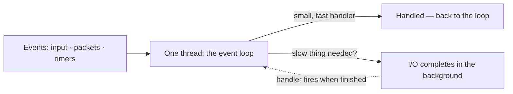

The flagship example is **JavaScript/Node.js**: one thread that juggles
interactions, timers, and I/O by offloading operations to the system kernel
whenever possible. Its one hard rule is **never block the loop**: a long
synchronous chunk stalls every queued task, because the loop yields only
*cooperatively*. Cooperative scheduling's signature failure applies — one
badly behaved task can consume all the CPU for itself — and re-entrancy plus a
single core complete the costs.

**When to reach for it.** I/O-heavy programs with many waiters but little
compute to parallelize: web servers, UI runtimes, and the *boundary* of game
engines. Engines take the *polled* branch of the clock decision — the frame
loop re-reads everything each tick ([01-common-structure.md](01-common-structure.md))
— but the input end of every engine is an event loop: DOOM drains OS events
through a central queue each frame ([Engines/doom.md](Engines/doom.md)); three.js
hands its clock to the application's `requestAnimationFrame` loop
([Engines/threejs.md](Engines/threejs.md)). If your loading screen stays
responsive or a network send does not freeze the game thread, you are depending
on event loops feeding the tick.

> **Come back to this.** One-thread programs use an **event loop**: handle the
> next event with a small, fast handler; never stand still waiting on a slow
> thing. "Don't block the loop" is law, because one long job starves everyone
> else.

## 3. Concurrency vs parallelism: one cook, many stoves

"Simultaneous" hides two ideas with exact names, both formal properties:

- **Concurrency** — several computations proceed during *overlapping time
  periods*. A **program-structure** property: a single-core machine can run a
  highly concurrent program with **zero** parallelism.
- **Parallelism** — *simultaneous execution on multiple processing units*. An
  **execution** property: impossible on a single-core processor.

The one-liner, widely credited to Rob Pike's talk *Concurrency Is Not
Parallelism*: **concurrency is about *dealing with* lots of things at once;
parallelism is about *doing* lots of things at once.** Coroutines make the
difference concrete: they provide concurrency but not parallelism, because
they do not execute multiple tasks simultaneously.

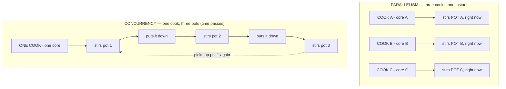

The properties are independent, and the *structural* decision comes first; then
Amdahl's law is the ceiling — speedup caps at the serial fraction
([03-hardware-and-performance.md](03-hardware-and-performance.md)). For a game team:
"the engine is multithreaded" is about parallelism; "the engine juggles many
systems" is its concurrency — separate knobs. A game can be bottlenecked with
cores sitting idle.

> **Come back to this.** **Concurrency = structured to deal with many things at
> once** (program property). **Parallelism = actually doing many things at the
> same instant** (hardware property). One core can host huge concurrency; many
> cores do not create it. Design the structure first; Amdahl sets the ceiling.

## 4. Who decides the order: preemptive vs cooperative

Someone must decide, every moment, which runnable thing runs next. Two styles,
and most of the field's vocabulary hangs off them:

- **Preemptive** — an external scheduler, usually the OS, interrupts a task
  without its cooperation to run something else later. This is how desktops
  and consoles run. The **threads** your engine uses — the smallest sequences a
  scheduler can manage independently — can be yanked off a core at any instant.
- **Cooperative** — each task decides when to hand over control: it
  voluntarily **yields**, or it runs forever. Coroutines are cooperatively
  multitasked; threads are typically preemptively multitasked.

The consequence lands on data. Preemptive threads share their process's memory
and switch at *unanticipated* moments, so shared data needs **locks** against
**race conditions** — bugs that are notoriously difficult to reproduce and
isolate. Cooperative units switch only at code-chosen points, so coroutine
programs can often avoid locking entirely.

**For a game team.** "That's a thread issue" means the preemptive scheduler
may strike at the worst moment, so code must lock; "let the async load finish"
means cooperative work that yields politely.

> **Come back to this.** **Preemptive** = the OS decides who runs next and
> interrupts anyone, anytime (threads; shared data needs locks). **Cooperative**
> = each task yields voluntarily (coroutines, fibers) — often lock-free, but one
> rude task can hang everyone.

## 5. Pause and resume: coroutines, yield, generators, async/await

Most names, least magic. In the kitchen: a recipe **suspended mid-step and
resumed later with everything exactly where you left it** — onion half-chopped,
pan at medium heat, order slip pinned up.

The formal name is **coroutine**: a function whose execution you can pause and
resume. Two properties define one: its local values *persist* between calls,
and when control returns, execution *carries on where it left off*.

In code terms:

- **`yield`** suspends execution, keeps position and local values, and hands
  control back; a later `resume` picks up right after the `yield`. The coroutine
  *chooses* when — cooperative by definition.
- **Generators** are the one-way subset (semicoroutines): they can yield many
  times, but control always returns to the *caller* — perfect for iterators
  and lazy streams. A generator is usefully remembered as an iterator that
  contains a frozen stack frame.
- **Async/await** is the same machinery in sequential-looking clothes: `async`
  marks a pausable function, `await` is the pause point, and the function
  suspends until the awaited work settles. Python, JavaScript, C#, and C++20
  all ship coroutine-family features; stackful coroutines (as in Lua) can pause
  from deep inside nested calls.

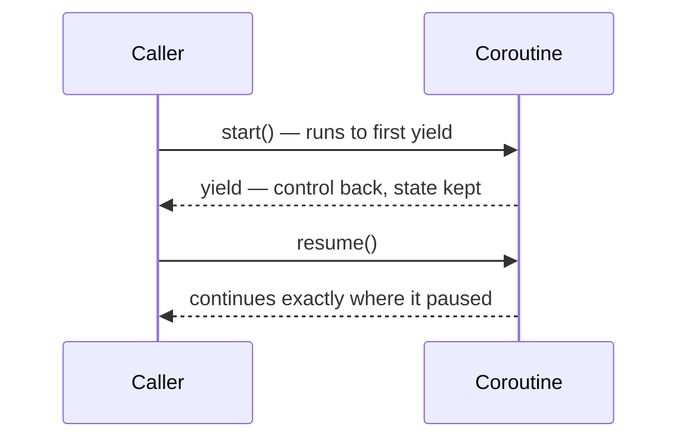

The family gives **concurrency, not parallelism**, and three traps come with
it: the **blocking hazard** (no preemption means a coroutine that calls a
genuinely blocking operation freezes the whole thread), **cooperative
starvation** (a busy-waiting task hangs everyone), and **no parallelism by
itself** (they share one real thread).

Games are a classic use in the literature: each actor has its own procedure,
but they voluntarily give up control to a central scheduler that runs them
sequentially — your tick/thinker list in coroutine clothes, and the shape
behind "wait until X, then continue" without freezing.

> **Come back to this.** Coroutines are **pause/resume with state preserved**:
> `yield` pauses, `resume` continues where it left off. Generators are the
> one-way (iterator) subset; `async`/`await` is the sequential spelling of the
> same machinery. Cooperative and cheap — but a blocking call freezes the
> thread, and they never give you parallelism alone.

## 6. Waiting on slow things: blocking vs non-blocking vs async I/O

I/O — reading disks, loading assets, talking to a network — is why most of this
machinery exists, because I/O is staggeringly slower than compute: during a
disk operation that takes ten milliseconds, a 1 GHz processor could have
performed ten million instruction cycles. Three easily-confused words:

- **Blocking (synchronous)** — start and wait until it finishes; the caller
  freezes and system resources sit idle.
- **Non-blocking** — returns immediately, but you keep checking (polling): the
  machine stays busy, but remembering the task is on *you*.
- **Asynchronous** — start it and get called back when done; the system or API
  notifies the program when the operation finishes. The doorbell rings.

A ladder of implementations moves "who waits" further from the caller:

| Style | What happens | Who waits / who works |
|---|---|---|
| **Blocking (sync)** | call blocks until I/O done | the caller waits; other resources idle |
| **Polling / non-blocking** | call returns now; you check again | you keep polling; wastes CPU |
| **select / poll / event loop** | watch many things at once; sleep until one is ready | one loop dispatches whoever is ready |
| **Callback / completion** | a "done" function is invoked per operation | the system calls *you* when finished |
| **Thread blocks for you** | one worker does the blocking I/O | that thread waits; the rest work |
| **Completion queue / port** | async I/O; completions queue up; you drain | no thread per op; the queue is the wake-up |

The sobering footnote is its own takeaway: all forms of asynchronous I/O open
applications up to resource conflicts and associated failure. Handlers are
re-entrant, buffers must outlive the call, and completion order is not request
order — the tax that made `async`/`await` the popular spelling of async I/O.

**For a game team.** this *is* loading screens, hitches, and lag spikes. A game
that waits synchronously for a giant texture freezes at the door; one that
streams asynchronously keeps rendering and slides the asset in later.

> **Come back to this.** To avoid freezing on slow I/O you can **block**, poll
> (non-blocking), **watch many things** (an event loop), run a **thread that
> blocks for you**, or let a **callback / `await`** notify you (async). As you
> climb, the burden moves from "the caller waits" to "the system notifies" —
> and every rung adds new hazards for the freedom.

## 7. The ladder: from one thread to many machines

Everything so far is rungs on one ladder of isolation and latency — the same
two questions at every rung:

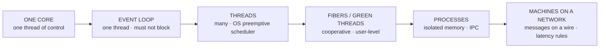

The rungs in real names:

- **Threads** — share their process's memory, so they share its data and its
  hazards; the OS schedules them.
- **Fibers / green threads / goroutines** — cooperative and lighter; several
  can run inside one thread, but a single blocking system call can block them
  all.
- **Processes** — isolated address spaces; they talk only through explicit
  mechanisms (pipes, shared memory, sockets), are expensive to create and
  switch, and a misbehaving thread crashes its whole process.
- **Machines on a network** — no shared memory at all, only packets: the
  slowest, least-trustworthy I/O there is. Distributed computing's founding
  lesson is the fallacies of distributed computing — "the network is reliable;
  latency is zero; bandwidth is infinite" — every assumption production will
  violate.

At machine scale, the sanity-preserving answer to "who decides the order" is
**one authoritative owner**: one node owns the shared state; everyone else
sends intent and gets verdicts. Real software drinks from several rungs at
once — Unreal is threads plus a task graph in one process, talking to other
machines over the network ([Engines/unreal-engine.md](Engines/unreal-engine.md)).

> **Come back to this.** One thread → event loop → threads → fibers → processes
> → machines: a ladder, each rung answering *who waits* and *who schedules*
> with more isolation and more latency. Real systems mix rungs; at the far end,
> give one node the authority.

## 8. UE5, part 1: the three-threaded frame and the task graph

Unreal Engine 5 is a clear real-world demonstration of *mixed* control flow
that names every rung ([Engines/unreal-engine.md](Engines/unreal-engine.md)).
Inside one process it runs **three cooperating threads**, paced like a relay
handing a frame down the line:

1. **Game thread** — ticks the world (`UWorld::Tick`), runs gameplay, physics
   bridging, input, and networking. Most authoritative simulation lives here.
2. **Render thread** — consumes the game thread's scene updates, culls, and
   builds the **render graph (RDG)**: the frame's dependency graph of GPU
   passes.
3. **RHI thread** — turns the render graph into GPU command lists through the
   abstract render hardware interface (RHI), then presents the swapchain.

On top runs a background **task graph**, where genuine parallelism happens —
physics and animation evaluation split into tasks across cores, so many CPU
cores feed the pipeline.

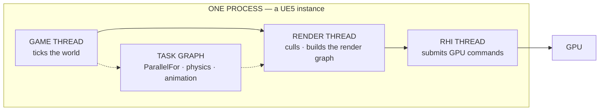

**For a game team.** the threads are different rooms, and the slowest one is
what you feel. The render thread lets the game thread start the next frame
instead of waiting at the door for drawing to finish — a deliberate frame of
pipelining latency.

> **Come back to this.** UE5 runs **game / render / RHI threads** (preemptive)
> plus a **task graph** for real parallelism. The threads are a relay: the game
> thread ticks and hands the scene to the render thread, which hands GPU work
> to the RHI thread. Ask "which thread is the bottleneck?" and you are already
> debugging.

## 9. UE5, part 2: latent actions, async loading, and World Partition

Every cooperative and event-driven rung has a first-class Unreal name.

**Coroutines in Blueprint: latent actions.** A **latent action** is a node that
*suspends* the Blueprint graph's execution until some condition, then *resumes*
with the graph's state intact — exactly like `yield`. Epic's docs describe the
famous **Delay** node as "a latent action with a delay (specified in seconds)"
([Epic: Delay node](https://dev.epicgames.com/documentation/unreal-engine/BlueprintAPI/Utilities/FlowControl/Delay?lang=en-US)).
While a graph is suspended on a `Delay`, nothing blocks: the engine keeps
ticking the whole world, and the node resumes downstream when its time passes.
(Calling latent actions "coroutines in Blueprints" is a teaching mapping; C++
has the same shape through `UBlueprintAsyncActionBase` subclasses that fire a
`Completed`-style delegate [unverified].)

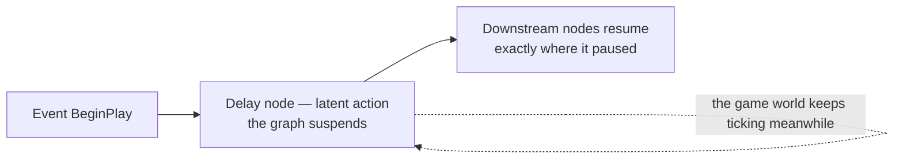

**Async I/O by name.** Epic's async-loading docs describe `SynchronousLoad`
as a blocking call that "could potentially stall your main thread for too
long," and `RequestAsyncLoad` as the doorbell: it loads assets asynchronously
and calls a delegate after completion
([Epic: Asynchronous Asset Loading](https://dev.epicgames.com/documentation/unreal-engine/asynchronous-asset-loading-in-unreal-engine?lang=en-US)).
Observable stats: `stat asyncLoad`, `stat streaming`, `stat levels`
([Epic: Stat Commands](https://dev.epicgames.com/documentation/en-us/unreal-engine/stat-commands-in-unreal-engine)).

**World Partition** (UE5's open-world streaming) raises the idea to world
scale: "an automatic data management and distance-based level streaming
system" storing the world as one persistent level of grid cells, streamed in
and out based on distance from a streaming source such as the player
([Epic: World Partition](https://dev.epicgames.com/documentation/en-us/unreal-engine/world-partition-in-unreal-engine)).

**For a game team.** "the frame hitched when I entered the zone" is often not
a rendering bug — it is the async-loading calendar. Hard references load
synchronously; soft references ring the doorbell.

> **Come back to this.** Cooperative coroutines have an Unreal name —
> **latent actions** like `Delay`: the node waits, the game does not. Event-
> driven I/O has names too: **async loading** (`RequestAsyncLoad`) and **World
> Partition** streaming. "Is the whole game frozen when I `Delay`?" — no.

## 10. UE5, part 3: server + clients, replication and RPCs

The network rung is the end of the ladder, and Unreal makes the decision
explicit: **the server is the boss.** Epic defines **Replication** as "the
process of synchronizing data and procedure calls between clients and servers"
([Epic: Networking and Multiplayer](https://dev.epicgames.com/documentation/en-us/unreal-engine/networking-and-multiplayer-in-unreal-engine)):
one dedicated server runs the authoritative simulation; clients send *input*
and receive *state snapshots*. **Remote Procedure Calls (RPCs)** are the
network's function-call bridge — functions called locally that execute on
remote machines — with types `Server` (runs on the server), `Client` (runs on
the owning client), and `NetMulticast` (runs on everyone relevant), and a
reliability choice: RPCs are "unreliable by default," so a dropped packet is
skipped unless a **reliable** RPC is used
([Epic: Remote Procedure Calls](https://dev.epicgames.com/documentation/en-us/unreal-engine/remote-procedure-calls-in-unreal-engine)).

The rhythm was pioneered by the id-networked engines: Quake III's server ran
the world at a fixed 20 Hz and shipped snapshots to clients, while each client
predicted its own movement by re-running the same shared movement code
([Engines/quake-iii-arena.md](Engines/quake-iii-arena.md)). Unreal wears the
same spine: server authority, a replicating world, client prediction covering
the gap.

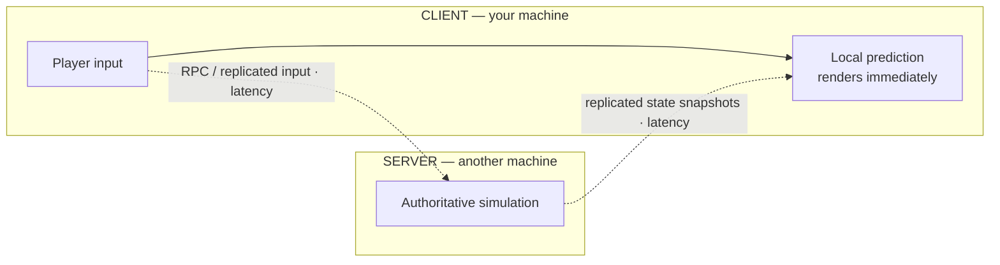

> **Come back to this.** At the network rung, **give one node the authority**:
> the server simulates, clients send intent and receive state snapshots, and
> **RPCs** are function-shaped messages that ride the wire. The lag you feel is
> the round-trip you are inside — `stat net` and Networking Insights show who
> waits on whom out there.

## 11. Reading "who runs when": stat unit and Unreal Insights

Unreal ships the tool this half of the chapter is about. **Unreal Insights**'
Timing Insights window displays CPU and GPU tracks on one timeline — so a task
wave in parallel, a coroutine yield, or the game thread idling while the render
thread catches up are each a visible block
([Epic: Unreal Insights](https://dev.epicgames.com/documentation/en-us/unreal-insights-in-unreal-engine)).
**Asset Loading Insights** reveals whether async loading respects package
priorities; **Networking Insights** exists to analyze, optimize, and debug
network traffic
([Epic: Networking Insights](https://dev.epicgames.com/documentation/en-us/unreal-engine/networking-insights-in-unreal-engine)).
Paired with **`stat unit`** — rows **Frame**, **Game** (game thread), **Draw**
(render thread), **GPU**, **RHIT** — the engine prints "who runs when" for you,
and its docs spell out the reading: find a bottleneck in the Game thread, the
Draw thread, or on the GPU ([Epic: Stat Commands](https://dev.epicgames.com/documentation/en-us/unreal-engine/stat-commands-in-unreal-engine)).

> **Come back to this.** Every rung has an Unreal name — game/render/RHI
> threads, task graph and `ParallelFor` [unverified], latent actions like
> `Delay`, async streaming and World Partition, server + replication. Ask
> "which thread?" or "why is this node waiting?" and `stat unit` plus Timing
> Insights answer: *who runs, who waits, who's parallel.*

## 12. The control-flow framework, assembled

Two questions pick the whole cabinet. **Who waits?** If the operation is fast
enough not to matter (a hash, a lookup), stay synchronous — zero machinery. If
it can take milliseconds or longer (disk, network, a remote tick), move the
wait: to a worker thread, an event-loop callback, or the async I/O pipeline.
**Who decides the order?** The OS (threads — preemptive, racy, parallel),
the runtime (fibers/coroutines — cooperative, cheap, freeze-prone), or a
protocol plus an owner (processes and machines — isolated, slow, disciplined)?

| Need | Reach for | Failure mode to watch |
|---|---|---|
| Many I/O waiters on one thread | Event loop + async I/O | a long task blocks everything; re-entrancy |
| CPU parallelism across cores | Threads / pool / task graph | races, deadlock, non-determinism |
| Many tiny state machines on one thread | Coroutines / `yield` / async-await | a blocking call starves the thread |
| Isolation of misbehaving code | Processes | expensive IPC; cache misses |
| Machines sharing truth | One owner + replication/RPC | network unreliability, latency, loss |

The **UE5 quickstart** turns that framework into commands and windows
([Engines/unreal-engine.md](Engines/unreal-engine.md)):

| Mechanism here | UE5 name | Where you see it |
|---|---|---|
| Threads (preemptive) | Game · Render · RHI threads | `stat unit`; Timing Insights |
| Parallelism | Task graph · `ParallelFor` [unverified] · `Async()` [unverified] | Timing Insights worker tracks |
| Cooperative coroutines | Latent actions — `Delay`, `UBlueprintAsyncActionBase` [unverified] | node graphs pausing mid-frame |
| Async I/O / streaming | Async loading · `FStreamableManager` [unverified] · World Partition | `stat asyncLoad`; Asset Loading Insights |
| Machines on a network | Dedicated server · replication · RPCs | `stat net`; Networking Insights |

The debugging habit: when something is slow, ask the engine *who is
waiting* — `stat unit` shows which row is long, Timing Insights which thread.

> **Come back to this.** Every concurrency complaint is the same two questions
> — *who waits?*, *who decides the order?* — and every mechanism is a tool with
> a known failure mode. Stay synchronous until the slow step bills you; move
> the wait to an event loop, a coroutine, a worker thread, or a completion
> queue; at machine scale give one node the authority.

---

## 13. State must live somewhere — and be owned

**State** is the passive substance software acts on: the numbers, structures,
and bytes that persist between operations ([00-software-is-the-medium.md](00-software-is-the-medium.md)).
A game has state everywhere — the world model, the render surface, the input
queue, the network connection. First law:

> **Every piece of mutable state needs an owner** — someone who can say "I am
> allowed to write this." If two participants can both write the same bytes
> with nothing in between, the machine cannot referee them: one catches a torn
> update and the two silently disagree. In C and C++ a *data race* is formally
> **undefined behavior**.

Ownership takes three shapes, and every mechanism in this half of the chapter
is one of them:

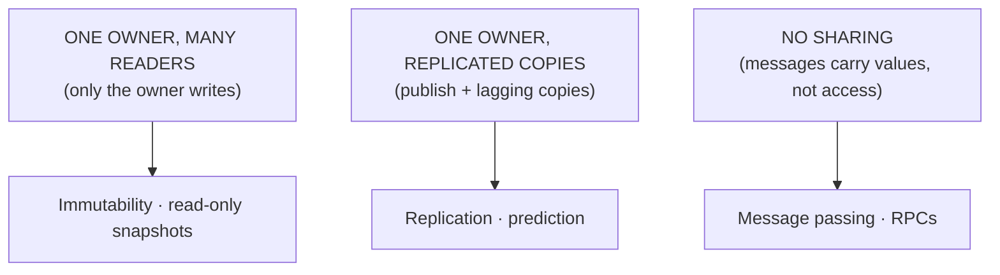

> **Come back to this.** State must live somewhere and be **owned**: one owner
> + many readers, one owner + replicas, or no sharing — only messages. Find the
> owner and the mechanism makes sense; find no owner and you have found the
> bug. Unowned shared mutable state is the source of the horror.

## 14. Stored vs live state: the serialization boundary

"State must live somewhere" splits into two very different *somewheres*.
Software works on **live state** — data in RAM that a running program reads and
writes every tick; the world model, the input queue, the render surface. But
state also outlives the process: **persistence** is exactly "the characteristic
of state that outlives the process that created it," achieved by storing it in
computer data storage. That storage is **stored state**: the save game, the
asset package, the config, the database row.

The two worlds are not merely fast and slow copies of the same thing; they are
different media. Stored state survives reboots, is orders of magnitude slower,
and can hold *plain data only* — no live pointers, no open handles, no running
threads. Live state dies with the process, is near-instant for the CPU, and is
pointer-rich. The boundary between them is **serialization** — the defined
operation that translates a data structure into a storable or transmittable
format and back, with pointers explicitly *unswizzled* (references become
names or positions) because pointer objects are too fragile to save.

> **A save file is not a photograph of memory — it is a transcription.** What
> crosses the stored/live boundary is always a *defined, serialized shape*
> chosen by the developer: which fields, in what format, with which references
> remapped.

Persistence techniques recur across software: a **system image** snapshots
whole state at once (hibernation, a state dump) but needs room; a **journal**
logs events before applying and replays on startup (undo/redo, crash-safe
autosave); a **dirty write** saves only what changed since the last save.

The two worlds collide with replication and streaming too: only *storable*
(serializable) values can cross a disk or network boundary — which is why game
replication properties are plain scalars and asset references, not live
pointers [unverified].

**UE5 landmarks.** Every engine lives at this boundary constantly: **`.uasset`
assets are stored state**, and cooked **`.pak` packages** are stored state
tuned for load speed ([Engines/unreal-engine.md](Engines/unreal-engine.md));
async loading is the disk-to-live movement with the game-thread doorbell, and
World Partition streams stored world cells into live memory based on distance
to a streaming source. Save games serialize chosen live state to disk — which
is why a "rewindable" save game does *not* exist for a simulated world:
rewinding means re-running the simulation, not restoring a snapshot
([02-world-models.md](02-world-models.md)).

> **Come back to this.** State lives in two worlds: **live** (RAM, dies with
> the process, fast, pointer-rich) and **stored** (disk, survives, slow,
> pointerless). The **serialization** boundary between them is a deliberate,
> developer-chosen transcription — never a memory photograph. Whatever can be
> serialized can also be replicated or streamed.

## 15. Shared memory: the whiteboard

A big whiteboard holds the lunch rotation, and *everyone* writes on it. When
software gives several running parts access to the same memory, that is its
whiteboard: **shared memory** is memory that may be simultaneously accessed by
multiple programs to communicate. Threads in one process share memory by
definition. Each core caches its own copy of a shared location, so hardware
**cache coherence** keeps the copies aligned — at real cost: hot locations cause
*contention* and nearby ones *false sharing*.

**What it protects.** Fast exchange of data too big or too hot to copy per use
— the game world is the archetype. **Costs:** coordination discipline,
contention, false sharing, coherence traffic — a frame waiting on the memory
bus is *memory-bound* work
([03-hardware-and-performance.md](03-hardware-and-performance.md)).

**Failure mode.** Race conditions — results nondeterministic, dependent on the
timing of interfering threads — whose visible symptom is the **torn read**:
catching half of a writer's update. Two threads both add 1 to the same number,
both read 0, both write 1 back: the answer is 1 instead of 2. Hard to reproduce
because the result is nondeterministic.

**UE5 counterpart.** The `UWorld` of actors is shared memory for gameplay —
the world-model store ([02-world-models.md](02-world-models.md)). The game→render
handoff shares it across threads: the game thread writes the `FScene` surface
(proxies), the render thread reads it
([Engines/unreal-engine.md](Engines/unreal-engine.md)).

> **Come back to this.** **Shared memory** is the one-whiteboard design: the
> fastest way to talk, and two colliding writers make a **race condition** — an
> erasure nobody intended. Use it for the world itself; pay for it in
> contention, false sharing, and discipline.

## 16. Message passing: photocopies in envelopes

The radical alternative to the whiteboard: **don't share the board — hand
someone a photocopy.** In software this is **message passing**: exchanging
information without sharing memory, over channels, buffers, or queues. No
address space is shared; **synchronous** passing blocks the sender,
**asynchronous** passing queues the message.

**What it protects.** Ownership and encapsulation — the **actor model**'s
creed: each actor has private state, actors affect each other only indirectly
through messaging, and there is no global state. A sender cannot tear anything,
because only copies of values are in flight — a network packet is a photocopy
traveling a wire.

**What it costs.** Copies cost, and networks drop things: arguments must be
copied into the message; async queues need buffer room (a full buffer forces
blocking or dropping); arrival order is not guaranteed. Failure mode: message
**loss**, **reordering**, **queue overflow** — in a game, *dropped intent*, a
command the simulation never saw.

**UE5 counterpart.** **Replication** is "the process of synchronizing data and
procedure calls between clients and servers"
([Epic: Networking and Multiplayer](https://dev.epicgames.com/documentation/en-us/unreal-engine/networking-and-multiplayer-in-unreal-engine)).
**RPCs** are function-shaped messages routed `Server` / `Client` /
`NetMulticast`, unreliable by default unless marked reliable
([Epic: Remote Procedure Calls](https://dev.epicgames.com/documentation/en-us/unreal-engine/remote-procedure-calls-in-unreal-engine)).
Epic lists the canonical uses — "playing sounds, spawning particles,
performing animations": the "play the chainsaw sound" event is paper marched to
every machine that must hear it. Input is message-shaped too: an **Input
Action** links the Enhanced Input system to your project's code
([Epic: Enhanced Input](https://dev.epicgames.com/documentation/en-us/unreal-engine/enhanced-input-in-unreal-engine)).

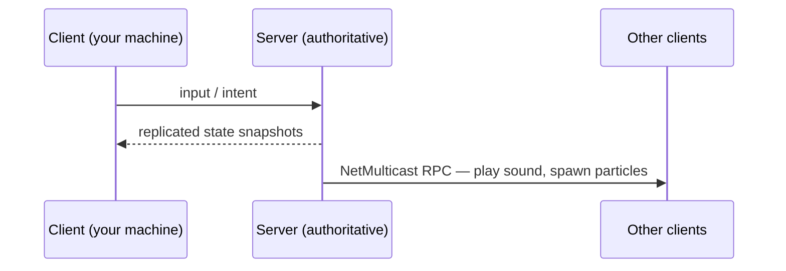

> **Come back to this.** **Message passing** replaces the shared wall with
> copies passed between participants: no races, no locks, works across machines
> — at the price of copying and unreliability. **RPCs** are message passing in
> function-call clothes. Use it at the network boundary, or wherever the actor
> model's "no global state" is the goal.

## 17. Mutation: locks, atomics, lock-free

Shared memory holds the data; **mutation** changes it. All mechanisms here
answer one question: when several threads reach the same bytes, how do we
change things without tearing? A discipline, cheapest → dearest:

- **Locks / mutexes** prevent state being modified by multiple threads at once
  — the marker-on-a-leash: only the holder writes, everyone else queues. They
  protect *invariants*, multi-step changes that must look atomic. They cost
  contention, per-access overhead, **priority inversion**, and worst of all
  **deadlock**, and compose poorly into larger programs.
- **Atomic operations** are the hardware's smaller answer: single operations
  that appear to happen instantaneously, so nobody observes a half-done change.
  **Compare-and-swap** (write a new value only if the location still holds the
  expected old one) and **fetch-and-increment** power *retry loops*. They
  protect single-word invariants without a lock, but span one word only.
- **Lock-free algorithms** are non-blocking: no thread is frozen by a crashed
  holder. They protect *progress* and cost famously hard correctness (retry
  loops, the ABA problem, memory reclamation) — use them only where a lock
  would block a hard deadline.

**The determinism connection.** Preemptive threads interleave at
scheduler-chosen moments, so which interleaving won becomes part of the
result; **fixed timesteps** restore repeatability, which is why networked games
use them ([01-common-structure.md](01-common-structure.md)).

**UE5 counterpart.** UE5 keeps **one owner** — the game thread — as the author
of world mutation instead of a lock pile; the task graph parallelizes by
*partitioning* state, and Chaos steps physics in fixed internal substeps, heir
of DOOM's fixed 35 Hz tic ([Engines/unreal-engine.md](Engines/unreal-engine.md),
[Engines/doom.md](Engines/doom.md)).

> **Come back to this.** A discipline, cheapest→dearest: **atomics** protect
> one word via CAS retries; **locks** protect multi-step invariants but can
> deadlock and invert priority; **lock-free** protects progress on critical
> paths and costs your sanity. The cheapest answer is often to not share at all:
> one owner, fixed timestep.

## 18. Immutability: never change what you share

Races exist because the whiteboard *changes under people's hands*. A different
design removes the problem by making change hard. The **mutable** way edits one
card in place; the **immutable** way never crosses out a step — each change
produces a *new* version, the old card remaining as it was. An **immutable
object** cannot be modified after it is created; because nothing can change
under you, multiple threads can act on it without concern of it changing —
immutable objects are *inherently thread-safe*.

**What it protects.** Sharing *without coordination* — no lock, no atom, no
torn read is possible when nothing can change; it buys free snapshots and
retry-friendly state. **Costs:** allocation and churn — every logical change
allocates a new version. Two tricks make it affordable:

- **Copy-on-write (COW)** shares the data until one tries to modify it, making
  a real copy only then — how OS virtual memory makes `fork()` cheap.
- **Persistent data structures** always preserve the previous version when
  modified, with old and new *sharing* unchanged parts via path copying.
  ("Persistent" here means versions survive; nothing to do with disks.)

**Failure mode.** Not torn reads — those are impossible; the classic bugs are
**stale references** and **allocation storms** that blow frame budgets. One
mutator breaks the deal.

**UE5 counterpart.** The world is mutable at its core; immutability sits at
read-mostly edges: static level data never changes at runtime
([Engines/doom.md](Engines/doom.md)); content ships as read-mostly assets
(`.uasset` → cooked `.pak`), and the Derived Data Cache is written once then
*only read* ([Engines/unreal-engine.md](Engines/unreal-engine.md)); networked
clients keep **snapshot rings** of entity state for interpolation — deliberate
lagged copies of authoritative state
([Engines/quake-iii-arena.md](Engines/quake-iii-arena.md)).

> **Come back to this.** **Mutable** state is in-place cross-outs: simple, but
> every shared write is a potential race. **Immutable** state cannot change
> after creation — naturally race-free and thread-safe — at the price of copies,
> which **copy-on-write** and **persistent data structures** make affordable.
> Reach for it where sharing is wide and writes are rare.

## 19. Replication and consistency: copies that disagree on purpose

Shared memory is one board; message passing is a paper route. **Replication**
powers online games: *a copy of the board on every desk, updated on a
schedule.* Formally, replication maintains multiple copies of data to ensure
consistency across redundant components — and its replicas may serve stale data
due to **replication lag**.

**The desk-copy analogy.** A copy of the production plan is pinned at each
desk; a courier replaces every copy at noon. At 12:30 your plan is the noon
copy, your neighbor's is yesterday's — everyone reads a real plan, they just
disagree for a while. That is **staleness**; the courier's schedule is
**replication lag**. A **consistency model** is the contract for how long
disagreement may last — what order and visibility of updates you may rely on.

The spectrum from tight to loose:

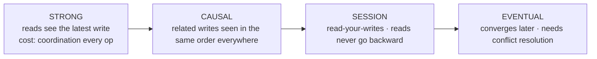

- **Strong** — **linearizable** or **sequentially consistent**: executions
  look as if all operations ran in some single order, as though there is one
  copy of the data. The most expensive guarantee: coordination on every
  operation. **Causal** weakens it: only causally related writes must order
  everywhere.
- **Eventual** — if no new updates are made, all reads eventually return the
  last updated value. Real systems add **session guarantees**:
  **read-your-writes** (own writes visible to later reads) and **monotonic
  reads** (never backward).

**The clean view of CAP.** The CAP theorem says a distributed data store can
provide at most two of **Consistency** (every read gets the most recent write
or an error), **Availability** (every request gets a response), and **Partition
tolerance** (keep operating despite dropped or delayed messages). The clean
formulation: *during a partition, choose — serve the read from an isolated node
(available, possibly stale) or refuse to answer (consistent, not available).*
In normal operation you can have both. CAP says nothing about latency,
"Consistency" means linearizability, and most highly available systems do not
meet its strict definition — so stop labeling stores "CP or AP"; name the
consistency level and acknowledge staleness.

**Staleness is bounded by replication lag.** With replication, staleness is
the normal state. Tight guarantees need coordination that travels the
round-trip (wide-area systems are typically asynchronous because of latency);
session guarantees are the one-reader fix; and production systems give
*staleness bounds* — "a read is at most N updates old" — to contract on.

**UE5 counterpart.** The engine *is* this philosophy: one dedicated server
runs the authoritative simulation, and Replication ships state down. At scale,
the **Replication Graph** routes "which copy to whom" — with 100 connected
players and about 50,000 replicated Actors, the naive per-actor check would
bottleneck the server's CPU, so nodes precompute per-client lists and keep
dormant actors quiet ([Epic: Replication Graph](https://dev.epicgames.com/documentation/en-us/unreal-engine/replication-graph-in-unreal-engine)).
**World Partition** is the data-plane sibling but *not* divergent replication:
it loads one persistent world streamed near you ([Epic: World Partition](https://dev.epicgames.com/documentation/en-us/unreal-engine/world-partition-in-unreal-engine)).

> **Come back to this.** **Replication** = intentional copies: one
> authoritative source, lagging copies that buy availability, latency, and
> parallelism. **Consistency models** are the contract for how long copies may
> disagree — from **strong** (never visibly) to **eventual** (converge later).
> **CAP** is the bill: during a partition, answer stale or wait for current.
> Bound the lag, name the guarantee, stop debating CP vs AP.

## 20. Stale on purpose: the price of running at the same time

Everything so far keeps state *right*. This section is the opposite trick, and
the heart of why many cores help at all:

> **Writers and readers can run in parallel only if they are allowed to
> disagree for a while.** Demand that a reader see exactly the latest write and
> the writer must stop to wait. Production systems make disagreement *bounded,
> invisible, and deliberate* — and spend that budget on width.

State is **stale on purpose** when a consumer must read a *complete old* state
— never a half-updated one — bounded by a **staleness budget** (one frame, one
tick, one round-trip). Four instances of one pattern:

**1. Double buffering.** A writer fills a back buffer, a swap presents it, and
the writer starts the next behind it — the theater projector: the reader always
sees a complete (though perhaps old) frame. DOOM's `I_FlipScreen` was the same
idea in miniature in 1993 ([Engines/doom.md](Engines/doom.md)).

**2. Scene proxies and deferred commands.** The engine-wide rule: "the
renderer is a downstream consumer of state, never inside the simulation"
([01-common-structure.md](01-common-structure.md)). The game thread writes the
renderer-facing `FScene` (proxies + render commands) and starts the next
frame; the render thread draws the scene it already has — a frame behind
([Engines/unreal-engine.md](Engines/unreal-engine.md)). The writer side has the
same shape: OpenEngine's ECS queues world changes as **deferred commands**
flushed once per frame ([Engines/openengine.md](Engines/openengine.md)); Redot's
thread-safe message queue flushes scheduled calls mid-frame
([Engines/redot-engine.md](Engines/redot-engine.md)).

**3. Client prediction.** In Quake III, the server simulates authoritatively
at a fixed 20 Hz and ships delta snapshots; each client predicts its own
movement by re-running the same shared movement code, renders its prediction,
then reconciles to the server's correction when it arrives
([Engines/quake-iii-arena.md](Engines/quake-iii-arena.md)). Prediction is
double buffering pointed forward in time — a stale or speculative copy, with
the round-trip as the lag the buffer hides.

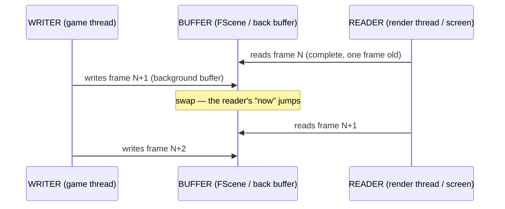

**4. Streaming.** Streaming runs the bet further: *the second copy does not
exist yet*, and the reader is built to wait. UE5's World Partition
streams the world in grid cells based on distance from a streaming source
([Epic: World Partition](https://dev.epicgames.com/documentation/en-us/unreal-engine/world-partition-in-unreal-engine));
async asset loading fires a completion callback instead of blocking
([Epic: Asynchronous Asset Loading](https://dev.epicgames.com/documentation/unreal-engine/asynchronous-asset-loading-in-unreal-engine?lang=en-US)).
Nobody blocks a thread on disk; the price is a pop, a missing asset, a cell
streaming in.

Three rules make staleness safe at any scale: set the **staleness budget
explicitly** (one frame, one tick, one round-trip); **never let the
disagreement be torn** (the reader always sees a complete old version); and
**resolve at a boundary** — the swap, the flush, the tick, the received
verdict — where lag becomes invisible correctness instead of a visible glitch.

> **Come back to this.** Parallelism is bought with authorized disagreement.
> **Double buffering**, **scene proxies / deferred command queues**, and
> **client prediction** are the same pattern at four scales: a writer builds
> the future while a reader consumes the past, and a named boundary closes the
> window so nothing is ever torn. **The staleness is the price that buys
> parallelism; the swap point is the only lock.**

## 21. Multiplayer: state replication at the highest stakes

Everything above converges on the hardest case: taking the world model — the
state store every engine runs — and making several machines simulate the same
world at once. Multiplayer is state replication in its purest form: the thing
replicated is not a database row but *the simulation itself*. The chapter's
three questions become the whole discipline: whose memory (no two machines
share memory, so every participant holds a private copy), whose copy is
authoritative (someone must be truth — the single biggest architecture choice
in the game), and who may be wrong and for how long (with latency in
milliseconds-to-round-trips, everyone reads slightly wrong state most of the
time).

The base situation: unlike a local game, an online game has several parallel
simulations — one per player — and a remote input for frame N arriving while
you are on frame N+k produces desynchronization. Every architecture below is
an answer to it.

```mermaid
graph TB
    subgraph AUTH["MASTER / CLIENT — replicate STATE"]
        S[Server: authoritative world] -->|state snapshots| C[Client predicts + reconciles]
        C -->|input / intent| S
    end
    subgraph LOCK["P2P LOCKSTEP — replicate INPUTS"]
        P1[Identical simulation] <-->|inputs only, tiny packets| P2[Identical simulation]
    end
    subgraph ROLL["ROLLBACK (GGPO) — predict + fix"]
        R1[Predict the opponent's input] -->|simulates now| R2[Renders immediately]
        R2 -->|real input arrives, mismatch| R3[Rolls back to the last correct frame]
        R3 -->|replays corrected inputs| R2
    end
```

- **Architecture A — master/client (replicate state).** The server owns the
  master copy of the world; clients send intent (input) and receive state
  snapshots; client prediction and reconciliation cover the gap. The price: the
  server is a choke point, and the wire carries the whole world's changes. This
  is Unreal's default.
- **Architecture B — peer-to-peer lockstep (replicate inputs).** Every machine
  runs the same simulation, and instead of replicating what happened they
  replicate the *inputs*. This is the classic RTS model (Age of Empires is the
  cited example): tiny packets on the wire and no server choke point — but it
  demands **byte-for-byte determinism**, and if one client falls out of step,
  the desynchronization compounds and can be unrecoverable.
- **Architecture C — rollback netcode (GGPO).** Fighting games push the
  peer-to-peer idea to its limit. Instead of waiting for every player's input
  (delay-based netcode, which freezes when the slowest arrives), each machine
  *predicts* the remote player's input, simulates immediately, and — when the
  real input arrives and does not match — rolls back to the last correct frame
  and replays the corrected inputs. It is "highly similar to client-side
  prediction, but applied to a peer-to-peer setup," and it requires the engine
  to be able to turn back its state.

**The what-to-sync decision is the heart of the difficulty.** You cannot sync
everything: bandwidth and CPU are finite, so the design is literally "choose
which state to replicate, how often, and how precisely." **Tick rate** is the
simulation's clock for networking — the server equivalent of frame rate — and
lower rates increase sync latency; FPS games run roughly 20–128 ticks/s
depending on title. **Frequency and priority are budgets**: some games
prioritize vital communications while limiting the frequency and priority of
less important information, and engines may reduce the precision of some
values to save bandwidth — exactly Unreal's `UPROPERTY(Replicated)` +
Replication Graph story. What a player cannot wait for gets
predicted; what they can (cosmetics, distant objects) gets interpolated or
streamed.

**Failure modes** are the chapter's vocabulary, real:

- **Desync** — two simulators in lockstep land in different states; in lockstep
  it may compound and be unrecoverable. The fix is determinism audits: hash the
  world each tick, compare across machines, find the first divergence.
- **Rubber-banding** — a reconciliation correction arriving as a visible jump:
  a **blown staleness budget**, either a wrong prediction or a budget too small
  for the round-trip.
- **Prediction errors** — rollback handles them by rewinding and replaying;
  the cheaper alternative is "wait for the slowest" (delay-based, which
  freezes). Rule of thumb: predict the short-lived and local, tolerate lag on
  the long-lived and remote.

Where UE5 sits: the engine's default is master/client replication — the server
is authoritative and state flows down
([Epic: Networking and Multiplayer](https://dev.epicgames.com/documentation/en-us/unreal-engine/networking-and-multiplayer-in-unreal-engine))
— but Unreal has also hosted full rollback implementations (fighting games
using GGPO on Unreal), showing the architectures are layers, not either/or.

> **Come back to this.** Multiplayer is state replication of the simulation
> itself. **Master/client replicates state** (server owns truth; clients
> predict and reconcile). **Peer-to-peer lockstep replicates inputs** (cheap,
> but demands byte-for-byte determinism). **Rollback (GGPO) predicts inputs and
> rewinds when wrong.** The difficulty is the what-to-sync decision — tick
> rate, frequency, priority, and precision are all budgets — and the failure
> modes are the chapter's own: desync (a determinism break), rubber-banding (a
> blown staleness budget), and the predict-vs-wait trade.

## 22. Deciding the state strategy: four questions, one table

Four questions, in order, pick the whole table. **Who may write this state?**
Nobody after load → immutable (baked content). Exactly one → single owner;
everyone else reads or sends intent (the game thread, the authoritative
server). Many → *synchronize* (share + locks) or *replicate* (copies + a
consistency story). **How old may a reader's view be?** Latest-and-total-order
→ strong consistency or one owner. Own writes always visible → session
guarantees. Old-but-converging → eventual consistency with a staleness bound.
**How far apart are readers and writers?** Same machine → shared memory usually
beats copying; different machines → replication, and the question becomes which
consistency level. **What does the failure mode cost?** A torn read of a
counter is a bug; a lost purchase is a lawsuit; a stale replica of another
player's health is a design choice. Price the failure before choosing.

| Strategy | What it buys | Failure mode to watch | UE5 name |
|---|---|---|---|
| **Single owner** (no sharing) | zero synchronization; determinism | throughput ceiling — everything serializes | `UWorld::Tick` on the game thread; fixed-timestep sim |
| **Shared memory + locks/atomics** | fastest shared data on one machine | races, deadlock, contention, torn reads | game/render/RHI threads hand `FScene`; task graph |
| **Immutable / COW / persistent** | thread-safe by construction; free snapshots | allocation cost; stale snapshot | cooked/baked content; Derived Data Cache |
| **Message passing / RPC** | ownership moves; no shared corruption | copy cost; latency; lost or duplicated messages | `Server`/`Client`/`NetMulticast` RPCs |
| **Single-leader replication** | strong-ish ordering; simple conflicts | leader bottleneck; follower lag | server-authoritative networking; `UPROPERTY(Replicated)` |
| **Eventual / bounded-stale replication** | lowest-latency reads; availability | conflicts; stale reads; no total order | replicated cosmetic/transient state; `stat net` |
| **P2P lockstep (replicate input)** | tiny packets; no choke point | absolute determinism; one desync compounds | RTS-style peer-to-peer architectures |
| **Rollback netcode (GGPO)** | near-zero input latency in 1v1 | needs engine state rewinding | engine-side rollback layer on top of replication |
| **Stale-on-purpose buffering** | producer/consumer parallelism | reader sees an old value; extra memory | swapchain; `FScene` + proxies; client prediction |

> **Come back to this.** Four questions — who writes, how old may a reader's
> view be, how far apart are they, what does a failure cost — pick the whole
> strategy table. A game engine demonstrates all of it at once: one owner,
> shared threads, replicated worlds, copies stale on purpose so no part waits
> on another.

## 23. Debugging state: what the UE5 tools tell you

The same windows that read *time* read *state*.

- **`stat unit`** — the fastest "whose state is hot" probe. `Frame ≈ Game`
  says the **owner of the world state** (the game thread) is the constraint;
  `Frame ≈ Draw` says the **reader** (render thread on `FScene`) is. When the
  cost is *copies* — immutability churn, packet buffers, snapshot rings — the
  memory views and the hitch log point at allocation pressure
  ([Epic: Stat Commands](https://dev.epicgames.com/documentation/en-us/unreal-engine/stat-commands-in-unreal-engine)).
- **Timing Insights** — draws the writer/reader pipeline physically: the
  render thread a frame behind the game thread is a visible, repeated offset; a
  thread parked on a critical section shows as a block doing no work
  ([Epic: Unreal Insights](https://dev.epicgames.com/documentation/en-us/unreal-insights-in-unreal-engine)).
- **`stat net`** — how much *replicated state* is moving. High bandwidth +
  property churn means the replica set outgrew the staleness budget; a stalled
  count means the authority is not delivering.
- **Networking Insights** — Packet Overview shows every packet over time;
  Packet Content drills into replicated objects, properties, and remote
  function calls down to how many bits each property wrote
  ([Epic: Networking Insights](https://dev.epicgames.com/documentation/en-us/unreal-engine/networking-insights-in-unreal-engine)).
- **Replication Graph** — which copy is computed for which client, per node; a
  client missing updates is an ownership question
  ([Epic: Replication Graph](https://dev.epicgames.com/documentation/en-us/unreal-engine/replication-graph-in-unreal-engine)).
- **Unreproducible hiccups** — the data-race signature: nondeterministic
  timing, spike-prone `stat unit` rows, "worked on my machine."

The one-sentence reading method: **a stall is news about a copy — stale,
unreachable, or slow.** Decide which of the three it is, map back to the owner,
and the tool row falls out.

> **Come back to this.** Debugging state = asking *which copy is slow or
> wrong*, then reading the tool that measures it. `stat unit` splits
> world-owner from render-reader; Timing Insights draws the staleness window;
> `stat net` / Networking Insights meter the replicas; the Replication Graph
> shows who is entitled to which copy; unreproducible hiccups usually mean too
> many writers on shared state.

## 24. Facts, provenance, and where to go next

**Sources and verification.** This document condenses the two vault notes that
first covered this material — the control-flow chapter ("Who Runs When?") and
the state chapter ("Whose State Is It?") — down to their working core.
Definitions follow the same references those notes used: Wikipedia survey
articles, IBM and Martin Kleppmann for the clean CAP treatment, and Epic's
official documentation for every UE5 mapping. Every external link here is an
Epic official page, cited inline where each claim lands.

Engine claims follow this folder's case studies — DOOM's 35 Hz tic and
`I_FlipScreen` ([Engines/doom.md](Engines/doom.md)), Quake III Arena's 20 Hz
server and prediction ([Engines/quake-iii-arena.md](Engines/quake-iii-arena.md)),
three.js's app-owned clock ([Engines/threejs.md](Engines/threejs.md)),
OpenEngine's deferred commands ([Engines/openengine.md](Engines/openengine.md)),
Redot's message queue ([Engines/redot-engine.md](Engines/redot-engine.md)), and
UE5's three-threaded frame, task graph, and World Partition
([Engines/unreal-engine.md](Engines/unreal-engine.md)). Structural framing is
mapped in [01-common-structure.md](01-common-structure.md) and
[02-world-models.md](02-world-models.md).

**Marked interpretation.** The kitchen/whiteboard/desk-copy analogies; the
"ladder" organization; "staleness is the currency that buys parallelism";
"latent actions are coroutines in Blueprints"; prediction as double buffering
at network scale; the decision-framework tables and their failure-mode
columns; and the "stall = stale/unreachable/slow copy" reading method are
teaching lenses from the source notes, not terms the engines use themselves.
Design-rule readings such as "the server is the boss" are likewise framing on
top of documented behavior.

**Carried [unverified] marks.** These Unreal internal API names come from the
documentation-based UE5 case study, not a verified primary source, and are
marked inline wherever they appear: `ParallelFor`, `Async()`,
`FStreamableManager`, `FLatentActionManager`, `UBlueprintAsyncActionBase`. The
claim that replication properties are plain scalars and asset references, not
live pointers — that `UPROPERTY(Replicated)` holds serializable data, not
object addresses — is likewise [unverified]; it follows from the serialization
requirement in section 14 but was not source-confirmed.

**Where to go next.** This is the second document in the chapter's reading
order. Read [03-hardware-and-performance.md](03-hardware-and-performance.md) first if
you have not — it establishes the frame budget and the time-bound story this
chapter leans on. Continue to [05-schemas-and-formats.md](05-schemas-and-formats.md),
which asks how the data that moves through these threads and copies is shaped.
And keep the flagship [00-software-is-the-medium.md](00-software-is-the-medium.md)
beside you: it argues why software as a medium matters, and this chapter
applies it to the flow of control and the state it acts on.

> **Come back to this.** One question — *who runs, who waits, who decides,
> whose copy is the truth?* — recurs from the one-cook kitchen to a
> hundred-player server. When your feature hitches or two machines disagree,
> ask it as a control-flow or state question: was it waiting on data, on a
> thread, on a latch, or on another machine? Know who runs and who owns, and
> you have stopped guessing.