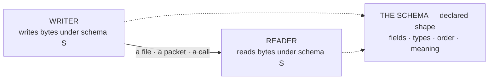
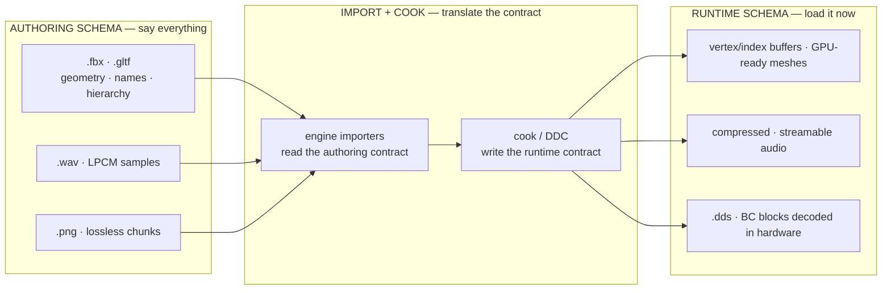
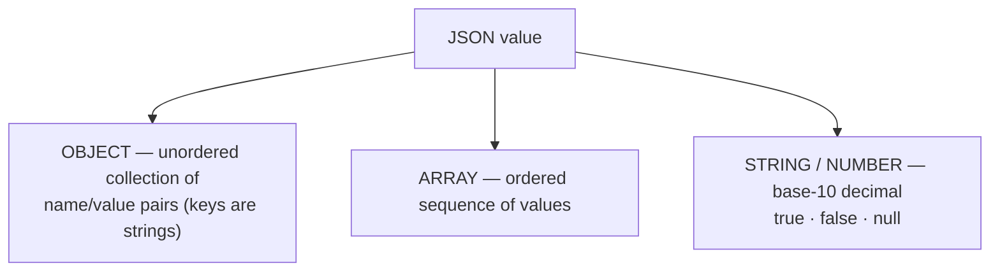
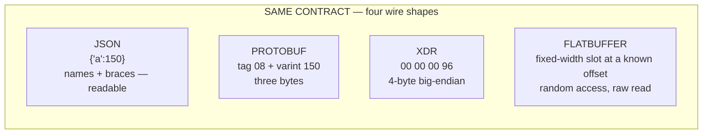
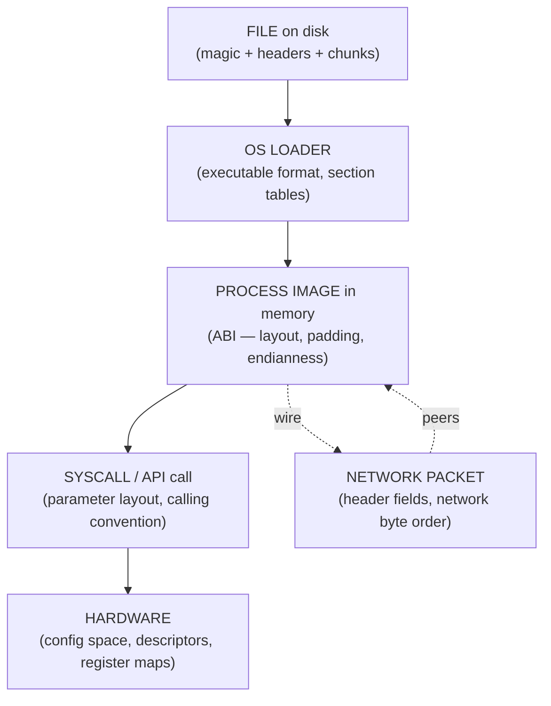
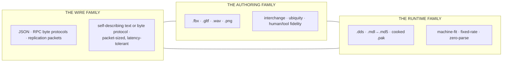

# Schemas and Formats — The Contracts Every Read Must Keep

This is the schemas-and-formats chapter of [00-software-is-the-medium.md](00-software-is-the-medium.md).
It is the **third** in the new chapter reading order — after
[04-concurrency-and-state.md](04-concurrency-and-state.md) (who runs when, whose
copies exist) and before [07-operating-systems.md](07-operating-systems.md) (the OS
as boundary keeper). It asks the question underneath all the family's questions:
**what shape are the bytes?**

State must live somewhere, and copies must cross boundaries — but every byte
that does so is governed by a **schema**: the declared structure, types,
order, and meaning of the data, the contract a writer and a reader agree to
before a single byte means anything. No programming is required: a designer
exports settings, an artist waits on an import, "the lobby packet looks wrong"
— every one of those is a schema question in work clothes.

> **The one idea.** No data ever works without a schema — a declared
> shape-and-meaning contract shared by a writer and a reader — and every format
> that exists (`.fbx`, `.gltf`, `.wav`, `.png`, `.dds`, `.mdl`, JSON, a byte
> protocol, an ABI, a hardware header) is the shape its *job* required, not a
> fashion choice. Every section below ends with a boxed **come back to this**.

## 1. What a schema is: the form, the mold, the handshake

Software is two substances — **code** (the active rules) and **data** (the
passive values). The code half gets the glory; the data half works *only
because every byte has a declared meaning*. A **schema** is that declaration,
in three parts:

1. **Fields and types** — *what exists* and what kind of thing it is. A few
   examples: a vertex is floats for position, normal, and UV; a WAV declares
   sample rate, channel count, and bits per sample.
2. **Order and layout** — the *byte recipe*: where each field sits, how many
   bytes it takes, and in what **endianness** (RIFF stores multibyte values
   little-endian, on the x86 order of the machines that made it). Move a field
   and every reader breaks — the contract was violated, not the file.
3. **Rules and conventions** — *what values mean together*. A PNG chunk type
   is four letters whose *case* is a bit field saying "critical," "public,"
   "safe to copy." Meaning is part of the schema; a format that lets readers
   skip unknown chunks is a schema with a **versioning policy** built in.

Three everyday analogies make the idea sticky:

- **The blank form.** The Post Office doesn't hand couriers loose scraps — it
  supplies forms with named boxes in a fixed order, and every office holds the
  same blank. The schema is the blank; the bytes are the filled-in form; a form
  filled out on a blank the reader doesn't recognize is a protocol mismatch.
- **The mold.** Data without a schema is melted metal with no mold — only
  meaningful to the pot that produced it. A **serialization format** pours a
  program's in-memory objects into a shape that can be stored or transmitted;
  **deserialization** is the second pour back out — reconstructing a
  semantically identical clone.
- **The handshake.** Two people who've never met can cooperate if both know
  the same grip. **Magic bytes** at a file's start are a literal handshake —
  `89 50 4E 47` for PNG, `MZ` for Windows executables, `PK 03 04` for ZIP — the
  file introduces itself so the reader can pick the right contract.

The most important consequence is the **contract reading**: a format is a
promise between the program that writes and every program that will ever read,
softened — not weakened — by versioning policy.

One rule recurs in every format this chapter meets: **no live pointers on the
wire or in files — only names, IDs, and offsets.** Memory layouts do not travel;
serialization unswizzles them ("primitive pointer objects are too fragile to
save"). Unreal's `UPROPERTY(Replicated)` properties replicate values and asset
references, never object addresses.



> **Come back to this.** A **schema** declares the fields, types, order, and
> meaning of data — the contract between every program that writes and every
> program that reads. The data half of "software is data and code" works only
> because every byte is governed by such a contract. No pointers travel — only
> names, IDs, and offsets.

## 2. Two worlds of game data: authoring vs runtime

The weapon chain from the flagship reference — *design → data production →
engine integration → gameplay code*, where the last stage only plays back what
the earlier ones produced — is a **chain of schemas**: stage two's output is
".fbx / .gltf, .wav, textures"; stage three "registers assets and sets up
loaders and importers." Read that chain as a chain of formats, and every format
belongs to one of two worlds:

- **Authoring / interchange formats** — created by DCC tools to be *edited and
  exchanged*: general, re-editable, information-rich. Their reason to exist is
  that humans and several tools must still change them tomorrow.
- **Runtime / cooked formats** — created by the conversion step ("import,"
  "cook," "bake") to be *consumed* by the playing game: fast to load,
  fixed-layout, compressed for the target, cache-friendly, GPU-native. Their
  reason to exist is speed and determinism inside the frame budget.

The engine's **asset and cache system** — a WAD, a `pk3`, a `pak`, a PCK, or a
`.uasset` store: only the container name changes — is the seam between the
worlds. Every handoff changes the owner and the shape of the data.

> **Come back to this.** Formats come in two worlds: **authoring formats** say
> everything and stay editable; **runtime formats** are loaded by the engine,
> built for speed, cache friendliness, and the GPU. The asset pipeline is the
> machine that translates the first world into the second.

## 3. The authoring side: formats designed to say everything

- **`.fbx` the de-facto interchange standard nobody openly owns.** FBX grew out
  of Kaydara's **Filmbox**, originally motion-capture recording software whose
  first format was a "binary dump" of its own libraries. In 1996 Filmbox 1.5
  shipped the object-based FBX format; other 3D packages adopted it quickly,
  and it passed to Autodesk via Alias in 2006. The twist is the schema itself:
  FBX can be binary or ASCII, and *both* are effectively undocumented — even
  the Blender Foundation publishes an unofficial spec of the binary form. The
  industry's most-used 3D interchange format is a proprietary schema everyone
  reverse-engineers (engines reach for assimp, an FBX2glTF fork, the open
  `ufbx`). Engines adopted it anyway because it was already in every authoring
  tool. What FBX is great at is exactly what a runtime hates: a full scene
  graph — names, hierarchies, materials, arbitrary transforms.
- **`.gltf` / `.glb` — the "JPEG of 3D," designed against runtime.** glTF is
  the Khronos Group's open standard for 3D scenes, explicitly intended to
  minimize file size and runtime processing. The file is JSON (`.gltf`) or
  binary (`.glb`), with binary buffers inside, and everything — nodes, meshes,
  materials, textures — is stored in **arrays referred to by index**, which
  gives loaders cheap random access: a silhouette of the runtime world inside a
  *delivery* format. glTF 2.0 (2017) standardized PBR materials and the `.glb`
  form; an extension registry (KTX2 textures, Draco meshes) bolts on new
  schemas. It still lives on the interchange side — but designed with the
  runtime already in the requirements.
- **`.wav` — a container that says "chunks you can ignore."** WAV is an
  application of **RIFF**, a generic chunk container: a chunk is a 4-byte ASCII
  identifier, a 4-byte little-endian length, and the chunk data. The mandatory
  `fmt ` chunk declares the **contract of the samples** (encoding, channels,
  sample rate, bits per sample); the mandatory `data` chunk holds them; every
  other chunk is optional metadata a reader must skip. A tagged format can be
  extended later while keeping backward compatibility — WAV's endurance.
- **`.png` — RFC 2083, where a letter's case means "safe to skip."** PNG is the
  flagship *specified* chunk schema: length (4 bytes, big-endian — the opposite
  of WAV!), type, data, and a CRC. `IHDR` must be first and declares width,
  depth, color type, filters, interlace; `IDAT` holds the image; `IEND` closes
  it. The elegant trick: the case of the first letter of the chunk type says
  critical or ancillary, and "a program encountering an ancillary chunk that it
  does not understand can safely ignore it" — private metadata rides along
  without breaking old readers. PNG also compresses losslessly through
  per-line filters and DEFLATE, designed for Internet transfer, not print.

| Format | Origin | Why the authoring world loves it | Why a runtime would hate it |
|---|---|---|---|
| **`.fbx`** | Kaydara 1996; Autodesk since 2006 | universal interchange; re-editable; full scene graph | reverse-engineered; heavy; no layout guarantees |
| **`.gltf`/`.glb`** | Khronos; 2.0 in 2017 | open, validated, runtime-conscious (indexed) | still general, not a fan-out GPU layout |
| **`.wav`** | IBM + Microsoft 1991 | dead simple; universally read; extends via chunks | LPCM is huge; not stream-optimized |
| **`.png`** | RFC 2083 (1997) | lossless, alpha, forward-compatible chunks | per-pixel decode cost; poor GPU-native ratio |

**For a game team:** "export settings" are schema options; "which version of
FBX did Blender write?" — contract questions.

> **Come back to this.** Authoring formats are contracts for **generality,
> editability, and interchange**: `.fbx` (a reverse-engineered scene-graph
> format from motion capture's Filmbox that became the industry drop-point),
> `.gltf` (the open "JPEG of 3D," indexed and runtime-aware), `.wav` and
> `.png` (chunk containers with ignore-unknown-chunk versioning clauses). They
> are traded between tools and people — not fed to the renderer.

## 4. The runtime side: formats designed to be loaded fast

Same ideas, opposite contract. The runtime world is read-mostly — content is
"written once then only read" — so the runtime schema throws away everything
that made the authoring side flexible and spends the savings on speed.

- **`.dds` — the texture served straight to hardware.** DirectDraw Surface is
  Microsoft's format for data compressed with S3 Texture Compression (S3TC),
  which GPUs **decompress in hardware**. S3TC converts a 4×4 block of pixels
  into a 64-bit or 128-bit quantity — a **fixed-rate** transform (about 6:1 on
  RGB, 4:1 on RGBA) whose block names became the modern BC family (DXT1→BC1,
  DXT4/5→BC3, up to BC6H/BC7). A DDS carries pre-compressed, fixed-layout mip-chain data in exactly the byte organization a GPU texture
  unit consumes — with no decode step in between. The opposite of "parse this
  PNG, then upload."
- **The id model family — `.mdl` → `.md5`, tied to the renderer.** The clearest
  picture of engine-native model schemas evolving with the renderer: Quake's
  `.mdl` alias models were vertex-frame animation with **no interpolation**
  (choppy motion); Quake II's `.md2` added vertex interpolation; Quake III
  Arena's `.md3` raised precision and added attachment tags; DOOM 3's `.md5`
  finally did full skeletal deformation. The format tracks the renderer's
  capability axis — vertex frames → interpolation → skeletal bones. And the
  *networking* half lives in the engine, not the mesh bytes: Q3A's shared
  `Pmove` and fixed server tick made prediction deterministic long before the
  model format decided anything — the fixed-size entity structs shipped over
  UDP [unverified] are the real "predictable-for-networking" schemas
  ([Engines/quake.md](Engines/quake.md),
  [Engines/quake-iii-arena.md](Engines/quake-iii-arena.md)).
- **`.wad` — DOOM's whole game as one schema.** Levels, textures, sounds, and
  monster behavior tables all shipped in WAD ("Where's All the Data?") files:
  every asset an 8-character **lump** name, and a header says IWAD (complete
  original) or PWAD (add-on), so modding means swapping data files — never the
  program ([Engines/doom.md](Engines/doom.md)). The container lesson recurs
  through the id line: Quake replaced WAD with PAK, Q3A shipped `pk3` zips,
  DOOM 3 shipped `.pk4` zips ([Engines/doom-3.md](Engines/doom-3.md)) — only the
  container name changes.
- **`.bsp` — maps compiled once, immutable at runtime.** The map is the extreme
  of baked content: "a tool is used to generate the BSP data for a level
  beforehand… it is because of this that it is not possible to move the walls
  in DOOM." The level is a binary tree of nodes, segs, and convex subsectors,
  sorted for front-to-back rendering; Quake's BSP adds the **PVS** (potentially
  visible set) — precomputed "who can see whom" tables used for rendering and
  network pruning ([Engines/quake.md](Engines/quake.md)). The runtime contract
  in its purest form: **resolve the expensive questions once, at build time,
  and ship the answers.**
- **`.uasset` → cooked `.pak` — Unreal's two-world pipeline, named.** Content
  lives as `.uasset` packages (the editor's editable world), passes through the
  **Derived Data Cache**, is **cooked**, and ships as `.pak` packages — stored
  state tuned for load speed. The master schema is **UObject reflection**:
  `UCLASS`/`UPROPERTY`/`UFUNCTION` macros expand through the Unreal Header Tool
  into runtime metadata describing every class, property, and function — one
  "describe yourself once" table that drives the editor, Blueprints,
  serialization, garbage collection, and replication
  ([Engines/unreal-engine.md](Engines/unreal-engine.md)). The chapter's thesis
  in a business suit: **the engine's central technology is its data schema.**

**For a game team:** "why can't I open the .pak?" — it isn't for you to open;
it is for the loader. When content streams in slowly, the first suspects are
memory and I/O — the schema, not the art, decides the load cost.

> **Come back to this.** Runtime formats are contracts written for the machine
> that consumes them: `.dds` (BC blocks **decompressed by hardware**, the GPU's
> byte order), the `.mdl`→`.md5` id models (vertex frames → interpolation →
> skeletal, tracking the renderer), `.wad`/`.pk4` (everything-as-data archives),
> `.bsp` (compile-once, immutable maps), and Unreal's `.uasset`→cook→`.pak`
> with UObject reflection as the master schema. They maximize load speed, cache
> locality, GPU friendliness, and read-mostly stability — and throw away
> editability on purpose.

## 5. Why engines convert: each schema was designed for its job

No format is "bad." Each was **designed against the requirements of its job**,
and the pipeline has many formats exactly because the jobs genuinely differ:

| | **Authoring / interchange job** | **Runtime / cooking job** |
|---|---|---|
| Priority #1 | generality, fidelity, re-editability | load speed, read-mostly stability |
| Human in the loop? | yes — artists open, tweak, re-save | no — a loader consumes it |
| Hierarchy & names | first-class (full scene graph) | flattened or gone (indexed arrays) |
| Parse cost | tolerable (a human opened it anyway) | almost zero (frame budget) |
| Data layout | whatever the tool likes | alignment, endian, cache, GPU-ready |
| Streaming / memory / determinism | not the point | the whole point (determinism for netcode and replays) |
| Versioning | the format negotiates it (chunks, extensions) | the engine owns it (cook + DDC own the mapping) |

The consequence is a law of the pipeline:

> **Engines do not read the authoring format at runtime. They *convert* it.**
> The runtime mesh becomes cache-friendly vertex/index buffers; the runtime
> texture becomes `.dds`; the runtime map becomes `.bsp`; runtime audio leaves
> `.wav` for a compressed, streamable codec; the runtime package is a cooked
> `.pak`. Conversion is the translation service between two contracts.

Three wins and one cost, named. **Clean seam** — because engines refuse to
parse FBX/PNG on the game thread, authoring formats can keep changing without
threatening the shipped game. **Determinism for netcode** — only "whatever you
can serialize" crosses a boundary: replication ships plain scalars and asset
references, never live pointers, and the cooked fixed-layout schema is exactly
what a bit-level protocol needs (Q3A's delta and Huffman snapshots over fixed
entity structs [unverified] are the ancestor of every "what to sync" budget —
[Engines/quake-iii-arena.md](Engines/quake-iii-arena.md)). And the **cost:
generality** — a cooked format cannot be edited or re-lit, which is why source
assets must stay in source control and the cook must be reproducible.



> **Come back to this.** Every schema was designed against the requirements of
> its job — authoring demands *generality and fidelity*, runtime demands *speed,
> cache, GPU-readiness, streaming, and determinism*. Because the jobs conflict,
> **engines convert**: import rewrites the authoring contract, cook writes the
> runtime contract, and the seam stays clean so neither world can break the
> other.

## 6. Schemas over the wire: text and binary

The same "shape for a job" logic governs networking — with the wire's job
being **bandwidth, latency, and cross-machine understanding**. Two families,
and their difference is the requirements difference.

### Text: JSON, JSON Schema, YAML, XML — the readable forms

When one party is a human at a desk and the other is a config file, the schema
should be readable by the human — the entire job of the **text formats**.

**JSON** (RFC 8259, an Internet Standard) is a lightweight, text-based,
language-independent data interchange format. Its whole type system: **four
primitive types** (strings, numbers, booleans, `null`) and **two structured
types** (objects — unordered name/value pairs — and arrays — ordered sequences
of values). Member order is not significant, numbers are agnostic about
integer vs float, and interop is a *schema* problem: two systems must agree on
semantics the grammar doesn't cover (such as dates).

**JSON Schema** answers "and what is my JSON *supposed* to look like?" — a
schema written in JSON that constrains and documents other JSON, providing "a
contract for the JSON data required by a given application." Write the blank
form once; readers check every filled-in form against it (its concepts borrow
from XML Schema, XSD).

**YAML** is the config office's "JSON has no comments and the braces hurt": a
human-readable data serialization whose structure comes from **indentation**, a
strict superset of JSON since 1.2. Its quirks are schema quirks — type
autodetection converts `Yes`/`No` to booleans and version strings to floats.
**XML** is the elder: tags are much larger in character count, values are
strings with no built-in type safety, and it leans on XML Schema for formal
**validation** — validation as a first-class concept JSON borrowed back as JSON
Schema.



The industry pattern: **author in text, ship in binary.** A level is designed
in JSON/YAML-ish data, cooked into a packed binary asset (Unreal's `.uasset` →
cooked `.pak`; Quake III's `pk3` archives), and only the packed form crosses
into the runtime and network. **For a game team:** never ship text
serialization in a per-frame path — a JSON-snapshot shooter would spend its
tick budget printing `"player_health":` once per player, per frame, just to
parse it again.

### Binary: XDR, Protocol Buffers, FlatBuffers, Cap'n Proto, MessagePack

Every modern binary format traces a line back to one ancestor. **XDR, the
External Data Representation standard** (Sun Microsystems, mid-1980s, RFC 1832)
is a declarative language that "can only be used to describe data; it is not a
programming language." Its decisions are every later format's decisions:

- **A fixed wire representation, endian-explicit.** XDR picks big-endian as the
  one true byte order — "having only one byte-order means you have to be unfair
  to somebody." Protobuf takes the opposite plunge; either way, **the wire
  states its byte order in the schema**, not in the data.
- **A fixed 4-byte unit.** Strings and arrays are **counted** (length prefix,
  then bytes) and zero-padded — so encoded data can be *compared or
  checksummed*.
- **No pointers.** Recursion is handled by **optional-data** — a boolean
  "present/not present" flag — the wire-safe form of a pointer.
- **Implicit typing.** XDR names types but ships no per-value type tags: "most
  protocols already know what type they expect." **The schema is the
  knowledge; the wire stays lean.**

XDR's partner **ONC RPC** (RFC 1831) stamps every call with a transaction id, a
**program number**, a **version number**, and a **procedure number** — the
version number *being* the schema-evolution mechanism — and its errors name the
disease: `PROG_MISMATCH` (the reply returns the supported range),
`GARBAGE_ARGS` ("a disagreement about the protocol between client and
service"). Programs are found through a **portmapper** on well-known port 111 —
the ancestor of every matchmaking and lobby service. XDR survives today in NFS,
ZFS, and netCDF.

**Protocol Buffers** (Google) compiles a `.proto` IDL into code for both ends;
its wire format is "compact, forward- and backward-compatible, but not
self-describing" — bytes carry only **field numbers**, never names. Two
signature moves: **varints** (variable-width integers, each byte holding 7
payload bits plus a continuation bit — small values cost one byte) and
**tagged fields** (each record begins with a tag = `(field_number << 3) |
wire_type`, so a parser that has never heard of field 9 can skip it — the
mechanical core of "add fields forever"). And Protobuf is honest about the
caveat game netcode cares about: its default serialization is **not
deterministic** — a contract about *meaning*, not a promise of canonical bytes,
which is why lockstep games hand-roll byte formats.

**FlatBuffers** and **Cap'n Proto** are the zero-copy branch, both designed
with games in mind. FlatBuffers gives zero-copy deserialization and random
access to any field, with integers in their native size (no varint decode); it
was "originally created at Google for game development." Cap'n Proto goes one
step further: its wire format *is* its in-memory format, choosing the endianness
of the most popular CPUs, so reading a message is *pointing at memory* — no
serialization step at all. Both trade Protobuf-like compactness for *nothing to
parse*.

**MessagePack** is the "binary JSON": type-tagged, compact, schema optional;
because it transmits field names it is less compact than tagged formats.

| Move | XDR (RFC 1832) | Protobuf | Zero-copy (FlatBuffers / Cap'n Proto) | Why |
|---|---|---|---|---|
| Byte order | fixed big-endian, 4-byte unit | little-endian ints; varints | native machine order (Cap'n Proto) | one byte order stated in the schema |
| Small values | everything multiples of 4 | varint with continuation bit | native fixed width | the common small case costs one byte |
| Field identity | position in a struct; counted arrays | **tag** = field number + wire type | field number → offset in a table | names live only in the schema, never the wire |
| Length prefixes | counted strings, zero-padded | LEN records: length varint + payload | vtable / size headers | the reader always knows where one record ends |
| Pointers | optional-data flag, never addresses | never — references are IDs or omitted | offsets into the same buffer | memory addresses are per-process |
| Alignment | 4-byte unit, zero padding | 1-byte tags, no promise | 4/8-byte alignment for random access | alignment buys fast typed reads; padding buys comparability |

One record — "field `a` = 150" — in four dialects:



### Schema evolution: why old and new software keep talking

The wire contract's superpower is that it is a *living* contract. Three rules
repeat across all the standards:

1. **Add fields freely.** Protobuf readers skip tags they don't recognize —
   new fields are invisible-safe to older readers. PNG and RIFF add the same
   rule at the file layer for unknown chunks.
2. **Never reuse or renumber a field.** Once "7" means player health, it means
   that forever; reusing it redefines every old save and packet. Cap'n Proto
   records the discipline in its IDL syntax with `@n` order markers.
3. **Version, and answer "what version?" explicitly.** ONC RPC's `vers` field
   plus a `PROG_MISMATCH` reply listing the supported range is the original
   pattern; a game server's "client version too old / too new" screen is the
   same letter in a modern envelope. Save games and assets carry version fields
   for the same reason.

### Determinism: the contract byte for byte

**Lockstep** networking — peer-to-peer games that replicate the inputs to
identical simulations — leans on the schema one level down: the format must be
**byte-for-byte deterministic** (the same input produces the same bytes, in the
same order, on every machine), because one misread byte is a permanent
divergence between two simulations. That is why demanding games hand-roll
packet layouts on raw UDP rather than piping everything through an
off-the-shelf serializer: general-purpose formats explicitly disclaim byte
stability, and XDR padding exists so encoded data can be compared or
checksummed.

Three determinism levers recur in game wire schemas: a **fixed tick** paces the
dance (Quake III Arena's server at 20 Hz
([Engines/quake-iii-arena.md](Engines/quake-iii-arena.md)); tick rates run
20–128/s across modern titles); **fixed-width and quantized fields** pin byte
counts (engines reduce the precision of network-bound values to save
bandwidth); and **reliability lives in the channel, not the format** (Unreal
RPCs are "unreliable by default," re-sent when marked `Reliable`).

> **Come back to this.** Wire schemas trade readability for a bandwidth-and-
> latency budget: **text formats** (JSON, JSON Schema, YAML, XML) for the
> authoring/config boundary; **binary formats** — XDR/ONC RPC (fixed
> big-endian, counted records, versioned programs on a portmapper), **protobuf**
> (tags, varints, byte-non-deterministic by default), **FlatBuffers / Cap'n
> Proto** (zero-copy, random access), **MessagePack** (binary JSON) — for the
> hot loop. Add fields freely, never reuse numbers, and version everywhere, so
> old and new builds keep talking. Games that demand byte-for-byte determinism
> hand-roll the layout.

## 7. What the engine ships: replication and snapshots as wire schemas

Everything above converges on the rule governing every multiplayer game: **what
ships is a byte-schema chosen for bandwidth and latency, not convenience.** The
shape of the state on the wire decides how many bits a world update costs.

### Unreal: `UPROPERTY(Replicated)` and RPCs

Epic defines **Replication** as "the process of synchronizing data and procedure
calls between clients and servers." Two mechanisms, both schemas
([Engines/unreal-engine.md](Engines/unreal-engine.md)):

- **Property replication** — a `UPROPERTY(Replicated)` is a *declared field of
  the wire contract*, driven by the same UObject reflection that powers the
  editor: "describe your data once; tooling follows." The replication
  serializer ships properties when they change, as **bunches** ("a collection
  of property changes and RPCs for a particular replicated object"), with
  priority and precision budgeting — the schema saying *fewest bits that still
  say the truth*.
- **RPCs** — "functions called locally that execute remotely on one or more
  connected machines," routed `Server` / `Client` / `NetMulticast` —
  unidirectional, with canonical uses "playing sounds, spawning particles,
  performing animations." Every choice — who may call, reliable or not, which
  properties are `Replicated`, whether the server validates client calls
  (`WithValidation`) — is a clause in the wire contract.

And the schema is *instrumented*: Unreal Insights' **Networking Insights**
exists to "analyze, optimize and debug network traffic" — the wire read as
visible records, per-property and per-packet.

### Quake and Quake III Arena: fixed layouts and delta snapshots

The classic engines show the same discipline at its rawest. Quake sends the
client's intent as `usercmd_t` and the server's state as `svc_*` messages over
sequenced channels ([Engines/quake.md](Engines/quake.md)). Quake III
industrializes it: the server simulates at a **fixed 20 Hz** and ships every
client a **snapshot** of entity and player state, "delta-compressed against the
previous snapshot, Huffman-compressed, over sequenced reliable/unreliable UDP
channels" ([Engines/quake-iii-arena.md](Engines/quake-iii-arena.md)). Two schema
ideas hide in that sentence:

- **Delta snapshots are schema evolution on a timer** — the wire carries *what
  changed since the last approved snapshot* instead of everyone's full state.
- **Byte-level entity formats are a fixed wire layout** — hand-rolled
  bit-packed records (quantized angles, byte health, entity numbers rather than
  names [unverified]), because the bandwidth budget of 1990s modems made every
  byte a gameplay decision — the genre's original "fewest bits that still say
  the truth."

```mermaid
sequenceDiagram
    participant C as Client (your machine)
    participant S as Server (authoritative world, fixed tick)
    participant O as Other clients (the rest of the room)
    C->>S: usercmd / input RPC — small, high-frequency, unreliable
    S->>S: sim step → build per-client delta snapshots
    S-->>C: delta snapshot / replicated properties (bit-packed records)
    S-->>O: delta snapshots + multicast RPC ("play the sound")
    Note over C,S,O: every hop is parsed through the same wire schema —<br/>a byte read as the wrong field is a broken contract
```

### Desync and protocol mismatch: the broken contract

- **A desync is a broken contract inside the simulation** — two machines ran
  the same inputs and diverged; in lockstep the divergence "may compound and be
  unrecoverable." Its causes are always schema-shaped: nondeterministic
  serialization order, a float that didn't survive the format, an unordered
  collection iterated differently per build.
- **A protocol mismatch is a broken contract at the boundary** — the receiving
  side sees exactly what ONC RPC called `GARBAGE_ARGS`. Modern games answer
  with version checks and build-matching; the mechanism hasn't changed since
  1987.
- **Loss and reordering are the wire's weather.** No format prevents them —
  only the reliability policy (reliable channels, sequencing, acknowledgement)
  does, and that policy is part of the contract.

> **Come back to this.** On the wire, **schema = budget**. Unreal's
> `UPROPERTY(Replicated)`, its `Server` / `Client` / `NetMulticast` RPCs with
> reliable-vs-unreliable flags, and Networking Insights are one wire
> philosophy; Quake and Quake III's fixed tick, bit-packed records, and delta +
> Huffman snapshots are the same philosophy twenty years earlier. A **desync**
> is a broken contract inside the simulation; a **protocol mismatch** is a broken
> contract at the boundary.

## 8. Operating systems and hardware: contracts as machine discipline

The OS is where contracts stop being paperwork and become *machine discipline*.

### The executable and the ABI: schemas that turn a file into a process

The **ELF** container (Linux) and the **PE** container (Windows) are the OS's
way of turning a *file* into a *process image*: the header says the target
machine, the ABI version, and the entry point; a loader walks section and
program tables to map code and data into the process's fresh address space.
This is the stack's pivot: **the schema that lived on disk is handed to a
loader, which expands it into the schema that lives in memory, which — via the
ABI — becomes the schema of every function call inside the running program.**

The **application binary interface (ABI)** is "an interface between two binary
program modules" — the contract governing **calling conventions, data types,
struct layout, and system-call interfaces**. Inside it, the **calling
convention** answers *where do the arguments go?* — registers or stack, in what
order, who cleans up. A library and an engine compiled separately run together
only because both complied with the same ABI.

Two quieter ABI details are the purest "shape" you'll ever meet:

- **Struct layout, alignment, and padding.** CPUs fetch most efficiently when a
  value's address is a multiple of its size; compilers insert **padding** so
  members are naturally aligned. The *same* C struct combined by different
  tools can differ in size by padding — which is why wire formats force
  `pack(1)`.
- **Endianness.** Big-endian stores the most significant byte first,
  little-endian the least. x86 is little-endian; the Internet wires big-endian
  "network order"; and a file may carry a marker telling the reader which it
  used — TIFF's `II` vs `MM` signature is exactly that. A struct shipped raw
  across an opposite-endian wire is reinterpreted backwards.

**System calls** are contract-abiding operations — "the mechanism by which a
program requests a service from the operating system kernel," with a defined
way to pass arguments and return results: which register holds the call
number, which holds each parameter, where the return lands.

**For a game team:** "it works on my machine but not theirs" is, half the
time, a schema mismatch — a DLL built against a different ABI, struct padding
that disagrees between builds, an executable the CPU doesn't honor.

### Hardware protocols are schemas, too

Hardware is stubbornly literal, which makes it the *best* teacher of what a
schema is: it cannot guess, so the shape must be exact.

- **PCI configuration space** — every PCI device exposes a fixed set of
  registers the OS polls to learn vendor, class, and resources: hardware
  *explaining itself through a fixed layout*.
- **USB descriptors** — devices enumerate through **descriptors**, structured
  declarations of what the device is, so a host can configure a stranger's
  hardware without an argument. The **HID** spec is deliberately
  self-describing and extensible — why one HID stack serves keyboards, mice,
  and gamepads.
- **EDID** — plug an HDMI monitor into any graphics card ever made and it
  works, because the monitor supplies an **EDID** block: a fixed 128-byte
  structure whose header is the pattern `00 FF FF FF FF FF FF 00`, then
  manufacturer, timings, and pixel clocks, ending in a checksum that must sum
    to zero mod 256. Standard timings express width in multiples of 8 pixels —
    a *schema limit*, not a display fault.
- **IPv4** — every packet opens with a header whose **first field is the
  version**, then lengths, flags, source, destination, all in network byte
  order. The header is never optional and never guessed.
- **The GPU and the API** — the delivery stack is a wall of schemas: the
  **swapchain** hands the display "a complete version" while the renderer fills
  the back buffer; low-level APIs like **Vulkan** (and Direct3D 12, Metal) are
  largely "here is the exact structure of the commands and memory you must
  produce; the driver will not guess"; and **texture formats are hardware
  literacy** — `.dds` BC blocks are fixed-rate 4×4→64/128-bit quantities
  decompressed in hardware, designed for a **single memory access per block**.
  The texture unit reads "64-bit blocks," not "an image."

**For a game team:** "why does the engine want .dds/BC7 and not my .png?" —
because the PNG's contract serves streaming and losslessness, while the DDS's
serves a fixed-rate hardware lookup the GPU does in one memory access. When the
engine says "converted at import," it rebuilt the data against the *hardware's*
schema, not the artist's.

> **Come back to this.** The OS and hardware are the strictest contract readers
> of all. The **executable format** turns a file into a process, the **ABI**
> (calling convention, struct layout, padding, endianness) is the binary
> interface between machine-code chunks, **system calls** are
> contract-abiding operations — and **PCI, USB, EDID, IPv4**, and the **GPU
> API/texture stack** are hardware contracts with exact shapes and checksums.
> Alignment and endianness are not trivia: they are what make a fixed layout
> readable at full speed.

## 9. Universal moves: the same tricks at every layer

Stack any two layers of this chapter side by side and the same moves repeat:

| Move | On disk | On the wire | In the OS / hardware |
|---|---|---|---|
| **Head / magic / handshake** | PNG signature, `MZ`, `PK`, `DDS ` | IP version field, protocol number | PCI class/vendor IDs, EDID header |
| **Lengths** | PNG/RIFF chunk lengths, ZIP sizes | IP total length, XDR counted strings | struct `sizeof`, fixed-size descriptors |
| **Tags / identifiers** | chunk type codes, ZIP extra fields | RPC program/procedure numbers, protobuf field tags | HID report descriptors |
| **Endianness + alignment** | PNG big-endian, TIFF `II`/`MM` | IPv4 network byte order | ABI struct padding, natural alignment |
| **Versioning** | IHDR method bytes, save-game versions | IP version, RPC `vers`, protobuf add-only fields | EDID version/revision, ABI version fields |
| **Self-describing vs fixed layout** | chunked vs fixed-header | header-and-payload vs hardcoded | descriptors/enumeration vs register maps |

The recurring trade is more powerful than any single trick: **generality and
fidelity (authoring) vs speed and simplicity (runtime).** Interchange formats
spend bytes so humans and many tools can round-trip; runtime formats shave
bytes and parsing so a constrained machine can consume them at sixty hertz.



**For a game team:** when you see `length`, `type`, `version`, `align`, `pad`,
`stride`, `format` — underline them. The same five appear in an `.fbx`
importer, a GPU descriptor set, and a packet header: that is the point.

> **Come back to this.** Every layer uses the same tools — **magic, lengths,
> tags, endianness/alignment, versioning, and the self-describing-vs-fixed
> trade** — because they all serve one machine, and the machine cannot guess.
> Learn the five moves once and you can read any format at any layer.

## 10. The synthesis: authoring, runtime, wire — the triangle

Place all three families on one triangle:



Every vertex exists because *its job demanded it* — and by trading away
something the other two wanted:

- **Authoring formats** (`.fbx`, `.gltf`, `.wav`, `.png`) are built to move
  *between tools* — edited, revised, exported, re-exported. They prize
  **interchange ubiquity over runtime fitness**: FBX was never designed to be
  streamed by a GPU, and PNG was designed to stream down a modem, not to be
  decompressed at frame rate.
- **Runtime formats** (`.dds` with BCn, the `.mdl`→`.md5` family, cooked
  `.pak`) are built for *what the machine actually needs*: fixed-rate, single
  memory access, minimal parsing, contiguous reads off the disk. You don't edit
  a DDS in a paint program; you bake it. The DOOM-family ancestry shows the
  same arithmetic: one archive format (WAD lumps) serves everything because one
  format means one loader and one mod toolchain
  ([Engines/doom.md](Engines/doom.md)); Quake's compiled `.bsp` with PVS has
  the engine, not the artist, as the consumer
  ([Engines/quake.md](Engines/quake.md)).
- **Wire formats** exist for a third requirement set: *small, fast, parseable
  per-packet, tolerant of loss and order* — "always a defined, serialized
  shape chosen by the developer: which fields, in what format, with which
  references remapped."

The triangle's lesson: **an interchange format is wealthy but slow; a runtime
format is fast but poor; a wire format is nervous but small.** None is better.
Each one *is* its requirements.

The weapon chain now reads as a **graph of schemas**: the `.fbx` and `.png` the
artist handed off, the `.dds`/`.mdl`/cooked `.pak` the importer baked, the
replicated property the netcode serializes, the swapchain the renderer
presents. The discipline map, in miniature, is *knowing which schema does which
job*: art tools own the authoring family; engine and pipeline own the runtime
family; multiplayer and backend own the wire family.

> **Come back to this.** Three requirement sets → three schema families:
> authoring trades runtime fitness for ubiquity; runtime trades interchange
> for what the machine needs; wire trades readability for latency. Every schema
> in a game exists because its job did — and only by telling the jobs apart can
> a team stop fighting its own formats.

## 11. Deciding the schema: the pocket framework

Five questions to ask of any format you meet — this chapter's answer to the
family's "who runs when?" and "whose state, whose copy?" habit:

1. **Which world is this for — authoring, runtime, or wire?**
2. **Who is the declared reader?** A DCC app (names and hierarchy matter), a
   GPU (block-compressed, indexed, aligned), a loader (chunked, parse-free), a
   peer machine (fixed-size, serializable)?
3. **What must the schema NOT lose?** A rig must keep its bone names; a
   texture its alpha; a netcode struct its byte size. That thing is the field
   the format was designed around.
4. **How does it face the future?** Chunk-ignore (WAV/PNG), extension
   registries (glTF), version fields (FBX, save games), add-only tagged fields
   (protobuf), or the engine's cook/DDC owning the mapping (Unreal)?
5. **Where does conversion happen — and who pays for it?** Import time? Cook
   time? Streaming? Every format's cost shows up in an artist's seconds, build
   wall-clock, or the player's frame budget.

| You need… | Format family | Names | Watch out for |
|---|---|---|---|
| Read by humans at a desk (config, level data) | text | JSON, JSON Schema, YAML, XML | float fidelity, size, parse cost — stay out of the hot loop |
| Authoring interchange of 3D/audio/image | interchange | `.fbx`, `.gltf`, `.wav`, `.png` | proprietary/undocumented FBX; generality is a runtime liability |
| Process the data at runtime | cooked | `.dds`, `.mdl`→`.md5`, `.bsp`, cooked `.pak` | replaceable via cook; source must stay in source control |
| Compact, schema-checked machine traffic | binary, tagged | Protocol Buffers (varints + tags) | not byte-deterministic; not self-describing |
| Lowest-latency repeated reads / random access | zero-copy binary | FlatBuffers, Cap'n Proto | longer encodings; more binding code |
| Byte-for-byte determinism (lockstep/rollback) | hand-rolled fixed layouts | Quake/Q3A packet codecs; Unreal replication bunches | every nondeterministic choice desyncs you |
| Versioned contract between old and new builds | any schema + discipline | version fields, add-only fields, mismatch replies | the discipline is yours to enforce |

> **Come back to this.** The five questions — which world, which reader, what
> must not be lost, how it faces the future, who pays for conversion — read any
> format like a contract. Formats feel arbitrary until you ask them; then every
> choice, from S3TC block size to "the wire's float is quantized," is an answer
> to a job.

## 12. Facts, provenance, and where to go next

**How this document was built.** This is a condensation of the vault's
data-schemas chapter, checked against the same primary sources: the RFCs that
*are* the formats ([RFC 2083 — PNG](https://www.rfc-editor.org/rfc/rfc2083.txt),
[RFC 8259 — JSON](https://www.rfc-editor.org/rfc/rfc8259),
[RFC 1831 — ONC RPC](https://www.rfc-editor.org/rfc/rfc1831), and
[RFC 1832 — XDR](https://www.rfc-editor.org/rfc/rfc1832.html)),
[Google's Protobuf encoding guide](https://protobuf.dev/programming-guides/encoding/),
Epic's documentation for [networking and
multiplayer](https://dev.epicgames.com/documentation/en-us/unreal-engine/networking-and-multiplayer-in-unreal-engine),
[remote procedure calls](https://dev.epicgames.com/documentation/en-us/unreal-engine/remote-procedure-calls-in-unreal-engine),
and [Unreal Insights](https://dev.epicgames.com/documentation/en-us/unreal-engine/unreal-insights-in-unreal-engine),
and the canonical Wikipedia references for the formats and hardware contracts
(FBX, glTF, WAV, PNG, DirectDraw Surface, S3TC, Protocol Buffers, FlatBuffers,
Cap'n Proto, MessagePack, ELF, PE, ABI, data structure alignment, endianness,
system calls, PCI configuration space, USB, HID, EDID, IPv4, Vulkan, Netcode).
Epic's two cooking-documentation pages rendered only a JavaScript shell at
retrieval time, so `.uasset`/`.pak`/cook claims are kept at the level of the
documentation-based UE5 case study
([Engines/unreal-engine.md](Engines/unreal-engine.md)) rather than
source-verified.

**Marked interpretation** (analytical framing carried from the source chapter,
on top of the cited sources): the blank-form / mold / handshake analogies; the
"two worlds" and the authoring/runtime/wire triangle as framing; the
requirements tables and the "designed against the job" argument; the FBX
adoption rationale (the sources document support, not economics); the reading
of DDS mip-chain layout as the "GPU texture unit's byte contract"; the reading
that the `.mdl` family tracked the renderer while networking predictability
lives in shared `Pmove` code and fixed entity structs; "fewest bits that still
say the truth"; "author in text, ship in binary"; the wire-dialect byte
illustrations; and the "desync inside the simulation, protocol mismatch at the
boundary" reading.

**Unverified marks carried over.** Two claims from the source are explicitly
marked **[unverified]** and kept here verbatim: that Q3A shipped fixed-size
entity structs over UDP (the real "predictable-for-networking" schemas), and
that its bit-packed records used quantized angles, byte health, and entity
numbers rather than names. Both appear in sections 4, 5, and 7, linked to
[Engines/quake-iii-arena.md](Engines/quake-iii-arena.md), and neither is given
a source it did not have.

**Where to go next.** This is chapter three of the new reading order: the
previous one, [04-concurrency-and-state.md](04-concurrency-and-state.md), ran on who
runs when and whose copies exist; the next one,
[06-spatial-indexes.md](06-spatial-indexes.md), covers the other half of data
organization — the structures that answer "where is it"; and
[07-operating-systems.md](07-operating-systems.md) follows with the OS as the keeper
of the boundary contracts. The flagship
[00-software-is-the-medium.md](00-software-is-the-medium.md) carries the medium-level
argument this chapter serves; [01-common-structure.md](01-common-structure.md) maps
where the asset and network channels sit in the five-part skeleton; and
[02-world-models.md](02-world-models.md) shows how the data in those formats becomes
the game world in memory. Per-engine depth lives in
[Engines/doom.md](Engines/doom.md), [Engines/quake.md](Engines/quake.md),
[Engines/quake-iii-arena.md](Engines/quake-iii-arena.md),
[Engines/doom-3.md](Engines/doom-3.md), and
[Engines/unreal-engine.md](Engines/unreal-engine.md).

> **Come back to this.** A game student who can name the schema on any handoff
> — and say what job it was shaped for — has the whole discipline map, folded
> small.
