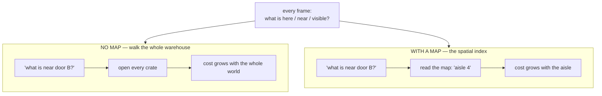
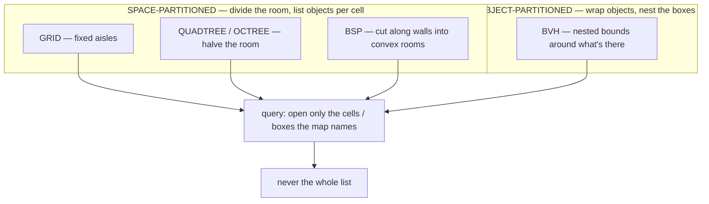
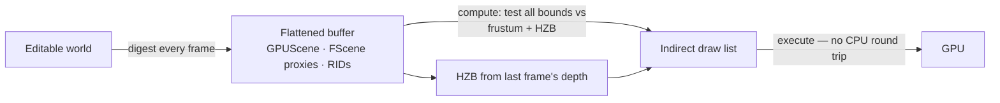
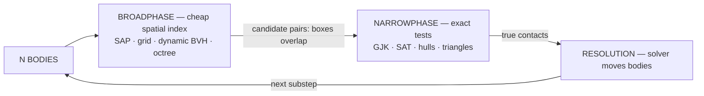
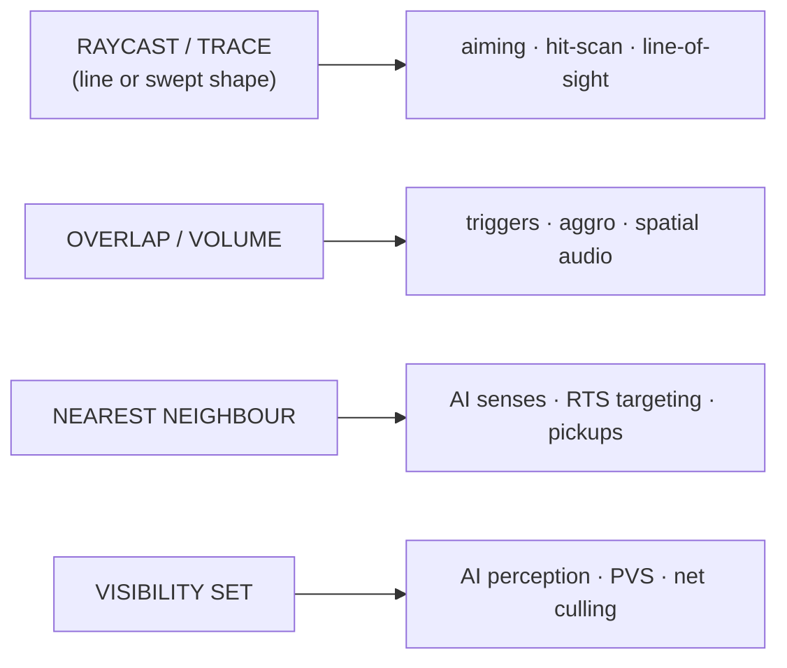

# Spatial Indexes — The Map, Not the Warehouse

This is the **spatial-indexes** chapter of [00-software-is-the-medium.md](00-software-is-the-medium.md), fourth in the new-chapter reading order ([05-schemas-and-formats.md](05-schemas-and-formats.md) before, [07-operating-systems.md](07-operating-systems.md) after). It answers the question beneath every discipline's daily work: **how does the game know what to pay attention to?**

Not "how does it draw" — but how it decides what is *worth* drawing, checking, colliding with, hearing, or streaming in. Looking at everything every frame is impossible: too much sits in the world for the ~16 ms a frame is allowed ([03-hardware-and-performance.md](03-hardware-and-performance.md)). So engines keep a **map**:

> **A spatial index is a *cache of where things are* — the map, not the items — and it is why big scenes render, collide, stream, and mix at all.**

Companions: [04-concurrency-and-state.md](04-concurrency-and-state.md) (who runs when, whose copy of state), [03-hardware-and-performance.md](03-hardware-and-performance.md) (what the two machines are made of), and [02-world-models.md](02-world-models.md), its natural partner — how the world *stored* vs how it looks *spatially*. Terms are defined on first use; every section ends with a boxed **come back to this**. (The map framing is the source note's; the mechanism is standard material, cited throughout.)

## 1. What a spatial index is — the map, not the warehouse

**The analogy that survives contact with reality.** A giant film-studio warehouse shelves every prop and crate the crew might need. All day you are asked: *"what is near door B?"*, *"what is in that corner?"*, *"what could a camera in the north hall see?"*

- **The naive way.** Walk the warehouse, opening every crate. Correct and impossibly slow — the cost grows with the *whole warehouse*. This is "check everything every frame."
- **The map way.** Somewhere there is a *living floor plan* — sections, aisles, and a list on each aisle's end: "items near door B live in aisle 4," so you read the list and walk one aisle. The warehouse is the world; the map is the **spatial index**.



**The sentence to keep: *the map is not the items — it is metadata about where the items are.***

Why a map at all? Because queries must *skip*. The goal is **output sensitivity**: a good index costs proportional to the objects *close* to the query, not the objects *in the world* — I-COLLIDE (1995) reached O(n+m) where naive is O(n²) ([Collision detection](https://en.wikipedia.org/wiki/Collision_detection), § Broad phase). Games are spatial databases wearing a costume — an ordinary keyed index "is not optimal for spatial queries" ([Wikipedia: Spatial database](https://en.wikipedia.org/wiki/Spatial_database)).

Three facts carry the subject:

**Fact 1 — it accelerates "what is here / near / visible."** A bounding-volume hierarchy makes queries logarithmic ([Wikipedia: BVH](https://en.wikipedia.org/wiki/Bounding_volume_hierarchy)), a k-d tree the same for nearest-neighbour ([Wikipedia: k-d tree](https://en.wikipedia.org/wiki/K-d_tree)), and physics calls the move **broad phase** — ruling out pairs that clearly do not intersect (Collision detection).

**Fact 2 — it is a cache, built *from* the world's state.** The map derives from positions and has no independent life — the *spatial vs relational* half of [02-world-models.md](02-world-models.md) (a keyed store has no idea where anything is), and the split [04-concurrency-and-state.md](04-concurrency-and-state.md) draws between **stored** state (built in the editor) and **live** state (in RAM, moving every frame).

**Fact 3 — it must be kept in sync with moving things.** Anything that moves makes the map wrong; the answers are **refit** (patch in place) or **rebuild** (redraw). Static worlds build once (BSP, PVS, §2); dynamic worlds re-list every frame (§5). An index that lies is worse than none — a body that left its cell is invisible there, and a rocket flies through it.

> **Come back to this.** A spatial index is a **cache of where things are**, derived from the world model's state and kept in sync when things move (refit or rebuild) — the map, not the items, and that ordering lets every engine answer "what is here?" without touching everything.

## 2. The shapes — the aisle, the quarter, the box, the wall

Every index is one of two kinds of map. **Space-partitioned** maps divide the floor into cells and note which items sit in each (grid, quadtree/octree, BSP); **object-partitioned** maps wrap each item in a snug box and nest the boxes (BVH). Space-partitioned cells *never overlap*, but a straddling object lives in several cells; object-partitioned volumes *may overlap* but hug their objects ([Space partitioning](https://en.wikipedia.org/wiki/Space_partitioning)). Under it all: the **bounding volume** — a simple closed shape enclosing an object, so a miss on the box is a miss on the object ([Wikipedia: Bounding volume](https://en.wikipedia.org/wiki/Bounding_volume)); the **AABB** (axis-aligned bounding box) is the workhorse.

The families, in the beat **analogy → name → accelerates → fails**:

- **Floor plan nailed to the wall — grid / spatial hash.** Pin contents to fixed cells; "near door B" reads the few near B. Cheap updates, even-spread neighbor queries. **Fails** on uneven distribution — a thousand crates in one cell turn its list back into the warehouse walk.
- **"Which quarter, which eighth?" — quadtree / octree.** Keep halving the space, splitting where dense — four quadrants or eight octants ([Quadtree](https://en.wikipedia.org/wiki/Quadtree), [Octree](https://en.wikipedia.org/wiki/Octree)). Accelerates frustum culling, collisions, nearest-neighbour. **Fails** on straddlers and fast crossers — Urho3D, for instance, culls via "the scene's **octree** — a spatial index that groups objects by position" ([urho3d.md](Engines/urho3d.md)).
- **Nested boxes around the objects — the BVH.** Boxes over objects, grouped up to one root — the one object-partitioned map, logarithmic for collision and ray tracing. **Fails**: boxes overlap, and motion forces refit (cheap only when small). NVIDIA **RT cores** (2018) accelerate "BVH traversal and ray-triangle intersection tests" ([NVIDIA: Real-Time Ray Tracing](https://developer.nvidia.com/rtx/ray-tracing)) — which is why the GPU-side **TLAS** (top-level acceleration structure, refit from entity data each frame) is OpenEngine's closest thing to a scene ([openengine.md](Engines/openengine.md)).
- **The wall that splits the room — the BSP.** Cut space along planes until every region is convex ([Wikipedia: Binary space partitioning](https://en.wikipedia.org/wiki/Binary_space_partitioning)). Accelerates front-to-back indoor rendering and traces against static geometry. **Fails**: built offline on static geometry; moving objects are awkward (same source). The **k-d tree** is its axis-aligned cousin for point nearest-neighbour ([k-d tree](https://en.wikipedia.org/wiki/K-d_tree)).
- **"Standing here, you might see…" — PVS.** Precompute, per room, which regions are visible from it; live, you read the card. Quake ships one per BSP leaf ([quake.md](Engines/quake.md)); the **potentially visible set** precomputes candidate geometry "then indexed at run-time" ([Wikipedia: Potentially visible set](https://en.wikipedia.org/wiki/Potentially_visible_set)). **Fails**: static-only — a door open at build time is visible forever.



> **Come back to this.** The **grid** shelves fixed aisles, the **quadtree/octree** keeps halving space, the **BVH** nests boxes around the objects (the one object-partitioned map), the **BSP** freezes walls into convex rooms, the **k-d tree** searches points on straight axes, the **PVS** precomputes what could possibly be seen. Failure modes are *stale data or static-only content* — never "the map hates you."
## 3. Why the frame budget cares — culling, from frustum to GPU-driven

A 60 fps frame is ~16.6 ms of budget for everything. Two ways to answer "what should we draw?":

- **Brute force.** Test every triangle against the camera, every frame. Time grows with the whole world, forever.
- **Narrow first.** Ask the map "which shelves are even in view?" Reject a whole shelf in one cheap box test — that is **frustum culling**, removing objects outside the camera's view pyramid, "using bounding volumes surrounding the objects" ([Wikipedia: Viewing frustum](https://en.wikipedia.org/wiki/Viewing_frustum)).

Modern renderer culling is a **ladder** — each rung cheaper, applied to fewer objects:

1. **Frustum culling** (every object, via the index): cheap, but blind to objects behind walls.
2. **Occlusion culling** (fewer objects, more math): reject objects "completely hidden from view (occluded) by other GameObjects" ([Unity Manual: Occlusion culling](https://docs.unity3d.com/Manual/OcclusionCulling.html)). The cheapest is **baked data** — precomputed inter-cell visibility makes runtime occlusion a lookup (the id family's PVS inside a modern engine; interpretation). It pays off "when a Project is GPU-bound due to **overdraw**" — fragments drawn then painted over (same source).3. **GPU occlusion queries + the hierarchical Z-buffer (HZB):** a depth pyramid from the previous frame rejects occluded bounds before shading — see Unity's "Enable GPU occlusion culling" and OpenEngine's documented "**HZB** (hierarchical-z-buffer) occlusion culling on the GPU" ([openengine.md](Engines/openengine.md)).



Why end GPU-side? The GPU from [03-hardware-and-performance.md](03-hardware-and-performance.md) is thousands of wide lanes — terrible at pointer-chasing, great at flat arrays. GPU-driven culling **flattens**: the world uploads as one buffer, a compute pass tests all candidates against frustum + HZB in bulk, and writes an **indirect draw buffer** with no CPU round trip ([openengine.md](Engines/openengine.md)).

> **Come back to this.** *Checking everything* costs "the whole warehouse" every frame. **Frustum culling** rejects whole shelves in one box test, **occlusion / PVS** drops what walls hide, and the modern ladder ends GPU-side with an **HZB** and an **indirect draw list** — no CPU round trip.

## 4. BVH versus octree — the two trees people confuse

Octrees and BVHs get used almost interchangeably in studio hallways; they are *not* the same structure — the difference is exactly the space-vs-object divide:

| | **Octree** | **BVH** |
|---|---|---|
| Partitions | *space*, into cells | *objects*, into bounding volumes |
| Children | 8 (4 in 2D) same-shaped cells | clusters of objects, each with its own box |
| Sibling regions | **never overlap** | **may overlap** |
| Moving an object | re-bucket it (a tree edit) | *refit* its leaf box; rebuild lazily |
| Best at | dynamic worlds, frustum/overlap queries | uneven/scattered objects, ray tracing, GPU |

The sources make the split explicit: octrees "partition a three-dimensional space by recursively subdividing it into eight octants," while k-d trees split along defined dimensions ([Octree](https://en.wikipedia.org/wiki/Octree)); the BVH is defined *through the objects*, not the space (BVH, cited above).

**Why the confusion is chronic.** Both answer "what is near / visible here?" with the same candidate list. The difference shows under pressure. **Movement** — an octree edits the tree when an object leaves a cell; a BVH refits (widen the leaf box, parents lazily, rebuild when sloppy). **Uneven sizes** — ten skyscrapers force an octree to carve deep, mostly-empty levels while the BVH hugs them — which is why it wins uneven scenes, ray tracing, and GPU acceleration.

**When each wins** (trade-off reading is interpretation): octree/quadtree for uniform game spaces and per-frame frustum insertion ([urho3d.md](Engines/urho3d.md)); BVH for wildly varying sizes, packed GPU memory, or ray casting. Mature engines own both.

> **Come back to this.** Octree = space cut into cells; BVH = objects wrapped in boxes. Octree siblings never overlap; BVH siblings may. Octrees move things in and out; BVHs refit and hug the objects. Same answers most frames; different costs when things move or differ in size.

## 5. The physics broadphase — which pairs could possibly touch?

Physics asks the same question from the other side, every substep: **which pairs of bodies should I even test for contact?** Testing every body against every other is O(n²) (Collision detection, cited above), so collision is a three-stage pipeline (same source):



1. **Broad phase** — cheaply find which pairs *might* collide, via a spatial index over loose boxes.
2. **Narrow phase** — decide whether each surviving pair really intersects (GJK, SAT, per-triangle tests).
3. **Resolution** — the solver separates, bounces, and constrains.

The order is "cheapest test first": only overlapping pairs get detailed comparison — the broadphase promotes that idea from one pair to the whole world (same source).

### Static world versus moving bodies

An honest index costs maintenance, and the world has two populations with opposite economics:
- **Static geometry** (the level): never moves — its index is **built once** offline (Collision detection, § Precomputed pruning).
- **Dynamic bodies** (player, enemies, boxes, rockets): move every frame — their index is **repaired or rebuilt every step**.

Each family's chore differs: an octree re-inserts a body leaving its cell; a BVH refits (cheap when motion is small); a grid/spatial hash rehashes on crossings; **sweep and prune** re-sorts nearly-sorted per-axis intervals, leaning on **temporal coherence** — solids barely move between steps ([Wikipedia: Sweep and prune](https://en.wikipedia.org/wiki/Sweep_and_prune)).

The reigning compromise is **two structures**: a build-once index for the world, a maintain-every-frame index for the bodies. Bullet ships `btAxisSweep3` (sweep-and-prune), `btDbvtBroadphase`, and a naive broadphase ([Bullet broadphase sources](https://github.com/bulletphysics/bullet3/tree/master/src/BulletCollision/BroadphaseCollision); [User Manual](https://github.com/bulletphysics/bullet3/blob/master/docs/Bullet_User_Manual.pdf)), Box2D a dynamic tree ([Box2D manual](https://box2d.org/documentation/)), and the id-Tech engines sit at the far end — a static BSP and so few moving bodies that no dynamic broadphase exists.

> **Come back to this.** Collision is **broadphase → narrowphase → resolution**, with the spatial index as the broadphase's engine room. Static worlds pay once; dynamic bodies pay every step — which is why every real physics library ships a *pair* of indexes, one static, one dynamic.

## 6. The four queries games run — and the determinism catch

**Four query shapes cover nearly every game need.** **(1)** **Raycast / trace** — "does a line hit anything?" Aiming and hit-scan (the bullet is a ray), line-of-sight for AI; a **sweep** pushes a whole shape and stops at first impact (kinematic movement). The id family calls these **traces**: Quake traces hulls against the BSP ([quake.md](Engines/quake.md)); Q3A's `CM_*` is trace code against BSP and bezier patches ([quake-iii-arena.md](Engines/quake-iii-arena.md)). **(2)** **Overlap / volume** — triggers, aggro ranges, spatial audio. **(3)** **Nearest-neighbour** — AI senses, RTS targeting, pickups. **(4)** **Visibility set** — AI perception, and the precomputed PVS QuakeWorld even reuses for *network culling*, deciding which entity deltas a client gets ([quake.md](Engines/quake.md)).



**Why one index serves them all.** Every query is "given a position or volume, which stored objects are spatially relevant?" — the world model's *spatial* quality from [02-world-models.md](02-world-models.md) as a question: four readings of the same map.

**The determinism catch — the index can change your simulation's results.** A simulation is **deterministic** when the same inputs always produce exactly the same states — "exact down to the bit-level" (Glenn Fiedler, [Deterministic Lockstep](https://gafferongames.com/post/deterministic_lockstep/)). The index quietly breaks that: the solver processes pairs *in the order the broadphase hands them over*, and floats do not add like real math — divergences compound (same source). Fiedler's canonical case: **ODE** randomized constraint order for stability, and that alone broke determinism until the seed was fixed. **Order is part of the computation.**

> **"If I build the index in a different order, do I get a different simulation?"** With a grid, almost certainly; with most dynamic trees, quite possibly; with a static, fixed BSP, no. *(Reading is interpretation; the mechanism is sourced.)*

**The fix: fixed substeps + fixed processing order.** A **fixed timestep** — physics in identical, fixed-size steps (DOOM's 35 Hz tic, Q3A's 20 Hz server tick — [doom.md](Engines/doom.md), [quake-iii-arena.md](Engines/quake-iii-arena.md)) — makes determinism *possible*; fixed *order* makes it *actual*. Hence **lockstep multiplayer** (machines exchange inputs, not state) demands byte-for-byte determinism, or a **desync** "may compound and be unrecoverable" ([Wikipedia: Netcode](https://en.wikipedia.org/wiki/Netcode)); **rollback (GGPO)** rewinds and replays, which works only if replay is bit-identical ([Wikipedia: GGPO](https://en.wikipedia.org/wiki/GGPO)). In [04-concurrency-and-state.md](04-concurrency-and-state.md)'s terms, the index is part of the stored state — and because you cannot snapshot a simulated world into agreement, the only fix is to *never diverge*.

> **Come back to this.** Four queries — **raycast/trace**, **overlap**, **nearest-neighbour**, **visibility** — one index serves all. The index is load-bearing twice: it makes collision fast and simulation **order-dependent**. Deterministic physics = **fixed substeps** + **fixed processing order** + a deterministic index.

## 7. The engine map back — one structure per world model

Every engine answers "what do I not need to draw / which pairs could touch?" with a structure that matches its world model ([02-world-models.md](02-world-models.md)):

| Engine | Spatial structure | What it accelerates | Anchored in |
|---|---|---|---|
| **DOOM** | BSP walk front-to-back + flat **blockmap** | static culling; movement and LOS | [doom.md](Engines/doom.md) |
| **Quake** | BSP **v29** + **PVS** per leaf; hull traces | visibility lookup; collision traces | [quake.md](Engines/quake.md) |
| **Quake III Arena** | BSP **v46** + PVS; draw-surf list → command buffer | culling + sorted render list | [quake-iii-arena.md](Engines/quake-iii-arena.md) |
| **Urho3D** | **octree** frustum culling in the `View` | per-frame drawable culling | [urho3d.md](Engines/urho3d.md) |
| **Redot** | scene tree + `RenderingServer` culling over flattened RIDs | culling per viewport | [redot-engine.md](Engines/redot-engine.md) |
| **three.js** | Object3D tree traversal, per-object frustum — **no engine index** | render-list build; raycasts | [threejs.md](Engines/threejs.md) |
| **Babylon.js** | scene graph + per-mesh `BoundingInfo` frustum/LOD | per-mesh culling during render | [babylonjs.md](Engines/babylonjs.md) |
| **OpenEngine** | ECS → **GPUScene**, **HZB** occlusion, bindless, **TLAS** | GPU-driven culling + ray-trace AS | [openengine.md](Engines/openengine.md) |
| **Unreal Engine 5** | **FScene proxies**, frustum + HZB occlusion, **World Partition** cells | render culling; distance streaming | [unreal-engine.md](Engines/unreal-engine.md) |

### The id family — the compiler builds the culler

The BSP came out of 1969 flight-simulator work, was formalized by Fuchs et al. in 1980, and the 1991 front-to-back paper "was used by John Carmack in the making of Doom" (Binary space partitioning, § History). The creative decision is the **two-direction walk**: one plane test tells which side the camera is on — draw the far side first, clip the near side against what was drawn — rendering front-to-back in O(what is visible), with no global sort.

The physics answer runs parallel: DOOM's movement uses a pre-built **blockmap** (a 2D grid of occupied cells), not the render BSP ([doom.md](Engines/doom.md)). Quake **merges** them — entities move by **hull traces** against the BSP while PVS handles visibility ([quake.md](Engines/quake.md)) — and Q3A's `CM_*` is trace code against BSP brushes and patches, with PVS handling visibility *and* network culling ([quake-iii-arena.md](Engines/quake-iii-arena.md)). Static geometry gets a frozen structure; dynamic entities ride on top in flat lists ([02-world-models.md](02-world-models.md)).

### The modern engines — a tree for people, a flat structure for machines

- **Redot** keeps the authoring `SceneTree` but serves rendering by **RID** (a numeric ID); "`RenderingServer::draw…` updates culling structures" each frame ([redot-engine.md](Engines/redot-engine.md)).
- **Unreal Engine 5** mutates `FScene` via **scene proxies** — "the renderer works on flattened FScene proxies rather than the actor graph" — and **World Partition** cuts the level into grid cells streamed by distance from a streaming source ([unreal-engine.md](Engines/unreal-engine.md); [Epic — World Partition](https://dev.epicgames.com/documentation/en-us/unreal-engine/world-partition-in-unreal-engine)): the index at world scale, deciding what is in memory at all.
- **three.js and Babylon.js** own **no spatial index at all**: the scene traversal *is* the culling — three.js's `projectObject` "keeps visible, layer-enabled objects, frustum-culls the rest"; Babylon's `_evaluateActiveMeshes` does per-mesh culling + LOD ([threejs.md](Engines/threejs.md), [babylonjs.md](Engines/babylonjs.md)).
```mermaid
graph TD
    subgraph WP["THE WORLD — cut into grid cells (UE5 World Partition)"]
        W1[cell] W2[cell] W3[cell]
        W4[cell] W5[cell] W6[cell]
        W7[cell] W8[cell] W9[cell]
    end
    P["the player — a streaming source"] -->|"cells within range"| L["near cells LOAD into memory"]
    L -. "distant cells UNLOAD" .-> D["the rest stays on disk"]
```

**The shape of the table is the argument:** static worlds precompute; editable worlds re-check their tree; the ECS/GPU era flattens everything because the GPU wants that. **Read the world model and you can predict the culling structure.**

> **Come back to this.** Engine → structure, one map: BSP+PVS for the static id worlds, octree for Urho3D, RID/server culling for Redot, scene traversal (no owner) for three.js/Babylon, and GPU-driven flattened structures for OpenEngine and UE5 — with World Partition as the map at world scale.

## 8. What it means for a game team

**The vocabulary.** *Culling* — deciding what to skip. *Broadphase* — the "might collide" filter (§5). *Build vs rebuild* — what a change costs an index. *Overdraw* — fragments drawn then painted over. *Draw call* — one "draw this" to the GPU; too many mean CPU setup cost or a failing index.

**The debugging reading — "why is draw-call count high."** Same discipline as [03-hardware-and-performance.md](03-hardware-and-performance.md)'s *find the bound first*: (1) is the count high because the scene is big, or because the index never thinned it (UE5's `stat initviews` reports visibility-cull cost)? (2) Do dynamic objects escape the static structure — runtime geometry defeats baked occlusion (Unity)? (3) Is the structure *stale* — a BVH refitted to death "looks slow" but is "the map lying"? (4) CPU or GPU-bound? If GPU, overdraw is the problem; occlusion, not more frustum, is the fix.

**The discipline menu** *(phrasings are the source note's framing; mechanisms are cited above):*
- **Artists:** culling, overdraw, streaming — a 4K scene is fast *because* the map throws most of it away before the GPU; a distant LOD is a *simpler member of the same indexing family*.
- **Audio:** attenuation works because the engine knows which emitters are near the listener; a **reverb zone** is literally a spatial cell with a name tag (a "3D audio effect" is "the virtual placement of sound sources anywhere in three-dimensional space" — [Wikipedia: 3D audio effect](https://en.wikipedia.org/wiki/3D_audio_effect)).
- **Designers:** aggro ranges, triggers, spawn systems — "Enemy wakes within N meters" is a nearest-neighbour query; **"too many enemies" is often a culling fact, not balance**.
- **Producers:** the budget *is* the index — room counts, prop budgets, and streaming cells in a design doc *are* the map's shape; "slower than it should be" is a deliverable conversation, not a mystery.
- **Engineers:** broadphase, queries, determinism, physics knobs — collision masks, a **contact offset**, and the fixed-substep cadence buying §6's reproducibility.

**Decision table — query → index family → engine example:**

| Query | Index family to reach for | Engine example |
|---|---|---|
| "What's in the frustum / this box?" | octree, quadtree, grid | Urho3D octree ([urho3d.md](Engines/urho3d.md)) |
| "What can this region see?" (static) | BSP + PVS | Quake, Q3A ([quake.md](Engines/quake.md)) |
| "What does this shot hit first?" | BVH (or BSP for static levels) | GPU TLAS/BVH ([openengine.md](Engines/openengine.md)) |
| "Which pairs might collide?" | broadphase: grid / BVH / SAP | Bullet / Box2D behind Redot's `PhysicsServer` ([redot-engine.md](Engines/redot-engine.md)) |
| "What's nearest?" | k-d tree / BVH | tool-side nearest-neighbour |
| "Everything, in bulk, on the GPU" | flattened HZB + indirect draw | OpenEngine, UE5 ([openengine.md](Engines/openengine.md), [unreal-engine.md](Engines/unreal-engine.md)) |

**The classic mysteries, decoded** *(teaching framing):* **"Shadows off changed the culling?"** Shadow casters are re-queried for every light's shadow pass. **"Prop-heavy level slow on a great GPU?"** The map grew — more candidates per cell means render-thread cost no GPU fixes. **"Why stream rooms in as I walk?"** Presence itself is index-decided — UE5's World Partition "only loads the parts of the Level that the player sees," by distance. **"Draw-call spike at the whole town?"** A wide frustum admits more shelves — *the question got bigger*.

**The five-part-skeleton echo.** The spatial index sits in the **State** slot of [01-common-structure.md](01-common-structure.md)'s skeleton as a device that makes the other slots cheap — a **State-shaped cache** (the world, sorted by *where*) that renderer and physics read, so their **Logic** and **Output** stop being linear in N:

> **A spatial index = State-shaped caches that make Logic and Output cheap.** *(Source note's skeleton echo.)*

> **Come back to this.** Teams read "high draw-call count" by asking whether the index thins the list, whether dynamic objects escaped it, whether it is stale, and whether the bind is CPU or GPU. Name your world's maps — BSP for the static level, grid for the moving cast, streaming cells for presence: **three maps, three cadences** — and treat cell sizes as budgets.

## The big recap

A game is a world too big to look at, plus a machine that must ask questions about it sixty or more times a second. The engine's answer is not "be faster" — it is **"keep a map."** The **spatial index** is the world model's *spatial vs relational* split made concrete: one cache that makes render, collide, trace, stream, and mix all work — from DOOM's BSP walk in 1993 to UE5's World Partition and OpenEngine's GPU HZB today.

> **Come back to this.** Spatial indexes are the medium's way of asking *"what is here?"* without touching everything. Keep the map in sync (refit vs rebuild), sized (cell vs budget), and honest — a quiet job every game team shares.

## Facts, provenance, and where to go next

**How this document was built.** A condensation of the vault's spatial-indexes note (2026-11-01); every external reference above is a web URL to a primary source (Wikipedia survey articles, the [Unity Manual](https://docs.unity3d.com/Manual/OcclusionCulling.html), [Epic documentation](https://dev.epicgames.com/documentation/en-us/unreal-engine/world-partition-in-unreal-engine), [gafferongames](https://gafferongames.com/post/deterministic_lockstep/), [Bullet](https://github.com/bulletphysics/bullet3/tree/master/src/BulletCollision/BroadphaseCollision), [Box2D](https://box2d.org/documentation/)), all verified at retrieval time (2026-11-01). Engine-internal names (blockmap, BSP v29/v46, hull traces, `CM_*`, octree-in-`View`, RID servers, FScene proxies, GPUScene/HZB/TLAS, `BoundingInfo`, `projectObject`) come from the per-engine case studies in this folder. The source note carried **no [unverified] marks**, and this condensation follows suit: every concrete claim above is anchored to a citation or a case-study link.

**Marked interpretation** (carried from the source note, on top of cited sources): the warehouse/map and "the map is not the items" analogy; "narrow first"; the static/dynamic framing and "three maps, three cadences"; the culling "ladder" and "baked occlusion as modern PVS"; the discipline-menu phrasings ("reverb zones are spatial cells with a name tag", "production budgets *are* the index's cells"); the debugging and mystery decoders ("teleport = staleness", "desync = order"); the "when-each-wins" readings (BVH vs octree, §4); the "State-shaped caches" skeleton echo; and the "index order ⇒ reproducibility" reading of the world model's axes. The mechanism facts — broad/narrow phase, the structure definitions, determinism and fixed steps — are sourced.

**Where to go next.** This is chapter **four**: the previous one, [05-schemas-and-formats.md](05-schemas-and-formats.md), asked what shape the bytes are; the next one, [07-operating-systems.md](07-operating-systems.md), covers the OS scaffold everything runs inside. It layers on the flagship [00-software-is-the-medium.md](00-software-is-the-medium.md) and sits beside [02-world-models.md](02-world-models.md), its natural partner. Per-engine depth lives in the case studies linked throughout ([Engines/doom.md](Engines/doom.md) and its siblings).

> **Come back to this.** Find the map an engine keeps and you can predict its culling, its collision, and the price it pays when things move — the key to why that engine feels the way it does.
