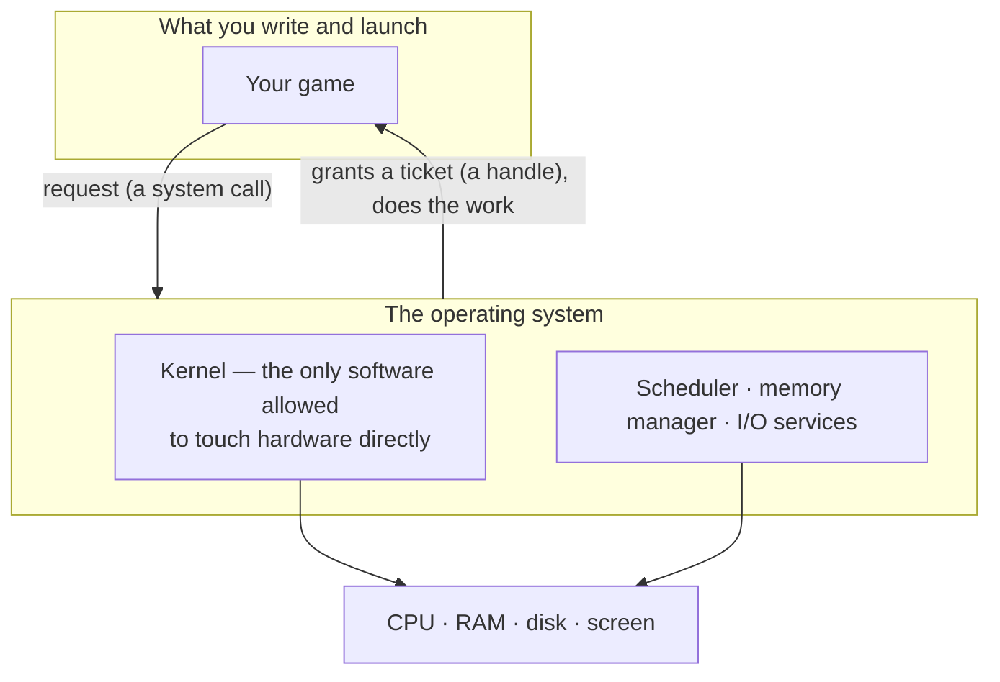
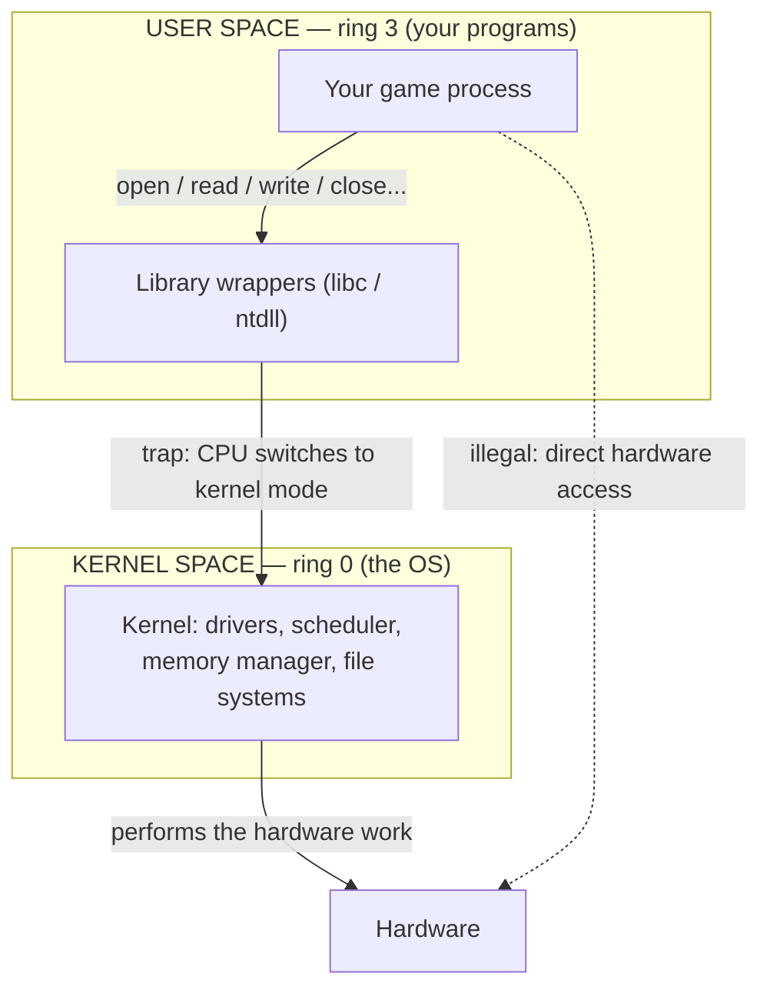
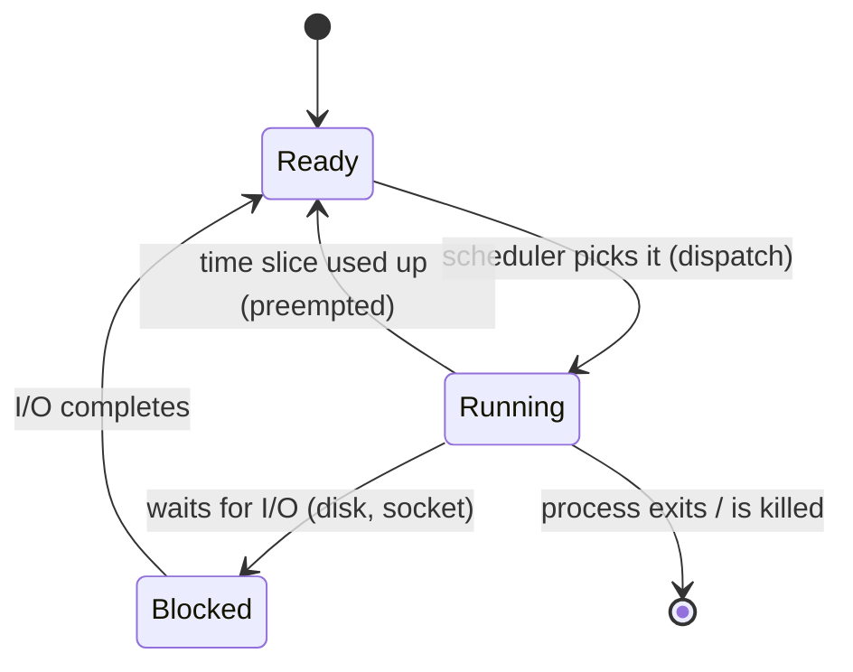
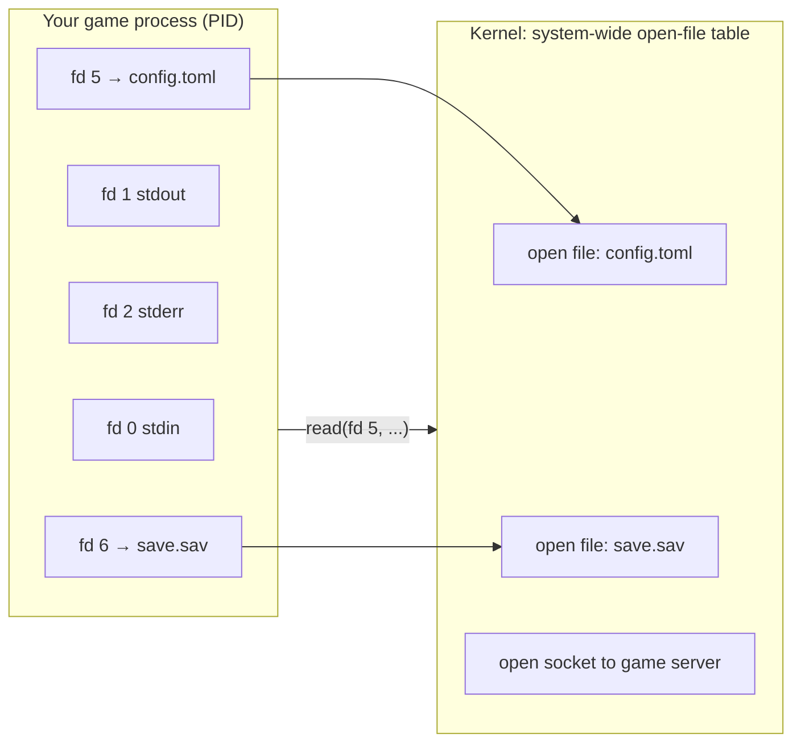
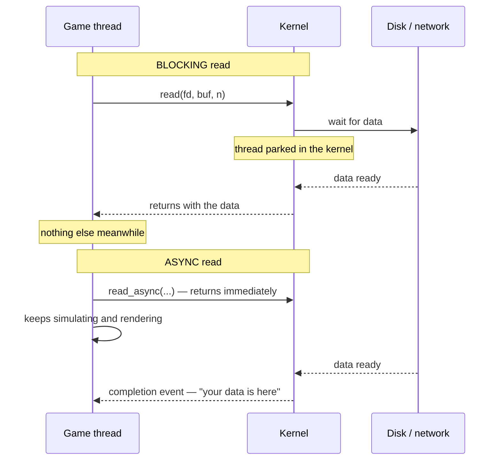
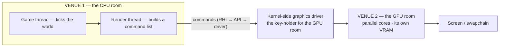
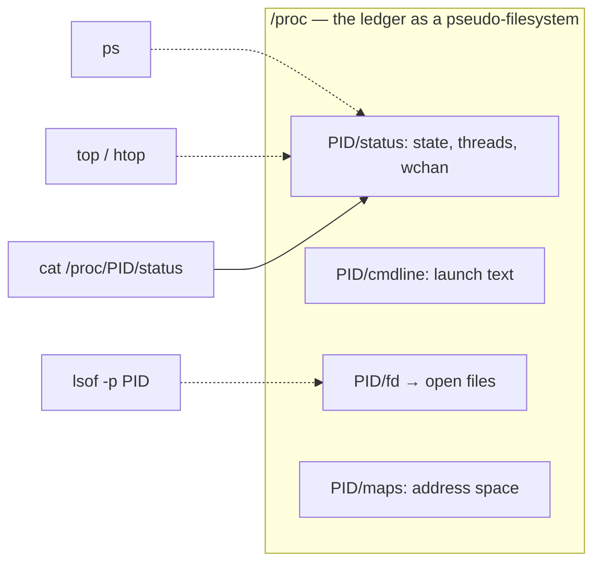
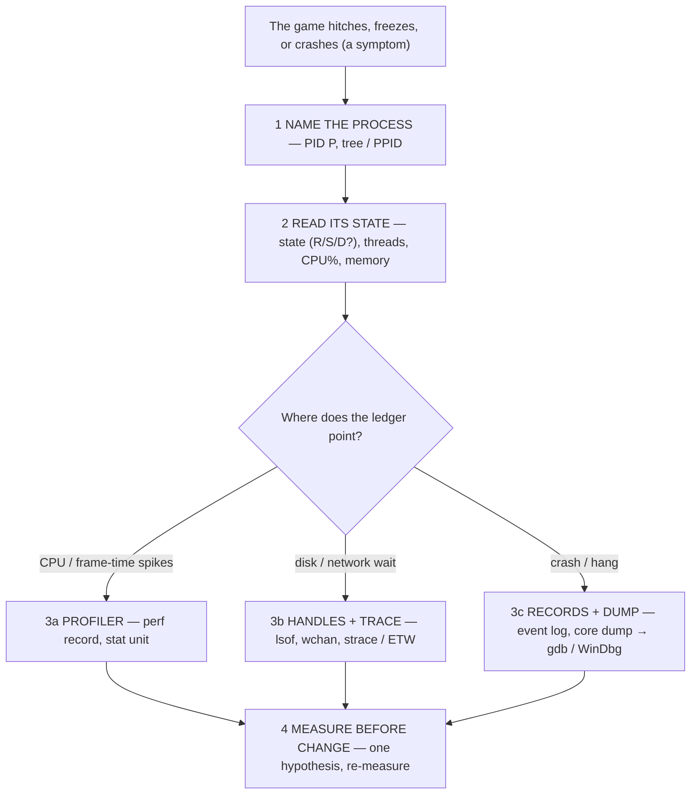

# Operating Systems — The Scaffold and the Observatory

This is the operating-system chapter of [00-software-is-the-medium.md](00-software-is-the-medium.md),
which frames the machine as nested layers — human → app → runtime → OS →
hardware — with every boundary an I/O exchange. It lives at that OS layer and
answers the question underneath every engine chapter: **what is the scaffold
everything runs inside — and how do I read the machine's own notes instead of
guessing?**

> **Your game never touches the machine directly.** Software never reaches
> hardware on its own: every access to CPU, memory, disk, or screen goes
> **through the OS**, which keeps every process isolated and can tell you
> exactly what each one is doing. That mediation is both what makes a process a
> process and what keeps one process from destroying another.

Think of the machine as a venue — a concert hall that holds your team. The
software you run — the Unreal editor, the game itself — are the acts and
guests. The **operating system** (Windows, macOS, Linux) is the building *and*
its landlord: it runs the lights, locks the doors, and knows which act is in
which room. You can read that knowledge any day as the **live board** (who's on
stage, who's sleeping) and the **guestbook and security tape** (who did what,
what broke).

No programming required; every term is defined on first use, and each section
ends with a boxed **come back to this**.

## 1. The load-bearing idea

An **operating system** is the system software that manages computer hardware
and software resources and provides common services to programs. Of everything
it does, two jobs matter most to a game team:

1. **Allocation.** Which program gets which CPU core, how much memory, which
   disk and network bandwidth, and when.
2. **Isolation.** Programs are kept apart so one program's bug or crash cannot
   corrupt another's memory or take the machine down.

To allocate safely the OS must be the only thing allowed to touch hardware; to
isolate, every touch must go through it. The result is the **process** — the
OS's walled arena for one running program:

**What the OS is not.** It doesn't draw your render passes or simulate your
physics — those are engine problems. It enforces the constraints around them.
Sorting "is this a game bug or an OS constraint?" is itself an OS skill.

> **Come back to this.** Software never touches hardware directly; the OS
> mediates every access — which is what makes a process a process and keeps one
> process from destroying another. Think venue/landlord: everything is
> negotiated, and the landlord keeps the books.

## 2. What makes a process a process

A **process** is a running instance of a program. **Program** is the passive
thing on disk (a `.exe`, the artwork); **process** is the live, running thing —
the artwork installed and performing tonight. Kill the process and the program
file is still on disk, ready to run again.

A process owns, in the OS's eyes: an image of its code, its own memory region,
its open files, sockets, and other resources, plus security attributes and
processor state. The OS identifies each one by a **process identifier (PID)** —
a number every monitoring tool keys off.

Two facts worth learning early:

- **PIDs get recycled.** Once a process dies, its PID and table entry can be
  reused. "I killed PID 1234" is meaningless fifteen minutes later — re-confirm
  the name alongside the number.
- **Processes have family.** Every process was started by another (the
  **parent**); the parent ID chain is the **process tree** — for example, "the
  Unreal editor is the parent that launches the client child process"
  **[unverified]**.

Each process record also notes its **state** — the shorthand `ps` prints as
letters:

| State | In the venue | In the OS |
| --- | --- | --- |
| `R` | on stage right now | **running** (or ready to run) |
| `S` | dozing in the green room | **sleeping** — usually waiting on the OS |
| `D` | deep in the maintenance closet | uninterruptible sleep — usually a disk wait |
| `T` / `t` | frozen mid-gesture | stopped by a signal or a debugger |
| `Z` | a ghost in the lobby | a **zombie** — ended, waiting for its parent to reap it |

### 2.1 Virtual memory: the private little universe

The load-bearing trick is **virtual memory**. The OS gives each process its own
*virtual* address space, and the CPU's memory management unit (MMU) translates
those addresses into real physical memory on the fly. To the program it looks
huge, private, and contiguous; to the hardware it lands in scattered physical
pages, some still on disk. Why it matters:

- **Isolation.** Process A's virtual address `0x1000` maps to physical page X;
  process B's maps to a different page. Addresses don't alias, so a game writing
  past an array corrupts — and usually crashes — *itself*, not the editor beside
  it.
- **More memory than you have.** Pages move between RAM and disk — why Task
  Manager can show 20 GB committed on a 16 GB machine, and why `top` shows
  `VIRT` (reserved) vs `RES` (physically present — the honest number the machine
  pays for).

### 2.2 Process vs thread: one process, many workers

The process is the *container*; a **thread** is the basic unit to which the OS
allocates processor time. Kitchen analogy: the restaurant (the process) owns the
kitchen and ingredients (the process's memory); the cooks (threads) share them
through one kitchen door — which is why a game with eight render threads still
shows as *one* process.

The asymmetry that decides what dies when: all threads share one address space,
so if one thread hits an illegal memory access the kernel kills the **whole
process** — but a *neighboring* process (the editor, Discord) has different
walls and stays alive.

**Unreal form.** A UE5 project isn't one abstract "process": the *editor* is one
process, a cooked build launched to play-in-editor (PIE) is another, and the
*dedicated server* executable is a third **[unverified]**. Inside one UE5
process the engine is explicitly multithreaded — game, render, and RHI threads
plus task-graph workers
([Engines/unreal-engine.md](Engines/unreal-engine.md)).

> **Come back to this.** A process is a running instance of a program, named by
> a PID (owned by its parent, recycled after death), owning a private virtual
> address space so it cannot corrupt others. Threads actually run inside that
> container, sharing its memory; read the state column (`R`/`S`/`D`/`Z`) and
> the process tells you what it *is* at a glance.

## 3. The negotiation: system calls and the ring boundary

How does a program ask the OS for anything? Through a **system call** — how any
program requests a service from the kernel. `open`, `read`, `write`, `close`,
`exit` are the classics: almost everything a program does touches one.

Syscalls exist because of **hardware privilege**. CPUs run in different
**protection rings** — ring 0 the most privileged (the kernel, full hardware
access), outer rings progressively restricted. Most OSes use two rings in
practice: the kernel at ring 0, your programs at the outermost ring.

The crossing is a **trap**: a special CPU instruction switches the processor
into kernel mode at a well-defined entry point; the kernel checks the request,
does the work, and returns. That traceable doorway is why `strace` can show
every syscall a process makes. The loop to memorize: **user code → library →
trap → kernel → hardware → kernel → return to user code**.

Your engine's libraries wrap the etiquette — on Windows the system DLLs, on
Unix libc — translating "I'd like to read this file" into the right syscall.
When a stack trace bottoms out in `ntdll.dll!NtReadFile`, you are seeing the
moment your code knocked on the office door.

Two orienting facts. **Every OS does the same job with different local rules** —
why Wine/Proton *translate* syscalls instead of smuggling hardware access, and
why "works on Windows but not under Proton" is often a translation failing at
one door. And drivers live on the kernel's side of the wall — which is why
"update your graphics driver" is a real fix, not a meme.

> **Come back to this.** System calls are the only doors between user space and
> kernel space. Hardware is protected by CPU privilege rings, with the OS alone
> in the inner ring. Every file, read, and network packet your game touches
> ends in a syscall.

## 4. The scheduler as timekeeper

A desktop runs far more threads than it has cores, so something must decide
**which thread runs on which core, and for how long** — that is the
**scheduler**. Its key move is **preemption / time-slicing**: run a thread for
a slice (typically 1–100 ms), then — finished or not — yank the CPU away and
run the next. "Running" really means "running, in slices." Three states matter
to the scheduler:

**Priorities and niceness.** Windows threads carry priorities, settable in Task
Manager; Unix uses the **nice value** (−20 to 19, default 0): lower is more
demanding, higher is "nicer" and runs only when nothing else wants the core.

This is why **a background app can steal your frame**: a browser download or
antivirus scan is a set of threads competing with your game's for cores, and
the scheduler decides who gets the next slice. Windows **services** and macOS
**agents/daemons** are background programs the OS starts without you — which is
how "the machine slows down every Thursday at 2 PM" becomes "the antivirus
full-scan runs at 2 PM."

**Why 60 fps is a deadline, not a vibe.** The game thread's frame budget — about
16.6 ms at 60 fps — is your contract with the world. The scheduler's turns are
the stage crew's schedule: a thread that waits its turn late simply misses the
moment. That is why teams ship "framerate torture" captures along with code: the
OS's tale explains the dips the profiler can't.

**Unreal form.** Unreal runs a three-threaded frame — game → render → RHI —
plus a task graph of workers
([Engines/unreal-engine.md](Engines/unreal-engine.md)). Each is a scheduling
entity to the OS, which has no idea which one is "the game thread." When a
shader compile drags the editor to a crawl, you are watching the scheduler
re-budget the shared stage.

> **Come back to this.** The scheduler time-slices threads across cores,
> preempting them on a schedule; priorities (Windows) and nice values (Unix)
> weight the choice. Your game never owns the CPU — it borrows slices from a
> referee feeding every other app too. When "the machine is slow," sort the
> task manager by CPU: it will name the culprit.

## 5. Handles and file descriptors: the admission tickets

A process can't hand the kernel a filename on every read; the OS needs a stable
identity for the thing accessed. That identity is a **file descriptor (fd)** on
Unix-like systems or a **handle** on Windows — a process-unique identifier for a
file, pipe, or network socket. Think of it as a **ticket the OS gives the
process for each resource it may touch**.

The ritual for any resource — file, socket, gamepad:

1. **`open`** (or `socket`, `CreateFile`, …) — "I want this." The OS checks
   permissions and, if OK, hands back a ticket: a number.
2. **`read` / `write`** — "operate on what *this ticket* refers to." You pass
   the number; the OS looks it up.
3. **`close`** — "give the ticket back." The resource is released.

On Unix the standard descriptors are fixed — **0 stdin, 1 stdout, 2 stderr** —
and the table is **per process**: my `fd 4` is my ticket; waving "number 4"
doesn't open your locker. Tickets declare intent up front (read / write /
both), which is the mechanical truth behind every `ACCESS_DENIED` and
"read-only" notice.

**A leak is a ticket never returned.** A process that never `close()`s
accumulates tickets until the OS refuses more — the everyday "file is locked by
another process" or "can't delete this folder." Not magic: another act is
standing at the storage room holding a ticket. That is why handle/fd counts are
a diagnostics column in Task Manager and `ps`.

**Unreal form.** You won't usually touch descriptors directly in Unreal — the
engine's platform file layer opens, reads, and closes handles for you
([Engines/unreal-engine.md](Engines/unreal-engine.md)). You meet tickets at the
edges: an editor refusing to save a file another process has open, "checked
out / locked" from source control, "could not open file for writing" in a build
log. And async asset loading exists because holding a ticket while the disk is
slow is exactly what you *don't* want on the game thread.

> **Come back to this.** Handles and file descriptors are per-process tickets
> for every open resource: `open` asks, `read`/`write` operate through the
> ticket, `close` returns it. Leaks show up as climbing ticket counts. When a
> file is "locked," your first tool is the auditor — `lsof` on Unix, Process
> Explorer on Windows.

## 6. I/O through the OS: blocking vs async at the syscall level

Disks are *glacial* next to the CPU: 10 ms of disk time is, to a 1 GHz
processor, ten million instruction cycles. At the OS level, blocking is not a
metaphor — a process waiting on something it requested is *blocked*: put down
by the scheduler until the device answers, using essentially no CPU (its record
shows a state like `S` or `D`). The OS can also handle work that needs no
waiting, using interrupts instead of polling.

Two ways a syscall can behave:

- **Blocking (synchronous).** The call doesn't return until data is ready; the
  *thread* is parked in the kernel — zero CPU, zero progress. The phone call
  where you hold the line.
- **Non-blocking / asynchronous.** The call returns immediately and the OS
  tells you later — "come back and check" (`poll`/`select`) or "call me when
  done" (true async: I/O completion ports on Windows, `epoll`/`io_uring` on
  Linux).

**The OS will tell you what your process is waiting for.** `top`'s **WCHAN**
column — "sleeping in function" — shows the kernel function the task is asleep
in, and `strace` prints each syscall's name, arguments, and return value
(blocked calls as `<unfinished…>` then `<…resumed>`). A hang stops being a
mystery: "process P isn't stuck in my code — it is *waiting inside kernel
function X*."

**Why engines hate blocking reads.** A 10 ms disk wait inside the game thread is
a 10 ms hole in a 16.7 ms frame budget at 60 fps — a visible hitch. That is why
Unreal's streaming systems (asset streaming, World Partition loading) use async
I/O and worker threads instead of blocking reads on the game thread
([Engines/unreal-engine.md](Engines/unreal-engine.md)); the game, render, and
audio threads must never stand at the counter.

Nuance: **non-blocking ≠ async.** Non-blocking returns immediately, but the
program must keep checking (wasted CPU); true async lets the OS notify it when
the operation finishes.

> **Come back to this.** Blocking syscalls park the calling thread until the
> device responds; async syscalls return immediately and deliver completion
> later. A blocking read on the game thread is a frame hitch, so engines move
> I/O off the critical path. "Waiting on the OS" is the everyday meaning of
> blocking — and the OS labels the exact function the process sleeps inside
> (`WCHAN`).

## 7. The GPU: a second venue through the same landlord

Games lean on one device that deserves its own treatment: the **GPU** — in the
OS's eyes still a device the process negotiates for through the OS, but a
special one.

A **graphics processing unit** is a specialized electronic circuit for digital
image processing and accelerated computer graphics — a *second processor*
sharing the venue, packing hundreds or thousands of parallel calculation units.
Three facts from the OS's viewpoint matter for a game team:

1. **The GPU is a device, so it has a driver, and the driver is a kernel
   capability.** Your game does not command the GPU directly; it goes through a
   graphics API (DirectX, Vulkan, Metal) and the graphics driver the OS loads
   and mediates. "Update your graphics driver" is a real fix precisely because
   you are updating the key-holder for the GPU room.
2. **The GPU keeps its own ledger: its own memory.** A *dedicated* GPU uses
   **VRAM** — on-board memory dedicated to the card; an *integrated* GPU shares
   system RAM, one reason integrated graphics under-perform for games. A game
   negotiates *two kinds of memory* with the machine — the process's address
   space and the GPU's VRAM — and "out of video memory" is a real, observable
   failure, not a metaphor.
3. **CPU and GPU are two workers overlapping in time.** The engine's render
   thread hands the GPU a stream of command lists rather than waiting, so CPU
   work and GPU work overlap
   ([Engines/unreal-engine.md](Engines/unreal-engine.md)). That is the "is it
   CPU-bound or GPU-bound?" question: a GPU spike with idle CPU cores says the
   frame waits on the second venue, not the first.

Your profiler says *which engine thread* rendered; the OS and Task Manager's GPU
column say *what the GPU did and how hot its memory is*. Two venues, one ledger
each — "it hitches" becomes "the GPU room is the slow room." When a frame is
slow, ask *which room* first: lowering graphics quality helps only if the GPU
is the bound.

> **Come back to this.** The GPU is a second venue: a parallel processor with
> its own VRAM, reached only through a graphics API and the kernel-side graphics
> driver. It has its own ledger and its own bound. "Is it CPU-bound or
> GPU-bound?" is the frame-budget question — two venues, one landlord.

## 8. Resolution of the lease: the process dies

When a process ends — on purpose or by crash — the OS tears down its arena:
reclaims its memory, closes its tickets, removes its record. This is **crash
isolation**, the same mechanism as address-space isolation: because processes
can't see each other's memory and can't touch hardware directly, a crashing
process damages only itself. Browsers run tabs as separate processes for the
same reason.

When a process dies from a fault, the OS can write a **core dump** — the
recorded state of the process's working memory at the crash, plus registers and
call stacks. Linux writes a core file you can open in a debugger (`gdb`);
Windows writes **user-mode minidumps** opened in WinDbg; Task Manager's
right-click "Create dump file" records the same thing on demand. The crash
reporters you see on game startup are this exact mechanism: turning "it crashed"
into "it crashed *here*, with this state."

**Environment variables and PATH** round out the lease. **Environment
variables** are values the OS stores alongside each process — `PATH` (where
executables are searched for), `HOME`/`USERPROFILE`, `TEMP` — inherited from the
parent at startup. Game-dev SDK paths and Unreal's `UE_`-prefixed build
variables live here, and so does a classic rabbit hole: a program that runs in
one terminal but not another usually differs only in its environment.

> **Come back to this.** The process wall is also a crash wall: one process
> dies, the machine lives. Core dumps are the OS's record of the crash — the
> autopsy written for you. Environment variables are per-process configuration
> inherited from the parent; when software behaves differently in a different
> terminal, diff the environment first.

## 9. The observatory: the ledger, the tools, and the wall

Everything a monitoring tool shows you — PID, CPU%, handle count, open files,
syscalls — is the OS **telling you what a process is doing**. It must keep the
ledger: it allocates every slice, page, and ticket, so it knows exactly who
holds what. Every tool is just a different way of **reading that same ledger**
— and learning to read it turns "it's broken" into "process P was waiting on
this."

### Columns are the ledger, renamed

| Tool column you've seen | Ledger fact it renders |
| --- | --- |
| PID | the identity number |
| PPID / tree view | who spawned it |
| STAT / State | execution state (running, waiting, blocked, zombie) |
| CPU% / CPU time | CPU-time accounting, user vs kernel split |
| Threads / NLWP | how many scheduled units the process contains |
| Mem / VIRT / RES | address space: virtual size vs resident pages |
| Handles / FD | entries of the process's ticket table |
| User / Command line | who owns it, and the exact launch text |

### The live tools

**Windows.** **Task Manager** shows CPU, GPU, and memory per process and splits
CPU time into kernel- vs user-mode
([MS Learn: Processes and Threads](https://learn.microsoft.com/en-us/windows/win32/procthread/processes-and-threads));
**Process Explorer** (Sysinternals) shows the **handles and DLLs** each process
has opened, with handle search — "which process has this file?" — and leak
tracking ([MS Learn: Process Explorer](https://learn.microsoft.com/en-us/sysinternals/downloads/process-explorer));
**Performance Monitor** logs counters over time; **Event Viewer** reads the
event logs ([MS Learn: Event Logging](https://learn.microsoft.com/en-us/windows/win32/eventlog/event-logging));
and **ETW** is Windows' kernel-level tracing facility
([MS Learn: About Event Tracing](https://learn.microsoft.com/en-us/windows/win32/etw/about-event-tracing)).

**Linux.** **`/proc`** is the ledger as a pseudo-filesystem: each process is a
directory — `/proc/PID/status` (state, parent, threads), `cmdline`, `environ`,
`fd/` (open tickets as symlinks), `maps`. **`ps`** prints a snapshot of the
table; **`top`/`htop`** give the live dashboard (`wchan`, and `s`/`l`
shortcuts to trace/lsof); **`lsof`** audits open tickets (`lsof -p PID`);
**`strace`** traces syscalls; **`journalctl`** reads the systemd journal with
per-process metadata.

**macOS.** **Activity Monitor** shows each process's CPU, memory, energy, disk,
and network use; **`top`** and **`lsof`** share the Unix tools; **`sample`**
samples where a PID's stacks spent time; **Instruments** is Xcode's profiling
suite.

### Recording what happened — four flavors

1. **Syscall traces** — the ordered receipt of each call: `open("/dev/null",
   O_RDONLY) = 3` (`strace`; `dtruss` on macOS; the debugger or ETW on
   Windows).
2. **Event logs** — the OS's diary: Windows' event log (Event Viewer); the
   systemd journal (`journalctl -b -1` = last boot).
3. **Performance traces** — ETW sessions and Linux `perf`: counters and
   tracepoints over time.
4. **Dumps** — core files and minidumps capturing process memory at the crash.

### The observation wall: why tools see only what the kernel shows

Everything above has a precise limit. The game runs in **user mode**; the OS —
scheduler, memory manager, file systems, drivers, and the actual process and
handle tables — in **kernel mode**. That divide is the **observation wall**:
**safety** (a crashing game cannot corrupt the OS; one user cannot read another
user's processes) and **limit** (tools are user-mode and learn only through the
doors the kernel builds). If the kernel does not expose a fact, no tool can see
it — and the kernel controls who reads what: `hidepid=` mounts, root-gated
journals, and elevation for deep Windows queries. A "permission denied" is the
wall; elevation is the door.

> **Come back to this.** The OS keeps a ledger on every process and ships tools
> that read it: **live** (Task Manager, Process Explorer, Activity Monitor,
> `ps`/`top`/`htop`/`lsof`/`/proc`) and **recorded** (syscall traces, event
> logs, ETW/`perf`, core dumps). Column names differ; the ledger row does not.
> Tools see only what the kernel exposes — the observation wall is safety *and*
> limit, and a failure to see is usually the wall, not the tool.

## 10. A field guide for a hitchy or crashing game

A five-move diagnosis walk, the same on every platform:

**1 — Name the process.** Symptoms don't have PIDs. Open the task manager, find
the game, note its **PID**, and check the tree: launchers, DRM, overlays, and
update children masquerade as — or drag down — "the game."

**2 — Read its state.** The row: **state** (`D` alone says disk/I-O wait),
**thread count** (a spike = a task storm), **CPU%**, **memory**. One metric
spiking when the frame dies points the way: CPU → profiler; memory climbing
across sessions → leak counters; `D`/I-O → the data path.

**3 — Ask the ledger what it is waiting on.**

- *CPU-bound?* — `perf top` / `perf record`, or the engine's frame counters
  (`stat unit` — Frame vs Game vs Draw vs GPU
  ([Epic: Stat Commands](https://dev.epicgames.com/documentation/en-us/unreal-engine/stat-commands-in-unreal-engine))).
- *I-O-bound?* — **handles** (`lsof -p PID`, `/proc/PID/fd`, Process Explorer)
  say *what* it touches; `ps -o wchan` and a **syscall trace** (`strace -p PID`;
  ETW/perfmon on Windows) say *what it is blocked in*.
- *Crashed or hung?* — read the **records**: the event log or
  `journalctl --since …`, then the **dump**: a core file into `gdb` (Linux) or
  a mini-dump into WinDbg (Windows).

**4 — Measure before you change.** Hypothesize from the record, change one thing,
re-measure with the same tools. If it still feels slow, the bottleneck moved or
the records never supported your guess.

**5 — The engine cross-check.** Engine tools name the thread; OS tools name the
cause: `stat unit` and Unreal Insights
([Epic: Unreal Insights](https://dev.epicgames.com/documentation/en-us/unreal-engine/unreal-insights-in-unreal-engine))
answer *which engine thread*; the process list, `lsof`, `strace`/ETW answer
*was it starved, did it wait, who took the CPU*. DOOM is the minimal walk:
input arrives as X11 events and output leaves as a 320×200 framebuffer flipped
to the window — every hop a mediated handoff through the OS
([Engines/doom.md](Engines/doom.md)).

> **Come back to this.** A five-move diagnosis walk: **name** the process (PID
> + tree), **read** its state, **ask the ledger** what it waits on (`wchan`,
> `lsof`, `strace`/ETW, event log), open the **dump** if it crashed, and —
> always — **measure before you change**. The OS wrote it all down; the job is
> reading the right column at the right time.

## 11. The lesson that stays

> **Learning to read the OS's ledger turns "it's broken" into "process P was
> waiting on this."**

The symptom is the player's experience; the ledger — the process row, the open
handles, the syscall trace, the event log, the dump — is the machine's statement
of what actually happened. And the OS is your environment for the whole career:
engines rise and fall, but every game runs inside one, negotiates every resource
through it, and can be observed through its records. **The interface changes,
the scaffold doesn't.**

## 12. Facts, provenance, and where to go next

Every claim in this document follows the collection's chain: definitions and OS
behavior from Wikipedia survey articles; Windows processes, handles, tooling,
and event/tracing models from Microsoft Learn; Linux tooling from the
man-pages project and the systemd manual; macOS entry points from Apple's
documentation. All URLs above are official product documentation (Microsoft,
Epic) and were verified reachable at retrieval time.

**Marked interpretation** (lenses added on top of the sources): the
venue/landlord analogy, the ledger vocabulary, the observation-wall name, the
four-flavors records, the five-move diagnosis walk, and the GPU-as-second-venue
framing. Engine internals — UE5's game/render/RHI threads, task graph,
streaming, PIE, `stat unit`, Unreal Insights — come from the
documentation-based case study in [Engines/unreal-engine.md](Engines/unreal-engine.md);
DOOM's X11/framebuffer details from [Engines/doom.md](Engines/doom.md). Two
process claims the source could not verify are carried here still marked
**[unverified]**: that the Unreal editor is the parent that launches the client
child process, and that a UE5 project splits into editor, cooked PIE, and
dedicated-server processes.

**Reading order.** Within the extended chapters this document is
**fifth**: read [06-spatial-indexes.md](06-spatial-indexes.md) (previous) before it,
then continue to [08-the-weapon-example.md](08-the-weapon-example.md)
(next). It layers on the flagship [00-software-is-the-medium.md](00-software-is-the-medium.md)
and sits alongside the collection's other chapters —
[01-common-structure.md](01-common-structure.md) and [02-world-models.md](02-world-models.md)
— with the deep engine case studies in [Engines/doom.md](Engines/doom.md) and
[Engines/unreal-engine.md](Engines/unreal-engine.md).
