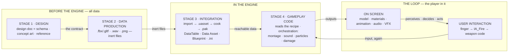
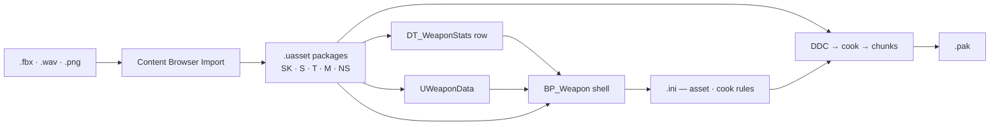
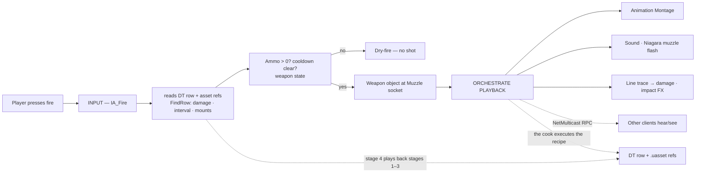
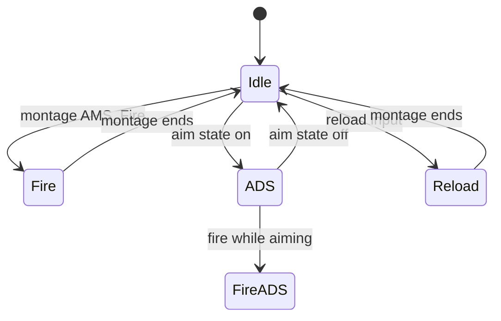
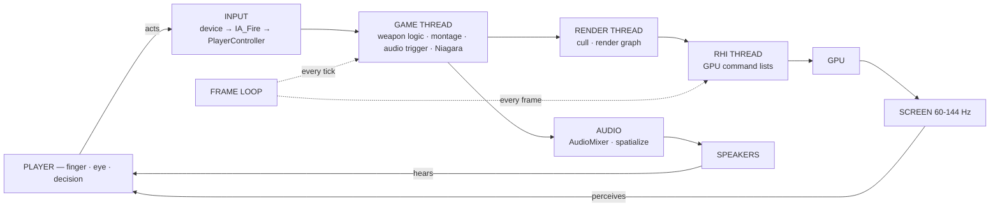
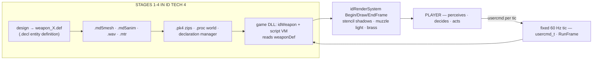

# The Weapon — From Concept to Muzzle Flash: One Gameplay Element Through the Whole Machine

This is a synthesis chapter. It takes one rifle (or pistol) and follows it from
the designer's first sketch to the muzzle flash on screen — and every stage of
that journey lands in a place you already know from
[00-software-is-the-medium.md](00-software-is-the-medium.md): software is **data +
code**; every program is **input → process → output**; the five-part skeleton is
**state, logic, input, output, clock** ([01-common-structure.md](01-common-structure.md));
and interactive software is a **cybernetic loop** with a human in it
([00-software-is-the-medium.md §3](00-software-is-the-medium.md)).

Why a weapon? It is simple, familiar, and it exercises every discipline end to
end — artists, animators, audio designers, technical artists, designers, tooling
people, gameplay programmers, and the player each touch the same object at a
different stage, and it only "works" when the stages line up. The walk is set
in **Unreal Engine 5**; the same chain is then re-traced in **DOOM 3 (id Tech
4)** to prove the skeleton is the constant and the engines are the variables
([Engines/unreal-engine.md](Engines/unreal-engine.md);
[Engines/doom-3.md](Engines/doom-3.md)). No programming is required; terms are
defined on first use, claims the sources could not verify are flagged
`[unverified]` inline, and source URLs are collapsed into the provenance
section at the end.

## 1. The four-stage chain, in one picture

**Framework map.** Stages 1–2 are the **data**; stage 3 fills the **assets/IO
channel** that makes data reachable by code; stage 4 is where **code** acts on
it; the player's finger supplies **input**; the renderer, audio mixer,
animation system, and VFX spawners are **output**, paced by the **clock** — the
frame loop ([01-common-structure.md](01-common-structure.md)).

> **Come back to this.** A weapon is a four-stage chain — **design → data
> production → engine integration → gameplay code** — and stage 4 only *plays
> back* what stages 1–3 produced. Everything before stage 4 is inert data;
> bound to code, that data crosses the input boundary (a finger) and comes
> back out as output (animation, audio, effects, model, materials) inside the
> frame loop — a cybernetic circuit with the human in it.

## 2. Stage 1 — Design and concept: the schema is born

Owners: the design director and the designers. Nothing in later stages has
direction without this stage, and it needs no programming. The design answer
has four spokes:

- **Role** — primary (kept out), secondary (fallback pistol), or utility (a
  breaching charge, a syringe). Role decides screen time and ammo economy.
- **Feel** — the numbers that make a trigger pull feel like a promise: **fire
  rate**, **recoil**, **spread**, **magazine size**, **reload speed**, **ADS**
  (aim-down-sights time and movement penalty). Players never read them; they
  *feel* them.
- **Silhouette and art direction** — recognizable at a glance, distinct from
  every other weapon; material language, faction identity, wear.
- **Sound identity** — a gun is a voice: the boom-vs-crack of the report, the
  clack of the bolt. Players identify weapons *by ear* before they see them.

Three outputs: the **design doc** (a written spec: stats table, feel goals,
audio identity, functionality list), the **concept art**, and the **reference**
(photos, recordings, measured equivalents a modeller builds to).

### 2.1 The design doc is a schema

A schema is a declared shape-and-meaning contract a writer and a reader share
([05-schemas-and-formats.md](05-schemas-and-formats.md)). Read the design doc this
way:

- The **stats table is a schema** for the numbers the engine will one day read —
  "Fire rate: 600 RPM" declares a field, a type, and meaning.
- The **functionality list is a schema** for behavior — every verb the doc
  specifies is a rule gameplay code will honor.
- The **feel goals are a schema** with the loosest validation — the audio
  designer and the recoil animator both read that sentence and agree with it.

So read the chain as a **chain of schemas**: stage 1 writes the master
contract, stages 2–4 fulfill and play it back.

### 2.2 The career question, asked before code exists

The career-long question — *what belongs in code, and what in data?*
([00-software-is-the-medium.md §1](00-software-is-the-medium.md)) — has its first
answer here. **Data:** every feel number, asset reference, and role label —
passive, cheap to change, the layer designers touch. **Code:** the *behavior
between the values* — "when Fire is pressed and ammo remains, decrement ammo
and spawn a bullet." The picture to keep: the design doc is the **sheet
music**, the gameplay code the **performance** — music describes every note; it
makes no sound until a performer plays it.

### 2.3 The UE5 anchor: the spec becomes a data-first home

Unreal maps the design doc almost 1:1 onto its "data-driven everything"
pattern — content and tuning as data, not code
([Engines/unreal-engine.md](Engines/unreal-engine.md)):

- **Data Tables** — "a table of miscellaneous but related data grouped in a
  meaningful and useful way." A `DT_WeaponStats` table with one row per weapon
  *is* the design doc's stats table — retuning a fire rate needs no C++
  ([Epic: Data Driven Gameplay Elements](https://dev.epicgames.com/documentation/en-us/unreal-engine/data-driven-gameplay-elements-in-unreal-engine)).
- **Data Assets** — an asset storing data for a system in an instance of its
  class; a `UWeaponData` asset (feel numbers plus mesh/sound/montage
  references) is the design doc as a clickable object
  ([Epic: Data Assets](https://dev.epicgames.com/documentation/en-us/unreal-engine/data-assets-in-unreal-engine)).
- **Curve Tables / Data Curves** take recoil kick-out and spread bloom as
  graph-editable curves (same Epic page).
- **`.ini` config** holds session-level and launch-time variables
  ([Engines/unreal-engine.md](Engines/unreal-engine.md)).

> **Come back to this.** Stage 1 decides what the weapon *is* — role, feel,
> silhouette, sound identity — and writes the design doc, concept art, and
> reference. This is the birth of **data**: the design doc is a **schema**, the
> contract stages 2–4 author against, and the stats table is already the shape
> of the engine's `DT_WeaponStats` row / `UWeaponData` asset / `.ini` config.
> Design answers *code vs data* before anyone writes either.

## 3. Stage 2 — Data production: inert content

Owners: artists, animators, audio designers, technical artists. They produce
the physical content the weapon is made of — and, crucially, **none of this
does anything yet**: it is inert content, all data
([00-software-is-the-medium.md §7.1](00-software-is-the-medium.md)).

- **Model** — high-poly sculpt → retopology → UV unwrap → **normal-map baking**
  of the detail onto a clean low-poly game mesh.
- **Skeleton + rig** — the bone hierarchy animation keyframes.
- **Animations** — idle, fire, reload, aim (ADS), inspect; the **ADS pose**
  must match the gameplay camera exactly.
- **Textures / materials** — the **PBR map set** (albedo, normal, roughness,
  metallic) plus emissive.
- **Sound effects** — report, reload clack, impact, dry-fire, room-tail,
  mixed into named files.
- **FX source art (with a caveat)** — muzzle flash, shell, tracer: the *source
  art* is authored here; the spawning *systems* are built in-engine in stage 3.

The output bag: `.fbx`/`.gltf`, `.wav`, `.png`/`.tga`, `.hdr` — **passive
values, not bound to code** ([00-software-is-the-medium.md §4](00-software-is-the-medium.md)).
Authoring formats stay editable; runtime formats are converted — *engines do not
read the authoring format at runtime, they convert it*
([05-schemas-and-formats.md](05-schemas-and-formats.md)). Framework: the weapon is
**future State**, and the mesh becomes a component on a **scene-graph actor**:
"put a gun under a hand bone, done" ([02-world-models.md](02-world-models.md)).

### 3.1 The UE5 anchor: the names content gets after import

When the files land in Unreal, each gets a *typed, loadable asset*
([Engines/unreal-engine.md](Engines/unreal-engine.md)):

- **`SK_Weapon_Rifle`** — a **Skeletal Mesh** (visual mesh plus Skeleton);
  **`AM_*`** — **Animation Sequences**: keyframes against the Skeleton.
- **`T_*` textures + `M_*`/`MI_*` Materials** — a node graph wired to the PBR
  inputs; Material Instances are runtime-tweakable variants.
- **`S_*` Sound Waves** plus the **Sound Cue** composition layer; codec and
  cook happen at cook time.
- **`NS_*` Niagara Systems** (muzzle flash, shells, tracers), assembled in
  stage 3 from stage-2 source art. *(Name and role at case-study level.)* `[unverified]`
- **Sockets** — "offsets from bones that allow you to attach game objects";
  the **`Muzzle` socket** is authored here, the anchor where stage 4 spawns the
  tracer, flash, and bullet origin.
- **PHAT, the Physics Asset** — rigid bodies and constraints; dropped-weapon
  pickups and shell ejection need it.

*(The `SK_`/`A_`/`T_`/`M_`/`MI_`/`S_`/`NS_` prefixes are common project
convention, cited at ecosystem-convention level.)*

> **Come back to this.** Stage 2 is the **data substance**: model, skeleton,
> animations, PBR materials, sounds, FX source art — inert files nothing acts
> on yet. In Unreal they get typed names after import (Skeletal Mesh, Skeleton
> + AnimSequences, Sockets with the Muzzle, Materials, Sound Waves, Physics
> Asset). This is future **State** — the passive values stage 4 plays back.

## 4. Stage 3 — Engine integration: data becomes reachable

Stage 3 binds the inert data to the engine's logic — importing, registering,
and referencing content so it becomes a *typed, loadable asset* code can find.
This is the **bridge layer**, filling the framework's **assets/IO channel** —
"an archive plus a search path plus on-demand parsing plus a cache," whether
the container is a WAD, a `.pk3`, or a `.uasset` store
([01-common-structure.md](01-common-structure.md)). After stage 3 a `.fbx` is a
first-class object with a name, a type, and a reference graph — but pressing
fire still does nothing.

**Import.** "Any piece of content in an Unreal Engine project is an **Asset**,"
and the Content Browser is where Import turns a `.fbx` into a Skeletal Mesh, a
`.wav` into a Sound Wave, and a `.png` into a Texture — each saved as a
`.uasset` package (the `SK_`/`S_`/`T_` prefixes are a community convention, not
an Epic rule) ([Epic: Assets and Content Packs](https://dev.epicgames.com/documentation/en-us/unreal-engine/assets-and-content-packs-in-unreal-engine)).
The depth comes from Unreal's master schema, **UObject reflection**: marking
classes and properties with `UCLASS`/`UPROPERTY`/`UFUNCTION` lets the engine
see them, powering serialization, the editor, runtime type info, and garbage
collection ([Epic: Unreal Object Handling](https://dev.epicgames.com/documentation/en-us/unreal-engine/unreal-object-handling-in-unreal-engine);
[Engines/unreal-engine.md](Engines/unreal-engine.md)).

**Cook and DDC.** Production ships `.uasset` → **DDC** (Derived Data Cache) →
**cook** → **`.pak`** ([Engines/unreal-engine.md](Engines/unreal-engine.md)).
When you cook, the project divides into **chunks**, each generating a `.pak`
file — and the engine decides what ships by walking the **reference graph**:
secondary assets load automatically when a primary asset references them
([Epic: Cooking Content and Creating Chunks](https://dev.epicgames.com/documentation/en-us/unreal-engine/cooking-content-and-creating-chunks-in-unreal-engine)).

### 4.1 The four concrete artifacts the weapon needs

- **`DT_WeaponStats`, a DataTable — where the design doc survives.** CSV import
  (first column `Name`) creates the table; rows map 1:1 to a struct inheriting
  `FTableRowBase`, reached via `FDataTableRowHandle` + `FindRow()`
  ([Epic: Data Driven Gameplay Elements](https://dev.epicgames.com/documentation/en-us/unreal-engine/data-driven-gameplay-elements-in-unreal-engine)).
- **`UWeaponData`, a Data Asset — the flavor profile.** One weapon = one asset
  holding mesh, fire mode, tags, montages, and sounds
  ([Epic: Data Assets](https://dev.epicgames.com/documentation/en-us/unreal-engine/data-assets-in-unreal-engine)).
- **`BP_Weapon`, a Blueprint — the class shell.** Blueprint Visual Scripting
  is a node-based system where "programmers can create baseline systems that
  can be extended by designers"
  ([Epic: Blueprints Visual Scripting](https://dev.epicgames.com/documentation/en-us/unreal-engine/blueprints-visual-scripting-in-unreal-engine));
  in stage 3 the shell is *built, not coded* — the behavior is stage 4.
- **`.ini` config — the border and the rules.** Asset Manager and cook-rule
  settings tell the pipeline what exists and where it ships
  ([Epic: Asset Management](https://dev.epicgames.com/documentation/en-us/unreal-engine/asset-management-in-unreal-engine)).

### 4.2 Soft vs hard references

- A **hard reference** (`UObject*`-style) means "if A is loaded, B is loaded." `[unverified]`
- A **soft reference** (`TSoftObjectPtr`) stores a *path/string* the engine
  resolves lazily through the Asset Manager's **Streamable Manager**
  ([Epic: Asset Management](https://dev.epicgames.com/documentation/en-us/unreal-engine/asset-management-in-unreal-engine)). `[unverified]`

The teaching payoff: because the reference is a *path* (data), not a
compiled-in address, **editing, re-importing, or re-saving an asset does not
force a recompile** — update the mesh, hit save, and the next session resolves
the new bytes (the loose-package facts are Epic-documented; the causal reading
is this document's framing). `[unverified]` The **Reference Viewer** draws the
resulting reference graph (same Epic cook source).

> **Come back to this.** Stage 3 is integration: **import** turns files into
> typed `.uasset` packages (→ DDC → cook → `.pak`), **UObject reflection** is
> the master schema that makes them typed and serializable, and **soft vs hard
> references** stitch them into a graph — with the `DT_WeaponStats` DataTable,
> `UWeaponData` Data Asset, `BP_Weapon` shell, and `.ini` config as the
> weapon's four fingerprints. Data is now reachable by code. **Nothing has
> fired yet.**

## 5. Stage 4 — Gameplay code: the weapon becomes an event

Stage 4 is where gameplay code *reads* the configured data, *instantiates* the
weapon object, and on the firing action *orchestrates playback* — animation,
sound, muzzle flash, damage. This is the first stage that produces anything
the player can see or hear.

The teaching frame: **the weapon object is a machine that reads a recipe; the
code is the cook; the DataTable row is the recipe card.** The `Pistol` row says
the dish — damage, magazine, fire interval, references to the mesh and clips —
and the code reads the card and executes the steps. **Code is the translator
from data to output.**

**The object.** A weapon is an `AActor` (a C++ `AWeapon` base or a `BP_Weapon`
child), owned by the character — "actors made of components," hierarchy-native
([Engines/unreal-engine.md](Engines/unreal-engine.md)). Instantiation is
`SpawnActor` + `AttachToSocket`: the same typed object, born at runtime out of
a class.

### 5.1 The fire loop

1. **Input.** The fire intent arrives through the Enhanced Input pipeline
   ([Engines/unreal-engine.md](Engines/unreal-engine.md); detail in section 6).
2. **Read the recipe.** `FindRow()` on the `FDataTableRowHandle` retrieves the
   struct, plus the asset references in `UWeaponData`/`BP_Weapon`
   ([Epic: Data Driven Gameplay Elements](https://dev.epicgames.com/documentation/en-us/unreal-engine/data-driven-gameplay-elements-in-unreal-engine)).
3. **Spend the state.** The weapon object is **state** — ammo, fire mode,
   cooldown, ADS. Minus one round; if ammo is empty, the fire withdraws:
   dry-fire sound, no trace.
4. **Orchestrate the outputs.** Start the fire **Animation Montage**
   ([Epic: Animation Montage](https://dev.epicgames.com/documentation/en-us/unreal-engine/animation-montage-in-unreal-engine));
   play the shot sound and spawn the particles by remote call — Epic's
   canonical uses are "playing sounds, spawning particles, performing
   animations" ([Epic: Remote Procedure Calls](https://dev.epicgames.com/documentation/en-us/unreal-engine/remote-procedure-calls-in-unreal-engine));
   fire the Niagara muzzle flash from the Muzzle socket. *(Montage playback at
   this level.)* `[unverified]`
5. **Apply damage: the trace.** A **line trace** from the muzzle registers a
   hit (damage, impact FX) or a miss
   ([Epic: Collision](https://dev.epicgames.com/documentation/en-us/unreal-engine/collision-in-unreal-engine)).
6. **The cooldown.** A post-fire interval gates the next event — as a
   timer/latent action or a tick-decremented cooldown. Input events are
   event-driven; cooldowns are often tick-based — "the node waits, the game
   does not" ([04-concurrency-and-state.md](04-concurrency-and-state.md)).

### 5.2 The weapon's state in multiplayer

**Replication** is "the process of synchronizing data and procedure calls
between clients and servers"
([Epic: Networking and Multiplayer](https://dev.epicgames.com/documentation/en-us/unreal-engine/networking-and-multiplayer-in-unreal-engine)).
Ammo and fire mode are `UPROPERTY(Replicated)` fields
([Epic: Unreal Object Handling](https://dev.epicgames.com/documentation/en-us/unreal-engine/unreal-object-handling-in-unreal-engine));
the fire itself is a `Server` RPC validated on the server, so a client cannot
fire a magazine it doesn't hold. The playback everyone must see and hear rides
a **`NetMulticast` RPC** — "executed on the server and all currently connected
clients," whose canonical uses are "playing sounds, spawning particles"
([Epic: Remote Procedure Calls](https://dev.epicgames.com/documentation/en-us/unreal-engine/remote-procedure-calls-in-unreal-engine)).
These are the single-leader replication and RPC rows of
[04-concurrency-and-state.md](04-concurrency-and-state.md).

The key beat — **"stage 4 only *plays back* what stages 1–3 produced."** The
press of fire is a *read* followed by an *orchestration*; the code does not
invent the weapon, it translates stages 1–3's data into output. That is why
editing `DT_WeaponStats` rebalances a gun with no programming.

> **Come back to this.** Stage 4 is instantiation and playback: code (the
> cook) reads the DataTable row and references (the recipe card), spawns and
> attaches the weapon to the Muzzle socket, and on fire orchestrates montage,
> sound, particles, and the damage trace. The weapon object is **state**
> (ammo, mode, cooldown — replicated via `UPROPERTY(Replicated)` and RPCs);
> fire is event-driven against the frame budget; damage and effects are
> **output**. **Stage 4 only plays back what stages 1–3 produced** — the code
> is a translator, not an inventor.

## 6. User interaction: the player's finger is the last stage

This is the **input** leg of input → process → output, and the human is
physically inside the loop: the machine presents output → the human perceives
and decides → acts → the action becomes input → new output
([00-software-is-the-medium.md §3](00-software-is-the-medium.md)). "The gun feels
responsive" describes the whole circuit, and **latency is the loop's critical
parameter** — at 60–144 Hz the round trip gets ~16 ms or ~7 ms per turn, and
every hop (finger → button → OS → input pipeline → output → eye → brain →
finger) adds to it.

**Enhanced Input.** Unreal's modern input answer adds "radial dead zones,
chorded actions, contextual input, and prioritization"
([Epic: Enhanced Input](https://dev.epicgames.com/documentation/en-us/unreal-engine/enhanced-input-in-unreal-engine);
[Engines/unreal-engine.md](Engines/unreal-engine.md)). Four concepts, in
pipeline order:

1. **Input Actions (`IA_`)** — the link between the input system and your
   code; each represents something the user can do (Epic's own example:
   **"Fire Weapon"**). Actions are *data assets* carrying a value type:
   boolean, axis, 2D, 3D (same source).
2. **Input Mapping Contexts (`IMC_`)** — a collection of actions for a context
   the player is in, with priority resolving collisions — how the same button
   means *fire* with the rifle and *drop* at a ledge (same source).
3. **Input Modifiers** — pre-processors altering raw values: dead zones,
   negation, sensitivity (same source).
4. **Input Triggers** — decide whether input activates the action, returning
   **Started, Ongoing, Triggered, Completed, Canceled** — semi-auto fires on
   *Triggered*, full-auto on *Ongoing* (same source).

**The PlayerController.** Epic's own line: "A **PlayerController** is the
interface between the Pawn and the human player controlling it … essentially
represents **the human player's will**"
([Epic: Player Controllers](https://dev.epicgames.com/documentation/en-us/unreal-engine/player-controllers-in-unreal-engine);
[Engines/unreal-engine.md](Engines/unreal-engine.md)). The controller persists
across death and respawn while the Pawn is transient. The one-liner that pays:
**the mapping (which physical input triggers which action) is data; the
binding (what the action does) is code — input stays a channel; the weapon
owns the meaning.**

**Per-input consequences are state transitions:** aim/ADS toggles a boolean
state (FOV, sight, pose); fire-mode switching cycles an enum so the same
trigger behaves differently per state; reload starts a fixed-duration state
that blocks fire. The frame is *polled*; the input boundary is *event-driven*
([04-concurrency-and-state.md](04-concurrency-and-state.md)).

> **Come back to this.** User interaction is the **input** leg, and the human
> is inside the loop: finger → device → OS → Enhanced Input (`IA_Fire`,
> mapping context, modifiers, triggers) → PlayerController → weapon code →
> game state. **Input is a channel: mapping is data, meaning is code.** The
> weapon's per-input behaviors are state transitions; the frame loop polls,
> the input boundary is an event loop.

## 7. On screen: the output side

Now the same trigger press comes back out. Several output subsystems act
within the same few milliseconds, and the player experiences them as one
event — the **output** leg of stage-4 code translating stages 1–3's data into
pixels, sound, and particles.

**Model + materials.** The first-person model is a **Skeletal Mesh** whose
geometry deforms through a skeleton of bones; UE5's world model is
hierarchy-native, so it attaches to the camera's transform
([Engines/unreal-engine.md](Engines/unreal-engine.md)). **The material is data
the shader reads per pixel**: a UE5 Material feeds the PBR set — Base Color,
Metallic, Roughness, Specular, Normal, Emissive
([Epic: Material Inputs](https://dev.epicgames.com/documentation/en-us/unreal-engine/material-inputs-in-unreal-engine)).
Two inputs matter most for a weapon: the **Normal map**, which modifies each
pixel's facing direction to fake detail — the expensive detail is *data*, a
texture, played back by shader *code* for nearly free (same source); and
**Emissive** — your iron sights, red-dot, and the muzzle-bright moment (same
source).

**Animation: the AnimBP is a state machine for the skeleton.** **Animation
Blueprints (AnimBP)** are "specialized Blueprints that control the animation of
a Skeletal Mesh," defining the **final pose per frame**
([Epic: Animation Blueprints](https://dev.epicgames.com/documentation/en-us/unreal-engine/animation-blueprints-in-unreal-engine);
[Engines/unreal-engine.md](Engines/unreal-engine.md)) — idle blends, ADS pose,
recoil kick, reload clip — with bone transforms evaluated every frame on the
engine's task graph. Scripted bursts come
from **Animation Montages** — assets combining animations and firing
**Montage Notifies** at exact frames, so muzzle flash, sound, and effect lock
to the animation. *(Playback control at this level.)* `[unverified]`

**Audio: the shot at a position.** The muzzle's **Sound Wave** plays through
an **AudioComponent** at the muzzle socket — a 3D-positioned sound. **Sound
Attenuation** governs it over distance: volume falloff, **spatialization**
(panning from a specific location), **air absorption**, **occlusion** (a wall
muffles it), reverb. Panning makes a gunshot *placed*; attenuation makes it
*spatial*; occlusion makes a door solid. The leg runs on the **AudioMixer** and
is asynchronous — the audio thread must not block on I/O
([Epic: Sound Attenuation](https://dev.epicgames.com/documentation/en-us/unreal-engine/sound-attenuation-in-unreal-engine);
[07-operating-systems.md](07-operating-systems.md)).

**Effects: Niagara emitters at the muzzle socket.** The **Niagara VFX System**
is described as "the primary tool to do visual effects (VFX) inside Unreal
Engine 5" ([Epic: Creating Visual Effects in Niagara](https://dev.epicgames.com/documentation/en-us/unreal-engine/creating-visual-effects-in-niagara-for-unreal-engine)). `[unverified]`
Muzzle flash, shells, tracers, and impacts are **Niagara systems** — emitters
spawning and updating particles over time, fed by data. A muzzle flash is a
burst of bright billboards for a few frames (why the engine affords hundreds
per minute); shell casings hand off to physics; CPU emitters run on the task
graph, GPU emitters on the GPU (same source;
[Engines/unreal-engine.md](Engines/unreal-engine.md)). VFX are time-sliced —
tiny simulations inside the frame budget
([03-hardware-and-performance.md](03-hardware-and-performance.md)).

**The frame: a relay under 16 ms.** The engine's clock is the **frame loop** —
the HMI loop at 60–144 Hz ([00-software-is-the-medium.md §5](00-software-is-the-medium.md)) —
run by UE5 on **three threads** ([Engines/unreal-engine.md](Engines/unreal-engine.md)):
the **game thread** ticks the world, processes input, and orchestrates
playback; the **render thread** consumes the scene, culls, and builds the
**render graph (RDG)** of GPU passes; the **RHI thread** turns that into GPU
command lists and **presents the swapchain** (the double-buffered framebuffer
set). The human sees, hears, decides — the loop closes. At 60–144 Hz everything
above happens every ~7–16 ms, so the frame is "a budget, not a unit" — and it
is bound to its slowest leg (`stat unit` answers "game, render, or GPU";
[03-hardware-and-performance.md](03-hardware-and-performance.md)).

> **Come back to this.** On screen is the **output** leg: model + PBR
> materials (data the shader plays back), the AnimBP + montages (bone poses
> per frame), 3D-positioned attenuated audio, Niagara emitters (particles over
> time) — all landing inside the frame loop (game → render → RHI → GPU →
> present, every 7–16 ms). **Stage 4 plays back stages 1–3, and the loop
> closes when the player sees, hears, and acts again.**

## 8. The full circuit: the player closes the loop

The chain was born in **data** (stages 1–2), made **reachable** (stage 3), and
turned into **output** (stage 4) — but nothing here is a one-shot
transformation ([00-software-is-the-medium.md §3](00-software-is-the-medium.md)):
> **Stage 4 only *plays back* what stages 1–3 produced. A weapon "works" only
> when all four stages line up — and no single discipline owns the whole
> chain.**
The weapon is **data + code** in an **input → process → output** loop —
**state** (ammo, aim, fire mode), **logic** (stage 4), **input** (the finger),
**output** (everything on screen), **clock** (the frame loop). The human, in
the loop at last, is where the story starts again.

> **Come back to this.** Design wrote the schema, artists baked the data,
> tooling made it reachable, code plays it back, and the player closes the
> loop — at ~16 ms per revolution, 60–144 times a second. **Stage 4 only plays
> back what stages 1–3 produced.**

## 9. The same weapon in DOOM 3 (id Tech 4): a second map of the same chain

The whole argument sharpens when the same weapon is traced in the engine the
vault studies — **DOOM 3 / id Tech 4** (2004) — which does the same four-stage
chain with totally different plumbing and the same backbone
([Engines/doom-3.md](Engines/doom-3.md)).

**The split that colors everything.** id Tech 4 is a **reusable engine core
plus the game as a separate plug-in DLL** speaking a fixed `idGame` interface —
"the engine and the game are finally different programs" (same source). And
*nearly every gameplay value lives in data*: "huge amounts of 'gameplay' are
plain-text `.decl` declarations … **Tuning a weapon is editing a text file, not
rebuilding a DLL.**" That is the same push-toward-data pattern UE5's DataTables
and Data Assets use, predating it by a decade in text files
([05-schemas-and-formats.md](05-schemas-and-formats.md)).

The framework mapping reads directly across: **State** — `.proc` world +
`idEntity` list + `.pk4`/`.decl`; **Logic** — the game DLL's `idWeapon` + script
VM; **Input** — one `usercmd_t` per fixed 60 Hz tic; **Output** —
`idRenderSystem` + stencil shadows; **Clock** — a fixed 60 Hz simulation tic
under a display-rate renderer (all at case-study level in
[Engines/doom-3.md](Engines/doom-3.md)).

**Stages 1–2: the `.def` file.** The design doc's home is the **entity
definition file** — `.def` text declarations read by the declaration manager: a
`weapon_shotgun.def`-style file declares damage, ammo type, clip size, fire
delay, sound references, and model names as key/value pairs — where UE5
designers retune `DT_WeaponStats` in the editor, DOOM 3 designers open
`weapon_X.def` in a text editor. *(The `.def`-as-"2004's DataTable" reading is
this document's framing — see provenance.)* Model data lands as **`.md5mesh` /
`.md5anim`**, sounds as `.wav` with sound-shader declarations, textures as
`.tga` with **`.mtr`** material declarations — all plain `.decl` text (same
source; [05-schemas-and-formats.md](05-schemas-and-formats.md)).

**Stage 3: `.pk4` and `.proc`.** Game data ships in **`.pk4` zip archives** —
the id-line descendant of WAD/PAK, "zip archives with an override order," the
same assets/IO channel as UE5's `.pak` (same source;
[01-common-structure.md](01-common-structure.md)). Levels compile offline (`dmap` →
**`.proc`**); dynamic content is a flat `idEntity` list with **no runtime
hierarchy** — "attaching a weapon to a hand means game code *positioning* the
model there every frame": `idWeapon` computes the view-model origin and axis
and calls `PresentWeapon` each frame (same source).

**Stage 4: `idWeapon`.** Judge the sameness by the names — everything the UE5
weapon has is present, spelled differently, in the open `idWeapon` class
([Engines/doom-3.md](Engines/doom-3.md)):

| Unreal (section 5) | id Tech 4 `idWeapon` |
|---|---|
| `DT_WeaponStats` via `FindRow` | `const idDeclEntityDef *weaponDef`, read once and cached |
| fire cooldown / interval | `lastAttack`, `kick_endtime`, `animDoneTime` |
| ammo / mag / dry-fire | `ammoType`, `ammoClip`, `clipSize`, `lowAmmo`, `ammoRequired` |
| fire-mode state | `weaponStatus_t`: `WP_READY`, `WP_OUTOFAMMO`, `WP_RELOAD`, … |
| montage + notifies | script `Event_PlayAnim` / `Event_PlayCycle` on channels |
| Niagara muzzle flash / shells | `Event_LaunchProjectiles`, `Event_EjectBrass`, muzzle flash light at joints |
| replicated fire | fixed 60 Hz netcode; snapshots (`WriteToSnapshot` / `ReadFromSnapshot`) |

The vintage difference: **DOOM 3's weapon logic is driven by the script VM** —
`idWeapon` exposes flags the level script reads, so the fire loop is a *script
state machine* the designer edits as text (same source) — UE5 Blueprint's
"designer-visible behavior" beat, in 2004's flavor.

**Input and on-screen.** Input is **sampled through the clock, not events**:
one `usercmd_t` per fixed **60 Hz tic**, consumed by `idGameLocal::RunFrame` —
"input and gameplay happen in fixed 60 Hz steps, and rendering is a downstream
consumer." On screen the viewmodel bobs (from the weapon joint), the muzzle
flash is a real `renderLight_t`, and brass ejects with physics — all inside
**`idRenderSystem` Begin/Draw/EndFrame** with the signature **stencil shadow
volumes** (same source).

> **Come back to this.** DOOM 3 maps the same weapon chain onto a
> decade-older engine: **`.def`** text data (design/data), **`.pk4` + `.proc`
> + the declaration manager** (integration), the game DLL's **`idWeapon`**
> (logic), and the **fixed 60 Hz tic + `idRenderSystem`/stencil shadows**
> (clock/output). Endless variation in names, **one skeleton in motion** —
> exactly the lesson this chapter is built to deliver.

## 10. Facts, provenance, and where to go next

**Provenance.** This document is a condensed rewrite of the weapon-example
deep-dive. UE5 claims are written at the level Epic documents publicly: the
case study [Engines/unreal-engine.md](Engines/unreal-engine.md) plus Epic's
official docs, the only external sources used here, verified 2026-11-01. The
most-used pages: the docs landing
[https://dev.epicgames.com/documentation](https://dev.epicgames.com/documentation)
and the Data-Driven Gameplay Elements, Data Assets, Unreal Object Handling,
Cooking Content and Creating Chunks, Blueprints Visual Scripting, Remote
Procedure Calls, Networking and Multiplayer, Enhanced Input, Player
Controllers, Animation Montage, Animation Blueprints, Sound Attenuation,
Creating Visual Effects in Niagara, and Material Inputs pages. The id Tech 4 material — `.decl`/`.pk4`/`.proc`, `idWeapon`
members, the fixed 60 Hz tic, stencil shadows — sits at the level of the case
study [Engines/doom-3.md](Engines/doom-3.md), which reads the GPL source; the
exact `weapon_X.def` file contents are not fetched (the GPL tree omits game
data), so they are inferred from `idWeapon`'s members and flagged as framing.

**Still unverified** (the source note's honest-gap marks, carried over inline):
the `NS_*` Niagara name/role in stage 2; the hard- and soft-reference
semantics; the no-recompile causal claim ("soft by path ⇒ no recompile");
Animation Montage playback control; and the Niagara "primary tool" quote.

**Marked interpretation:** the design doc as "sheet music" and annotated
schema; the design-fields → UE5 data-home framing; the "cook reads the recipe
card" analogy and the six-step fire-loop walk; "mapping is data, meaning is
code"; the time-sliced VFX reading; the cybernetic-circuit synthesis; and the
DOOM 3 mapping — the `.def`-as-"2004's DataTable" analogy, the
`idWeapon`-vs-UE5 table, and the "same skeleton, different skins" framing.

**Reading order.** This is the fifth document in this chapter's reading order —
a synthesis chapter that pulls the previous notes together. Read it after
[07-operating-systems.md](07-operating-systems.md), with the flagship
[00-software-is-the-medium.md](00-software-is-the-medium.md) §7.1 (the weapon chain)
beside you, and continue to [09-ai-and-the-medium.md](09-ai-and-the-medium.md) next.
For the raw detail behind any UE5 name, [Engines/unreal-engine.md](Engines/unreal-engine.md)
anchors it; the id Tech 4 version lives in
[Engines/doom-3.md](Engines/doom-3.md).