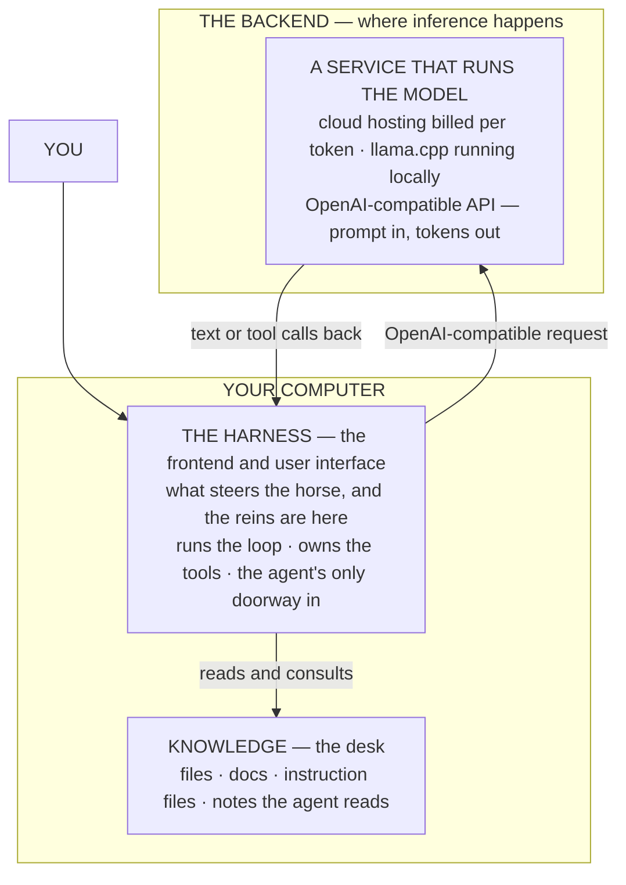
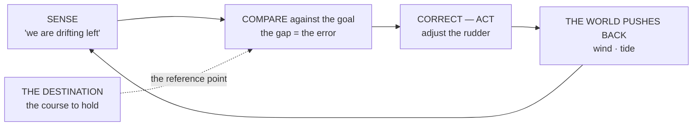
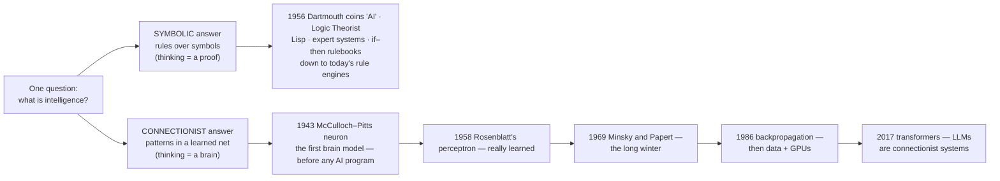
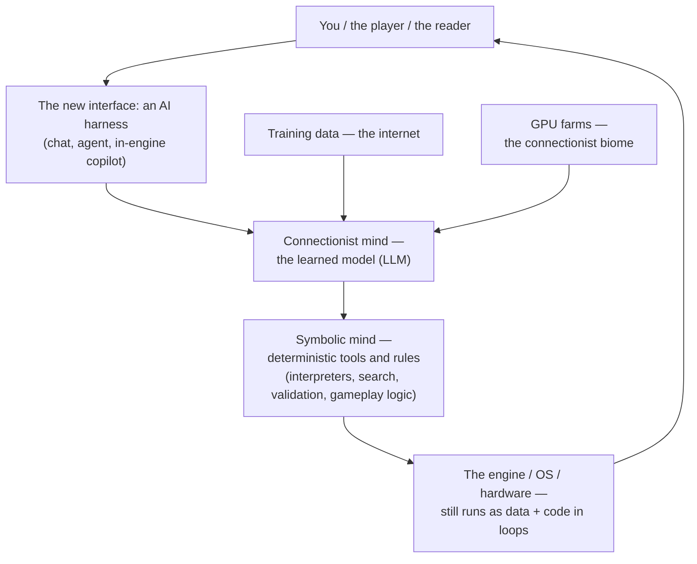
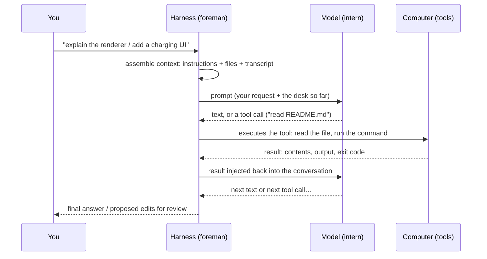
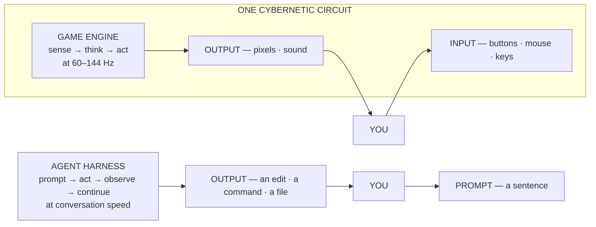
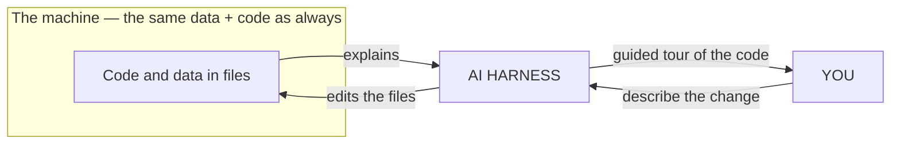
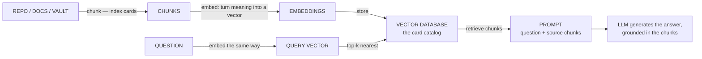

# AI and the Medium — From the Steersman to the New Interface

This chapter answers the question the flagship reference opens and leaves
open in its section 8.1 (the new interface): **once we can talk to software,
what exactly is doing the talking — and where did that ability come from?**
Read the two source drafts as one story. The first half is history: the
steersman's loop that became cybernetics, the two minds that split AI into
rival camps for seventy years, and the two winters and springs that built the
world you live in. The second half is engineering: strip any modern AI coding
agent to its bones and you find four pieces — a **backend**, a **model**, a
**harness**, and **knowledge** — and every concept in this chapter hangs off
those four.

It is a companion to [00-software-is-the-medium.md](00-software-is-the-medium.md),
the flagship, and to [01-common-structure.md](01-common-structure.md) and
[02-world-models.md](02-world-models.md). In the collection's reading order this is
the sixth chapter: it follows [08-the-weapon-example.md](08-the-weapon-example.md),
which showed the whole data → code chain at work in one weapon, and it leads
into [10-the-coming-times.md](10-the-coming-times.md), which asks where all of this
is going.

No programming is required. If you have typed a request into any AI tool, you
have already met the front of this machine; here is the rest of it. Terms are
defined on first use, each section ends with a boxed **come back to this**
takeaway, and everything that is the author's framing rather than a source's
fact is flagged in **Facts, provenance, and where to go next** at the bottom.
No claim carried an `[unverified]` mark in its sources, and none is needed
here; every sentence that outruns its citation is interpretation, and it is
listed as such.

> **The one idea: four pieces make "talking to software" possible — a
> backend** (the inference service: a cloud provider billing per token, or a
> local runner on your own machine), **a model** (the trained brain that
> backend runs), **a harness** (the frontend you actually talk to — the thing
> that steers the brain and **grants the AI agent access to your computer**),
> and **knowledge** (the context: files, instructions, docs, notes the agent
> can read). A model alone is a chat box; the harness turns words into actions
> against your machine; the knowledge layer is what lets an agent understand
> *your* project rather than the internet's.

## 1. The one idea: the backend, the model, the harness, the knowledge

Strip any modern coding agent to its bones and you find exactly four pieces —
with one piece most conversations forget. The **backend** is the service that
does the *inference*: the actual math of running the model. The **model** is
the trained brain the backend runs. The **harness** is the *frontend* — the
program you actually talk to — which sits on your computer, not in a data
center, and is the one and only piece allowed to touch your machine. And the
fourth, forgotten piece is **knowledge**: the context — files, instructions,
notes — served into the prompt at request time so the agent knows *your*
project rather than the general world.

| Piece | What it is | Who runs it, where | Product |
|---|---|---|---|
| **Backend** | the inference service | a cloud data center (paid per token), or a local runner on *your* machine | tokens |
| **Model** | the trained brain | runs inside the backend | the intelligence behind the tokens |
| **Harness** | the frontend and user interface — the literal "harness" that steers the horse | on *your* computer | the loop, the tools, the permission gates |
| **Knowledge** | the context | served into the prompt at request time | understanding of *your* project |

Three of the four do the visible work inside the agent's loop; the backend is
the quietly running plinth beneath them:

- **The model is a statistical text predictor** behind an API or a local
  binary. It has no hands: it cannot open a file or run a command, because it
  has no access to a computer at all — it produces *text*
  ([Wikipedia: Large language model](https://en.wikipedia.org/wiki/Large_language_model)).
- **The harness is an ordinary program.** It assembles a prompt from your
  request, the transcript, and the instructions; sends it to the model; receives
  words back; and — the decisive step — interprets *tool calls* in those words
  and **executes them** on the computer. Every open harness says this in its
  own words: opencode "plans and edits" ([opencode docs](https://opencode.ai/docs));
  pi "can inspect files, run commands, edit content, and work through
  multi-step tasks" ([pi docs](https://pi.dev/docs/latest)); Hermes runs 60+
  built-in tools with a learning loop that improves the longer it runs
  ([Hermes docs](https://hermes-agent.nousresearch.com/docs)).
- **Knowledge must be placed on the desk.** The harness has no memory of
  yesterday, and the model has a small, fixed desk (the context window, §10).
  Everything else the agent may need must be put there before or during the
  job — which is the whole purpose of instruction files like `AGENTS.md` and
  of documentation, and the subject of the knowledge section (§9).

A proof from the thing itself: this chapter belongs to a collection written by
exactly this stack — an open-source harness pointed at a remote model reached
through a gateway. The model never touched a file; it only ever saw text. The
harness gave it tools (read, search, edit, shell, subagents). And the
knowledge for the job arrived because the harness read a plain-markdown
instruction file at startup plus a folder of installable **skill** bundles.
Neither the file nor the skills are code the model "runs." They are *context*
— the desk.

> **Come back to this.** An agent is four things: the **backend** (the
> inference service — cloud per token, or a local runner), the **model** (the
> trained brain that backend runs), the **harness** (the frontend on *your*
> computer that owns the loop and the tools), and **knowledge** (the desk:
> files, instruction files, project notes). When someone says "the AI edited my
> files," they really mean "the harness gave the model hands."

## 2. The history: from a Greek boat to Norbert Wiener

The oldest idea in this chapter is an ancient boat being steered. The person
holding the steering oar was the **kybernetes** — the steersman — and Plato
already used the image for good governance. Wind and tide push every vessel
off course; the steersman does one thing, over and over: *look ahead, notice
the drift, correct, look again*. That cycle — **sense, compare against a goal,
correct, repeat** — is the loop every era of this story has been rediscovering,
from Babbage's engines to today's language models

The name has a date. The French physicist André-Marie Ampère used
*cybernétique* in 1834. In summer 1947 **Norbert Wiener** reached for the same
Greek root and named the whole phenomenon — "whether in the machine or the
animal" — *Cybernetics*, landing in his 1948 book *Cybernetics: Or Control and
Communication in the Animal and the Machine*. Wiener loved the ancestry: the
mechanical **governor** that steadies a steam engine descends from the same
root via Latin *gubernator*, and James Clerk Maxwell wrote about feedback
governors as early as 1868. Even the field's name is a steering word
([Wikipedia: Cybernetics](https://en.wikipedia.org/wiki/Cybernetics)).

The core idea is the **feedback loop**: a system with a goal senses its own
output, compares it to the goal, and corrects. The classic example is the
**thermostat**: you want 21 °C; it measures the room, heats when the gap is
too cold, stops when it closes — steering temperature the way the kybernetes
steered the boat. **Negative feedback** reduces a gap (heater off as the room
warms); **positive feedback** grows one — the microphone hearing its own
speaker feed, louder and louder: the live-show howl.

Wiener's 1948 insight was that the cycle has *the same shape* whether the
steersman is a sailor, a thermostat, a nervous system, or a machine — a
science, not a metaphor. The reference renders the same cycle as
**sense–think–act** with a human inside the machine
([00-software-is-the-medium.md](00-software-is-the-medium.md), §3). For a game team
this is familiar ground: "tight loop," "bad game feel," "the controls feel
laggy" are all cybernetic statements. Every 16.6 ms step at 60 fps, your game
senses input, compares against a design goal, acts, and senses again.

> **Come back to this.** The oldest idea in computing is a Greek boat being
> steered. **Sense → compare → correct** is the feedback loop; it was named by
> **Norbert Wiener in 1948**, descends from *kybernetes* (the steersman)
> through the word *governor*, and runs in the thermostat, your heart, and
> your game loop at 60–144 Hz.

## 3. The two minds: symbolic vs connectionist

One question — *what is intelligence?* — got two rival answers, and they built
two rival software worlds. A game team should care because your engine, your
NPCs, and the AI in your pipeline are all built from **both** minds, and most
AI confusion — "it hallucinated," "just add more rules," "just train a model"
— is really the two paradigms bumping shoulders in one system.

- **The symbolic hypothesis:** *intelligence is the manipulation of symbols
  according to rules.* A symbol is a token that stands for something — the
  word `cat`, the number `7`, the sentence "the player has a key." A rule says
  how symbols may be replaced, the way a grammar turns one sentence into
  another. Thinking is a formal proof: start from premises, apply rules, reach
  conclusions ([Wikipedia: Symbolic artificial intelligence](https://en.wikipedia.org/wiki/Symbolic_artificial_intelligence)).
- **The connectionist hypothesis:** *intelligence is patterns in a network of
  simple elements.* The elements are tiny computing units roughly modeled on
  neurons; each sums its weighted inputs and "fires" if the total crosses a
  threshold. Knowledge lives not in explicit rules but in the *pattern of
  weights* — how the elements are connected and how strongly. Thinking is a
  brain ([Wikipedia: Connectionism](https://en.wikipedia.org/wiki/Connectionism)).

**The deep irony: the brain model came first.** The first computational model
of the brain predates the first symbolic AI program by thirteen years:

- **1943 — the artificial neuron.** Warren McCulloch and Walter Pitts showed
  a simplified neuron — sum inputs, compare to a threshold, fire or not — can
  compute logic gates, and networks of them can compute anything a Turing
  machine can.
- **1956 — symbolic AI is founded.** The Dartmouth summer workshop coined
  "artificial intelligence," and Newell and Simon's **Logic Theorist** (usually
  credited as the first true AI program) proved theorems by manipulating
  symbols.
- **1958 — the perceptron.** Frank Rosenblatt built a real, trainable machine
  that weighted its inputs and *adjusted its weights from mistakes* — learning
  classifications by example.
- **1969 — the critique that froze the field.** Minsky and Papert's
  *Perceptrons* proved a single-layer perceptron cannot compute XOR. The point
  was correct about one layer — and was read as a verdict on all neural
  networks: funding collapsed into a **perceptron winter**. (Two nuances: the
  book did not forbid multilayer nets, and nobody yet had a practical training
  algorithm for them.)

So **connectionism is not a recent fad that got lucky — it is the older
idea.** It sat dormant for most of the discipline's life because the people
with money and machines chose rules, and because the computers of 1956 could
barely simulate a handful of brain cells.

**The symbolic branch produced software of its own: Lisp, then expert
systems.** Symbolic AI needed a language that treated symbols as first-class
citizens. In 1958 John McCarthy designed **Lisp** — "LISt Processing" — where
*everything is a list* and *code is data*: a Lisp program *is* a list, so a
Lisp program can read, edit, and rewrite other Lisp programs at run time. By
the 1970s the symbolic program settled on its signature artifact, the
**expert system**: a program that emulates an expert by reasoning over
knowledge represented as **if–then rules**. Touchstones: DENDRAL identified
organic molecules; MYCIN diagnosed blood disease and could *explain* each
answer by replaying fired rules; XCON configured DEC's computers, the first
big commercial win. Symbolic software's superpower is *explanation* — ask an
expert system "why?" and watch the rule chain answer. Its disease is
*brittleness*: knowledge never written down as a rule is knowledge the system
does not have, and writing all of it down became the **knowledge-acquisition
bottleneck** that eventually broke the industry (§4).

**The connectionist branch had its own machine vision: learn the network from
examples instead of writing rules.** In 1986 Rumelhart, Hinton, and Williams —
building on a lineage that includes Paul Werbos (1974) — applied the chain rule
of calculus backward through a network to compute how much each connection
contributed to the current error, then nudged every weight against it. The
**hidden layers** — the units between input and output — could finally be
trained. The two things the idea had always needed were *fuel* and a *biome*:
the fuel arrived as digital data (the web became a training corpus; ImageNet
taught networks to see), and the biome arrived as the graphics processor, whose
parallel lanes are exactly what a layer of a neural network — thousands of
multiply-adds on many inputs at once — demands. **AlexNet**, trained on GPUs,
won the 2012 ImageNet challenge by a landslide and ignited the deep-learning
boom. The games industry built the connectionist engine by accident; CUDA made
it programmable. In 2017 Google's *Attention Is All You Need* introduced the
**transformer** — a network parallelizable across the words of a sentence — and
transformers became the substrate of the modern **large language model (LLM)**:
GPT (2018), GPT-2 (2019), GPT-3 (2020), **ChatGPT** (November 2022)
([Wikipedia: History of artificial intelligence](https://en.wikipedia.org/wiki/History_of_artificial_intelligence)).

> **Come back to this.** The two minds are nearly the same age, and they have
> traded the crown ever since. The brain model (**McCulloch–Pitts, 1943**)
> predates the first AI program (**1956**); the **perceptron (1958)** really
> learned; **Minsky–Papert (1969)** froze the field on a real limit plus a
> missing training algorithm; **1986 backpropagation and then data + GPUs**
> brought it back. Every time you hear "neural nets are recent hype,"
> remember 1943.

## 4. Two winters, the springs, and the hybrid the world actually built

Every boom here is the same trade: an era promises more than its hardware and
data can deliver, the promise runs ahead, and the money collapses.

- **Winter one: the Lighthill report (1973).** James Lighthill's review told
  the British government the promised dividends had not appeared — search
  exploded combinatorially — and funding was cut through the late 1970s.
- **Spring: expert systems (1980s).** The symbolic program's one commercial
  footing — and the scaling wall was the knowledge-acquisition bottleneck.
  Rule bases did not scale; each system was a hand-built museum, and
  maintenance became a people problem.
- **Winter two (1987–93).** The Lisp-machine market collapsed (reportedly
  ~$500 million vanished in a single year), ambitious projects slimmed, and
  funding dried up.

Recovery, both times, meant learning over hand-written rules:
**connectionism returned** with backpropagation (1986); **statistical NLP
replaced hand-written grammar** in the 1990s — trust swung from "what a genius
writes" to "what the data says"; and **the internet grew into a substrate** —
ARPANET (1969), TCP/IP (1983), the World Wide Web (1989–91) — that connected
the world's computers and began indexing the world's documents. Nothing was
built to feed neural networks, and nothing about them could go mainstream
without it, since learning is data-hungry. Then the names: **deep learning**
(named 2006), **AlexNet on ImageNet on GPUs** (2012), **the transformer**
(2017), the GPT/ChatGPT era (2018–2022)
([Wikipedia: AI winter](https://en.wikipedia.org/wiki/AI_winter)).

### The engineering table: two specialists, both needed

Enough mythology. In engineering terms the two minds are *specialists*:

| | Symbolic (rules, proofs) | Connectionist (learned networks) |
|---|---|---|
| **Native strengths** | exact rules, logic, algebra; verifiable behavior | pattern recognition, perception, translation, generation |
| **Best when** | the rules are known, few, stable; wrong answers are unacceptable | the rules are unknown, many, or changing; examples are abundant |
| **Can it explain itself?** | yes — replay the rule chain ("why?") | no — the weights are opaque |
| **Failure mode** | brittle: outside the rulebook, catastrophically wrong | fuzzy: confidently wrong (hallucination) |
| **Cost** | expensive human knowledge-maintenance | expensive data and GPU-scale compute |

Real engineering problems demand *both*. Spellcheck: dictionary rules catch
typos, a neural re-ranker picks the best fix. E-commerce: hard rules govern
checkout and fraud blocks; learned models pick what you will click. LLM
agents: the learned model generates fluent thought; a symbolic harness
supplies the tools — calculators, search, code interpreters — whose exact
answers the model cannot be trusted to compute. **And game engines are the
clearest example: the whole authored stack is symbolic in spirit** — Blueprint
graphs, behavior trees, finite-state machines, decision trees, A* pathfinding,
data tables: rules about the world, written by humans
([01-common-structure.md](01-common-structure.md)). The learned mind shows up where
perception lives — motion matching for animation, learned noise removal and
image upscaling, content generation.

### The UE5 anchor: a modern engine is exactly this hybrid

The family's [Engines/unreal-engine.md](Engines/unreal-engine.md) case study
documents a modern engine as precisely this synthesis: **explicitly authored,
symbolic systems** (UObject reflection, Blueprints, replicated state) **driving
a massively parallel GPU data pipeline** whose light and physics are pushed
through data-driven mathematics — Lumen being the *biome* logic at extreme
scale, not a neural network. When a game student asks "where is the AI in my
engine?," the honest answer is *both* minds, joined in one loop: the rules
mind owns the logic, the learned mind handles perception.

> **Come back to this.** Two winters (Lighthill 1973; 1987–93) bracketed an
> expert-systems spring whose scaling wall is the era's permanent lesson.
> Recovery everywhere meant **learning over hand-written rules** — and the
> world you live in is a **hybrid**: symbolic systems for the parts that must
> be exact, learned systems for the parts that swim in examples. Your engine
> already runs both.

## 5. The loop returns: the harness as cybernetics at conversation speed

"How agents talk to software" turns out to be a small loop, not a mystery.
Every harness runs some version of this, and it is the oldest idea in this
chapter wearing modern clothes:

Three mechanisms make it work:

- **Context assembly.** Every session begins with a fresh context window; the
  way to give a session knowledge is to place instruction files the harness
  reads at the start of every session.
- **Tool calling.** The harness's tools are real programs it can launch — read
  a file, edit it, search, run a shell command, fetch a URL. The model does
  not run anything; it *requests* a call, and the harness performs it and
  reports back. The practice predates MCP: OpenAI's 2023 "function-calling"
  API was exactly this.
- **Observation → continuation.** The harness injects the tool's result into
  the model's next turn, so the loop self-corrects: "the tests fail → try
  again" is a mainstream agent behavior.

**The context window is working memory, and it is small and precious.**
Everything the model can "remember" is what fits in the window at once — which
is why harness docs repeat the advice that irrelevant files "will often
distract or confuse the LLM," and why instruction files are kept short. The
flagship's catch — "you still have to know the medium to ask good questions" —
is literal: what is not on the desk, the agent cannot see
([00-software-is-the-medium.md](00-software-is-the-medium.md), §8.1).

**The tool list is the agent's job description** — and it is almost the same
everywhere: file tools (read, write, edit) are the actual productivity;
command tools (run a shell, run tests) let the agent verify its own work;
search and index tools expand the desk; web tools fetch docs and forums; and
**MCP servers** are the expanding toolkit for everything else (§8).

### The cybernetic mapping, one-for-one

Now put the reference's sense–think–act loop next to the agent loop. Nothing
has to be stretched; it is the same circuit with a different "think" engine:

| Cybernetics (Wiener) | The agent harness |
|---|---|
| **Goal** | your request + the stop condition |
| **Sense** | the tool calls: read file, run command, search |
| **Think** | the model's next-token reasoning |
| **Act** | executing the tool call on your computer |
| **Feedback** | the result injected back into context |
| **Stability / error** | "the tests fail → try again" · "ask before acting" |

The reference's §3 already said it: the harness *senses* via tools, *compares*
via the model, and *corrects* via the next tool call. And the priceless point
for a game student is the reference's §5 claim that cybernetics is **not a
metaphor**: the engine's frame loop *is* the human–machine loop, executed fast
enough to feel immediate — every optimization in the engine exists to tighten
the sense–think–act circuit. So stack the two loops and the whole picture
clicks:

**The agent harness is the human–machine loop at conversation speed.** The game
loop runs hard-real-time on a frame budget; the harness runs the same loop
slowly on purpose — the senses are file-and-search tools instead of input
drivers, the actuator is an editor instead of a renderer, and the "display" is
the diff the human reads before approving. The cybernetic structure is
identical; only the timescale and the human's position differ. What the harness
adds beyond Wiener's classic loop: the **goal is renegotiable in plain
language** mid-loop (you restate the prompt — the human is *in* the loop);
**tools are interchangeable sensors and actuators** (a read, a test run, an MCP
server); and the **hardware is often unreliable** — the damage-tolerant
behavior from this chapter's intelligence aside (§12) is cybernetics' answer to
"what if a component breaks?": sort the array, navigate around the defect,
still reach the goal.

**For a game team:** understand the harness the way you understand the frame
loop — as a bandwidth-budgeted, feedback-corrected circuit. The twin rules for
an AI-assisted build are (1) keep the **feedback tight** — short context, fast
local model, incremental diffs — and (2) keep the **human in the loop** just
like the player is: the diff is your display, and review-before-apply is the
"feel immediate" of agent work.

> **Come back to this.** An agent harness is a small, slow **cybernetic
> loop** — goal, sense, compare, correct, feed back — the same circuit as a
> video game's frame loop, just at conversation speed instead of 60–144 Hz.
> The game runs that loop hard-realtime; a harness runs it slowly on purpose,
> with you approving every revolution. **Cybernetics is not a metaphor — it is
> the skeleton in motion, from thermostat to game engine to coding agent.**

## 6. The new interface: explain and modify

For the entire history of computing, the human side of the loop had to learn an
*artificial* language first — punch cards, then C++, Blueprint, SQL. The
machine never understood us; we learned its languages, because there was no way
to turn intent reliably into correct code and data. **That is no longer true.**
AI is the first interface that works in *both* directions of the loop at once
([00-software-is-the-medium.md](00-software-is-the-medium.md), §8.1):

- **Explain** (software → understanding): "walk me through the engine's
  renderer," "what does this world-model query do," "why is my UI overlay
  wrong?" The interface reads the code and data and pushes back a guided tour —
  the learning tool.
- **Modify** (intent → software): describe the change, and the harness edits
  the files. The same edit loop an engineer does by hand, now driven by words.

**This is not a new kind of software. It is a new interface to the *same*
medium** — the exact input → process → output loop from the flagship's §2, with
a new doorway. The medium didn't change; only the doorway did. And that comes
with a catch that is good news for everything else in this collection:

> You still have to **know the medium** to ask good questions. You need to know
> that a renderer and a scene graph *exist* before you can ask "walk me through
> the renderer." The foundations in this reference are exactly what make the
> interface useful.

Every discipline — art, audio, design, production — now has the same doorway
into the machine. What you point it at is what you choose to understand.

> **Come back to this.** AI is the first interface that **explains** software
> *and* **modifies** it — a new doorway to the same machine, not a new
> machine. The interface changed, the medium didn't; and the foundations in
> this collection are what make the new doorway worth having.

## 7. The harness landscape, open-source first

Everyone converged on the same shape — a harness with a loop and tools — and
then painted it different colors. **This chapter's bias is open-source**: the
harnesses marked as open below are the ones you can read, fork, vet, and point
at your own local model. Read the table through the lens of §5 — **every row
is a frontend.** The *backend* behind them is whatever model service (cloud or
local) they are pointed at; the same open harness can be aimed at several
backends, and the harness is what decides the interface, the tools, and the
access.

### The open-source quartet: Kilo, opencode, pi, Hermes Agent

- **Kilo** — "an open-source AI coding assistant that works wherever you do —
  in your IDE, terminal, browser, or on the go." Its docs add a killer line
  for this chapter: the easiest way to configure it is to ask the agent
  *"add my Ollama endpoint"* — because Kilo reads a plain config file and can
  point at a local model ([Kilo docs](https://kilo.ai/docs)).
- **opencode** — "an open source AI coding agent," terminal-based, desktop, or
  IDE. Its `/init` command writes your project's `AGENTS.md`; its plan mode
  lets the agent "suggest *how* it'll implement the feature" instead of
  editing; it ships skills, permissions, MCP, and a full SDK. Its providers
  page documents local `llama.cpp`, `ollama`, and `lmstudio` endpoints
  ([opencode docs](https://opencode.ai/docs)).
- **pi** — a minimal, self-extensible agent: "an extensible AI agent that
  works from your terminal. Give it a goal and a working folder, and it can
  inspect files, run commands, edit content, and work through multi-step
  tasks." It ships four built-in tools (read, write, edit, bash) plus
  sessions, branching, and explicit guidance to "connect a subscription, API
  key, **local model**, or compatible endpoint" ([pi docs](https://pi.dev/docs/latest)).
- **Hermes Agent** — the self-improving agent from **Nous Research**: "the
  only agent with a built-in learning loop — it creates skills from
  experience, improves them during use, and builds a deepening model of who
  you are across sessions." It supports "Nous Portal, OpenRouter, OpenAI, **or
  any endpoint**" — including local model servers — with built-in skills, MCP
  support, and honestly-documented security ([Hermes docs](https://hermes-agent.nousresearch.com/docs)).

The proprietary or source-available names are the same idea behind a license
wall — much more famous, no less a frontend: **Claude Code** ("reads your
codebase, edits files, runs commands"), **Codex CLI** (Apache-2.0 but designed
around OpenAI backends), **aider** ("AI pair programming in your terminal"),
and the IDE-embedded editors **Cursor / Windsurf / Copilot** — which you buy,
not fork. Names genuinely move fast (an acquisition, an org change, a 1.0
release; reported at retrieval time); the shapes below are the durable part.

| Harness | License | Where it lives | What its primary docs claim |
|---|---|---|---|
| **Kilo** | Open source | IDE / terminal / browser / Slack | "Open-source AI coding assistant"; configure by asking the agent — even "add my Ollama endpoint" |
| **opencode** | Open source | Terminal / desktop / IDE | "Open source AI coding agent"; `/init` writes `AGENTS.md`; plan mode; local providers documented |
| **pi** | MIT | Terminal | "Extensible AI agent"; four built-in tools; sessions and branching; "local model or compatible endpoint" |
| **Hermes Agent** | MIT | Terminal / desktop / messaging | "Self-improving agent"; learning loop creates skills; memory across sessions; "any endpoint" |
| Claude Code | source-available | Terminal / IDE | "Reads your codebase, edits files, runs commands" |
| Codex CLI | Apache-2.0 | Terminal | "Coding agent from OpenAI that runs in your terminal" |
| Cursor / Windsurf / Copilot | proprietary | IDE | In-editor assistants sold as products |

> **Come back to this.** The open-source quartet — **Kilo, opencode, pi,
> Hermes Agent** — are the harnesses this chapter steers you toward: readable,
> forkable, and happy to point at a local model. The famous proprietary names
> are the same idea with a license wall. The interface you can inspect and
> re-point beats the one you can only lease.

## 8. The emerging standards: AGENTS.md, dotfolders, skills, MCP

Five harnesses from five vendors all need to read your repo, learn your
conventions, and connect to your tools. Left to themselves, each would invent
its own file format, folder, and plugin SDK — an N×M integration problem. Out
of that, four standards are converging:

### 1. `AGENTS.md` — the "README for agents"

One plain-markdown file in a repo's root explaining to any agent how the
project works: setup, test commands, conventions. The agents.md site calls it
"a **README for agents**: a dedicated, predictable place to provide context and
instructions to help AI coding agents work on your project," now used by
"over 60k open-source projects" and read by Codex, aider, opencode, Cursor,
Windsurf, Gemini CLI, Kilo, and Copilot ([agents.md](https://agents.md)).
Anthropic formalized the same idea earlier as `CLAUDE.md`; current Claude Code
reads `AGENTS.md` "in place of a `CLAUDE.md`" so one file serves every tool.
Conflict rules are already settled: "the closest `AGENTS.md` to the edited
file wins; explicit user chat prompts override everything."

### 2. The dotfolder conventions — `.agents/`, `.claude/`, `.cursor/`

Beyond one file, agents look in a per-project configuration folder for rules
and skills: Claude Code documents `./.claude/CLAUDE.md` and `./.claude/rules/`;
Cursor uses `.cursor/rules`; Windsurf `.windsurf/rules`; Copilot
`.github/copilot-instructions.md`. One convention, several spellings.

### 3. Skills — installable instruction bundles

A **skill** is a small, packaged set of instructions and resources an agent
loads on demand — like an AGENTS.md you invoke when relevant instead of
carrying always. Anthropic published **Agent Skills** as an open companion to
MCP; the open quartet made it first-class and open — opencode documents Agent
Skills, Hermes' skills system *is* the point of the product, and pi is built
around "skills, prompt templates, and themes" you can package and share.
Skills are how knowledge stops living only in human heads and starts living in
the desk.

### 4. MCP — the "USB-C for AI"

The **Model Context Protocol** is an open standard, introduced by Anthropic on
November 25, 2024, "for connecting AI applications to external systems… Think
of MCP like a **USB-C port for AI applications**"
([modelcontextprotocol.io](https://modelcontextprotocol.io)). Before MCP, every
integration meant a hand-written connector per tool per model — the N×M
problem. Three roles: **host** (the agent), which spawns one **client** per
connected **server**; each server advertises **tools and resources** the model
can discover; the host forwards the model's tool call and the server runs it.
Adoption is the story: OpenAI, Google, ChatGPT, Claude, VS Code, and Cursor
all use it — and the open quartet documents MCP as a native feature. That MCP
runs *inside your harness even against a fully local model* is the quiet part
worth saying out loud.

**Why this matters to a student:** a standard is the difference between N×M
connectors and one adapter. With MCP, your game's build system, task tracker,
and design tool each need one "server," and every harness can attach without a
bespoke integration.

> **Come back to this.** Four standards are converging: **`AGENTS.md`** (the
> README-for-agents), **dotfolder config** (`.agents/`, `.claude/`,
> `.cursor/`), **skills** (installable instruction bundles), and **MCP** (the
> open "USB-C for AI": host/client/server, tools the model can discover).
> Standards turn N×M into one adapter.

## 9. The knowledge layer: why the weights are not the world

A large language model is a giant compressed memory of text it trained on. Ask
it about C++ trivia and it shines; ask it about *your* codebase and it has
never seen it. Retrieval-augmented generation (the RAG subsection below) exists precisely
because LLMs need "domain-specific and/or updated information that is not
available in the training data." Everything an agent "knows" beyond general
knowledge has to be *served to it* from somewhere. Two consequences: **an
agent's knowledge is what you feed it, not what it was born with** — and **the
quality of the answer is bounded by the quality of the retrieval**: stuff the
wrong chunk into the prompt and the model will confidently tell you something
wrong.

### RAG: retrieve, then generate

**RAG** combines a parametric language model with a non-parametric external
memory accessed through retrieval at inference time
([Wikipedia: Retrieval-augmented generation](https://en.wikipedia.org/wiki/Retrieval-augmented_generation)).
The reading-room analogy: a library organized by index cards. When a question
arrives, you read the cards, pick the most relevant, go to the shelves, and
hand the *open books* to the person writing the answer. Four stages:

1. **Embed.** The documents to be referenced are converted into **embeddings** —
   numerical representations in a large vector space — in two steps: **chunking**
   (cutting documents into retrievable pieces) and **embedding** (turning each
   chunk into a vector).
2. **Store.** The vectors live in a **vector database** — the card catalog.
3. **Retrieve.** Given a query, a retriever selects the most relevant
   documents.
4. **Generate.** The model draws on the augmented prompt to answer — putting
   source text into the prompt is sometimes called **prompt stuffing**.

**What it buys, and what it does not.** RAG grounds answers in fresh or
private material with fewer hallucinations, at lower cost than retraining, and
it can cite its sources so readers can verify them. But **RAG does not prevent
hallucination**: the model can "misinterpret the context" of a correctly
retrieved source; it can merge old and new misleadingly; it "may struggle to
determine which source is accurate"; and models "may generate answers even when
they should indicate uncertainty." Add **lost in the middle**: performance
peaks when relevant information sits at the start or end of a long context and
degrades significantly in the middle. **Retrieval is an ingredient, not a
truth serum.**

### Vector databases: shelves indexed by meaning

Words and sentences can be turned into **embeddings** — vectors whose
positions encode meaning, so words closer in the vector space are expected to
be similar in meaning. "Similar" is measured as **cosine similarity** — the
angle between two vectors. A **vector database** stores these embeddings and
retrieves by semantic similarity rather than exact match. Two things per row:
the **embedding vector** and the **payload metadata** — the pointer back to the
world (file, line, source) so retrievals are citable. Exact nearest-neighbor
search compares against every vector — trivial and perfect-recall up to tens of
thousands; to scale to millions you add an index family like **HNSW**
(a layered graph: upper layers act as a rough map, the bottom layer holds every
node) that trades a little recall for speed. The well-known open stores are
Chroma, LanceDB, Qdrant, Milvus, Weaviate, and **pgvector** (a Postgres
extension, so vectors join your ordinary rows with ACID); **FAISS** is the
foundational library rather than a service. Plain text finds characters;
embeddings find meaning.

### Knowledge graphs for code: the codebase, drawn

Embedding a whole file as one fat vector is a blob of meaning. A **knowledge
graph** is the opposite shape: a knowledge base that uses a graph-structured
data model — **nodes** (symbols, files) and **edges** (defines, calls,
references) — so "where is X defined?" and "who calls Y?" become queries, not
guesses. The layers: **tree-sitter** parses source into concrete syntax trees
fast enough to update on every keystroke; **CodeQL** lets you "query code as
though it were data" — compile a project into a database and write queries to
find every variant of a bug; **Sourcegraph** adds symbol search across millions
of repos; and **llms.txt** gives a website a markdown "front door" that is
"human and LLM readable." "Why does the agent keep referencing a function that
doesn't exist?" is the graph question in disguise. *(The belief that graphs
beat chunk soup on symbol questions is strong engineering belief grounded in
how these tools advertise themselves, not a controlled study — treat
accordingly.)*

### OKF and Obsidian: knowledge written once, read twice

The most durable knowledge layer is also the most boring: plain markdown files
in folders. **Open Knowledge Format (OKF)** is "an open, human- and
agent-friendly format for representing knowledge: a directory of markdown
files with YAML frontmatter." Its spec's preamble is the whole pitch: "There
is no schema registry, no central authority, and no required tooling. **If you
can `cat` a file, you can read OKF; if you can `git clone` a repo, you can
ship it.**" The goals: readable by humans without tooling, parseable by agents
without bespoke SDKs, diffable in version control, portable across tools,
organizations, and time. The discipline is thin but load-bearing: a concept =
one `.md` file, frontmatter is YAML, `type` is the only required field — and
**provenance, trust, and freshness are first-class** (`sources`,
`generated`/`verified`, `status`, `stale_after`), precisely because OKF assumes
knowledge is continuously written and maintained by agents.

**Obsidian** is the human UI over that exact format — "the free and flexible
app for your private thoughts," storing notes as plain-text Markdown files,
with links, a graph view, and plugins ([Obsidian](https://obsidian.md/)). One
format, two readers.

**Why "write once, read twice" beats embedding-everything.** An embedding index
is a *derived artifact*: it must be rebuilt when the source changes, stores no
provenance, and can silently serve stale vectors. A folder of plain markdown is
the **source of truth** (humans and agents both read it), **versioned** (a
claim's history is trust), **linkable** (edges to walk, not tokens to parse),
and **yours** — open file formats, no lock-in. It is the collections'
world-models idea in a new costume: *knowledge as stored, versioned, linked
state — the project's world model* ([02-world-models.md](02-world-models.md)), with
a human-readable view layer instead of a second database to keep in sync.

A closing discipline note on "decision models": whatever name the industry is
currently marketing them under, the durable pattern is (1) **enumerate the
answer space** so the model cannot invent an option, (2) **confidence gating
with a human in the loop** — send low-confidence cases to a person, and
(3) **a plan that gates the work** — an agent that reads a plan before acting
is running a decision layer.

> **Come back to this.** To teach an agent your world, give it **a reading
> room, not a brain transplant**: a retrieval pipeline (chunk → embed → store →
> retrieve top-k → stuff into the prompt → generate), a code graph for symbol
> questions, curated doc sets, and an OKF vault any agent can read. RAG grounds
> answers but is **not a truth serum**; retrieval is an ingredient, and the
> durable practice is knowledge written once, read twice.

## 10. The models behind the interface: local first, cloud as upgrade

The **brain** half of the triad — and the whole content of the **backend** — is
what a model actually is, where it lives, and the few numbers that decide how
much software you can talk about at once. Recall the lesson of §1: **choosing a
model is choosing a backend.** The harness stays the frontend either way; what
changes is which brain the harness talks to, and whether you pay per token or
per gigabyte.

**What a model is.** An **LLM** is "a machine learning model (typically a
neural network) trained on a vast amount of text… to generate, summarize,
translate, and analyze text." Four things pack any downloadable model: the
**weights** (billions of numbers — "7B, 70B, 405B," the headline capacity
number), the **tokenizer** (rules that chop text into *tokens* and map each to
a number — models process numbers, not letters), the **architecture** (layers
and attention; dense vs mixture-of-experts), and **quantization** (rounding
weights to fewer bits — 4-bit, 8-bit — which decides whether a model fits
*your* GPU). Two numbers decide "how much software can I talk about at once":
**tokens** (roughly ¾ of a word, or a chunk of code) and the **context window**
— the number of tokens the model can hold in working memory at once, from 8K
on small models to 128K+ and beyond on big ones. Crucially, your function
definitions count against the context limit: "callable function definitions
count against the model's context limit" — tools live on the desk too.

### Local AI first: the ten-minute recipe

This chapter's bias is that the *default* way to run an agent should not
require a credit card or an internet connection. The recipe a student can run
tonight, all open source, all local:

1. **Get a local backend.** Install **Ollama** — "your prompts are never
   stored or trained on" ([ollama.com](https://ollama.com/)) — or run
   **llama.cpp** directly: `llama-server` serves an **OpenAI-compatible API**
   on your own machine ([llama.cpp README](https://github.com/ggml-org/llama.cpp)).
2. **Pull an open-weight model.** A Qwen2.5-Coder-class GGUF gives you a
   tool-calling-capable local coding model in a few GB of RAM.
3. **Point an open harness at it.** Every harness in the open quartet reads a
   config where "provider" can be a local URL — opencode documents a
   `llama.cpp` provider at `http://127.0.0.1:8080/v1`, an `ollama` provider at
   `http://localhost:11434/v1`, and an `lmstudio` provider at
   `http://127.0.0.1:1234/v1`; Kilo's docs suggest asking the agent *"add my
   Ollama endpoint"*; pi lists "a subscription, API key, **local model**, or
   compatible endpoint"; Hermes supports "any endpoint."
4. **Start at 7–8B and grow.** The cheapest honest-machine arithmetic: about
   one billion parameters ≈ 2 GB at float16, and quantization shrinks that a
   further ~4× at Q4. A 7–8B Q4 model (~4–5 GB) fits any gaming laptop with
   8 GB+ VRAM; 13–14B wants a 12 GB desktop GPU; 27–32B wants 16–24 GB VRAM;
   70B+ is datacenter territory. The trade is always the same: **Q4 fits, Q8 is
   smarter; a 70B at Q4 is usually smarter than an 8B at Q8 — if it fits.**

**Why local** is the bias of this note: privacy (the vendor does not see your
prompts), zero per-token cost after hardware, offline use (LLMs have flown
with no internet at all), an open ecosystem of quantized weights you can run
forever — and the software-medium argument that matters most: **your agency.**
An "AI the vendor can turn off" is a token stream, not a tool; a local model on
a local harness is a tool you own. **Why not local:** weaker models and slower
tokens/sec than the cloud's biggest cards.

### The cloud: rental, via the aggregator

**Hosted inference** is the cloud flavor of the same backend job: a service
"runs a language model on remote AI data centers and makes the output
available… over the Internet" — OpenAI, Anthropic, Google, Mistral, DeepSeek,
all billed per token. Whether the backend is five time-zones away or on your
motherboard, the harness in front of it does not care — it only speaks the
OpenAI-compatible request shape. **OpenRouter** is the aggregator that matters
for harnesses: "a **unified API for every major LLM. One endpoint, hundreds of
models,** with routing, fallbacks, and cost tracking across providers"
([openrouter.ai](https://openrouter.ai/)). You POST to one endpoint and switch
brains by changing one string — and the killer detail is that the *same*
OpenAI-compatible shape that local runners expose is the shape OpenRouter
speaks: one harness config points at either your laptop or the whole open
market. Gateway/aggregators are a *pattern*, not a product — one door into many
brains.

### Hugging Face: the "GitHub of AI"

**Hugging Face** is where open weights live — "the reference AI platform for
open ML… all open and publicly available" ([Hugging Face](https://huggingface.co/)).
If GitHub is where source code is shared, Hugging Face is where trained brains,
their data, and the demos that run them are shared — Git-based repos with
commits and branches. The pieces a student touches: **model cards** (every repo
ships a defined-format card telling you the model's "limitations and biases"
before you download), **GGUF quantization repos** (quantized versions for your
hardware, with the quantization level in the name), **datasets and Spaces**
(training data, and hosted demos), and the `hf` CLI for downloads.

**Open-weight is not open-source.** One language lesson saves a career:
open-weight releases the trained numbers but withholds (or gates) training data
and code; open-source releases all four, and the OSI has disputed Meta's use of
the term for Llama. Read the license line before you build on a family:

| Family | Maker | License class | Software strengths |
|---|---|---|---|
| **Qwen** | Alibaba | Apache-2.0 for most dense releases | The open coding workhorse — Qwen2.5-Coder up to 32B; Qwen3 hybrid thinking/non-thinking |
| **Llama** | Meta | source-available (Community License + AU Policy) | The "industry default"; the family that spawned llama.cpp |
| **Gemma** | Google | source-available, newer versions Apache-2.0 | Light, long context, function-calling capable |
| **Mistral** | Mistral AI | Apache-2.0 (Mixtral/7B) | "Frontier open models," strong on code |
| **DeepSeek** | DeepSeek | MIT (V3, R1) | Reasoning cheap — "comparable to o1 at a much lower price per token" |
| **Phi** | Microsoft | MIT | Small on-device models "built in function calling" |

*(Licenses verified at retrieval; two very new families — Prism ML's Bonsai and
the Ornith line — surfaced in the source research as real at that date but are
not carried into this table; treat anything younger than a year as worth
re-verifying before you build on it.)*

### What to pick for software work

The feature that makes harness tools work is **tool / function calling**: "a
mechanism that enables LLMs to interact with external systems" — a program
separate from the LLM watches its output for a tool-calling syntax, calls the
tool, and feeds the result back in. That is exactly the §5 loop. So the
screening question on any new model is **"does this version support tool
calling?"** — and beyond that, four dials decide the pick:

- **strength ≈ parameters**; **VRAM ≈ parameters ÷ quantization bits**;
  **speed ≈ tokens/sec** the runner reports; **cost ≈ per-token price** (or
  zero, locally).

The selection rule of thumb: **local first, cloud as the optional upgrade**.
A 7B at Q4 fits a laptop and beats a credit-card bill for the same task; a 27B
at Q4 handles almost everything an engine team asks; only the genuinely rare
frontier questions justify renting the strongest cloud model. And whichever
backend you choose, *your harness keeps working* — you are only changing the
base URL, because everything speaks the same OpenAI-compatible shape.

> **Come back to this.** Pick **brains by budget, not fashion**: strength ≈
> parameters, VRAM ≈ parameter-bits, speed ≈ tok/s, cost ≈ per-token — and
> always check **tool-calling support** before wiring a model into a harness.
> The model is a backend you swap by config; **the harness and the knowledge
> outlast every model.**

## 11. Trust boundaries: sandboxes, permissions, and the human in the loop

Giving a text-predictor the ability to run commands on your computer is a
permission decision, and the harness is where it is enforced. Four layers:

1. **Scope.** Tools run in a working directory — the repo you started the
   harness in.
2. **Permissions and approval.** Approval prompts gate destructive actions
   ("ask before running destructive commands"), and harnesses carry **plan
   modes** — opencode's "disables its ability to make changes and instead
   suggest[s] how it'll implement the feature"; Claude Code enforces "blocks"
   via hook rules.
3. **Sandboxing.** Execution can be confined further — Copilot-style agent work
   runs in cloud sandboxes or CI runners; the Gemini CLI documents a full
   sandboxing and security section.
4. **Human review — the wall the docs print in bold.** GitHub's own docs on
   agent output say verbatim: "**Copilot can produce incorrect or suboptimal
   code, including code that contains security vulnerabilities. Review and test
   the output before using it in production.**" Agent output is a draft, not a
   veto.

Even the plumbing has teeth: the MCP history is a security curriculum —
"tool poisoning" attacks via malicious tool descriptions (a prompt-injection
route) and a remotely executable vulnerability in a connector. Treat MCP
servers as untrusted code. *(The specific incidents are as reported by the
protocol's history at retrieval; the lesson is standard security practice.)*

**For a game team:** every review gate you already run — script review,
permissioning assets, the four-stage weapon handoff in
[08-the-weapon-example.md](08-the-weapon-example.md) — generalizes to agent work.
Same instinct, different predictor: *the agent drafts, the human owns the
build.*

> **Come back to this.** Harnesses gate what an agent may touch — **scoped
> working directory, approval prompts, sandboxes, and — non-negotiable —
> human review.** Giving the intern hands is fine; keeping the foreman on the
> loop is the job.

## 12. The synthesis: the interface changed, the medium didn't

Everything above lands on the flagship's closing claim: "the interface changed,
the medium didn't" ([00-software-is-the-medium.md](00-software-is-the-medium.md),
§8.1). The medium — data, code, the loop, state, the clock — still structures
everything the agent touches; the harness only changes *who* can poke it. But
there is a quiet second half to the story, and it is this collection's own next
chapter:

> **A knowledge base written so agents can read it becomes desk supply for the
> whole team — human *and* machine.**

Nothing in the OKF discipline (§9) is "for AI" and nothing is "for humans" —
the discipline makes notes machine-serviceable without making them
machine-garble. The proof is in front of you: this very chapter was drafted by
an agent that read the sibling documents and the flagship and produced drafts
in their voice — because those notes were written as knowledge, not as source
code. The vault even ships a search skill for its own markdown.

### Aside: intelligence is not a human monopoly

A quiet question hangs over everything: once an agent loop can explain and edit
your software, *what exactly is doing the talking?* The shortest honest answer
from the source research: goal-directed problem-solving is **not a human
monopoly, and not even a brain monopoly.** Michael Levin's lab at Tufts builds
its argument across substrates — planaria that keep a learned memory across a
regenerated head, computer-designed "xenobots" made of living cells that walk,
push, and heal themselves, and a classic paper whose *self-sorting arrays* sort
themselves *around* a damaged element, "temporarily reduc[ing] progress in
order to navigate around a defect" — the same damage-tolerance a behavior tree
wants from its NPCs ([Zhang, Goldstein & Levin 2023](https://arxiv.org/abs/2401.05375)).
A crow bends a wire into a hook on the first try; an octopus is obviously
intelligent and deeply alien; and an LLM is alien in a different way — "surprisingly
good" at *formal* linguistic competence and "spotty" at *functional*
competence ([Mahowald et al. 2023](https://arxiv.org/abs/2301.06627)). The
test is never "does it look like us" but **"does it reach its goals in novel
situations?"** — and the agent loop of §5 is the same loop the rest of life
has been running all along.

> **Come back to this.** The interface changed, the medium didn't — and the
> medium is on the desk, readable by both readers. Intelligence is goal-directed
> problem-solving on a continuum, planarian to crow to LLM; the agent loop is
> the shape of it. Design NPCs like the sorting array: give them **a goal, a
> loop, and damage tolerance** — a stop-condition instead of a script for every
> part.

## 13. Facts, provenance, and where to go next

**What this document is.** This chapter condenses two working notes from the
collection's drafting process — the AI history note and the AI harness-landscape
note — into one student-facing reference. It is a rewrite, not a copy: the notes'
per-source URL lists have been collapsed into the external links cited inline
and below, research scaffolding has been cut, and only the argument, the
strongest examples, the mermaid graphs (refactored to fit this document's
layout), and the boxed takeaways survive.

**External sources, official and primary:**

- Histories and definitions: [Wikipedia: Cybernetics](https://en.wikipedia.org/wiki/Cybernetics),
  [Wikipedia: History of artificial intelligence](https://en.wikipedia.org/wiki/History_of_artificial_intelligence),
  [Wikipedia: AI winter](https://en.wikipedia.org/wiki/AI_winter),
  [Wikipedia: Large language model](https://en.wikipedia.org/wiki/Large_language_model),
  [Wikipedia: Retrieval-augmented generation](https://en.wikipedia.org/wiki/Retrieval-augmented_generation).
- Harness docs: [Kilo](https://kilo.ai/docs), [opencode](https://opencode.ai/docs),
  [pi](https://pi.dev/docs/latest), [Hermes Agent](https://hermes-agent.nousresearch.com/docs).
- Standards and infrastructure: [agents.md](https://agents.md),
  [modelcontextprotocol.io](https://modelcontextprotocol.io),
  [ollama.com](https://ollama.com/), [llama.cpp](https://github.com/ggml-org/llama.cpp),
  [OpenRouter](https://openrouter.ai/), [Hugging Face](https://huggingface.co/),
  [Obsidian](https://obsidian.md/).
- Science aside: [Zhang, Goldstein & Levin 2023](https://arxiv.org/abs/2401.05375),
  [Mahowald et al. 2023](https://arxiv.org/abs/2301.06627).
- Engine documentation: [Epic's Unreal Engine docs](https://dev.epicgames.com/documentation).

All URLs were verified reachable at the retrieval date of the source notes
(2026-11-01). Fast-moving facts — the open quartet's current sponsorships and
1.0 releases, adoption lists, model-family licenses — are reported at that
retrieval vintage and are exactly the kind of thing to re-verify before
building on it.

**`[unverified]` marks.** None are carried in this document. The source notes
carried none (verified in the collection's Phase A check), and no surviving
sentence needed an invented source. Where a claim is the author's framing rather
than a source's fact, it is listed below.

**Marked interpretation** (the author's, on top of the sources): the four-piece
"backend / model / harness / knowledge" split; the literal horse-harness
analogy; the agent-loop skeleton "prompt → act → observe → continue"; the
cybernetics mapping table and the "harness as the game loop at conversation
speed" framing; the "interface changed, the medium didn't" synthesis with the
flagship's §8.1; the steersman's-story and "two minds" narrative spine, and
"winters and springs" as a sharpened retelling of the history sources; the
deliberate **open-source and local-first bias** — the recommendation of the
quartet and of local Ollama/llama.cpp inference; the four-cluster grouping of
emerging standards and the "N×M becomes one adapter" framing; the reading-room
analogies for RAG and the "write once, read twice" slogan applying to
OKF/Obsidian; the "graph beats chunk soup on symbol questions" engineering
belief; the "buy a car vs lease a car" local-vs-cloud metaphor; the four-dials
selection rule; the intelligence-as-goal-directed-problem-solving framing of
the aside; the JEV decision-model vendor story from the source research is
*not* carried forward (it resolved to one unverified vendor blog; the durable
pattern — enumerated schemas, confidence gating, human sign-off — is covered
in the knowledge section as the decision discipline).

### Where to go next

This is the sixth chapter of the collection's reading order. Read it as the
partner to the flagship's section 8.1 — "the new interface" — and as the
bridge from the past to the future:

- **Back to:** [08-the-weapon-example.md](08-the-weapon-example.md) — the
  previous chapter, and the concrete chain the AI now helps you walk.
- **Forward to:** [10-the-coming-times.md](10-the-coming-times.md) — where the
  collection looks at what the machines you just dissected are becoming.
- **The anchor:** [00-software-is-the-medium.md](00-software-is-the-medium.md),
  section 8.1 (and §3, for the loop that makes everything here click), plus
  [01-common-structure.md](01-common-structure.md) and [02-world-models.md](02-world-models.md),
  which supply the skeleton the harness sits in front of.
- **The engine claim:** [Engines/unreal-engine.md](Engines/unreal-engine.md)
  for the hybrid-engine anchor — the modern engine as symbolic systems driving
  a learned-and-biome-heavy data pipeline.

> **Come back to this.** The steersman's loop is still closing, two hundred
> years old and newer than the newsletter. An agent harness is that loop at
> conversation speed; the two minds are both inside your engine; the reading
> room you keep in plain markdown is the part that lasts; and the interface
> changed, the medium didn't. When you hear noise about "which AI this week,"
> remember: **the harness and the knowledge are the durable parts, and you
> still have to know the medium to aim the doorway.**
