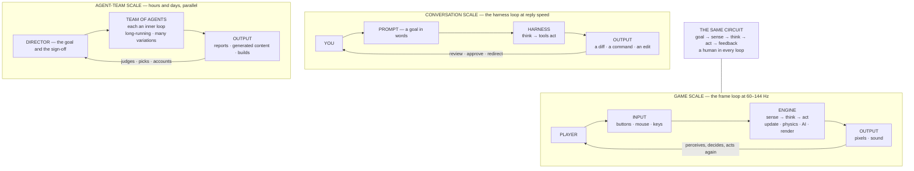
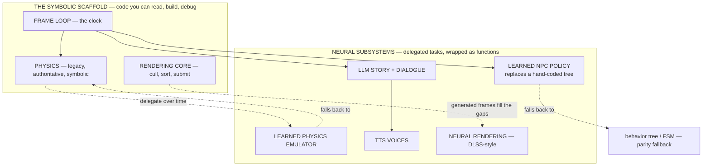
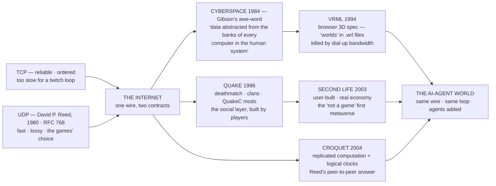
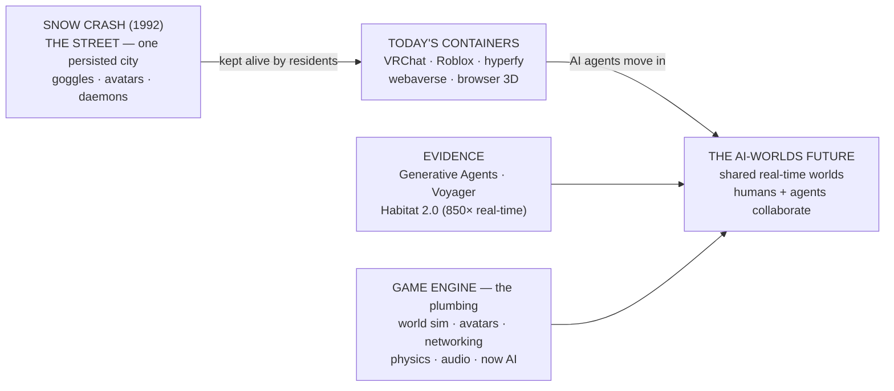

---
type: Reference
title: The Coming Times — Games, AI, Symbiosis, Hybrid Engines, and the Worlds Agents Will Live In
description: The closing chapter of the software-medium reference — the fear and the cybernetic answer (AI as symbiosis, not replacement), the hybrid engine (symbolic scaffolding with neural subsystems), and the Metaverse as a capability, not a place.
generated: { by: kilocode/deepseek-v4-flash, at: 2026-11-02T02:50:00Z }
---

# The Coming Times — Games, AI, Symbiosis, Hybrid Engines, and the Worlds Agents Will Live In

This is the seventh and closing chapter of the reference family: everything
built so far — data and code, the loop, the frame clock, the discipline map,
the engine case studies — meets the horizon's question: **what comes next, and
what happens to the people?** The chapters before asked where time goes, who
runs when, whose state, what shape the bytes, and what the new interface
([09-ai-and-the-medium.md](09-ai-and-the-medium.md)) is doing the talking. This one
asks whether the machine leaves the humans behind. No programming required,
terms defined on first use — one claim in three parts:

1. **The fear is real but the reading is wrong.** AI touches ~40% of jobs, but
   the measured story is *symbiosis*, not *replacement* — because software is a
   goal-seeking cybernetic circuit with a human inside it, and AI changes the
   loop's scale, not its membership ([§2](#2-the-fear-and-the-cybernetic-answer-the-loop-is-the-point-humans-are-in-it)).
2. **The engine is becoming hybrid.** The next-generation engine will be
   today's engine — symbolic code as scaffolding — with subsystems handed to
   neural networks over time: physics prediction, AI behaviors, story/TTS
   generation, and neural rendering that already ships
   ([§3](#3-the-hybrid-engine-symbolic-scaffolding-neural-subsystems)).
3. **The Metaverse was a place; the future is a verb.** Shared real-time
   simulated worlds — video games — are becoming the primary place AI agents
   learn about us ([§4](#4-the-metaverse-from-snow-crashs-street-to-ai-in-real-time-worlds)).

> **Come back to this.** The one idea: the future is not machines replacing
> people — it is the cybernetic loop reshaped, deeper, faster, more parallel,
> with a human and a machine completing each other in it. Engines keep symbolic
> scaffolding and hand subsystems to neural networks one at a time; the shared
> virtual world arrives as the *medium* the next interface lives in. **A game
> without a player is a simulation; a game with a human is a goal-seeking
> loop — and the loop changes speed, not membership.**

---

## 1. The fear, named

The claim, in the words people say it:

1. **"AI will take the jobs."** "Technological unemployment" (Keynes's term)
   is real, and as recorded in [Wikipedia's article](https://en.wikipedia.org/wiki/Technological_unemployment),
   a July 2025 Ford CEO predicted AI "is going to replace literally half of all
   white-collar workers," and an October 2025 senator proposed a "robot tax"
   citing up to 100 million jobs lost over a decade.
2. **"Almost 40% of jobs are exposed."** The IMF's figure: "AI will affect
   almost 40 percent of jobs around the world, **replacing some and
   complementing others**"; ~60% of advanced-economy jobs may be impacted
   ([IMF via Wayback](https://web.archive.org/web/20240315071149/https://www.imf.org/en/Blogs/Articles/2024/01/14/ai-will-transform-the-global-economy-lets-make-sure-it-benefits-humanity)).
3. **"We won't be needed."** Hinton argues AGI plus robotics will automate
   "all intellectual and physical tasks"; Acemoğlu counters that humans stay
   *complementary* to AI (both as summarized in the same article).
4. **"The software writes itself."** The coding agent marks up the pull
   request and nobody sits at the keyboard.

Read the IMF sentence again: **"replacing some and complementing others."** The
fear story reads only the first word.

> **Come back to this.** The fear is real and partly justified — AI touches
> ~40% of jobs globally, ~60% in advanced economies. But "exposed to AI" and
> "replaced by AI" differ: the IMF counts **replacement *and* complementarity**
> in one number, and the measured evidence shows an augmenting tool, strongest
> for the least experienced ([NBER w31161](https://www.nber.org/papers/w31161)).

---

## 2. The fear and the cybernetic answer: the loop is the point, humans are in it

The answer comes from this reference's own foundation. Software is control and
communication over time — Wiener's *cybernetics* — whose central idea is the
**feedback loop**: a goal-seeking system senses its own output, compares it to
the goal, corrects its behavior. And the flagship
[00-software-is-the-medium.md](00-software-is-the-medium.md) is explicit: **the human
is usually *inside* the loop**, not outside it like the canonical thermostat.

Now the move that makes the whole family one picture. The engine's **frame
loop is the human–machine loop executed at 60–144 Hz** — "cybernetics is not a
metaphor here; **it is the product spec**" — and the AI harness from
[09-ai-and-the-medium.md](09-ai-and-the-medium.md) is that **same circuit at
conversation speed**: goal (your request), sense (search-and-read tools), think
(the model's reasoning), act (the tool call), feedback (the result), correct
(the next call). Nothing requires a human to leave. The same circuit at three
timescales — a human in every loop:

Three speeds, three actuators, one skeleton. The harness enforces this as
*architecture* — it is the only component with access to your computer, so
approval prompts, plan modes, and sandboxes keep a person at the gate.
**Human-in-the-loop is not a feature bolted onto AI; it is the loop, running at
a human's scale.**

### What changes: the scale — what does not: the structure

The next few years are *width* changes, not *shape* changes. **Deeper** —
agents operate "independently over extended periods," pausing at checkpoints
and "returning to the human for further information"
([Anthropic](https://www.anthropic.com/research/building-effective-agents)) —
the human is at the checkpoints, not the keystrokes. **Faster** — games already
run inference *inside* the frame budget: NVIDIA ACE runs "small AI models — from
speech to vision" with "inference alongside graphics"
([NVIDIA ACE](https://developer.nvidia.com/ace)). **More parallel** —
parallelization (run a task several times, "voting") and sectioning (split into
independent subtasks) multiply the variety one person can see (same Anthropic
source).

What does not change is a three-part question the family repeats until it
sticks: **who holds the goal, who judges the quality, who carries the
accountability?** The sources answer in one voice — "**human review remains
crucial**" ([Anthropic](https://www.anthropic.com/research/building-effective-agents));
Microsoft Research's 18 [Guidelines for Human-AI Interaction](https://www.microsoft.com/en-us/research/publication/guidelines-for-human-ai-interaction/)
keep the human in charge; "only humans in the simulation can accurately judge
the final design"; and shipped tools encode it — Unity's assistant flags
AI-generated assets with metadata, and "developers are fully responsible" for
usage rights ([Unity AI tools](https://unity.com/ai)).

| The fear claim | The cybernetic reading |
|---|---|
| "AI will take our jobs." | It *executes* some tasks and *complements* others; measured: +14% overall / +34% novice ([NBER w31161](https://www.nber.org/papers/w31161)) |
| "40% of jobs are exposed." | Half the exposed jobs *benefit* ([IMF via Wayback](https://web.archive.org/web/20240315071149/https://www.imf.org/en/Blogs/Articles/2024/01/14/ai-will-transform-the-global-economy-lets-make-sure-it-benefits-humanity)) |
| "We won't be needed." | The tool *needs* the human — it helps novices most ([NBER w31161](https://www.nber.org/papers/w31161)) |
| "The software writes itself." | No — the software *drafts* itself ([Anthropic](https://www.anthropic.com/research/building-effective-agents)) |

> **Come back to this.** The human *is* the loop — in the game, the harness,
> and the agent team. Deeper, faster, parallel makes it wider, never humanless:
> **somebody holds the goal, somebody judges the quality, somebody carries the
> accountability** — and industry guidelines, agenting docs, and shipped tools
> all encode that somebody as a human.

### The discipline map does not disappear, it re-centers

The flagship's discipline map — every subsystem has **owners** and **feeders**,
and the handoff is where the work happens — reads as a four-stage weapon chain:
**design → data production → engine integration → gameplay code**, stage 4 only
*playing back* what stages 1–3 produced. AI does not delete that chain; it adds
a prompting-and-validating layer to every stage:

| Weapon-chain stage | Classic role | AI-assisted re-centering |
|---|---|---|
| **1 Design + concept** | Designers decide role, feel, stats, silhouette | Designers state goals in language — the spec becomes the prompt; the designer owns the vision |
| **2 Data production** | Artists/animation/audio craft assets by hand | Artists **prompt, curate, validate** generated work; authority moves to "who *approves* it" ([Unity AI tools](https://unity.com/ai)) |
| **3 Engine integration** | Technical artists bind data to engine logic | The harness reads your conventions and schema contracts and does the binding ([Unity AI tools](https://unity.com/ai)) |
| **4 Gameplay code** | Programmers write the class; playback | Agents draft code and run tests; "human review remains crucial" ([Anthropic](https://www.anthropic.com/research/building-effective-agents)) |

> **The roles change from "modeling a texture by hand" to "prompting,
> curating, and validating the generated texture" — but someone with art
> literacy still decides it is good.**

Two consequences. First, **literacy rises, it does not retire**: judging
someone else's drafts at ten per minute is harder than judging your own.
Second, it is the schemas chapter's insight wearing a job title: data is a
contract between a writer and a reader — **generated content is data; curation
is reading the contract.** A pipeline where everything is generated is a
pipeline where *everyone is a reader*. **For a game team:** agree now, on
paper, on three roles — the **goal-setter** (authors the prompt/spec that
becomes the brief), the **curator** (reviews and merges output at every
handoff), the **accountability-holder** (signs the build). Naming the columns
before the tools land is the difference between steering your AI and being
steered by it.

> **Come back to this.** The discipline map **re-centers, it does not
> vanish**: the four stages stay, each gaining a prompting-and-validating layer.
> Production multiplies what one person can see; the literacy required to judge
> it goes **up**, not down.

---

## 3. The hybrid engine: symbolic scaffolding, neural subsystems

The proposal at the chapter's heart: the next-generation engine will most
likely **not be an "AI engine."** It will be the engine we already have — C++,
C#, Python, Java — whose individual *tasks* progressively get handed to trained
networks while the *structure* stays symbolic.

> **The hybrid thesis:** the engine stays a body of symbolic code — the
> scaffolding (build, asset pipeline, editor, game loop, rendering core,
> networking, save/load) — while specific subsystems are delegated to neural
> networks: physics prediction, AI behaviors, real-time data generation (story,
> dialogue, TTS), and rendering that already ships (DLSS-style). The migration
> is already in flight; the honest question is which tasks it can afford to
> hand over.

### The two paradigms, taught plainly

- **Symbolic — "AI old school": software as data + code.** The programmer
  writes rules — *if the player presses jump, apply upward velocity* — and
  designs the data structures those rules transform. When the industry says
  "game AI" it usually means this: finite-state machines, decision trees,
  **behavior trees** (popular for "ease of human understanding"), navmeshes and
  A*. The guarantee: **exact, deterministic, debuggable, human-readable.**
- **Connectionist — neural networks.** A neural network is "a computational
  model *inspired by* the structure and functions of biological neural
  networks," each connection's **weight** adjusting during training. The
  connectionist writes the *training procedure*, not the rules — nobody types
  "if the NPC is flanked, retreat"; they train on a million examples and
  retreat *emerges* from numbers. Training runs on **GPUs and large datasets**.

| | **Symbolic (data + code)** | **Connectionist (neural networks)** |
|---|---|---|
| What a human writes | rules, logic, data structures | architecture + training procedure |
| Where knowledge lives | readable code | weights, which are numbers |
| Behavior | exact, deterministic, replayable | statistical, emergent, non-deterministic |
| Debugging | breakpoints and variables | the loss curve; "lack of interpretability" |
| Strong at | specifiable rules, budgets, invariants | pattern tasks — vision, speech, language |
| Weak at | tasks you can't write rules for | tasks that need guarantees |
| Example in an engine | a behavior tree; a fixed-tick integrator | DLSS upscaling; a trained NPC policy |

The asymmetry that makes the hybrid necessary and painful: **symbolic software
is exact but brittle** (handwritten trees produce repetitive or abnormal
behavior in unplanned situations); **neural software is adaptive but opaque.**
An engine is *built*; a neural network is *grown*.

The image to keep: **the magic black-box janitor** — a specialist who does one
room brilliantly and cannot explain how; when two janitors disagree, no human
can referee with a breakpoint, and the argument goes to a committee of numbers.

### Subsystem candidates: what the research says

Four hand-overs, graded **shipping / demo / research**.

**Physics prediction — learned simulators.** Predict bodies, fluids, and
particles faster than a numerical solver — and the network is *trained by the
very solver it hopes to replace*: DeepMind's **GNS** represents a system as
particles in a graph and computes dynamics via learned message-passing
([arXiv:2002.09405](https://arxiv.org/abs/2002.09405)). Demos roll out water,
sand, and goop from **ground-truth simulators** (SPH, MPM, PBD) — with honest
failures on the project page ([Learning to Simulate](https://sites.google.com/view/learning-to-simulate)):
over long rollouts solids become **deformed**; some models get goop **stuck to
the wall**. *Reality check:* research-to-demo; the symbolic solver must stay as
the authority that re-syncs the prediction, or deformation becomes canon.

**AI behaviors — learned policies instead of hand-coded trees.** The classic
task's failure is "artificial stupidity." Already in devs' hands: Unity's
**ML-Agents** lets "games and simulations... serve as environments for training
intelligent agents using deep reinforcement learning and imitation learning"
([Unity ML-Agents](https://github.com/Unity-Technologies/ml-agents)). A trained
policy **emerges** (strats designers never wrote) and is **opaque** ("the NPC
acted crazy" — no stack trace). The frontier flips to language: the
**Generative Agents** town of 25 LLM agents stores experience as natural
language, synthesizes it into reflections, and plans from them — from one
user-specified notion (a Valentine's Day party) the agents showed up together
([arXiv:2304.03442](https://arxiv.org/abs/2304.03442)). *Reality check:*
ML-Agents **shipping**; Generative Agents **research**; NVIDIA-ACE-style chatty
NPCs at **report level** (several ACE pages unreachable at retrieval). *For a
team:* hybrid-in-miniature — a symbolic behavior tree keeps the debuggable
skeleton; a trained module supplies perception or motor skill inside it.

**Generating data in real time — the game that writes itself.** The ladder:

- *Ships today — symbolic with a neural garnish:* quests and dialogue are
  authored content shipped as data.
- *Demos beautifully — the generative-agents town* ([arXiv:2304.03442](https://arxiv.org/abs/2304.03442)).
- *Too slow for real-time:* model work is memory-bound (1B parameters ≈ 2 GB),
  and small models run at a few to ~100 tokens/second — a conversation is
  hundreds of tokens; a town of 25 agents is a data center.

*Reality check:* **TTS is nearest to shipping**; **unconstrained in-game LLM
narrative is research/demo**; the fully self-writing game is a **proposition**.
What *does* ship: players' choices feeding a *bounded* generator — templates
plus an LLM filling the prose, the state machine and quest data symbolic.

**Rendering — what already ships.** **DLSS** renders low and *infers* the
high-resolution image ([Wikipedia: DLSS](https://en.wikipedia.org/wiki/Deep_learning_super_sampling)).
Its timeline is the hybrid story in one product:

- **DLSS 1 (Feb 2019):** per-game-trained upscaler — the stumble.
- **DLSS 2 (Apr 2020):** generalized network across games; ~1–2 ms overhead.
- **DLSS 3 (Sep 2022):** **Frame Generation** — "for every frame rendered, one
  additional frame is generated." **AI is now writing frames.**
- **DLSS 4 (Jan 2025):** transformer-based Multi Frame Generation.
- **DLSS 5 (Sep 2026):** "neural rendering" of lighting and materials — met
  with developer backlash over *altered art direction*.

540+ games and apps support DLSS, and over 80% of RTX users activate it —
adoption, not demo. AMD's **FSR 1–3** are the control arm: *classical, not
neural*, until the newest "Redstone" generation pivoted to neural upscaling and
frame generation ([Wikipedia: GPUOpen](https://en.wikipedia.org/wiki/GPUOpen)).

Root this in cybernetics: **generated frames replace sense–think–act steps with
learned predictions.** (*That framing is this chapter's reading; the sources
state DLSS 3 generates extra frames.*) The honest caveat: frame generation
leads to **increased input latency** even as it fills frames — the machine
appears faster than its true loop latency, and DLSS ships because *perceived*
tightness wins. Never call "AI upscaling" free: it is a budget transfer trading
measured latency for perceived smoothness, and DLSS 5 showed a neural renderer
can change the artist's intent.

### The honest engineering story: in flight, with real failure modes

The migration is **already happening** — DLSS/FSR on tens of millions of GPUs,
ML-Agents shipping a training loop into Unity, generative-agent research. The
failure modes are equally real:

- **Non-determinism breaks what needs determinism.** Lockstep assumes identical
  simulation on all clients — desync "may compound and be unrecoverable" — and
  rollback requires *turning back state* ([Wikipedia: Netcode](https://en.wikipedia.org/wiki/Netcode)). A neural pass is not byte-reproducible across
  GPUs, drivers, and library versions: it must hash-match or live
  server-authoritative.
- **Opacity hits QA, certification, law.** "There's a bug in the NPC" has no
  line number; an LLM-NPC that says what an 8-year-old shouldn't hear is a
  model-side liability, not a hotfix.
- **Data hunger.** Every learned subsystem needs a training set, and the only
  free one is *your own engine*: GNS trained on the exact simulators it hopes
  to beat. Synthetic data from the scaffolding is the plausible budget.
- **Latency and VRAM budget.** The frame is a budget, not a unit — even DLSS
  2's ~1–2 ms is a real slice of the ~16 ms frame.
- **The two-systems debugging problem.** Symbolic engineers debug with
  breakpoints, ML engineers with loss curves. A hybrid team *is both teams* —
  operability depends on the contract between them.

### What does NOT exist yet — future prospects, not promises

None exist as products today; each is a missing part the hybrid story needs —
proposals of this reference, so marked `[unverified]`:

1. **Neural subsystems as native engine citizens** — the same status as the
   physics module: a subsystem seat with a **contract** (inputs, outputs,
   types, versioning), a **determinism knob** ("byte-identical" or "cosmetic"),
   and a **GPU budget** the frame loop enforces. Studios integrate ML-Agents or
   DLSS by hand today; the missing product *schedules* a neural module like
   physics or audio.
2. **Paradigm-level level-of-detail** — the frame loop deciding, per task and
   per moment, *which* implementation runs: neural when budget is spare,
   symbolic on the netcode-critical tick. Games do mesh LoD; nobody ships
   paradigm-switching — and GNS's deformation failure is what a re-sync on
   proximity would fix.
3. **Training INSIDE the engine** — the inverse of ML-Agents' pipe-out: an
   editor button runs your level, records the symbolic sim's behavior as
   labeled data, trains a specialist overnight, hot-swaps it in, the old code
   kept as teacher and auditor. The precedent is GNS: training data *was* the
   simulators' rollouts.

The honest close: **every rung above is a job description, not a rumor.** The
noise separates into shipping (DLSS/FSR, ML-Agents, TTS), demos (generative NPC
dialogue), research (GNS, generative agents) — and a fourth bucket, *native
neural citizens*, that nobody owns yet.

> **Come back to this.** This section is proposition, not promise: native
> neural citizens with a **contract, determinism knob, GPU budget**;
> **paradigm-level LoD**; **in-engine training**. The research basis is real —
> GNS trained on SPH/MPM/PBD, DLSS trained on rendered frames — but the engine
> that treats them as citizens does not exist yet. That is the open room.

---

## 4. The Metaverse: from Snow Crash's Street to AI in real-time worlds

The third part is the oldest idea and the newest arrival: it was never about
the *place* — it is about **shared real-time worlds**, the natural container
for the next interface.

### 4.1 The idea as written: *Snow Crash* (1992)

The term **metaverse** was coined by Neal Stephenson in his 1992 cyberpunk
novel — "meta" + "universe" — for "a virtual-reality–based successor to the
internet" ([Wikipedia: Metaverse](https://en.wikipedia.org/wiki/Metaverse)). The
book's definition beats every one that followed:

> "So Hiro's not actually here at all. He's in a computer-generated universe
> that his computer is drawing onto his goggles and pumping into his
> earphones. In the lingo, this imaginary place is known as the Metaverse."
> — Neal Stephenson, *Snow Crash* (1992)

The vocabulary: the **Street**, an urban strip a hundred meters wide running
the full 65,536 km circumference of a black spherical planet — one shared,
persisted world, not a lobby per company. **Avatars** of any form, sole
restriction height, status by access and sophistication. The **door**: personal
goggles or grainy public terminals — a gap that is still this decade's VR price
gap. And the **residents**: long-stay "gargoyles" among user avatars, plus
system **daemons** — software agents already inside the shared world. **That
early human/agent splice is exactly the mix this chapter predicts will grow.**

Language archaeology: **avatar** comes from Sanskrit *avatāra*, "the descent of
a deity into a terrestrial form"; Garriott applied it to the on-screen player
in 1985; *Habitat* (1986) used it for online bodies; *Snow Crash* popularized
the modern sense ([Wikipedia: Avatar](https://en.wikipedia.org/wiki/Avatar_%28computing%29)).
Its article notes avatars can be "virtual embodiments of embodied agents...
driven... by artificial intelligence rather than real people" — in the AI
future, **an avatar is an identity slot an agent can occupy too.**

One caution: *Snow Crash* is a **satire** of anarcho-capitalist excess — and the
2021 companies that adopted the word took the *place* seriously and missed the
*joke*.

### 4.2 Primer: how the pre-2021 metaverse was actually built

Before the buzzword, the idea was being built by **protocol engineers, game
programmers, and virtual-world platforms** — and the sequence matters, because
each layer is a concrete, named answer to the question "what does it *take* to
run a shared world?" The honest way to teach the metaverse-as-history is to
follow its **plumbing, not its press.**

**TCP/IP and UDP — the wire games chose.** Every virtual world ever shipped
sits on the Internet transport layer, which offers **two different contracts**
([Wikipedia: Internet protocol suite](https://en.wikipedia.org/wiki/Internet_protocol_suite)).
**TCP** is the *reliable, ordered* channel: it retransmits lost packets and
delivers a complete in-order stream — at the cost of waiting when a packet
drops. **UDP**, designed by **David P. Reed in 1980 (RFC 768)**, is the *fast,
lossy* contract: fire a datagram, hope it lands
([Wikipedia: User Datagram Protocol](https://en.wikipedia.org/wiki/User_Datagram_Protocol)).
Real-time games chose UDP for the loop's sake — to a twitch loop, an old
packet is **wrong data, not late data**, and the sources note the "lack of
retransmission delays" makes UDP "suitable for real-time applications such as
Voice over IP, online games." It is the same staleness call every replicated
engine makes ([04-concurrency-and-state.md](04-concurrency-and-state.md)); Quake
III's delta snapshots over UDP are the shipped version
([Engines/quake-iii-arena.md](Engines/quake-iii-arena.md)).

**Gibson's cyberspace — the awe-word (1982–1984).** Before Snow Crash gave the
metaverse a *place*, William Gibson gave the culture a *word*. **Cyberspace**
entered fiction in his 1982 short story "Burning Chrome" and was popularized by
***Neuromancer*** (1984) — still the only novel with science fiction's "triple
crown" (Hugo, Nebula, Philip K. Dick). Gibson did not understand computing in
detail; he wanted "the shared vocabulary," calling the coined word "evocative
and essentially meaningless." His definition became the genre's constitution —
and notice how much of it is *data*, not *places*:

> "Cyberspace. A consensual hallucination experienced daily by billions of
> legitimate operators... A graphic representation of data abstracted from the
> banks of every computer in the human system." — Gibson, *Neuromancer* (1984)

The word predates the Internet's meaning — the **Atelier Cyberspace** (late-
1960s Danish artists) meant a concrete, physical space — and it reached the
real world early: **Autodesk's 1989 virtual design system was literally named
Cyberspace**, and in 1992 **John Perry Barlow** took the word to the US
Intelligence Community (Gibson's dismay, often paraphrased as *"they're
selling our ghosts back to us"* — the paraphrase, not a quote). A live reading
calls the novel's circulating data **"a metaphor for the global circulation of
financial capital"** — the sourced basis for the user's requested reading:
cyberspace as the hidden "credit profile of every individual, at scale, for
finance." Snow Crash gave the metaverse its *place*; Gibson gave it its *awe*
— and every later layer in this primer is an attempt to make the awe
*navigable*: data seeking the container its contract demands
([05-schemas-and-formats.md](05-schemas-and-formats.md)).

**VRML — the browser's first 3D spec (1994–1997).** The first shot at a
*web-wide* 3D world was **VRML**, a "file format for representing
3-dimensional (3D) interactive vector graphics, designed particularly with the
World Wide Web in mind." Its files are called **"worlds"**, can fire URLs, play
animations and sounds, and attach a **Script Node** that runs real program code
(Java or ECMAScript) inside the scene. It became an **ISO standard — VRML97
(1997)**. The use proved the promise and the floor: 3D chat sites and Sony's
SAPARi service on Vaio PCs — but VRML "has never seen much serious widespread
use," because most users were "using slow dial-up Internet access." The verdict
that survives is Clay Shirky's 1998 put-down — a **"technology in search of a
problem"** where, he argued, Quake did one thing well instead of many things
poorly ([Wikipedia: VRML](https://en.wikipedia.org/wiki/VRML)).

**Quake — the multiplayer and modding blueprint (1996–1998).** Games, not
spec committees, built the social layer the metaverse would need. **Quake**
(id Software, 1996) made organized online play a culture: **deathmatch** modes
including **clan** teamplay, server browsers like **QuakeSpy**, and renown as
one of the first games singled out as a form of **electronic sport** — the
1997 **Red Annihilation** tournament. And **QuakeC** let end users "partially
program the game," which "popularized fan-created **modifications (mods)**" —
Team Fortress, Rocket Arena, CTF
([Wikipedia: Quake](https://en.wikipedia.org/wiki/Quake_%28video_game%29)).
Dedicated servers, server browsers, player-hosted modes, a competitive scene —
the entire infrastructure the 2021 product would claim to invent, organized by
players rather than land-sellers. **The social metaverse was built by
deathmatch servers and modders before any company named it** — and Quake III
packaged the same ingredients into a product
([Engines/quake-iii-arena.md](Engines/quake-iii-arena.md)).

**Second Life — the virtual world that was not a game (2003–).** **Second
Life** (Linden Lab, launched 2003) is the world-model-level step toward Snow
Crash's vision precisely because it is *not a game*: Linden Lab is emphatic
that there is "no manufactured conflict, no set objective." Residents build
from **primitives** with a built-in modeling tool and script interactivity in
the **Linden Scripting Language (LSL)**; there is a real economy with a real
currency, the **Linden Dollar (L$)**, so when residents cash out the loop is a
marketplace, not a game. And the metaverse label stuck here first: Second Life
"has been cited as the first example of the metaverse" — proof that a
persistent, shared, user-built world can run for decades on ordinary servers
([Wikipedia: Second Life](https://en.wikipedia.org/wiki/Second_Life)).

**Croquet — the engineers' answer, and Reed's UDP connection (2004).**
**Croquet** is the project where engineers explicitly tried to build a shared,
distributed virtual environment from first principles: an open-source SDK for
"deeply collaborative multi-user online applications" written in Squeak
Smalltalk, whose principals include **Alan Kay and David P. Reed — the man who
designed UDP in 1980**. Its **TeaTime** architecture runs on the principle of
**replicated computation**: shared, versioned objects whose state updates are
ordered by a **logical clock** scheduling them toward a shared deadline, so
"an arbitrary number of users... can view and comment on the same world
without conflicting" ([Wikipedia: Croquet Project](https://en.wikipedia.org/wiki/Croquet_Project)).
Replication, logical clocks, peers sharing one world: it is the state
replication this collection studies, in peer-to-peer form
([04-concurrency-and-state.md](04-concurrency-and-state.md)) — the **peer-to-peer
cousin of the game loop**.

> **Come back to this.** The pre-2021 metaverse was built by plumbers, not
> brand-managers: **UDP** (David P. Reed, 1980 — fast and lossy on purpose, the
> wire twitch loops chose), **Gibson's cyberspace** (1982/84 — the awe-word:
> "a consensual hallucination... data abstracted from the banks of every
> computer in the human system"), **VRML** (1994 — the browser's first 3D spec,
> dead on dial-up), **Quake** (1996 — deathmatch, clans, and QuakeC mods as the
> first social plus modable shared world), **Second Life** (2003 — user-built
> with a real economy, cited as the first metaverse), and **Croquet** (2004 —
> Reed's peer-to-peer replicated-computation answer to sharing a world). Every
> later claim about AI living in worlds stands on plumbing that was already
> here.

### 4.3 From book to buzzword: 2021, and its deflation

In 2021 Facebook announced a **$10 billion over-the-year** investment into
Reality Labs and, three days later, renamed itself **Meta Platforms** —
Wikipedia is blunt that the term worked "as a **buzzword**" for public
relations. What was sold was NFT land, not a Street: a 116-parcel Decentraland
"estate" fetched ~**$2.4 million** while the platform "was a ghost town"
("you're effectively buying into their service" — [WIRED](https://www.wired.com/story/metaverse-land-rush-illusion/)),
and Decentraland saw as few as **38 users a day** (disputed ~8,000). The
deflation since: Reality Labs lost **over $10 billion in 2021** and ~**$80
billion total** by January 2026 ([Wikipedia: Reality Labs](https://en.wikipedia.org/wiki/Reality_Labs));
**Feb 2023** — Zuckerberg's "pivot to AI"; **into 2026** — 1,000+ layoffs,
shuttered VR studios, commercial Quest sales ending February 20, 2026.

**None of that killed the *interaction* — it killed the *noun*.** The same
period set the real scale: Second Life at ~90,000 concurrent versus Roblox's
record ~5.5 million ([BBC, Nov 2021](https://www.bbc.com/news/technology-59180273)).

| | **Snow Crash (1992)** | **2021 buzzword era** | **The tech today** |
|---|---|---|---|
| What is meant | one **persisted street** — a VR successor to the internet | marketing: NFT land, VR apps | **many interoperating real-time worlds** |
| Who lives there | humans + **daemons** | mostly nobody: Decentraland ~38–8,000/day | humans *and AI agents* (Sims towns, Minecraft, VRChat) |
| Access | goggles; public terminals | pricey VR headsets as the gate | browsers as containers (hyperfy, webaverse) |
| Outcome | a satirical prediction | ~$80B of losses, then a pivot | the capability, minus the noun |

> **Come back to this.** 2021 renamed a company over a buzzword and burned ~$80
> billion before pivoting to AI; the products were NFT land tokens in
> ghost-town worlds, not a Street. The failures **invalidate the business
> model, not the interaction** — which had never stopped growing inside game
> engines.

### 4.4 Why the idea persists: AI makes simulated worlds the training ground

Strip the branding away and the durable prediction is architectural: **as AI
grows, simulated real-time environments — video games and engine runtimes —
will be the primary way agents interact with humans and learn about us.**
The evidence, in three flavors:

**Agents already learn in simulations.** The **Generative Agents** town (25 LLM
agents that "remember and reflect on days past as they plan the next day";
given one user-specified notion — a Valentine's Day party — they spread
invitations and showed up together) is Snow Crash's Street with the humans
replaced by the daemons ([arXiv:2304.03442](https://arxiv.org/abs/2304.03442)).
**Voyager**, "the first LLM-powered embodied lifelong learning agent in
Minecraft," built from an automatic curriculum and a growing skill library of
executable code, earns real game numbers: 3.3× more items, 2.3× longer
distances, up to 15.3× faster tech-tree milestones
([arXiv:2305.16291](https://arxiv.org/abs/2305.16291)). **Habitat 2.0** is "a
simulation platform for training virtual robots in interactive 3D
environments" at 25,000+ steps/second (850× real-time) — agents train in a
world before they touch yours ([arXiv:2106.14405](https://arxiv.org/abs/2106.14405)).
And industry builds the same explicitly: NVIDIA's Omniverse sells
"simulation-ready worlds for physical AI," usable *by AI agents*
([NVIDIA Omniverse](https://www.nvidia.com/en-us/omniverse/)).

**Humans + agents inside worlds — the beginnings are real.** **VRChat** is the
healthiest counterexample to "the metaverse is dead": users upload
**user-created avatars and worlds** through a Unity-based SDK and script with
the Udon visual language; by 2025 it averaged ~120,000 weekend concurrent users,
peaking ~156,700 at a 2026 virtual concert ([Wikipedia: VRChat](https://en.wikipedia.org/wiki/VRChat)).
It is a culture, not a demo — sign language, "mutes" writing by pen, a Creator
Economy. *Snow Crash's Street built by its residents.* The **web-native
containers** make the browser a shared world: **hyperfy**'s `imo` is "A
standard for interoperable metaverse objects" ([hyperfy-io](https://github.com/hyperfy-io));
**webaverse** is an "MMO universe of 3D apps on the web" with an "AI scene
format" repo ([webaverse](https://github.com/webaverse)). Roblox holds the mass
version; Decentraland is the land experiment — treat them as **beginnings**, not
the destination.

**Why games specifically — the loop already in the machine:**

1. **The game loop is a goal-seeking cybernetic loop already.** An agent does
   not need a new machine — it needs a **seat in the existing one.**
2. **Real-time 3D is the "smoothed-from-reality" sensorimotor loop.** Habitat
   runs 850× real-time so agents can fail thousands of times a day.
3. **The engine is the most complete plumbing for a shared world that exists** —
   replication, authority, prediction, rollback, world sim, avatars, physics,
   audio, "and now AI."
4. **Avatars are an identity slot both species fill** — Snow Crash's daemons,
   VRChat's humans, Voyager's agent; the separator became invisible.

### 4.5 Synthesis: passes away as a name, catches up as a capability

Envisioned as a *place*, sold as a *place*, the metaverse delivers an
**activity**: a wordless sharing of a world model in which humans and agents
cohabit — the same thing the AI harness does at conversation speed, now at
frame speed. **1992** — capability fiction, place plausible, word new;
**2021** — word stolen, place sold as land, capability quietly building inside
game engines where it had never left; **present** — the place model collapsed
while the capability grew in simulators (Habitat, Omniverse), sandboxes
(Minecraft), web frameworks (hyperfy, webaverse), and the social platforms
humans chose (VRChat).

**"The Snow Crash vision passes away as a name and catches up as a
capability"** — the chapter's one-line synthesis, the author's reading, not a
quotation. *For a game team:* treat your engine as a **world platform**, not a
game player only. The agent loop (prompt → act → observe → continue) is your
frame loop with a different driver; NPCs built as "goals + loop +
damage-tolerance" are the first draft of every agent you will host; and the
multiplayer skills — replication, prediction, staleness budgets — decide
whether agents and humans can share your world without tearing it.

> **Come back to this.** Envisioned as a *place*, sold as a *place*, the
> metaverse survives as a **capability**: shared real-time worlds where humans
> and AI agents collaborate, built in the medium that already ships everything
> it takes — the game engine. If a student takes one sentence: **you are not
> building games; you are building the worlds the next interface will live
> in.**

---

## 5. Synthesis: the loop changed speed, not membership

Bring all three parts together, one wheel-turn. **Games are the clearest
human-in-the-loop medium there is** — the human-in-the-loop literature lists
**video games** among its canonical examples of interactive simulation, beside
flight simulators ([Wikipedia](https://en.wikipedia.org/wiki/Human-in-the-loop))
— and this family made the mechanism concrete, from the earliest to the newest
case study:

- **DOOM** (1993) runs its simulation as fixed 35 Hz "tics" (`TICRATE`) — a
  goal-seeking clock with the player inside it ([Engines/doom.md](Engines/doom.md)).
- **Unreal Engine 5** runs `FEngineLoop::Tick` — the same loop, with threads
  between the skeleton's slots ([Engines/unreal-engine.md](Engines/unreal-engine.md)).
- **Quake III Arena** makes it literal: single-player bots are *fake clients
  injected into the server* — goal-seeking loops a human authored
  ([Engines/quake-iii-arena.md](Engines/quake-iii-arena.md)).

> **The synthesis:** AI fear is loudest in games precisely because symbiosis is
> most visible there — the product *is* the loop. A game without a player is a
> simulation; a game with a human is a goal-seeking loop.

Apply it to the two futures people fear. Build *with* AI agents and you are
the player in a slower loop — holding the goal, watching the diff, approving
the handoff. Run AI characters and those interiors are nested loops whose goals
you authored and whose output players judge. The measured ground agrees: "the
key to winning the race is not to compete *against* machines but to compete
*with* machines" — and the 14% (34% novice) field-study gain came from a machine
"disseminating the best practices of more able workers" to others. In both
directions the flagship's rules hold, plus this chapter's one new rule: **the
loop changed speed, not membership.**

**For a game team — the career question:** train the literacy that stays
scarce — **setting goals, judging quality, carrying accountability** — and treat
every new tool as a new loop to get inside. Engines will hand physics, NPCs,
story, and rendering to neural subsystems; they will not hand away the *who
decides*.

> **Come back to this.** The coming times are not machines replacing people;
> they are the cybernetic loop reshaped — deeper, faster, more parallel — with
> humans and machines completing each other in every one of its scales. The
> shared virtual world arrives as the *medium* the next interface lives in.
> **The interface changed, the medium didn't — and the medium was always you,
> in the loop. Go build; when the panic gets loud, find the loop.**

---

## Facts, provenance, and where to go next

**Verification.** All external claims were checked against the cited public
sources on 2026-11-01; substitutions are stated, not hidden: the **IMF blog**
returns HTTP 403 to automated fetches, so it was verified via the Wayback
capture (2024-03-15); an unreachable **MIT News** item's finding is verified
from the primary **NBER w31161**; several **NVIDIA ACE** pages returned 404, so
ACE holds at industry-report level; Epic's "Cobalt" returned 403 and is
withheld; **Meta Habitat** pages returned 400 and were replaced by the
**Habitat 2.0 arXiv paper**; **Unity ML-Agents'** product page redirected to
pricing, so its GitHub README is primary. The §4.2 history is new in this
revision: UDP (David P. Reed, 1980; RFC 768), Gibson's cyberspace (1982
"Burning Chrome"; 1984 *Neuromancer*), VRML (1994; VRML97, 1997), Quake
(1996), Second Life (2003), and the Croquet Project (2004) are documented from
their Wikipedia articles, fetched directly for the source note on 2026-11-01 —
with the cyberspace beat's Atelier Cyberspace, Autodesk-1989, and Barlow-1992
facts from [Wikipedia: Cyberspace](https://en.wikipedia.org/wiki/Cyberspace)
and the novel's "triple crown" and financial-capital reading from
[Wikipedia: Neuromancer](https://en.wikipedia.org/wiki/Neuromancer) — and the
TeaTime primary paper was unreachable at retrieval, so Croquet's TeaTime
description rests entirely on the Wikipedia article. Engine facts
(DOOM's 35 Hz tics, UE5's `FEngineLoop::Tick`, Q3A bots as fake clients) come
from this folder's case studies, which are checked against the public source
releases.

**Marked interpretation.** The symbiosis frame and its vocabulary (the human
is the loop; goal-setter/curator/accountability-holder; "generated content is
data; curation is reading the contract"); the hybrid-engine synthesis; the
learned-prediction reading of DLSS frame generation; the shipping/demo/research
classifications beyond what sources literally say; and the Metaverse framing —
"passes away as a name and catches up as a capability" is the author's
formulation, not a quote. In the §4.2 primer, interpretation is marked
separately from fact: the TCP-as-wrong-trade-for-a-twitch-loop reading (the
latency cost is sourced; the loop framing and its "old data is wrong data"
phrasing are the author's); the "VRML = the browser's first attempt, killed by
dial-up" framing; the claim that Quake's deathmatch servers and modders were
the actual first social metaverse (deathmatch, clans, QuakeC mods, and esports
are sourced; the metaverse-labeling is the author's synthesis); and Croquet as
the "peer-to-peer cousin of the game loop" (the Reed, replicated-computation,
and TeaTime facts are sourced; the game-loop framing is the author's reading).
In the cyberspace beat, the framings are marked, not sourced: the "awe-word" /
"awe before architecture" framing; the reading that every later layer — VRML,
Quake, Second Life, Croquet — is an attempt to make the awe navigable; the
"*selling our ghosts back to us*" line (only the common paraphrase of Gibson's
dismay, not a quote); and the "credit profile of every individual, hidden, at
scale, for finance" reading — the user's requested framing, interpretation
grounded in the sourced financial-capital critique and the "data abstracted
from the banks of every computer" definition.
The three §3 proposals (native neural citizens with
contract/determinism knob/GPU budget; paradigm-level LoD; in-engine training)
**do not exist as products today** and carry the `[unverified]` mark.

**Grouped sources.** Jobs: the [IMF analysis (Wayback)](https://web.archive.org/web/20240315071149/https://www.imf.org/en/Blogs/Articles/2024/01/14/ai-will-transform-the-global-economy-lets-make-sure-it-benefits-humanity),
[NBER w31161](https://www.nber.org/papers/w31161),
[Wikipedia: technological unemployment](https://en.wikipedia.org/wiki/Technological_unemployment).
Agents in the loop: [Anthropic](https://www.anthropic.com/research/building-effective-agents),
[Guidelines for Human-AI Interaction](https://www.microsoft.com/en-us/research/publication/guidelines-for-human-ai-interaction/),
[Unity AI tools](https://unity.com/ai),
[Wikipedia: Human-in-the-loop](https://en.wikipedia.org/wiki/Human-in-the-loop).
Hybrid engine: [GNS (arXiv)](https://arxiv.org/abs/2002.09405) + [failure cases](https://sites.google.com/view/learning-to-simulate),
[Unity ML-Agents](https://github.com/Unity-Technologies/ml-agents),
[Generative Agents (arXiv)](https://arxiv.org/abs/2304.03442),
[NVIDIA ACE](https://developer.nvidia.com/ace),
[Wikipedia: DLSS](https://en.wikipedia.org/wiki/Deep_learning_super_sampling),
[Wikipedia: GPUOpen/FSR](https://en.wikipedia.org/wiki/GPUOpen),
[Wikipedia: netcode](https://en.wikipedia.org/wiki/Netcode). Metaverse:
[Voyager (arXiv)](https://arxiv.org/abs/2305.16291),
[Habitat 2.0 (arXiv)](https://arxiv.org/abs/2106.14405),
[NVIDIA Omniverse](https://www.nvidia.com/en-us/omniverse/),
[Wikipedia: Metaverse](https://en.wikipedia.org/wiki/Metaverse),
[Wikipedia: Reality Labs](https://en.wikipedia.org/wiki/Reality_Labs),
[Wikipedia: VRChat](https://en.wikipedia.org/wiki/VRChat),
[WIRED](https://www.wired.com/story/metaverse-land-rush-illusion/),
[BBC](https://www.bbc.com/news/technology-59180273),
[hyperfy-io](https://github.com/hyperfy-io),
[webaverse](https://github.com/webaverse). §4.2 history:
[Wikipedia: Internet protocol suite](https://en.wikipedia.org/wiki/Internet_protocol_suite),
[Wikipedia: User Datagram Protocol](https://en.wikipedia.org/wiki/User_Datagram_Protocol),
[Wikipedia: Cyberspace](https://en.wikipedia.org/wiki/Cyberspace),
[Wikipedia: Neuromancer](https://en.wikipedia.org/wiki/Neuromancer),
[Wikipedia: VRML](https://en.wikipedia.org/wiki/VRML),
[Wikipedia: Quake (video game)](https://en.wikipedia.org/wiki/Quake_%28video_game%29),
[Wikipedia: Second Life](https://en.wikipedia.org/wiki/Second_Life),
[Wikipedia: Croquet Project](https://en.wikipedia.org/wiki/Croquet_Project).

**Where to go next.** You have reached the end of the new chapters. The
previous chapter was [09-ai-and-the-medium.md](09-ai-and-the-medium.md). As the
closing chapter, this one hands you back to the foundations: re-read the
flagship [00-software-is-the-medium.md](00-software-is-the-medium.md) (the loop and
cybernetics in §3/§5, the discipline map in §7, the ten rules in §9),
[01-common-structure.md](01-common-structure.md), and
[02-world-models.md](02-world-models.md); and ground the loop concretely in
[Engines/doom.md](Engines/doom.md),
[Engines/quake-iii-arena.md](Engines/quake-iii-arena.md), and
[Engines/unreal-engine.md](Engines/unreal-engine.md). Everything here is the
vocabulary you already learned — the interface changed, the medium didn't.

> **Come back to this.** The family closes on three claims: the fear reads
> "replacement" where the evidence says "complementation," because the human was
> always inside the goal-seeking loop; the engine is becoming hybrid — symbolic
> scaffolding first, neural subsystems one at a time, with honest failure modes
> and an open room for native neural citizens; and the metaverse arrives as a
> *capability*, not a place, powered by the engines this collection teaches.
> The final exam is the same as the first sentence: find the loop, and name who
> is in it.